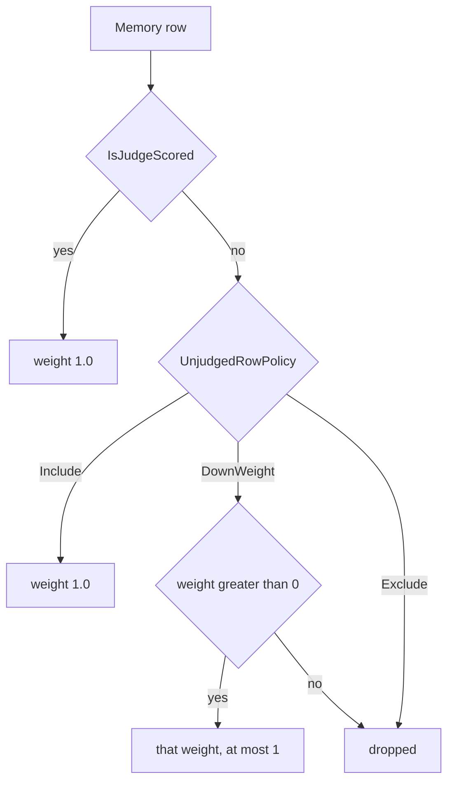

# 0026. Grade a response against its question, and learn only from complete grades

**Status:** accepted
**Date:** 2026-10-14
**Deciders:** David Pizon
**Accepted:** 2026-10-14 (David, chat sign-off on #293 plan)
**Amendments:** [Amendment 1 (2026-10-22) — the row policy applies to unjudged rows](#amendment-1-2026-10-22-the-row-policy-applies-to-unjudged-rows)

## Context and Problem Statement

The router chooses agents from live grades ([#293](https://github.com/davidpizon/TotallyHot-ArcRouter/issues/293)).
A grade is a mix of three signals: whether the code parses (`SyntaxValid`), a static analysis score, and a G-Eval
judge score. The judge has read the user's question since PR #117, and `GraderQuestionText.Require` makes every LLM
grader fail closed without it. The other two signals never see the question. When the judge is off, abstains, times
out, or its join is evicted, `QualityScorer` drops that axis and divides by the remaining weights, and
`RouterMemoryScoreObserver` and `EmbeddingMemoryScoreObserver` write the result into router memory exactly as if the
judge had answered. That score says "this is well-formed", not "this answers the question", so the router can learn
to prefer tidy answers that are wrong.

Four more facts make this a decision and not a patch:

- `JudgeRowPolicy` defaults to `DownWeight` at 0.5, so the only rows that carry question-aware evidence count for
  half and the rows that do not count in full.
- `DimensionCriteria` in `GEvalJudgeClient` is keyed on names the router does not use (two of nine
  `RouterDimension` values match), so the judge mostly runs a generic "overall quality" rubric.
- The scorer's effective weights vary per request, while the paper's Verifier (Zhou et al., arXiv:2606.22902, §3.3
  Eq. 8) fixes them per task type and requires they sum to 1.
- A grade is stored with a `correlation_id` and nothing that ties it to its question. Question text is held in
  memory and dropped, and [ADR-0019](0019-store-conversation-text-in-encrypted-per-session-files.md) requires
  SQLite to stay a text-free index, so the link cannot simply be the text.

The change alters what the router learns from, which is why it needs an ADR. The detailed plan is
[`docs/plans/issue-293-graders-judge-against-the-question.md`](../plans/issue-293-graders-judge-against-the-question.md).
It implements phase 4 of [`router-evaluator-and-live-pricing.md`](../plans/router-evaluator-and-live-pricing.md).

## Decision Drivers

- **Learn the right target**: a live grade that trains the router must measure "answered the question", not
  "looks well-formed".
- **No silent renormalization**: an abstention must be visible and must not change the weights behind the scenes.
- **Text-free index**: grade rows may not hold question text ([ADR-0019](0019-store-conversation-text-in-encrypted-per-session-files.md)),
  and a link to a question must not bypass the passkey gate ([ADR-0020](0020-require-passkey-verification-for-conversation-content.md)).
- **Bounded exposure**: how much of the user's conversation reaches a grader must be limited, and the grader must
  be no new destination.
- **Auditable and reproducible**: each grade must say which rules produced it.
- **A trustworthy start**: learning written under the old rule, and tallies that cannot be separated by row, must not
  sit beside grades that saw the question.

## Considered Options

- A. Fixed weights with explicit grade status, a learning gate that admits only `Complete` grades, and grade
  receipts that link to the question by keyed hash and fingerprint reference
- B. Keep renormalizing, and only down-weight rows that lack a judge
- C. Make the static graders question-aware (a question-versus-response similarity check) and keep learning from
  static-only grades
- D. Store the question text in the grade row so audits need no join

## Decision Outcome

Chosen option: "A. Fixed weights with explicit grade status, a learning gate that admits only `Complete` grades,
and grade receipts that link to the question by keyed hash and fingerprint reference", because only it satisfies
the **Learn the right target** and **No silent renormalization** drivers together while keeping the **Text-free
index** driver. A is the one option in which a grade that never measured the question can never move the router.

The rules, in short (full design in the plan):

1. A grade has a status: `Complete` (every nonzero-weight grader answered), `StructureOnly` (no judge is
   available), or `Incomplete` (a judge was available and did not answer). Only `Complete` grades enter router
   memory, the voters, or the trainers. The other two are stored for the dashboard and audit, labeled.
2. Weights are fixed per dimension and must sum to 1, checked at startup. Starting weights for code tasks are
   judge 0.60, syntax 0.25, analysis 0.15. The remaining-weight division and the syntax weight halving are removed.
   Heuristic syntax carries a confidence in `[0,1]`; below 0.70 the grade is `Incomplete` (weights stay fixed).
3. The judge scores one grade against three named criteria — relevance, correctness, completeness — with a
   per-dimension hint keyed on `RouterDimension`.
4. A grader sees the newest user message plus up to six earlier text messages, within 16,384 characters, after
   secret obscuring, and only through the provider the judge already uses. System prompts, tool output, file
   contents and images are never sent.
5. A `grade_receipts` table stores the status, an HMAC-SHA-256 of the question keyed by an install-local secret,
   size facts, the rule versions, and a nullable fingerprint reference reserved for
   [#294](https://github.com/davidpizon/TotallyHot-ArcRouter/issues/294). It stores no question text.
6. `JudgeRowPolicy` defaults to `Include`. Existing live learning (rows and `live:` tallies) is deleted once on
   upgrade, finally, per ADR-0024. Benchmark data is kept. David chose this on 2026-10-14 over quarantining the
   rows.

   > **Correction, 2026-10-21 (issue #319).** A `Complete` grade no longer means the embedding-memory row is
   > judge-scored. `EmbeddingMemoryScoreObserver` stamps `IsJudgeScored` from `JudgeScore.HasValue`. Rows
   > already stored with `is_judge_scored = 1` whose provenance could not be trusted were deleted once, by
   > the marker `issue-319-untrusted-judge-provenance-purge` in `router_embedding_memory.db`, and
   > `request_transcripts.memory_entry_id` values that pointed at those rows were set to NULL. This note
   > does not reopen decision point 6: the `Complete`-only gate, the `Include` default, and the #293 purge
   > stay as decided.

### Consequences

- Good, because the router can no longer reward a tidy answer to the wrong question through a missing or failed
  judge.
- Good, because each grade can be traced to its question (by keyed hash, and to the text through the passkey-gated
  session file) and to the exact rules that produced it.
- Good, because the weights match the paper's Verifier and are visible in configuration.
- Bad, because with no judge available the router stops learning from live traffic. David accepted this on
  2026-10-14, so the dashboard must show "learning paused" instead of looking healthy.
- Bad, because the judge call is longer, so the free provider's quota and latency are used faster, and more of the
  user's conversation reaches that provider than the newest message alone.
- Bad, because the judge becomes the dominant signal (0.60), which makes the router's learning depend on one
  model's opinion and on the judge's known self-preference bias. The calibration analysis in
  `judge_shadow_scores` has not yet been run on the new rubric.
- Bad, because the one-time purge is irreversible: the router loses what it learned from live traffic and runs on
  benchmark priors until new `Complete` grades arrive, and the upgrade notes must say to copy the database first.
- Neutral, because `ScorerVersion` moves to 3.0 and the rescan re-grades history, which spends judge quota.
- Neutral, because `fingerprint_ref` stays NULL until #294, so similar-question comparison is exact-match only
  until then.
- Neutral, because the static graders stay blind to the question; Option C remains available as a later issue.

## Pros and Cons of the Options

### A. Fixed weights, explicit status, learning gate, keyed-hash receipts

- Good, because a grade that did not measure the question cannot teach the router.
- Good, because abstentions are recorded as such rather than hidden in a smaller denominator.
- Good, because the receipt links to the question without putting text in SQLite.
- Bad, because live learning pauses whenever no judge is available.
- Bad, because it needs a schema change, a startup validation, and a one-time purge migration.

### B. Keep renormalizing and down-weight rows lacking a judge

- Good, because it is the smallest change and learning never stops.
- Bad, because a down-weighted tidy-but-wrong grade still teaches the router the wrong thing, only more slowly.
- Bad, because it keeps the effective weights per request unfixed, against Eq. 8.
- Bad, because it is the policy already in place (`DownWeight`), and it is inverted: question-aware rows count less.

### C. Make the static graders question-aware and keep learning from static-only grades

- Good, because learning would continue with no judge, and a cheap relevance check could catch some wrong-question
  answers.
- Bad, because a similarity score between a question and code is a weak proxy for correctness and completeness.
- Bad, because it adds a new signal to calibrate before anything depends on it.
- Bad, because David scoped it out on 2026-10-14; it can follow as its own issue.

### D. Store the question text in the grade row

- Good, because an audit needs no join.
- Bad, because it puts prompt text in plaintext SQLite, against [ADR-0019](0019-store-conversation-text-in-encrypted-per-session-files.md).
- Bad, because it would let anyone who can read the index read the questions, around the passkey gate in
  [ADR-0020](0020-require-passkey-verification-for-conversation-content.md).

## More Information

- Plan: [`docs/plans/issue-293-graders-judge-against-the-question.md`](../plans/issue-293-graders-judge-against-the-question.md).
- Parent plan: [`docs/plans/router-evaluator-and-live-pricing.md`](../plans/router-evaluator-and-live-pricing.md) §14, §15.
- Code this changes: `QualityScorer`, `QualityScoreAggregator`, `GEvalJudgeClient`, `RouterMemoryScoreObserver`,
  `EmbeddingMemoryScoreObserver`, `JudgeRowPolicy`, `RouterMemoryDatabase`, `ScoreTableRetentionService`,
  `RequestTextExtractor`.
- Out of date by the time this lands: `docs/how-it-learns.md` ("Honest gaps", the graders-cannot-see-the-question
  bullet), corrected in the plan's phase 6.
- Related: [#288](https://github.com/davidpizon/TotallyHot-ArcRouter/issues/288), [#291](https://github.com/davidpizon/TotallyHot-ArcRouter/issues/291), [#292](https://github.com/davidpizon/TotallyHot-ArcRouter/issues/292), [#294](https://github.com/davidpizon/TotallyHot-ArcRouter/issues/294).

## Amendment 1 (2026-10-22): the row policy applies to unjudged rows

**Status:** accepted (David Pizon, 2026-10-22). The decision is accepted. The code is [#326](https://github.com/davidpizon/TotallyHot-ArcRouter/issues/326) and is not in the tree until that implementation merges. This amendment does not reopen decision point 6, the 2026-10-21 correction above, or the `Complete`-only learning gate.

### Why

Option B of this ADR already named the inversion: "it is the policy already in place (`DownWeight`), and it is inverted: question-aware rows count less." Decision point 6 changed the default to `Include`, which hides the inversion. It left `DownWeight` and `Exclude` aimed at judge-scored rows. `JudgeRowWeighting.ResolveWeight` returns `1.0` for a row that is not judge-scored before the policy switch runs, so under those two values a `Complete` grade with no judge score counts in full while a grade the judge did score is scaled down or dropped.

[#319](https://github.com/davidpizon/TotallyHot-ArcRouter/issues/319) made that row a real stored row: `IsJudgeScored` is `JudgeScore.HasValue`, and a `Complete` grade with no judge score is still written. The **Learn the right target** driver is not met while unverified evidence can outweigh verified evidence. That is a decision because it changes what the router learns from, and because the issue's own suggested fix (cap the unjudged weight at whatever weight the policy gave the judged row) keeps the policy aimed at the judged row.

### Decision

Chosen option: flip the axis the policy acts on (David, 2026-10-22, Option C), because **Learn the right target** requires that a grade which did not measure the question never count more than a grade which did, and the flip makes that true for every policy value inside the one resolver.

- A judge-scored row (`JudgeScore.HasValue`, the #319 stamp) always has weight `1.0`. The policy switch does not run for it.
- The policy applies to unjudged rows. `Include` gives weight `1.0`. `DownWeight` gives the configured weight when that weight is greater than 0 and at most 1, and drops the row when the weight is 0 or less. `Exclude` drops the row.
- The default stays `Include`. Under `Include` both populations have weight `1.0`, so a deployment that never changes the setting learns what it learns today.
- The options properties are `UnjudgedRowPolicy` and `UnjudgedRowWeight`. David confirmed the same day that the enum `JudgeRowPolicy` becomes `UnjudgedRowPolicy`, `JudgeRowWeighting` becomes `UnjudgedRowWeighting`, and `RoutingOptions.ResolveJudgeRowWeight` becomes `ResolveRowWeight`. The parameter renames are in the plan.
- A configuration that still contains `Routing:JudgeScoredRowPolicy` or `Routing:JudgeScoredRowWeight` fails startup with a validation error that names the new key. The old value is not copied across and not inverted. Copying `Exclude` onto the new key by hand would drop unjudged rows, which is the new meaning, not the old one.
- `[Range(0, 1)]` stays on the weight. Startup still rejects a non-positive weight when the policy is `DownWeight`.
- Leave-one-out is in scope for #326. `TaxonomyComparisonService` subtracts a row's resolved weight from the cluster cell. When the resolver returns null, `ClusterLedger.Build` never added that row, so the comparison uses the cell mean as-is and does not subtract. A missing cell stays null.

The plan is [`docs/plans/issue-326-unjudged-row-policy.md`](../plans/issue-326-unjudged-row-policy.md).

### Options

**Flip the axis (chosen).** Judge-scored weight is the constant `1.0`. The configured policy is applied only to unjudged rows.

- Good, because an unjudged weight is then `1.0`, a value in `(0, 1]`, or absent, and none of those is greater than the judged weight.
- Good, because every consumer already calls the one resolver, so the invariant does not depend on each caller remembering a cap.
- Bad, because an operator who set the old key in order to drop judge-scored rows, and who then types that same value under the new key, drops the other population. Startup stops the silent case. It cannot stop a deliberate copy.
- Bad, because `Exclude` means a stretch of `Complete` grades with no judge score teaches the router nothing. The Consequences section already records that pause: with no judge available the router stops learning from live traffic, and David accepted that on 2026-10-14. This extends it to unjudged rows that the learning gate still admits.

**Cap the unjudged weight at the judged weight (the direction [#326](https://github.com/davidpizon/TotallyHot-ArcRouter/issues/326) suggested; not taken).** Leave the policy aimed at judge-scored rows, and limit an unjudged row so it cannot count for more.

- Good, because `Include` would stay "both at `1.0`" and the property names could stay.
- Bad, because the judged weight stays a variable. A later edit that scales judged rows below `1.0` reopens the inversion unless every caller keeps the cap.
- Bad, because `Exclude` as written today drops the judge-scored row and keeps the unjudged row. A cap that only clamps `DownWeight` leaves that case inverted. Making `Exclude` drop both populations is already a change of which rows the policy removes, which is the flip.

### Consequences

- Good, because unverified evidence cannot outweigh verified evidence under any value of the policy.
- Good, because the shipped default does not move. `Include` still gives every admitted row weight `1.0`.
- Bad, because `Exclude` and `DownWeight` now change which rows move the router, and an operator reading the old names would predict the opposite. The startup error and the renamed keys are what make that visible.
- Bad, because the one-time #293 purge and the #319 purge are not re-run. Rows already stored with `is_judge_scored = 0` become the population the non-default policy down-weights or drops the next time a consumer reads them. No migration deletes them.
- The 2026-10-21 correction stands. A `Complete` grade is judge-scored only when `JudgeScore` has a value. This amendment changes the weight of the other rows. It does not change the learning gate.
- Which [#304](https://github.com/davidpizon/TotallyHot-ArcRouter/issues/304) grades leave `JudgeScore` empty is deferred to that issue's planning (David, 2026-10-22). It does not change this decision and does not block #326.
