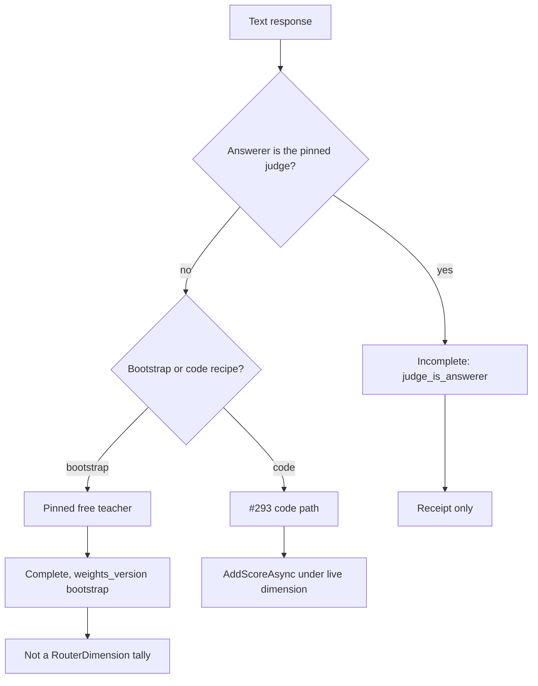
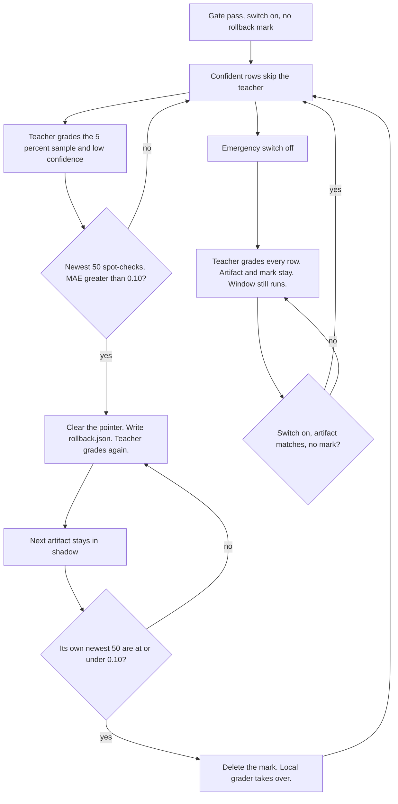

# 0027. Grade non-coding responses on a bootstrap recipe and keep them out of code tallies

**Status:** accepted
**Date:** 2026-10-23
**Deciders:** David Pizon
**Accepted:** 2026-10-23 (David, chat sign-off on #304 plan)
**Amendments:** [Amendment 1 (2026-10-23) — phase 3 stores the sealed response vector and the question-vector miss](#amendment-1-2026-10-23-phase-3-stores-the-sealed-response-vector-and-the-question-vector-miss) · [Amendment 2 (2026-10-26) — phase 7 acceptance stays in shadow](#amendment-2-2026-10-26-phase-7-acceptance-stays-in-shadow) · [Amendment 3 (2026-10-26) — phase 8 takeover is approved](#amendment-3-2026-10-26-phase-8-takeover-is-approved) · [Amendment 4 (2026-10-26) — phase 9 marks existing charts](#amendment-4-2026-10-26-phase-9-marks-existing-charts)

## Context and Problem Statement

[ADR-0026](0026-grade-a-response-only-against-its-question-and-learn-only-from-complete-grades.md) decides
how a code reply is graded and when that grade may train the router. It does not decide what happens when
the reply has no fenced code block. On 2026-10-23, before phase 0, `CodeBlockSignalExtractor.Extract` returns null,
`QualityIngress.TryIngest` enqueues nothing, and `QualityRescanService` stamps a null score. The judge never sees
the row on that tree. After [#334](https://github.com/davidpizon/TotallyHot-ArcRouter/pull/334), a null extract
calls `CreateBootstrapRequest` and is enqueued. `QualityRescanService.RescanOneAsync` still stamps a null score.
A prose
question that does get a fence is filed under a `RouterDimension` (default `code_generation`), so any later
grade would land in a code tally.

The router can only improve at work it can score. Leaving prose ungraded means explanations, writing, Q&A,
and analysis are routed on priors forever. Grading them with the code recipe would corrupt those tallies.
[#294](https://github.com/davidpizon/TotallyHot-ArcRouter/issues/294) will hang a weight vector on a bucket
version, but that epoch has not shipped, and Eq. 8 still needs weights that sum to 1 for a stable type.

This changes what the router learns from, which is why it needs an ADR. ADR-0026 stays the code-reply
decision; this record cites it and does not reopen it. The detailed plan is
[`docs/plans/issue-304-grade-non-coding-responses.md`](../plans/issue-304-grade-non-coding-responses.md).

## Decision Drivers

- **Grade the work the router actually sees**: a live reply with text must be able to produce a grade, not
  only a reply that contains a fence.
- **Do not poison code tallies**: a prose grade must never call `RouterMemory.AddScoreAsync` under a
  `RouterDimension` key.
- **Keep ADR-0026's gate**: weights stay fixed and sum to 1; only `Complete` trains; the question window,
  HMAC, and receipt stay as #293 built them.
- **The teacher is not an agent**: the pinned free judge must not grade a response it wrote, and the
  router must not auto-select it as an answerer.
- **Text-free index**: new receipt columns must not store question or response text
  ([ADR-0019](0019-store-conversation-text-in-encrypted-per-session-files.md)).
- **No historical rescan**: `ScorerVersion` stays at #293's `3.0`; already-stored null stamps stay null.

## Considered Options

- A. A stable grading recipe beside the fingerprint: bootstrap judge-only weights for unfenced text until
  a bucket version exists; a pinned free teacher, later a local C# grader; prose never enters a code tally
- B. Patch the code grader: keep `KeywordDimensionInferrer`, add a prose keyword list, and grade unfenced
  text under `code_understanding` or a new `RouterDimension`
- C. Wait for [#294](https://github.com/davidpizon/TotallyHot-ArcRouter/issues/294) bucket versions before
  grading any non-code reply
- D. Leave prose ungraded and route it on priors indefinitely

## Decision Outcome

Chosen option: "A. A stable grading recipe beside the fingerprint: bootstrap judge-only weights for unfenced
text until a bucket version exists; a pinned free teacher, later a local C# grader; prose never enters a
code tally", because only it satisfies **Grade the work the router actually sees** and **Do not poison code
tallies** together while **Keep ADR-0026's gate** still holds. B files prose in a code box. C delays the
P0 hole until an epoch that is not this issue. D is the status quo this issue exists to stop.

The rules, in short (full design in the plan):

1. **Recipe, not topic.** The stable type Eq. 8 needs is a weight vector over judge / syntax / analysis,
   not a new `RouterDimension`. Until a bucket version exists, a fenced reply keeps #293's code weights
   (`0.60 / 0.25 / 0.15`) and unfenced text uses the bootstrap recipe (judge `1.0`, syntax `0`, analysis
   `0`, `weights_version = bootstrap`). A code fence does not flip the recipe in the steady state; the
   bootstrap extractor split is a temporary assignment, accepted as a leak until #294.
2. **Same gate.** Every grade still uses #293's window, HMAC, status (`Complete` / `StructureOnly` /
   `Incomplete` plus a reason), and `Complete`-only learning. A bootstrap `Complete` grade is linked to
   its question. `RouterMemoryScoreObserver` calls `AddScoreAsync` only for a code-recipe `Complete` row.
3. **Who grades.** A pinned free model (`ProviderOptions.IsFree`, `JudgeOptions.ModelName`) is the teacher.
   It is removed from the auto-route candidate set. An explicit pick still reaches it; that response is
   `Incomplete` reason `judge_is_answerer` and is not graded. A missing, paid, or switched-off pin is
   `Incomplete` reason `no_judge`, not a fallback to some other agent. After a later grader epoch accepts
   a local C# artifact, that artifact fills the judge axis and leaves `JudgeScore` empty (unjudged, per
   the 2026-10-23 decision recorded in the plan's §12; narrowed by Amendment 2: phase 7 acceptance is
   shadow only; phase 8 fills the judge axis). This implementation ships the teacher path;
   takeover is a later phase of the same plan, not a second ADR.
   **Note (2026-10-27, #315).** Phase 8 landed in [#348](https://github.com/davidpizon/TotallyHot-ArcRouter/pull/348)
   and phase 9 landed in [#351](https://github.com/davidpizon/TotallyHot-ArcRouter/pull/351). "Later phase" means
   later than phase 7. That later phase is in the tree.
   [Amendment 3](#amendment-3-2026-10-26-phase-8-takeover-is-approved) is the procedure that shipped. It is not a
   second ADR, and it is not still waiting.
   [Amendment 2](#amendment-2-2026-10-26-phase-7-acceptance-stays-in-shadow) splits the acceptance sentence:
   phase 7 stores the artifact as accepted and leaves it in shadow, and the teacher stays the grade of
   record. Phase 8 is when the artifact fills the judge axis.
4. **Syntax weight 0.** The parser does not run. `MinimumSyntaxConfidenceForComplete` does not withhold
   `Complete`. When syntax weight is greater than 0 and the response has no fence, syntax score is 0
   ("no code in the response") and the grade can still be `Complete`.
5. **No rescan of history.** `ScorerVersion` stays `3.0`. A live non-code transcript update stamps that
   version so the code-only sweep does not overwrite the grade with null. Pre-existing null stamps stay
   null.

### Consequences

- Good, because a prose reply can train later routing of prose work instead of remaining invisible.
- Good, because a `Complete` bootstrap grade cannot move `live:code_generation` or any other
  `RouterDimension` tally, including `code_understanding`.
- Good, because the teacher never grades its own answer, which is the self-preference guard ADR-0026's
  Consequences section already named as a risk of a judge-heavy mix.
- Bad, because until bucket versions exist, a fenced answer to a writing question still takes the code
  recipe and can enter a code tally. David accepted that bootstrap leak.
- Bad, because the teacher phase grades every eligible new text reply, so the free pin's quota is spent
  faster than the code-only path. Queue-full drops become `Incomplete` reason `queue_full` rather than a
  silent debug log.
- Bad, because excluding the pin from the auto-route set means that model never answers user traffic
  unless the client picks it. If it is the operator's only strong model, routing quality and grading
  quality are different fleets on purpose.
- Neutral, because the local C# grader, encrypted response vectors, user-signal dispute, and tool-loop
  receipts are decided here and implemented in later phases of the same plan.
- Neutral, because `fingerprint_ref` stays null until #294's routing receipt exists.

## Pros and Cons of the Options

### A. Bootstrap recipe, pinned teacher, prose out of code tallies

- Good, because unfenced text is graded against the question under weights that sum to 1.
- Good, because the code path #293 already owns is unchanged until a bucket version replaces it.
- Good, because the same `Complete` gate and text-free receipt apply to both recipes.
- Bad, because the bootstrap fence split is a known leak onto code tallies.
- Bad, because the teacher is 100% of a bootstrap grade until a local grader takes over.

### B. Patch the code grader with prose keywords and a new or reused dimension

- Good, because it is the smallest extractor change: stop returning null, keep one request shape.
- Bad, because `KeywordDimensionInferrer` falls through to `code_generation`, so prose lands in a code
  box and **Do not poison code tallies** fails.
- Bad, because two of three axes (syntax, analysis) only make sense for code, and silent renormalization
  is what ADR-0026 removed.

### C. Wait for #294 bucket versions

- Good, because the steady-state type is then the bucket's recipe, and the bootstrap split can be deleted.
- Bad, because #294's epoch is parent-plan phase 7 and this issue is P0: prose stays ungraded until then.
- Bad, because the teacher, the pin exclusion, and the tally predicate are still required once buckets
  exist, so waiting does not shrink this decision.

### D. Leave prose ungraded

- Good, because it costs no judge quota and cannot corrupt a code tally.
- Bad, because it is the hole this issue names: the router never learns about non-coding work.
- Bad, because a later patch onto the code grader (option B) becomes the tempting shortcut.

## More Information

- Plan: [`docs/plans/issue-304-grade-non-coding-responses.md`](../plans/issue-304-grade-non-coding-responses.md).
- Parent plan: [`docs/plans/router-evaluator-and-live-pricing.md`](../plans/router-evaluator-and-live-pricing.md) §14.
- Cites, and does not reopen: [ADR-0026](0026-grade-a-response-only-against-its-question-and-learn-only-from-complete-grades.md).
- Code this changes in the first implementation slice (phases 0–2): `QualityIngress`, `QualityRequest`,
  `QualityResult`, `QualityGrader`, `QualityScorer`, `GradeStatusCalculator`, `RouterMemoryScoreObserver`,
  `TranscriptScoreObserver`, `GradeReceiptRecord`, `JudgeModelSelector`, `GEvalJudgeClient`,
  `RoutingCandidateBuilder`.
- Later phases of the same plan, not a second ADR: local grader epoch, encrypted `response_vectors`,
  user-signal dispute, tool-loop receipts.

## Amendment 1 (2026-10-23) — phase 3 stores the sealed response vector and the question-vector miss

Phase 3 of the same plan adds two pieces of storage. Neither is a second ADR.

`grade_receipts.question_vector_missing` is `INTEGER NULL`. A grade-time `TryPeek` hit writes 0 and a miss
writes 1. There is no default, so a receipt stored before the column stays null and is not backfilled.
The column is a flag, not a vector and not text. `fingerprint_ref` stays null.

`response_vectors` lives in the router memory database, keyed by `correlation_id`. Each row stores the BGE
model id and a blob `nonce (12) || tag (16) || ciphertext` sealed with AES-256-GCM under one 256-bit key
in `secrets.dat` (`response-vector-key`). Associated data is the table name, the correlation id, and the
model id. The plaintext is the same little-endian `float32` layout as `memory_entries`, and it is not
stored. A row is written only when the reply has non-blank text still on the grade path and `JudgeScore`
or `LocalScore` is set. Deleting the session deletes the row. Shred destroys the key; the next start
deletes every row and creates a new key. Question vectors in `memory_entries` stay unencrypted
([#306](https://github.com/davidpizon/TotallyHot-ArcRouter/issues/306)).

## Amendment 2 (2026-10-26): phase 7 acceptance stays in shadow

**Status:** accepted (David Pizon, 2026-10-26). The decision is accepted. The phase 7 code landed in [#346](https://github.com/davidpizon/TotallyHot-ArcRouter/pull/346). Amends decision 3's sentence about what acceptance does. It does not change the teacher pin, the recipe split, the tally rule, or the rule that takeover is a later phase of this plan rather than a second ADR.

### Why

Decision 3 said two things at once. After the grader epoch accepts a local C# artifact, that artifact fills the judge axis and leaves `JudgeScore` empty. Takeover is a later phase of the same plan. Read as one step, a gate pass would replace the teacher. The plan's phases do not. Phase 7 saves the artifact and keeps scoring in shadow. Phase 8 is when the local score becomes the grade of record. The decisive point is the one decision 3 already recorded: takeover is a later phase, so the pinned teacher stays the grade of record until that phase. Accepting an artifact in phase 7 must not empty `JudgeScore`.

The alternative, treating the original sentence literally, would make phase 7 the takeover. David rejected that on 2026-10-25 (decision A in the phase 7 plan) and confirmed the split on 2026-10-26.

### Decision

Acceptance and takeover stay two phases of [`docs/plans/issue-304-grade-non-coding-responses.md`](../plans/issue-304-grade-non-coding-responses.md). The procedure is [`docs/plans/issue-304-phase-7-grader-epoch.md`](../plans/issue-304-phase-7-grader-epoch.md).

- Phase 7: a candidate that clears the agreement gate is stored as the accepted artifact for its kind, status `accepted, shadow`. The teacher score stays the grade of record for every grade in that phase. A shadow `LocalScore` may be written beside it. It does not fill the judge axis, and it does not leave `JudgeScore` empty.
- Phase 8: takeover. The local score becomes the grade of record and fills the judge axis. `JudgeScore` stays empty on those rows, which is the unjudged rule in the plan's §12. Spot-check rows and low-confidence rows still set `JudgeScore` from the teacher. The approved procedure is [Amendment 3](#amendment-3-2026-10-26-phase-8-takeover-is-approved).
- This remains one plan. It does not open a second ADR.

Related: [#293](https://github.com/davidpizon/TotallyHot-ArcRouter/issues/293),
  [#294](https://github.com/davidpizon/TotallyHot-ArcRouter/issues/294),
  [#319](https://github.com/davidpizon/TotallyHot-ArcRouter/issues/319),
  [#326](https://github.com/davidpizon/TotallyHot-ArcRouter/issues/326).

## Amendment 3 (2026-10-26): phase 8 takeover is approved

**Status:** accepted. David approved the phase 8 plan on 2026-10-26, including takeover defaulting on and a rollback mark that a teacher, prompt, BGE, or feature-schema change does not delete. This amendment records that procedure so this ADR and the plans describe the same phase. It does not change the teacher pin, the recipe split, the tally rule, or Amendment 2. It does not open a second ADR.

### Why

Amendment 2 left phase 8 as the phase that fills the judge axis. It did not say when a grade may skip the teacher, how the 5% sample is chosen, what "too wrong" measures, or what a rollback does to the next artifact. The phase 7 method `GraderEpochArtifactStore.RollbackToTeacher` only clears `accepted.json`. Its name reads as if phase 7 returned authority to the teacher. Phase 7 could not do that, because the teacher never lost authority. Phase 8 is the phase in which clearing the pointer returns authority, since the pointer is what allows a skip.

The alternative, treating a gate pass in phase 7 as takeover, is the reading Amendment 2 already rejected. The alternative of renaming `RollbackToTeacher` was set aside: the method is in the tree, phase 7 tests call it, and the name matches the phase 8 effect. The alternative of shipping with `TakeoverEnabled` defaulting to false was the first draft. David rejected that on 2026-10-26. The switch stays as an emergency off.

### Decision

The procedure is [`docs/plans/issue-304-phase-8-grader-takeover.md`](../plans/issue-304-phase-8-grader-takeover.md). David approved P1–P9 and the epoch history on 2026-10-26.

- Takeover is per kind. An accepted matching artifact for `code` does not grade `non-code`, and the reverse is also true. A rollback of one kind leaves the other kind's pointer, window, and epoch rows in place. Both kinds may take over in phase 8, each from its own artifact. Skipping the teacher removes only the judge key. CodeJudge, ICE-Score, and RACE still join when they are pending.
- `GraderEpochOptions.TakeoverEnabled` defaults to true. A matching accepted artifact takes over as soon as the gate passes, when that kind has no `rollback.json`. The match includes the teacher model, the teacher prompt version, the BGE id, and the feature-schema version. False is the emergency off: the next grade does not skip the teacher, `accepted.json` and the artifact files stay, old receipts are not rewritten, and `rollback.json` is not deleted. The 5% draw and the spot-check window still run. APPROVED by David (2026-10-26): while the switch is off, a spot-check or any other teacher call that fails never makes the local score the grade of record. `Enabled` stays the fit switch. `Enabled` false still logs that the tick will not fit, still runs retirement and the window, and returns before the trainer check. That removes the early return in `GraderEpochHostedService.RunTickAsync` (lines 98–102).
- The first gate pass takes over immediately when the artifact matches the teacher model, the prompt version, the BGE id, and the feature-schema version, and that kind has no `rollback.json`. There is no wait for 50 live spot-checks before that first takeover. After a rollback, the next artifact stays in shadow until its own newest 50 spot-checks have a mean miss at or under 0.10. The mark stays until that live check passes.
- The 5% draw is a hash of the correlation id. It does not use `GraderEpochOptions.RandomSeed`.
- The teacher still grades the 5% sample and every row whose question cosine is strictly below the stored floor. A score on the line is graded locally. A null floor and a missing question vector are not low confidence. `local_confidence` stays null in those cases, never 0.
- A spot-check window of the newest 50 rows for the grader in charge, with mean absolute error against the judge score strictly greater than 0.10, calls `RollbackToTeacher` and writes `rollback.json`. Exactly 0.10 stays. Fewer than 50 rows does nothing. The previous file stays on disk and is not promoted. Stored grades are not rewritten. The mean is against the teacher judge score, not the blended unified score.
- APPROVED by David (2026-10-26): a teacher, prompt, BGE, or feature-schema change still clears `accepted.json` and never creates a rollback mark. It does not delete `rollback.json`. With no mark, the next artifact that passes the gate takes over immediately. An existing mark stays until the live 5% check passes. A bucket re-form does not retire the artifact and does not touch the marker. APPROVED by David (2026-10-26): a change of teacher model id or teacher prompt version appends one `teacher_changed` row per kind, a BGE model-id change appends one `bge_changed` row, and a feature-schema change appends one `feature_schema_changed` row. Each row stores the UTC time, the previous and new value, and whether a rollback mark existed. The teacher row stores both the model pair and the prompt pair. The BGE row stores `previous_bge_model` and `bge_model`. The schema row stores `previous_feature_schema_version` and `feature_schema_version` as integers. Phase 8 compares all four fields on the accepted artifact before `TryRetireMismatch` (lines 100–117, called at lines 131–133) clears it. `Mismatch` (lines 360–369) still returns only the first difference. The identity rows are committed before that clear. A restart does not write the same row again. A BGE change does not append `teacher_changed`. A feature-schema change does not append `teacher_changed`.
- Who graded the row is the existing `grade_source` column. Phase 8 does not add a receipt column.
- A `LocalScore` is not a grader-epoch training label. Rows the teacher actually scored remain the labels. kNN still stores a `Complete` takeover row with `is_judge_scored` false. Disputes still compare `UnifiedScore` and still delete the response vector and the kNN row.
- A skipped teacher call does not write cost 0. Unknown request cost stays null.
- Each time a kind's local grader begins grading on its own, and each time the teacher takes charge again for that kind, phase 8 appends one `grader_epoch_events` row in `RouterMemoryDatabase`. A gate pass while `rollback.json` exists does not append `local_takeover`. A switch flip that leaves the teacher already in charge does not append an authority row. A BGE or feature-schema retirement that leaves the teacher already in charge does not append an authority row. It appends `bge_changed` or `feature_schema_changed`. A repeat of the same artifact and the same authority does not append again. A teacher-model or prompt-version change appends `teacher_changed`, a BGE change appends `bge_changed`, and a feature-schema change appends `feature_schema_changed`, even when the teacher was already in charge, once per change per kind. Phase 9 graphs `local_takeover`, `teacher_resumed`, `teacher_changed`, `bge_changed`, and `feature_schema_changed` on the token-efficiency timeline. The row has a UTC timestamp, the kind, the epoch type, a cause, the artifact id and the previous artifact id, and, only for a window, the window size and the mean miss. A `teacher_changed` row also has the previous and new teacher model id, the previous and new prompt version, and `rollback_mark_present`. A `bge_changed` row has the previous and new BGE model id and `rollback_mark_present`. A `feature_schema_changed` row has the previous and new feature-schema version and `rollback_mark_present`. No row stores question text or response text. Rows are not updated and not deleted. They survive a restart. Authority rows (`local_takeover`, `teacher_resumed`) insert, then rename the authority file, then commit. Identity rows (`teacher_changed`, `bge_changed`, `feature_schema_changed`) are a different order: they commit before the pointer clear so a retry cannot write a second row and cannot lose the previous identity. Phase 9 reads `SELECT id, at_utc, kind, epoch_type, cause, artifact_id, previous_artifact_id, window_size, mean_miss, previous_teacher_model, teacher_model, previous_prompt_version, prompt_version, rollback_mark_present, previous_bge_model, bge_model, previous_feature_schema_version, feature_schema_version FROM grader_epoch_events ORDER BY at_utc, id` and overlays that list on `request_transcripts` (`created_at_utc`, `input_tokens`, `output_tokens`, `cost`). Those are two database files. The chart does not join them in SQL, and it does not claim the epoch caused a token-efficiency change. A null cost stays null, never 0. A null token count stays null, never 0. Phase 9 owns the chart. The named tests are `EpochEvent_OnTakeover_AppendsLocalTakeover`, `EpochEvent_OnRollback_AppendsTeacherResumed`, `EpochEvent_OnSwitchOff_AppendsTeacherResumed`, `EpochEvent_AppendOnly`, `EpochEvent_NoQuestionOrResponseText`, `Kinds_RollBackIndependently`, `EpochEvent_OnTeacherModelChange_AppendsTeacherChanged`, `EpochEvent_OnPromptVersionChange_AppendsTeacherChanged`, `EpochEvent_TeacherChange_OnceAcrossRestart`, `EpochEvent_TeacherChange_NoQuestionOrResponseText`, `EpochEvent_OnBgeModelChange_AppendsBgeChanged`, `EpochEvent_OnFeatureSchemaChange_AppendsFeatureSchemaChanged`, `EpochEvent_BgeAndSchemaTogether_AppendsBoth`, `EpochEvent_BgeChange_OnceAcrossRestart`, `EpochEvent_FeatureSchemaChange_OnceAcrossRestart`, `EpochEvent_BgeChange_NoQuestionOrResponseText`, and `EpochEvent_FeatureSchemaChange_NoQuestionOrResponseText`.

### Consequences

- Good, because a confident row can skip the pinned teacher without copying `LocalScore` into `JudgeScore`, which keeps #319's stamp honest.
- Good, because phase 9 can place each takeover, each return to the teacher, and each teacher, BGE, or feature-schema change on a time axis next to token efficiency, and the rows are still there after a restart.
- Bad, because the first takeover can grade alone before any live spot-check exists, so a holdout that looked fine can be the grade of record until 50 spot-checks have been scored. The emergency switch and the rollback window are the brakes. The live 5% check applies after a rollback, not before the first takeover. David accepted that order on 2026-10-26.
- Bad, because the epoch insert and the authority-file rename cannot share one SQLite transaction. A crash between them is repaired by the next tick, so authority and the history can disagree until that tick runs.

## Amendment 4 (2026-10-26): phase 9 marks existing charts

**Status:** accepted. David answered Q1, Q2, Q3, and the unit switch of the [phase 9 plan](../plans/issue-304-phase-9-epoch-time-graph.md) on 2026-10-26. This amendment records those answers so Amendment 3's "phase 9 owns the chart" is not read as a new chart. It does not change the teacher pin, the recipe split, the tally rule, or Amendments 2 and 3. It does not open a second ADR.

### Why

Amendment 3 says phase 9 graphs the five epoch types on the token-efficiency timeline and that phase 9 owns the chart. The first phase 9 draft turned that into a new Report Card chart. David rejected a new chart. He asked for point-in-time marks on the charts that already exist, reusing a chart that already draws pulsating dots, with a color per epoch type and a tooltip on hover or click.

Two charts draw those dots. Both are `effectScatter` series in `echarts-interop.js`: `optionRunawayArea` (Cost Analytics Tokens, kind `RunawayArea`) and `optionThresholdLine` (Cost Analytics Context Buffer, kind `ThresholdLine`). David chose the Context Buffer drawing on 2026-10-26. The same day he added a switch between tokens per dollar and dollars per 1,000 tokens.

### Decision

- Token efficiency defaults to tokens per dollar: sum `input_tokens + output_tokens` and sum `cost` over rows that have both token counts, a cost greater than 0, and a token sum greater than 0, then divide. The switch shows dollars per 1,000 tokens: that same cost sum divided by that same token sum, times 1,000. A missing cost, a missing token count, a cost that is not greater than 0, or a token sum that is not greater than 0 is a blank in both views, never plotted as 0.
- Epochs are single points in time on the eight Cost Analytics time charts. The dot drawing is copied from `optionThresholdLine`. The dots do not use the >90% context points and do not use `#ef4444`. Phase 9 does not add a grader-epoch chart. The five types stay `local_takeover`, `teacher_resumed`, `teacher_changed`, `bge_changed`, and `feature_schema_changed`. The marks do not claim they caused a line to move. #292 voter-weight epochs stay out of this phase. Flipping the unit switch does not move the marks.
- Unknown cost stays null, never 0. A null token count stays null, never 0. The two database files are still not joined in SQL. No row on the chart carries question text or response text.
- Amendment 3's read query and its null rules still stand. "Phase 9 owns the chart" means phase 9 places those rows on a time axis. It does not mean a new chart kind.

### Consequences

- Good, because the formula is fixed and a null cost cannot be drawn as zero.
- Good, because an implementer will not add the Report Card chart the first draft described.
- Bad, because the first takeover can still grade alone before any live spot-check exists. That risk is Amendment 3's, and this amendment does not change it.
