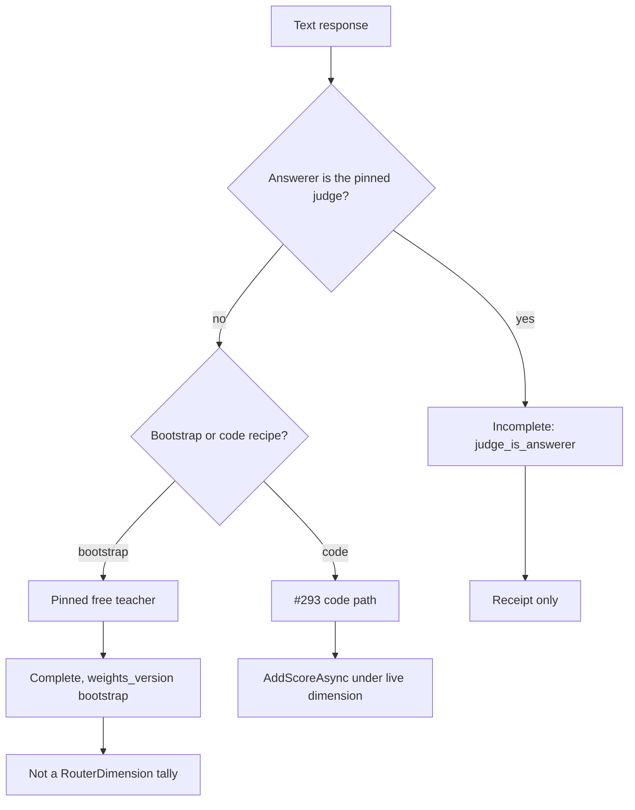

# 0027. Grade non-coding responses on a bootstrap recipe and keep them out of code tallies

**Status:** accepted
**Date:** 2026-10-23
**Deciders:** David Pizon
**Accepted:** 2026-10-23 (David, chat sign-off on #304 plan)

## Context and Problem Statement

[ADR-0026](0026-grade-a-response-only-against-its-question-and-learn-only-from-complete-grades.md) decides
how a code reply is graded and when that grade may train the router. It does not decide what happens when
the reply has no fenced code block. Today `CodeBlockSignalExtractor.Extract` returns null, `QualityIngress.TryIngest`
enqueues nothing, and `QualityRescanService` stamps a null score. The judge never sees the row. A prose
question that does get a fence is filed under a `RouterDimension` (default `code_generation`), so any later
grade would land in a code tally.

The router can only improve at work it can score. Leaving prose ungraded means explanations, writing, Q&A,
and analysis are routed on priors forever. Grading them with the code recipe would corrupt those tallies.
[#294](https://github.com/davidpizon/TotallyHot-ArcRouter/issues/294) will hang a weight vector on a bucket
version, but that epoch has not shipped, and Eq. 8 still needs weights that sum to 1 for a stable type.

This changes what the router learns from, which is why it needs an ADR. ADR-0026 stays the code-reply
decision; this record cites it and does not reopen it. The detailed plan is
[`docs/plans/issue-304-grade-non-coding-responses.md`](../plans/issue-304-grade-non-coding-responses.md).

## Decision Drivers

- **Grade the work the router actually sees**: a live reply with text must be able to produce a grade, not
  only a reply that contains a fence.
- **Do not poison code tallies**: a prose grade must never call `RouterMemory.AddScoreAsync` under a
  `RouterDimension` key.
- **Keep ADR-0026's gate**: weights stay fixed and sum to 1; only `Complete` trains; the question window,
  HMAC, and receipt stay as #293 built them.
- **The teacher is not an agent**: the pinned free judge must not grade a response it wrote, and the
  router must not auto-select it as an answerer.
- **Text-free index**: new receipt columns must not store question or response text
  ([ADR-0019](0019-store-conversation-text-in-encrypted-per-session-files.md)).
- **No historical rescan**: `ScorerVersion` stays at #293's `3.0`; already-stored null stamps stay null.

## Considered Options

- A. A stable grading recipe beside the fingerprint: bootstrap judge-only weights for unfenced text until
  a bucket version exists; a pinned free teacher, later a local C# grader; prose never enters a code tally
- B. Patch the code grader: keep `KeywordDimensionInferrer`, add a prose keyword list, and grade unfenced
  text under `code_understanding` or a new `RouterDimension`
- C. Wait for [#294](https://github.com/davidpizon/TotallyHot-ArcRouter/issues/294) bucket versions before
  grading any non-code reply
- D. Leave prose ungraded and route it on priors indefinitely

## Decision Outcome

Chosen option: "A. A stable grading recipe beside the fingerprint: bootstrap judge-only weights for unfenced
text until a bucket version exists; a pinned free teacher, later a local C# grader; prose never enters a
code tally", because only it satisfies **Grade the work the router actually sees** and **Do not poison code
tallies** together while **Keep ADR-0026's gate** still holds. B files prose in a code box. C delays the
P0 hole until an epoch that is not this issue. D is the status quo this issue exists to stop.

The rules, in short (full design in the plan):

1. **Recipe, not topic.** The stable type Eq. 8 needs is a weight vector over judge / syntax / analysis,
   not a new `RouterDimension`. Until a bucket version exists, a fenced reply keeps #293's code weights
   (`0.60 / 0.25 / 0.15`) and unfenced text uses the bootstrap recipe (judge `1.0`, syntax `0`, analysis
   `0`, `weights_version = bootstrap`). A code fence does not flip the recipe in the steady state; the
   bootstrap extractor split is a temporary assignment, accepted as a leak until #294.
2. **Same gate.** Every grade still uses #293's window, HMAC, status (`Complete` / `StructureOnly` /
   `Incomplete` plus a reason), and `Complete`-only learning. A bootstrap `Complete` grade is linked to
   its question. `RouterMemoryScoreObserver` calls `AddScoreAsync` only for a code-recipe `Complete` row.
3. **Who grades.** A pinned free model (`ProviderOptions.IsFree`, `JudgeOptions.ModelName`) is the teacher.
   It is removed from the auto-route candidate set. An explicit pick still reaches it; that response is
   `Incomplete` reason `judge_is_answerer` and is not graded. A missing, paid, or switched-off pin is
   `Incomplete` reason `no_judge`, not a fallback to some other agent. After a later grader epoch accepts
   a local C# artifact, that artifact fills the judge axis and leaves `JudgeScore` empty (unjudged, per
   the 2026-10-23 decision recorded in the plan's §12). This implementation ships the teacher path;
   takeover is a later phase of the same plan, not a second ADR.
4. **Syntax weight 0.** The parser does not run. `MinimumSyntaxConfidenceForComplete` does not withhold
   `Complete`. When syntax weight is greater than 0 and the response has no fence, syntax score is 0
   ("no code in the response") and the grade can still be `Complete`.
5. **No rescan of history.** `ScorerVersion` stays `3.0`. A live non-code transcript update stamps that
   version so the code-only sweep does not overwrite the grade with null. Pre-existing null stamps stay
   null.

### Consequences

- Good, because a prose reply can train later routing of prose work instead of remaining invisible.
- Good, because a `Complete` bootstrap grade cannot move `live:code_generation` or any other
  `RouterDimension` tally, including `code_understanding`.
- Good, because the teacher never grades its own answer, which is the self-preference guard ADR-0026's
  Consequences section already named as a risk of a judge-heavy mix.
- Bad, because until bucket versions exist, a fenced answer to a writing question still takes the code
  recipe and can enter a code tally. David accepted that bootstrap leak.
- Bad, because the teacher phase grades every eligible new text reply, so the free pin's quota is spent
  faster than the code-only path. Queue-full drops become `Incomplete` reason `queue_full` rather than a
  silent debug log.
- Bad, because excluding the pin from the auto-route set means that model never answers user traffic
  unless the client picks it. If it is the operator's only strong model, routing quality and grading
  quality are different fleets on purpose.
- Neutral, because the local C# grader, encrypted response vectors, user-signal dispute, and tool-loop
  receipts are decided here and implemented in later phases of the same plan.
- Neutral, because `fingerprint_ref` stays null until #294's routing receipt exists.

## Pros and Cons of the Options

### A. Bootstrap recipe, pinned teacher, prose out of code tallies

- Good, because unfenced text is graded against the question under weights that sum to 1.
- Good, because the code path #293 already owns is unchanged until a bucket version replaces it.
- Good, because the same `Complete` gate and text-free receipt apply to both recipes.
- Bad, because the bootstrap fence split is a known leak onto code tallies.
- Bad, because the teacher is 100% of a bootstrap grade until a local grader takes over.

### B. Patch the code grader with prose keywords and a new or reused dimension

- Good, because it is the smallest extractor change: stop returning null, keep one request shape.
- Bad, because `KeywordDimensionInferrer` falls through to `code_generation`, so prose lands in a code
  box and **Do not poison code tallies** fails.
- Bad, because two of three axes (syntax, analysis) only make sense for code, and silent renormalization
  is what ADR-0026 removed.

### C. Wait for #294 bucket versions

- Good, because the steady-state type is then the bucket's recipe, and the bootstrap split can be deleted.
- Bad, because #294's epoch is parent-plan phase 7 and this issue is P0: prose stays ungraded until then.
- Bad, because the teacher, the pin exclusion, and the tally predicate are still required once buckets
  exist, so waiting does not shrink this decision.

### D. Leave prose ungraded

- Good, because it costs no judge quota and cannot corrupt a code tally.
- Bad, because it is the hole this issue names: the router never learns about non-coding work.
- Bad, because a later patch onto the code grader (option B) becomes the tempting shortcut.

## More Information

- Plan: [`docs/plans/issue-304-grade-non-coding-responses.md`](../plans/issue-304-grade-non-coding-responses.md).
- Parent plan: [`docs/plans/router-evaluator-and-live-pricing.md`](../plans/router-evaluator-and-live-pricing.md) §14.
- Cites, and does not reopen: [ADR-0026](0026-grade-a-response-only-against-its-question-and-learn-only-from-complete-grades.md).
- Code this changes in the first implementation slice (phases 0–2): `QualityIngress`, `QualityRequest`,
  `QualityResult`, `QualityGrader`, `QualityScorer`, `GradeStatusCalculator`, `RouterMemoryScoreObserver`,
  `TranscriptScoreObserver`, `GradeReceiptRecord`, `JudgeModelSelector`, `GEvalJudgeClient`,
  `RoutingCandidateBuilder`.
- Later phases of the same plan, not a second ADR: local grader epoch, encrypted `response_vectors`,
  user-signal dispute, tool-loop receipts.

## Amendment 1 (2026-10-23) — phase 3 stores the sealed response vector and the question-vector miss

Phase 3 of the same plan adds two pieces of storage. Neither is a second ADR.

`grade_receipts.question_vector_missing` is `INTEGER NULL`. A grade-time `TryPeek` hit writes 0 and a miss
writes 1. There is no default, so a receipt stored before the column stays null and is not backfilled.
The column is a flag, not a vector and not text. `fingerprint_ref` stays null.

`response_vectors` lives in the router memory database, keyed by `correlation_id`. Each row stores the BGE
model id and a blob `nonce (12) || tag (16) || ciphertext` sealed with AES-256-GCM under one 256-bit key
in `secrets.dat` (`response-vector-key`). Associated data is the table name, the correlation id, and the
model id. The plaintext is the same little-endian `float32` layout as `memory_entries`, and it is not
stored. A row is written only when the reply has non-blank text still on the grade path and `JudgeScore`
or `LocalScore` is set. Deleting the session deletes the row. Shred destroys the key; the next start
deletes every row and creates a new key. Question vectors in `memory_entries` stay unencrypted
([#306](https://github.com/davidpizon/TotallyHot-ArcRouter/issues/306)).
- Related: [#293](https://github.com/davidpizon/TotallyHot-ArcRouter/issues/293),
  [#294](https://github.com/davidpizon/TotallyHot-ArcRouter/issues/294),
  [#319](https://github.com/davidpizon/TotallyHot-ArcRouter/issues/319),
  [#326](https://github.com/davidpizon/TotallyHot-ArcRouter/issues/326).
