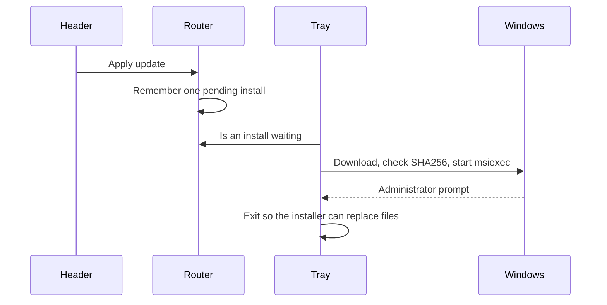

# 0028. The tray launches the installer the dashboard requests

**Status:** proposed
**Date:** 2026-11-23
**Deciders:** David Pizon

## Context and Problem Statement

The dashboard already knows when GitHub has published a newer Windows installer, but a click on the
dashboard cannot start that installer. The dashboard is a Blazor WebAssembly page, so it has no
process-launch API. The router usually runs as a Windows service, and a service in session 0 cannot
show the administrator approval prompt. The tray already runs in the logged-on user's session and
already has an authenticated channel to the router. This decision is who is allowed to start
`msiexec`, and how the dashboard asks for that without the router itself starting a process.

The MSI packaging choice in [`packaging-and-distribution.md`](../router/packaging-and-distribution.md)
still stands: one signed MSI, no detached updater executable. This record only decides which
process launches that MSI when the operator clicks Update on the dashboard.

## Decision Drivers

- The administrator approval prompt has to appear on the logged-on user's desktop.
- The dashboard cannot start a process, and the Windows service cannot show that prompt.
- One click records one install. A second click must not queue a second install.
- The call that records the install is an authenticated admin call, the same kind as the other
  dashboard admin calls.
- The router process does not download the installer and does not start `msiexec`.

## Considered Options

- The tray claims one pending install and launches `msiexec`.
- The dashboard calls `MsiUpdateApplier` directly.
- The router service launches `msiexec` when the dashboard asks.

## Decision Outcome

Chosen option: "The tray claims one pending install and launches `msiexec`", because the
administrator approval prompt has to appear on the logged-on user's desktop, and the tray is the
process that already runs there with an authenticated channel to the router.

### Consequences

- Good, because the dashboard button can be a normal authenticated admin call, and Windows still
  shows the approval prompt in the user session.
- Bad, because the install does not finish when the tray app is not running. The header has to say
  so, and the existing release link in Settings stays as the fallback.
- Neutral, because the tray exits after `msiexec` starts, so the installer can replace the tray's
  files. A later tray start finds nothing pending.

## Pros and Cons of the Options

### The tray claims one pending install and launches `msiexec`

The dashboard's `RequestApply` stores the download URL, SHA256, and version on the router's
in-memory update state. The tray polls `ClaimPendingApply`, and the first claim clears that record.
The tray then runs the existing `MsiUpdateApplier` and exits. The router never starts a process.

- Good, because the prompt shows on the interactive desktop, and a second request or a second claim
  cannot start a second install.
- Good, because the new calls sit on `UpdateAdminService`, which is already authenticated the same
  way as the other admin services. `ManagementFacade` does not grow a new method.
- Bad, because a dashboard click does nothing visible until a tray in that session claims it.

### The dashboard calls `MsiUpdateApplier` directly

- Good, because the download and checksum code already lives next to the dashboard's update store.
- Bad, because the dashboard is a browser page and cannot start `msiexec` or show the approval prompt.

### The router service launches `msiexec` when the dashboard asks

- Good, because the router already holds the release URL and checksum, so no second process has to poll.
- Bad, because a Windows service in session 0 cannot show the administrator approval prompt, so the
  install would either fail or wait with no one able to approve it.

## More Information

- [`packaging-and-distribution.md`](../router/packaging-and-distribution.md) — one MSI installs the
  router service and the logon tray. This decision does not replace that packaging.
- `UpdateAdminGrpcService` — `RequestApply` and `ClaimPendingApply`.
- `MsiUpdateApplier` — download, SHA256 check, and elevated `msiexec`.
- `UpdateApplyMonitor` and `SessionRouterConnector` — the tray's poll over the existing session channel.
- `Dashboard` — the header button, shown only when the release check says a newer installer exists.
