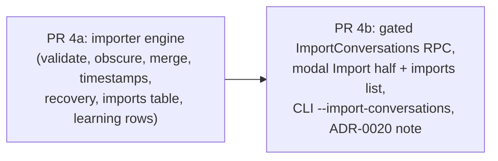

# Plan: #165 phase 4 — Import conversations from a zip

**Status:** PR 4a approved (David, chat, 2026-10-11: “I confirm 4a”), including the `overwrite` design in 4a step 5 (append the replacement turn and supersede the old index row; the session checksum is recomputed for that session, because the chain cannot drop a link). PR 4b approved (David, chat, 2026-10-12: “I approve 4b”). Each implementation PR must link this plan.
**Issue:** [#165](https://github.com/davidpizon/TotallyHot-ArcRouter/issues/165). **Parent plan:** `docs/plans/issue-165-export-import-history.md` §2 (Import), §5 phase 4, §6 tests, §7 decisions 3, 4, 8, 11, 12. **Prior phase:** `docs/plans/issue-165-phase3-export.md` (merged as #231).
**ADR-0008:** no `ManagementFacade` change, no smell work, proxy hot path untouched. `SessionStore.AppendTurn` is reused, not widened. If the SQLite changes below touch `SessionIndex`'s public surface, re-run CodeGraph on `SessionStore`/`SessionIndex` callers first.

## Context

Phases 1–3 are merged: every captured turn lives in an encrypted per-session file indexed by `transcripts.db`, and the router can export them to a zip (`ConversationExportWriter`, gated `ConversationAdminGrpcService.ExportConversations`, Sessions-tab modal, `--export-conversations` with browser approval hand-off). Phase 4 is the reverse: read that zip back, validate it, obscure secrets, and restore sessions so David can pool conversations from several machines into one dataset (the point of #165).

**Exit criteria (parent plan §5):**
- importing a secret-free corpus into an empty store reproduces the source;
- a second import under `skip` adds zero rows;
- a tampered byte fails that turn;
- `original` keeps source timestamps; `import-time` keeps source order;
- an identical session imports nothing; a partly present one gains exactly its missing turns;
- re-importing a fully present zip reads **no** body entries.

## Decisions made with David (this session)

| # | Decision |
|---|---|
| 1 | **Source:** a path on the router machine, **staged**. The router copies the zip into a private staging file, hashes the copy, the passkey approval binds to that hash (`GatedOperation.ImportParameters` / `ContentGateHooks.RequireImport` already exist), and import reads only the staged copy, so the file cannot change after approval. |
| 2 | **Surfaces:** gated RPC + Import half of the Sessions-tab modal (with the imports list and per-import delete) + `--import-conversations` CLI using the existing pending-approval hand-off. |
| 3 | **Grading:** imported turns arrive ungraded (the phase 3 zip carries no score) and are embedded and graded like any other unscored turn. |
| 4 | **Delivery:** two stacked drafts — **4a engine**, **4b transport + UI + CLI**. All parent-plan options stay in scope. |

## Assumptions I am carrying (flag if wrong)

- **Extracts are regenerated on import** (phase 3 risk #4): the zip omits the `Extracts` frame, so import derives newest-user-message and reply text with `RequestTextExtractor` / `ResponseTextExtractor` from the stored bodies. Imported turns get extracts in the current extractor's shape.
- **Score/judge fields are absent** from imported turns; `request_transcripts` rows for them carry `score = NULL`, which makes them eligible for `QualityRescanService`.
- **`secrets_obscured` is `null` in schema v1**, so import cannot trust it; it always re-obscures.

## What CodeGraph shows is reusable

- `SessionStore.AppendTurn(archiveSessionId, clientSessionId, SessionTurnInput)` already accepts `ArchiveTurnId`, `CreatedAtUtc`, and `Origin` (`SessionTurnOrigin.Imported`), takes the per-session gate + rotation read-lock, writes frames then the index transaction (ADR-0019 commit order), and computes `session_bodies` hashes and the `session_sha256` chain. A test (`AppendTurn_RecordsImportedOrigin`) already covers the origin. **Import is a caller of this, not a new write path.**
- `AppendBody(sequence, kind, bytes, turnId)` obscures in the in-memory path; the spooled path (`SessionBodySpool` → `StreamingSecretObscurer`) handles bodies too large for memory. Import uses the spool path for large entries so memory stays bounded.
- `SessionArchiveIds`, `SessionStore.ResolveArchiveSessionId`/`ListSessions`/`ListTurns`, recovery (`RecoverOnStartup`, `.spool`/`.tmp` sweep) cover crash safety.
- `GatedOperation.Import` + `ImportParameters` + `ContentGateHooks.RequireImport` and `PendingApprovalTable`/`PasskeyAdminGrpcService` hand-off exist; `ExportConversationsCommand` + `IConversationExportRouter` + `GrpcConversationExportRouter` are the CLI template; `ConversationAdminGrpcService` is the service template (single flight, progress `Channel`, `ToStatusCode`).
- `SqliteTaxonomyComparisonStore` (line 43) joins `request_transcripts`: this is the ROI/savings path that must skip imported rows. `EmbeddingBackfillService` / `QualityRescanService` read `request_transcripts` and extracts via `ISessionExtractReader`.
- `ConversationExportWriter`'s layout constants, `ConversationExportWire`, `ConversationExportModels` define the format the importer must parse; the importer should share them rather than re-declare field names.

## Delivery

Each PR is a **draft**, iterated with a local `/code-review` (or a different-model reviewer) until clean, then marked ready once for the single Copilot review; never re-request. Each links this approved plan.

### PR 4a — importer engine (no transport, no UI)

New namespace `src/TotallyHotArcRouter/Sessions/Import/`.

1. **`ConversationImporter`** — library entry point: `ImportAsync(SessionStore, stagedZipPath, ConversationImportOptions, IProgress<…>, CancellationToken) → ConversationImportResult`. Single-flight (second concurrent import → `FailedPrecondition`, like export).
2. **Validation, in parent §2 order.**
   - Reject entry names that are absolute, contain `..`, or start with `/` or `\` (zip-slip); reject duplicate entry names.
   - `manifest.json` parses and `schema_version == 1`; any other version is rejected with a message naming it. Stop on the first manifest failure.
   - Recompute SHA-256 of `turns.jsonl` always (must equal the manifest value). Recompute a body's SHA-256 **only when that body is about to be stored**.
   - Each JSONL line: required `archive_turn_id`, `archive_session_id`, `client_session_id`, `turn_sequence`, `created_at_utc`, body paths under `conversations/{archive_session_id}/turns/`; unknown fields ignored; a bad line skips and counts that turn, never aborts the rest.
   - Streaming everywhere: `turns.jsonl` is read line by line; bodies are never loaded whole.
3. **Disk budget.** Decide skip/fill first (step 5), then sum declared lengths of bodies that will be stored; refuse unless free space ≥ sum + reserve (larger of 1 GiB and 10% of the volume), reusing the export writer's volume-space seam. While streaming, an entry that inflates past its declared length, or declared lengths summing past the manifest total, are rejected (compression-bomb / lying-manifest guard).
4. **Obscure on write.** Bodies go through `SessionStore.AppendTurn` (in-memory) or a `SessionBodySpool` (large), both of which obscure. If obscuring changed a body, the stored hash differs from the zip's; the zip hash is kept as `source_sha256` (new column on `session_bodies`).
5. **Merge logic** (sessions match on `archive_session_id`, turns on `archive_turn_id`; the client `session_id` is never used to match):
   - Compare the manifest's `session_sha256` with the local session's chain value first. Equal → skip the whole session, **read no body entries**.
   - Differ → per-turn compare by recorded body hashes; also accept a turn's `source_sha256`, so a previously-obscured import still dedups.
   - Missing turns of a present session are appended (they keep original timestamps under either timestamp option, so they slot in order).
   - Conflict on a turn present on both sides with different content, keyed by `archive_turn_id`: `skip` (default; "keep local copy on conflict" on), `overwrite` (replace bodies + metadata, keep id), `keep-both` (new local id, original recorded as `source_archive_turn_id`, so a later `skip` re-import does not insert a third copy).
   - `overwrite`/`keep-both` need a store operation to replace or insert-beside a turn. A session file is append-only, so `overwrite` is implemented as: append the replacement turn and mark the old index row superseded (rows excluded from reads and the checksum), with the old frames reclaimed only when the session is deleted. **Open design point for the review:** confirm this over rewriting the file; rewriting is simpler to reason about but breaks append-only and crash recovery guarantees.
6. **Timestamps.** `original` (default): keep `created_at_utc`. `import-time`: compute one offset = (import time − newest imported turn of the zip) and shift every timestamp of each session **new** to the history by it; record `original_created_at_utc`. The offset is per import, not per session, so inter-session spacing is preserved. Session checksum excludes timestamps, so it is unchanged.
7. **Metadata snapshot for imported turns.** Rebuild the `TurnMetadata` frame from the zip's `metadata` object (all keys preserved), set `origin = imported`, `imported_at_utc`, `import_id`. The metadata is JSON text and is obscured like any other body.
8. **Batching and crash safety.** Append turns to session files and flush, then commit index rows in batches (e.g. 100 turns) per ADR-0019 commit order; startup recovery already truncates to the last committed record and sweeps `.spool`/`.tmp`. A killed import loses only the in-flight batch; re-running under `skip` fills the gap.
9. **Imports table.** New `session_imports(import_id, imported_at_utc, source_sha256, source_file_name, options_json, sessions_added, turns_added, turns_skipped, turns_rejected, turns_removed_by_retention)` and `session_import_turns(import_id, archive_turn_id)` in `transcripts.db`, text-free. Powers the modal's list and "delete this import" (deletes the sessions that import **created**; turns it filled into pre-existing sessions are removed individually; sessions that also hold captured/other-import turns are never deleted whole).
10. **Learning rows, spend isolation (parent §2, decisions 3/8).**
    - Insert a `request_transcripts` row per imported turn (metadata only, `archive_*_id` bound, `score = NULL`) so `EmbeddingBackfillService` embeds it into `memory_entries` and `QualityRescanService` grades it. New column `request_transcripts.origin` (`captured` default, `imported`), added by the existing idempotent schema-ensure.
    - **Never** write `usage_ledger`, provider spend, budgets, or `taxonomy_comparisons`. Add `origin <> 'imported'` to `SqliteTaxonomyComparisonStore`'s join (line 43) and to every other spend/savings aggregate found by CodeGraph on `request_transcripts` readers; a regression test pins each. Never write `benchmark_*` tables (decision 8).
    - Deleting a session (Clear, retention, import delete) already removes its `request_transcripts` rows and `memory_entries`; assert imported rows follow.
11. **Retention interplay.** Under `original`, an old session may fall outside the newest Sample Size turns and be deleted at the next `SessionRetentionService` pass. After the import, run the same selection in a dry-run to **report** `turns_removed_by_retention` in the result instead of waiting.
12. **Tests (each < 5 s; real `SessionStore` over temp dir, fake master key store, as `SessionStoreTests`).** See Test strategy.

### PR 4b — gated RPC, modal Import half, CLI, ADR note

1. **Proto / service.** Add `StageImport(path) → {staged_id, sha256, size}` and `ImportConversations(ImportConversationsRequest{staged_id, options, authorization_token}) → stream ImportConversationsEvent{progress|result}` to `ConversationAdminService`. The service computes the staged copy's digest **itself** (never accepts a client digest), calls `ContentGateHooks.RequireImport(gate, token, digest)` before any store I/O, and imports from the staged copy. `StageImport` copies with a size/free-space check into a private staging subfolder of the session folder (swept at startup by recovery, deleted after import or on TTL), applies the same destination-path rules as export (absolute, regular file, link-aware, not under the data directory/session folder — here "must exist" instead of "must not exist"). No `ManagementFacade` change.
2. **Modal.** Add the Import half to the existing `DialogShell`-based Export modal (retitled "Export / Import"): source-path field, options (timestamps `original`/`import-time`, conflict mode, "keep the local copy on conflict"), the existing one-operation passkey ceremony bound to the staged digest, progress, result summary (added / skipped / rejected / removed by retention), and the **imports list** with per-import delete. Client calls go in `TotallyHotArcRouter.Gui.Telemetry` beside the export client, throwing `GrpcAdminException`.
3. **CLI.** `--import-conversations <path>` plus `--timestamps`, `--on-conflict`, `--keep-local`; dispatched with `ExtractFlag` in `Program.Main` like `--export-conversations`; reuses the pending-approval hand-off (`CreateApprovalRequest` / `WaitForApproval`) with operation `import` and the staged digest; same exit codes as `ExportConversationsCommand` (documented in `README.md`). The CLI is a gRPC client of the running router and never reads the session folder.
4. **ADR-0020 amendment** (via `adr-writer`): approvals now cover `import` bound to a router-computed staged digest; record that the staged copy is the TOCTOU defence and that an import creates sessions that feed learning but never spend.
5. **bUnit** modal test plus one manual click against an isolated router (`reference_router_isolated_smoke`).

## Test strategy

- **Round trip:** export a fixture corpus (reuse `ConversationExportWriterTests.Seed`), import into an empty store; bodies byte-identical, `session_sha256` equal, `origin = imported`.
- **Validation:** bad version names the version; bad `turns.jsonl` hash; tampered body byte fails **that turn only**; zip-slip and duplicate names; malformed JSONL line skips one turn; unknown extra fields ignored; missing required field rejects the turn.
- **Safety:** declared bodies exceed free space − reserve → refused before any write; entry inflating past declared length rejected; lying manifest total rejected; two sessions with equal client `session_id` but different `archive_session_id` stay separate.
- **Idempotency:** second import under `skip` adds zero rows **and opens zero body entries** (counting `ZipArchive` entry reads, as parent §6); identical session skipped by checksum; partly present session gains exactly its missing turns.
- **Conflict modes:** `skip` keeps local; `overwrite` replaces; `keep-both` records `source_archive_turn_id` and a later `skip` import does not grow.
- **Timestamps:** `original` preserves; `import-time` one offset, order and spacing preserved, `original_created_at_utc` recorded, checksum unchanged, filled-in turns keep originals.
- **Obscuring:** each planted secret shape (parent §3) in a request, tool-argument string, SSE-split reply, and a hand-edited zip never reaches a session file or a re-export; `source_sha256` recorded when changed; a re-import of an obscured import still dedups.
- **Crash recovery:** kill between a batch's flush and its index commit; after restart no uncommitted records, no orphan spools/staged files, re-run adds exactly the missing turns.
- **Isolation:** imported sessions appear marked imported; embed and (unscored) grade; **never** touch `usage_ledger`, spend, budgets, `taxonomy_comparisons` (ROI/savings totals identical before and after import), or `benchmark_*`; vanish with their session; import delete respects shared sessions.
- **Retention:** over-Sample-Size import under `original` reports removed turns; `import-time` keeps them.
- **Gate (4b):** no token, spent token, token for a different staged digest, no passkey enrolled — each rejected with nothing written; staged file swapped after staging is not imported (digest is of the copy).
- **CLI (4b):** fake router asserts stage → create-request → wait → import order; denial/timeout/unreachable exit codes distinct.
- **Census isolation** (parent §6): imports never write census lines.

## Gates (every PR)

- Zero warnings/errors (`TreatWarningsAsErrors`, `CS1591`); accurate XML docs on every new type/member (`<inheritdoc/>` rules per repo convention).
- Static Serilog templates only; never log paths with user content, body bytes, tokens or hashes of secrets.
- Unit tests pass, each under 5 s, coverage ≥ 80%.
- Mermaid for any new doc diagram; update `README.md` (flag, exit codes), `docs/router` API docs, and `docs/gui/DESIGN.md` only if the modal deviates from `DialogShell`.
- Golden-path smoke is **not** required (hot path untouched); the isolated-router manual smoke covers export → import round trip.

## Risks and open items

1. **`overwrite` on an append-only file** (4a step 5) — design point above; resolve in the 4a review before coding the conflict modes beyond `skip`.
2. **Grader spend on large imports** — decision 3 accepts it; the import result should show how many turns will be graded so the operator sees the cost coming.
3. **Extract shape drift** — imported extracts come from the current extractors, not the originals; documented, not fixed.
4. **Staging disk use** — a multi-GB zip needs a second copy; the free-space check counts staged copy + stored bodies + reserve.
5. **`secrets_obscured` stays `null`** (phase 3 risk 3); import cannot use it for skipping work.
6. **Phase 5 (test helper reader)** is out of scope here; the importer shares format constants with the writer so the reader can too.

## Verification (end to end)

1. Windows: `dotnet build src/TotallyHotArcRouter.slnx` with no warnings; `dotnet test` on the touched test projects (MTP runner; see `xunit_v3_test_runner` memory).
2. Isolated router (scratch data dir, stub upstream): capture two sessions incl. a >4 MiB streamed reply → export via modal → **delete all sessions** → import via modal with passkey → Sessions tab shows them marked imported; byte-compare re-export against the first zip (`sha256sum` of every body).
3. Re-import the same zip: result shows zero added, and the import log/entry counter shows no body reads.
4. Import with `import-time`; confirm order/spacing and that ROI/savings totals did not move.
5. `--import-conversations` from the CLI: approve in browser; denial/expiry write nothing.
6. Plant a key into a copy of the zip's body (and fix the hash in `turns.jsonl`/manifest); confirm it is obscured in the store and the turn records `source_sha256`.

## Implementation notes (PR 4a: importer engine)

4a is in `src/TotallyHotArcRouter/Sessions/Import/` (`ConversationImporter`, `ConversationImportModels`, `TranscriptImportSink`). It follows the plan above and differs from it, or settles it, in these places:

- **Source digest, not `session_bodies.source_sha256`.** An import records one `source_digest` per stored turn in a new `session_import_turns` table (SHA-256 over the zip's turn id and the exchange-body hashes the zip declared), written in the same transaction as the turn's index row (`SessionTurnInput.Import`, `SessionIndex.CommitTurn`). A later import compares the digest before it reads any body, so a turn whose bodies were changed by obscuring is still recognised, and so is a turn stored under a new local id by `keep-both` or `overwrite`. No `session_bodies` column was needed.
- **`overwrite` stores under a fresh local id.** `session_turns.archive_turn_id` is the primary key, so the replacement cannot reuse the retired turn's id. The replacement gets a new id with the zip's id recorded as its source, and the old turn is *retired* (`session_turns.retired = 1`) after the replacement commits. A retired turn stays in the append-only file but leaves `ListTurns`, the export and the session checksum, which is recomputed from the live turns in the same transaction (`SessionIndex.RetireTurn`). Anything that walks frames in file order (`BackfillBodyHashes`) asks for retired turns too. The retired turn's transcript row and learned embedding are **not** removed; only a session delete removes them.
- **Fill-in turns are appended.** A session file is append-only and `turn_sequence` is contiguous, so a turn added to a partly present session lands after the existing ones with its original timestamp, not in timestamp order inside the file. Readers that order by time are unaffected; readers that order by sequence see it last.
- **Imported rows carry `request_transcripts.origin`.** The column is added by the existing idempotent schema-ensure (`'captured'` default). `SqliteTaxonomyComparisonStore.LoadPendingComparisonsAsync` is the only place a transcript row enters the savings/ROI path, and it now skips `imported`. `usage_ledger`, spend, budgets and `benchmark_*` are never written by the importer. The row's correlation id is `imp-{archive session id}:{turn}`, because a score update applies to every row with the same correlation id and a client session id can repeat across machines.
- **Extracts are regenerated on import** with `RequestTextExtractor` and `ResponseTextExtractor`, as assumed. A body larger than 4 MiB (the in-memory limit, equal to the telemetry capture cap) is spooled to disk and yields no text; its reply is flagged `response_text_truncated`. The reply parser is tried for the metadata's provider first, then the OpenAI and Anthropic shapes, because the zip does not say which shape the client saw.
- **Manifest size.** `manifest.json` is read whole and capped at 256 MiB uncompressed. `turns.jsonl` is streamed line by line, one line capped at 16 MiB, and verified against the manifest's hash and length before anything else.
- **Retention report.** `ImportAsync(..., sampleSize)` returns `TurnsDueForRetention`, the turns `SessionStore.SelectExpiredSessions` would delete at the next pass (a dry run of the retention selection, about the whole store). It is zero when the caller passes no Sample Size.
- **A size check at parse time.** A line whose body entry has a different uncompressed size than the line declares is rejected without reading it, even in a session that would otherwise be skipped.

**Not in 4a (still owed):**
- the imports list and "delete this import" (`session_imports` and `session_import_sessions` are recorded; no reader or delete yet);
- the Sessions-tab "imported" marker, the RPC, the modal and the CLI (4b).

## Implementation notes (PR 4b: transport, dialog, CLI)

4b is in `Sessions/Import/` (`ImportStagingArea`, `ConversationImportCatalog`, `ImportConversationsCommand`, `GrpcConversationImportRouter`, `ConversationImportWire`), `ConversationAdminGrpcService`, `PasskeyAdminGrpcService`, `PendingApprovalTable`, the proto, `Gui.Telemetry`, and the dialog's new `ImportPanel`. It follows the plan and differs from, or settles, it in these places:

- **Four RPCs, not two.** `ConversationAdminService` gains `StageImport`, `ImportConversations`, `ListConversationImports` and `DeleteConversationImport`. Only the import is gated. Staging writes a copy the import would not otherwise exist for; listing and deleting carry no text ([ADR-0020 Amendment 2](../adr/0020-require-passkey-verification-for-conversation-content.md#amendment-2-2026-10-11-the-import-is-approved-against-a-staged-copy-of-the-zip)).
- **The router computes the approved digest.** An approval request and an import call name a staged copy by id. `ImportApprovalDetails` has no client-supplied digest field the router reads. `PasskeyAdminGrpcService` gained an optional `ImportStagingArea` constructor parameter, so every existing construction still compiles; without it an import request is refused as not found.
- **Wire options are phrased so zero is safe.** `ImportOptions.replace_local_on_conflict` (default false) is the inverse of `KeepLocalCopy`, so a client that omits the message keeps the local copy. The dialog and the CLI send `Skip` as the conflict mode whenever the local copy is kept.
- **CLI conflict option.** The plan listed `--on-conflict` and `--keep-local`. The CLI has only `--on-conflict skip|overwrite|keep-both`: `skip` is "keep the local copy" and the other two are what happens when it is not kept, so a second flag would only have allowed the contradictory combinations.
- **Delete import.** `ConversationImportCatalog.Delete` deletes a session the import created only when every live turn in it came from that import; otherwise it retires that import's turns in it (and deletes their transcript rows and embeddings through the new `ITranscriptStore.DeleteByArchiveTurns`). It does not remove the transcript row or embedding of a turn an `overwrite` import retired; only a session delete does.
- **Shared CLI scaffolding.** `Program.RunConversationCommandAsync` now holds the Ctrl+C handling, token loading and ownership restore that `--export-conversations` and `--import-conversations` share.
- **Dialog.** The existing dialog is retitled "Export / Import" and gains a two-tab switch; the Import side is `ImportPanel.razor`, rendered inside the same `DialogShell`. The approvals dialog lists import requests with the source path, the staged copy's digest and size, and the options.

**Not done (still owed):**
- the Sessions-tab "imported" marker on a conversation (the data is there: `session_turns.origin` and `request_transcripts.origin`; the list RPC and view do not yet show it, and #176 is redesigning that tab);
- an isolated-router smoke of the dialog and CLI by hand (the plan's verification steps 2 to 6): the unit and bUnit tests cover the pieces, not a live browser passkey.
