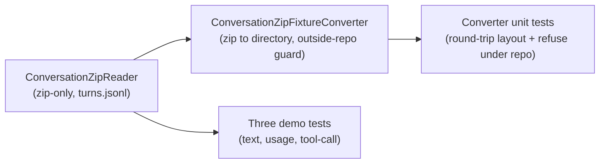

# Plan: #165 phase 5 — Test helper (zip reader + fixture converter)

**Status:** Approved by David (Cursor chat, 2026-10-12 — locked decisions below; instructed to implement the Cursor plan as specified). Implementation may begin; the implementation PR must link this plan.
**Issue:** [#165](https://github.com/davidpizon/TotallyHot-ArcRouter/issues/165). **Parent plan:** [`issue-165-export-import-history.md`](issue-165-export-import-history.md) §3 (Purpose), §5 phase 5, §6 (reader / scrubbed-fixture tests), §7 decision 8.
**Prior phases:** [`issue-165-phase3-export.md`](issue-165-phase3-export.md) (merged), [`issue-165-phase4-import.md`](issue-165-phase4-import.md) (4a on `main`).
**ADR-0008:** no `ManagementFacade` change, no smell work, proxy hot path untouched. Test-project helpers only.

## Context

Phases 1–3 (and 4a's importer engine) give the router a schema-v1 conversation zip: `manifest.json`, `turns.jsonl`, and per-turn body files under `conversations/{archive_session_id}/turns/`. Phase 5 is what makes that zip useful for writing tests: a small offline reader that yields `(metadata, request bytes, response bytes)`, a converter that copies a zip out to a loose fixture directory for human review, and demo tests that prove an existing parser/translator can consume a turn loaded through the reader.

**Exit criteria (parent plan §5):**

- A test helper opens a schema-v1 zip and yields metadata plus request/response bytes.
- A converter emits a fixture directory and refuses to write under the repository root unless the destination is outside the tree.
- At least one scrubbed-fixture-style test exercises an existing parser or translator via the reader (this phase ships three).
- No change to CodeRouterBench sync or the regret harness.

## Decisions made with David (this session)

| # | Decision |
|---|---|
| 1 | **Separate plan doc**, then implement after sign-off of this file (same standing-rule pattern as phases 3/4). |
| 2 | **Demo coverage: all three** when feasible — `ResponseTextExtractor`, `UsageExtractor`, and tool-call translation via a `RecordedModelTranscripts` envelope. Fallback if any path proved infeasible was the tool-call path alone; all three are feasible with a synthetic zip. |
| 3 | **Reader + converter** both in this phase. |
| 4 | **Reader opens a zip only** (not a loose extracted directory). The converter produces the loose directory for offline review; tests that need the reader keep using the zip. |

## Findings from CodeGraph that shape the design

- `ConversationExportWriter` defines schema version `1` and the `turns.jsonl` line shape (`archive_turn_id`, `archive_session_id`, `client_session_id`, `turn_sequence`, `created_at_utc`, nested `metadata`, `bodies.{request|response|provider_request|provider_response}` with `path` / `sha256` / `length` / `missing`). The reader must share that layout, not invent a second schema.
- `ConversationImporter.IsSafeEntryName` already encodes the zip-slip rule (relative, forward slashes, no `..`, no drive/stream markers). The reader reuses that helper via `InternalsVisibleTo` rather than copying the rule.
- `RecordedModelTranscripts` + `ToolCallEmulationReplayTests` already replay a recorded OpenAI-shaped response through `ToolCallNormalizingTranslator.TranslateResponse`. Phase 5's tool-call demo loads that same envelope as the zip's client-response body and runs the same translator path — proving zip → bytes → existing code.
- `ResponseTextExtractor` / `UsageExtractor` take `(provider, isStreaming, ReadOnlyMemory<byte>)`. The synthetic zip's metadata supplies `provider` and a streaming flag; the response entry supplies the bytes.
- Parent plan forbids committing real conversation zips. CI builds a **synthetic** schema-v1 zip in a temp file; the converter's "outside the repo" guard is unit-tested with an injectable repo-root seam.

## Delivery

One implementation PR (draft → local review → ready once). Links this plan and #165.

### What lands

1. **`ConversationZipReader`** — test-project helper under `src/TotallyHotArcRouter.Tests/Sessions/Fixtures/`.
   - Opens a seekable zip path (`ZipArchiveMode.Read`).
   - Rejects unsafe entry names with the same rule as import (`ConversationImporter.IsSafeEntryName`).
   - Requires `manifest.json` with `schema_version == 1` and verifies `turns.jsonl` against the manifest's `turns_jsonl.sha256` / `length` when present.
   - Enumerates `turns.jsonl` line by line; for each turn loads non-missing client request/response (and exposes provider bodies when present) by the relative paths in `bodies`.
   - Yields `ConversationZipTurn` records: identity fields, metadata JSON text (or null), request/response byte arrays (null when missing).
   - Not registered in DI; not a router hot-path type.

2. **`ConversationZipFixtureConverter`** — same folder.
   - Input: zip path. Output: destination directory with the same relative layout (`manifest.json`, `turns.jsonl`, body files).
   - Destination must be absolute and must not already exist as a non-empty conflict that would overwrite (create the directory; refuse if a required entry path already exists as a file).
   - **Repo-root guard:** resolve the destination and a caller-supplied (or detected) repository root; refuse when the destination is at or under that root. Parent plan: the converter refuses to write under the repository root unless the operator passes an explicit fixture path **outside** the tree — so the only allowed destinations are outside the root. Tests inject a fake root.
   - Does not pretty-print bodies (byte-preserving copy).

3. **`SyntheticConversationZip`** — test-only factory that writes a minimal valid schema-v1 zip (one session, one turn, known request/response bytes, matching hashes) into a temp path. No real user content.

4. **Three demo tests** (each &lt; 5 s):
   - Reader → client response → `ResponseTextExtractor.TryExtractText` asserts the expected reply.
   - Reader → client response → `UsageExtractor.TryExtractUsage` asserts token counts.
   - Reader → client response carrying `RecordedModelTranscripts.Qwen25Coder7BInstruct` / scenario `"single"` → `ToolCallNormalizingTranslator.TranslateResponse` asserts the expected tool call name(s), matching the existing replay contract.

### Out of scope

- Production GUI, CLI flags, gRPC, or host one-shots for the reader/converter.
- Changes to `ConversationExportWriter` / `ConversationImporter` behavior (sharing `IsSafeEntryName` only).
- CodeRouterBench sync, regret harness, `ManagementFacade`, smell refactors.
- Checking real conversation zips into the repository.
- Reader support for a loose extracted directory (decision 4).

## Test strategy

- **Reader:** synthetic zip round-trips metadata and body bytes; missing response yields null response bytes; bad `schema_version` fails with a message naming the version; bad `turns.jsonl` hash fails; zip-slip entry name fails; a body marked `missing` does not require a zip entry.
- **Converter:** zip → temp directory outside a fake repo root preserves every entry's bytes; destination under the fake repo root is refused before any write; CI never downloads a zip.
- **Demos:** the three tests above; each builds its zip via `SyntheticConversationZip` and does not share mutable state across tests.

## Gates

- Zero warnings/errors (`TreatWarningsAsErrors` on production projects; test project analyzers clean).
- Accurate XML docs on new types/members that the test project exposes publicly (or clear `///` summaries on internal helpers matching repo style).
- Unit tests pass, each under 5 s.
- Mermaid for any new doc diagram in this plan only; no README change required (no new host flag).

## Verification

1. `dotnet build` the test project (and router dependency) with no warnings.
2. Run the new tests via the Microsoft.Testing.Platform host binary under `src/TotallyHotArcRouter.Tests/bin/.../TotallyHotArcRouter.Tests`.
3. Confirm no production `src/TotallyHotArcRouter` surface grows a new public API unless a tiny shared constant extraction is required to avoid schema drift (prefer reusing `ConversationExportWriter.SchemaVersion` and `ConversationImporter.IsSafeEntryName`).
