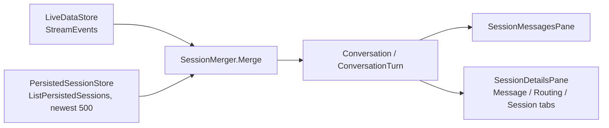

# Plan: Sessions tab Phase 2 — persisted turn details (#176)

**Issue:** [#176](https://github.com/davidpizon/TotallyHot-ArcRouter/issues/176)
**Status:** Approved by David Pizon on 2026-10-13 (in chat). ADR-0025 and its Amendment 1 are accepted. Implementation may start.
**Date:** 2026-10-13
**Parent plan:** [`issue-176-sessions-three-pane.md`](issue-176-sessions-three-pane.md) (approved 2026-10-12). This file **supersedes its §5.2–§5.6 and the Phase 2 bullets of §11 and §12**, and keeps the rest (§4, §6, §7, §8, §9). Every deviation is listed in §2.
**ADR first:** [ADR-0025](../adr/0025-serve-persisted-turn-details-and-a-session-aggregate-on-a-metadata-only-rpc.md) (**accepted** by David on 2026-10-13). Proto, router, and GUI work still wait on this plan's own sign-off (§8).
**Research:** CodeGraph (`TelemetryGrpcService`, `ITranscriptStore`, `SqliteTranscriptStore`, `PersistedSessionsClient`, `SessionMerger`, `LiveDataStore`, the details tabs) and Serena (project activated; symbol overviews) against `main` at `1ece469a`.

## 1. Goal and scope

Phase 1 renders the three panes from live telemetry plus the newest 500 persisted rows. Phase 2 fills the gaps Phase 1 shows as "—":

- **Message tab:** persisted classification, score, scorer version, exploration, text lengths.
- **Routing tab:** the Baseline comparison section (baseline model, costs, estimated savings and regret, tokenizer ratio, frozen cost ingredients).
- **Session tab:** retained-history aggregate — turns, cost, tokens, models, "used for training", Est. savings and Est. ROI with "n of m turns compared".
- **History beyond the newest 500 rows:** keyset paging per session, plus a refresh button.

- **Tool-call replies (added 2026-10-13):** a new nullable `has_tool_calls` column on `request_transcripts`, written at capture, so a reply with no text is labeled "tool call" instead of "—" (§4.4). This is the one **capture-path** change in Phase 2; see §7.

**Out of scope (decided 2026-10-13):** any change to text. `GetTurnTexts` stays as is (passkey-gated, 2,000-character previews, ADR-0023); Show more behaves as in Phase 1. A larger on-demand text cap would need its own ADR and plan.

## 2. Deviations from the approved plan

| Approved plan | This plan | Why (evidence in the code) |
|---|---|---|
| §5.2 `GetTurnTexts` extended to 262,144 chars, `omitted`, response budget | **Unchanged.** No `TurnText` field added | Text moved to encrypted session files (ADR-0019) behind the passkey grant (ADR-0020); `TelemetryGrpcService.GetTurnTexts` already exists with a 50-id limit and 2,000-char previews |
| §5.3 `ListTurnTextsAsync` with `substr(prompt_text, …)` | **Dropped** | `TranscriptDatabase` migration NULLs `prompt_text`/`response_text`; `SqliteTranscriptStore.LoadTurnTextsAsync` reads session-file extracts |
| §5.3 "metadata page carries no lengths; `length()` reads bodies" | **Lengths included** from the stored `prompt_text_length` / `response_text_length` columns | The columns exist now (`TranscriptDatabase` lines 47–48); no body is read |
| §5.6 Phase 2 "2,000 of 18,432 characters" only after a text call | Shown from the metadata page | Same reason |
| Exit criterion "`GetTurnTexts` response stays under 4 MB" | Removed | `GetTurnTexts` is untouched |
| §10 `ITranscriptStore.ListTurnTextsAsync` | Removed | See above |
| (not in the approved plan) | **Adds** a `has_tool_calls` column, written at capture | David chose option C on 2026-10-13: a stored length of `0` cannot tell an unreadable row from a tool-call-only reply, and nothing on the row flags tool calls |

## 3. Current state (verified)



- `ConversationTurn` already carries `TranscriptId`, `PromptTokens`, `Provider`, `RouterTokens`, … but has **no** classification, score, comparison, or training-flag-per-turn fields.
- `PersistedSessionsClient` has `ListAsync` and `GetTurnTextsAsync`; `IPersistedSessionsClient` uses default interface members so fakes keep compiling.
- `ITranscriptStore` already uses default members (`ListSessionsAsync`, `LoadTurnTextsAsync`) for new capabilities — the pattern to follow.
- `ITaxonomyComparisonStore` has `LoadSinceAsync(since, sessionId?, …)`; the new per-page overload is additive.
- Retention deletes `request_transcripts` rows only; `taxonomy_comparisons` has no FK, so orphans accumulate (the aggregate must join on `transcript_id`).

## 4. Design

### 4.1 Contract (additive, `src/Protos/telemetry.proto`)

One new RPC beside `ListPersistedSessions`, behind the same `TelemetryAuthInterceptor` and gRPC-Web mapping. It carries **no conversation text**, so it needs no content grant.

```proto
rpc GetSessionTurnDetails (GetSessionTurnDetailsRequest) returns (GetSessionTurnDetailsResponse);
```

Messages (field lists as in the parent plan §5.2, with these changes):

- `GetSessionTurnDetailsRequest`: `session_id`, `limit` (0 → 500, clamped [1, 2000]), `optional before_transcript_id`, `live_floor_turn_number` (first page only).
- `GetSessionTurnDetailsResponse`: `transcript_capture_enabled`, `repeated SessionTurnDetail turns` (newest first), `optional next_before_transcript_id`, `optional SessionAggregate aggregate` (first page only).
- `SessionTurnDetail`: all parent-plan fields **plus** `optional int32 prompt_text_length`, `optional int32 response_text_length`, `transcript_id`, and `optional bool has_tool_calls` (absent = unknown: rows captured before this change, and imported turns).
- `BaselineComparison`, `SessionAggregate`, `SessionModelUsage`: unchanged from parent §5.2 (decimals as strings; `persisted_turn_numbers_from_floor`, `models` capped at 20 with `other_models` / `other_model_turns`).
- Free-form strings capped at 1,024 characters inside SQL (`substr(col, 1, 1025)` plus "…"); a page stops adding rows at 2 MiB serialized and returns the cursor; the first row always goes in.

### 4.2 Router

| File | Change |
|---|---|
| `src/TotallyHotArcRouter/Transcripts/ITranscriptStore.cs` | Default members `ListSessionTurnMetadataAsync(sessionId, limit, beforeTranscriptId, ct)` and `GetSessionAggregateAsync(sessionId, liveFloorTurnNumber, ct)` returning `[]` / `null`; new records `SessionTurnMetadata`, `SessionAggregate` next to `SessionTranscript` |
| `…/Transcripts/SqliteTranscriptStore.cs` | Real implementations. Own projection that never names the text columns; paging `WHERE session_id=$s AND ($b IS NULL OR id<$b) ORDER BY id DESC LIMIT $n+1` on `ix_request_transcripts_session_id`; the aggregate in **one read transaction** (WAL snapshot), joining `taxonomy_comparisons` on `transcript_id`; gated on `TranscriptOptions.Enabled`, `EnsureSchema()` first |
| `…/Transcripts/ITaxonomyComparisonStore.cs`, `SqliteTaxonomyComparisonStore.cs` | Overload `LoadForSessionAsync(sessionId, minTranscriptId, maxTranscriptId, ct)` using `ix_taxonomy_comparisons_session`; own column list (omits `session_id`, `routed_model`, `is_exploratory`) |
| `…/Telemetry/TelemetryGrpcService.cs` | `GetSessionTurnDetails`: empty `session_id` → `InvalidArgument`; limit clamp; capture off → `transcript_capture_enabled=false` without querying; aggregate only when `before_transcript_id` absent; new optional ctor param `ITaxonomyComparisonStore? comparisonStore = null` |
| `…/Proxy/ProxyServer.cs` (near line 375, where `ManagementReportingService` takes `managementApi.TaxonomyComparisonStore`) | Register the comparison store as a singleton when non-null so the web host can inject it |
| `…/Transcripts/TranscriptDatabase.cs` | Add `has_tool_calls INTEGER NULL` with `AddColumnIfMissing` (the existing migration pattern); no backfill, so old rows stay NULL |
| `…/Transcripts/TranscriptRecord.cs` | Add a **trailing optional** `bool? HasToolCalls = null`. `TranscriptRecord` is a positional record built in ~25 places (mostly tests); a defaulted trailing parameter leaves them all compiling |
| `…/Transcripts/SqliteTranscriptStore.cs` (`InsertAsync`, `ReadTranscriptRecord`) | Write and read the column |
| `…/Proxy/RequestTelemetryPublisher.cs` (`PersistTranscriptAsync`) | Pass the flag into the record. **Detection source is a spike in step 2:** the existing response parsers (`OpenAiResponseTextParser`, `AnthropicResponseTextParser`, dispatched by `ResponseTextExtractor` on `ProviderRegistration.UsageParserShape`) already read the buffered response, so the likely design is to have them report "a tool call block was seen" next to the text. **This covers every provider the router translates with two parsers, not one per provider:** `UsageParserShape.OpenAiCompatible` holds `openai`, `ollama`, `gemini`, `bedrock-titan`, `bedrock-llama` and the third Bedrock provider, because each translator converts the upstream response to the OpenAI shape before bytes are captured; `UsageParserShape.Native` holds native `anthropic`. A provider with no registration (for example `alibaba`, `zhipu`, `moonshot`, `minimax`) or an unreadable body stays NULL, never `false`. The Bedrock path (`BedrockInvocationHandler`) must be checked in the spike, since it submits the finished turn separately from `ProxyMiddleware` |
| `…/Sessions/Import/TranscriptImportSink.cs` | No change: imported turns leave `HasToolCalls` NULL |

### 4.3 GUI

| File | Change |
|---|---|
| `Gui.Telemetry/PersistedSessionsClient.cs` | `IPersistedSessionsClient.GetSessionTurnDetailsAsync(sessionId, limit, beforeTranscriptId, liveFloorTurnNumber, ct)` as a default member; implementation through `Wrap` |
| `Gui.Telemetry/SessionTurnDetailDto.cs` (new) | `SessionTurnDetailsResult`, `SessionTurnDetailDto`, `BaselineComparisonDto`, `SessionAggregateDto` |
| `Gui.Components/Services/SessionDetailsStore.cs` (new) | `AdminStoreBase<IPersistedSessionsClient>` singleton registered in `Gui.Web/Program.cs`; per-session snapshots, `LoadEarlierAsync`, memory budgets (16 MiB / 16 sessions), head-refresh gap repair, state `Loading/Loaded/CaptureOff/Unreachable/Failed`; refresh when a snapshot is missing or >30 s old, 2 s after the last live turn (debounced from `LiveDataStore.Changed`), and on the refresh button; cancels the previous session's load |
| `Gui.Components/Models/DashboardData.cs` | `ConversationTurn` gains optional details (classification, score, comparison, lengths); join by `(SessionId, TurnNumber)`, not by id |
| `Gui.Components/Services/SessionMerger.cs` | Fold store details into turns; session aggregate replaces loaded-only figures, labeled "retained" |
| `MessageDetailsTab.razor`, `RoutingDetailsTab.razor` (Baseline comparison), `SessionOverviewTab.razor` (Est. savings, Est. ROI, "n of m compared"), `SessionDetailsPane.razor` (refresh button, `refresh` icon) | Render the new data; §6.6 states for capture off / unreachable / no row |
| `docs/router/telemetry.md`, `docs/gui/dashboard.md`, `docs/router/backlog.md` | Document the RPC, the capture gate, size caps, the retained-history labels |

### 4.4 Length and tool-call labels

| `response_text_length` | `has_tool_calls` | Label |
|---|---|---|
| > 0 | any | "N characters" (with "2,000 of N" when the preview is cut) |
| 0 or absent | true | "Tool call (no text)" |
| 0 or absent | false | "No text" |
| 0 or absent | unknown | "—" (unreadable, older row, or imported turn) |

`prompt_text_length = 0` always shows "—": it means the prompt could not be read, and a tool-call flag says nothing about requests.

### 4.5 ROI rules (unchanged from parent §5.5)

Per turn: `estimated_net_savings_usd / baseline_estimated_cost_usd × 100`, only when both are present and the baseline is above 0. Per session: `Σ savings / Σ baseline cost × 100` over compared turns, same guard. "Used for training" shows "Yes" or "Not in the retained history" — never "No".

## 5. Delivery order (each step a draft PR)

1. **ADR-0025** accepted (2026-10-13). **Amendment 1 to ADR-0025** records the `has_tool_calls` column and capture-path change (a schema and contract change); David accepts it, then plan sign-off (§8), before code.
2. **One implementation PR** (David, 2026-10-13), built in this commit order so each commit compiles and passes:
   1. `has_tool_calls`: migration, `TranscriptRecord`, store read/write, publisher detection, tests, golden-path smoke.
   2. Contract and router: proto, store members, gRPC method, `ProxyServer` registration, router tests.
   3. GUI client, DTOs, `SessionDetailsStore`, merger and tab rendering, docs.

## 6. Test strategy (all under 5 s)

- **Router:** paging walks a 2,500-turn session with no gap or duplicate; a worst-case metadata row (1 MiB free-form strings) keeps a page ≤ 2 MiB (asserted via `CalculateSize()`); `correlation_id` suffix that is not a number → turn 1; capture off returns the flag without a query; aggregate counts agree with page contents (`compared_turns ≤ persisted_turns`, orphan comparisons ignored); `persisted_turn_numbers_complete=false` past 2,000; empty `session_id` → `InvalidArgument`; no query names `prompt_text`/`response_text`.
- **Capture (`has_tool_calls`):** OpenAI-style and Anthropic-style responses, streaming and non-streaming, each with and without a tool call, give `true` / `false`; an unparseable or errored response gives NULL; the migration is idempotent on an existing database; a pre-existing row reads back NULL; `RequestTelemetryPublisherTests` assert the persisted record carries the flag.
- **Client:** field mapping incl. decimals via `InvariantCulture`; `RpcException` wrapped.
- **Store (`SessionDetailsStore`):** snapshot state machine, eviction budgets, head-refresh gap repair (`1000..501` + `500..1` → `1010..511` repairs `501..510`), debounce, cancellation on session switch.
- **bUnit:** each tab with and without details; refresh button; Est. savings / ROI guards (`baseline = 0`); "retained" labels; §6.6 states.
- **Exit criteria:** a live session shows classification, score, and comparison once persisted without a reload; capture off / unreachable / no-row render their states; paging has no gaps; coverage stays ≥ 80%; build warning-free.

## 7. Risks

| Risk | Mitigation |
|---|---|
| `prompt_text_length = 0` marks an unreadable row (`ITranscriptStore` doc: zeroed to take it out of the backfill), so a "0 characters" label could mislead | Label table in §4.4: a zero prompt length shows "—"; a zero response length is explained by `has_tool_calls` |
| `has_tool_calls` is written on the request hot path (`RequestTelemetryPublisher`, fed by `ProxyMiddleware`) | AGENTS.md safety rule: re-run CodeGraph on `ProxyMiddleware` callers before editing, keep Serilog templates static, run the golden-path smoke from `docs/router/code-smell-refactoring-plan.md`'s validation gate. Detection reuses parsers that already read the response, so no new read of the body |
| Old rows and imports have no flag | NULL = unknown, labeled "—"; no backfill (the response body is not in SQLite, and re-reading encrypted session files for every row is out of scope) |
| Detection format coverage | Every translated provider is covered through the two captured shapes (§4.2). Unregistered providers record NULL, not `false`. Tests cover each registered provider key, streaming and non-streaming, including the Bedrock path |
| Aggregate join cost on very large sessions | Indexed lookups only; measured in a router test with a 2,500-turn fixture |
| `ITranscriptStore` has 40+ callers and ~8 fakes | Default interface members only; no existing signature changes |
| Refactor-plan rules | `ProxyMiddleware`, `RequestInterceptor`, `ManagementFacade` bodies are not changed; only the publisher's persist call gains a field (ADR-0008 Amendment 1: a feature, not a smell refactor) |

## 8. Decisions and open questions

Decided by David on 2026-10-13:

1. The metadata RPC needs **no content grant**.
2. Zero-length responses: add a **`has_tool_calls`** column (option C), labels in §4.4.
3. **One** implementation PR.

Still open:

4. ~~Model list cap~~ Decided: keep 20 (David, 2026-10-13).

Also decided on 2026-10-13: detection covers **every provider format the router translates** (§4.2), and **Amendment 1 to ADR-0025** is drafted in the ADR for the column and capture change. It needs David's acceptance before code.
