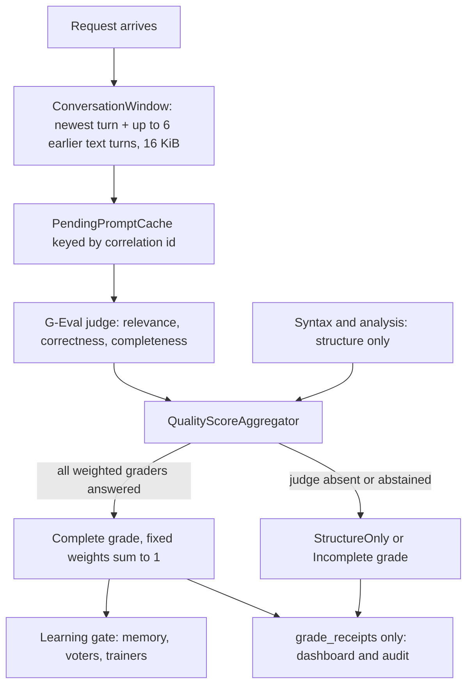

# Plan: Grades that judge each response against the original question (#293)

**Status:** Signed off by David on 2026-10-14 (chat). Implementation in progress.
**Issue:** [#293](https://github.com/davidpizon/TotallyHot-ArcRouter/issues/293) — "Graders must judge each response against the original question".
**Parent plan:** [router-evaluator-and-live-pricing.md](router-evaluator-and-live-pricing.md) §14 and §15 phase 4. This plan owns phase 4. The parent plan says live grades may not train the quality head or move voter weights until grades are computed with the question and stored linked to it. That is this work.
**ADR first:** [ADR-0026](../adr/0026-grade-a-response-only-against-its-question-and-learn-only-from-complete-grades.md) (proposed). This changes what the router learns from, so AGENTS.md wants the ADR before code.
**Related:** [#288](https://github.com/davidpizon/TotallyHot-ArcRouter/issues/288) (prompt-test extractor and self-consistency need the same prompt), [#294](https://github.com/davidpizon/TotallyHot-ArcRouter/issues/294) (fingerprint and buckets), [#291](https://github.com/davidpizon/TotallyHot-ArcRouter/issues/291) and [#292](https://github.com/davidpizon/TotallyHot-ArcRouter/issues/292) (consume these grades), [ADR-0019](../adr/0019-store-conversation-text-in-encrypted-per-session-files.md) (SQLite is a text-free index).
**ADR-0008:** This is a correctness fix to what the router learns, not a smell refactor. It does not change `ManagementFacade`'s public method set.

## Summary

- **The issue's premise is partly out of date.** The LLM judge has read the question since PR #117 (merged 2026-09-20). `GEvalJudgeClient.BuildPrompt` weaves in the task and tells the judge that a complete answer to a different question must score low. `GraderQuestionText.Require` makes every LLM grader fail closed without it. `docs/how-it-learns.md:429-433` still says the judge is "handed the answer alone". That text is wrong and this plan corrects it.
- **What is still broken (verified in code, 2026-10-14):**
  1. The judge rubric is mostly not applied. `DimensionCriteria` is keyed `algorithm`, `bug_fixing`, `test_generation`, `code_review`, `design`, `explanation`, but the router's dimensions are `RouterDimension.AllDimensions` (`code_generation`, `algorithm_design`, `bug_fixing`, and so on). Only two of nine match. The rest fall to a generic "overall quality" line. Nothing asks for relevance, correctness and completeness against the question.
  2. A grade with no judge still trains the router. `RouterMemoryScoreObserver` and `EmbeddingMemoryScoreObserver` write `UnifiedScore` whether or not the judge answered. Syntax and static analysis never see the question, so that score says "tidy", not "answered".
  3. The existing `JudgeRowPolicy` points the wrong way. Its default is `DownWeight` at 0.5, so a judge-scored row counts for half and a structure-only row counts in full.
  4. Weights are not fixed. `QualityScorer` divides by whatever weights remain after dropping absent axes, and halves the syntax weight for a heuristic verdict, so the effective weights move per request. Paper Eq. 8 (Zhou et al., arXiv:2606.22902, §3.3) fixes them per task type and requires they sum to 1.
  5. A grade is not linked to its question. `grader_scores` holds only `correlation_id`. The question text is held in memory by `PendingPromptCache` and dropped. There is nothing to trace a grade back to a question, or to compare similar questions.
  6. Conversation context is only the newest user message (`RequestTextExtractor.ExtractNewestUserMessage`), so a follow-up such as "no, the other one" cannot be graded.
- **What this plan builds:** an explicit grade status (`Complete`, `StructureOnly`, `Incomplete`), fixed weights per dimension that sum to 1, a three-criterion judge rubric (relevance, correctness, completeness), a bounded conversation window for graders, a `grade_receipts` table that links each grade to a keyed hash of its question (and, when #294 lands, its fingerprint), a learning gate that admits only `Complete` grades, and the doc and ADR updates.

## 1. Decisions

**Settled by David on 2026-10-14** (this conversation):

| # | Decision |
|---|---|
| 1 | Scope is the leftover pieces above. The static checkers do **not** get a question-similarity check in this issue. |
| 2 | Graders read the newest user message plus a few earlier turns, under a size limit. File contents and tool output stay out. |
| 3 | A grade where any weighted grader abstained is stored as incomplete and excluded from learning. |
| 4 | Grade rows store a question hash and a fingerprint reference, never question text. |
| 5 | When no judge exists, the structure-only grade is kept and labeled, and never trains the router. Learning pauses until a judge is available, and the dashboard says so. |
| 6 | Starting weights are judge-heavy: judge 0.60, syntax 0.25, analysis 0.15 for code tasks. |

**Defaults chosen in this plan. Veto any of them in the sign-off:**

| # | Default | Why |
|---|---|---|
| D1 | "Last few turns" is the newest user message plus up to **6 earlier text messages** (3 exchanges), with an earlier assistant message cut to its first 500 characters. | Enough to resolve "the other one"; bounded so the judge call stays short. |
| D2 | Grading-input budget is **16,384 characters** for question plus context. The newest user message keeps up to 12,288 of them, cut head-and-tail with a visible marker. | The instruction is often at the end of a long paste, so cutting only the tail would lose it. All three are `JudgeOptions` settings. |
| D3 | A heuristic syntax verdict keeps its **fixed weight**. It also carries a `SyntaxConfidence` in `[0,1]` (authoritative = 1.0; language-aware Python/shell heuristic = 0.75; generic delimiter heuristic = 0.55). If confidence is **below 0.70**, the grade is `Incomplete` and does not train — weights stay fixed (no renormalization). Today's weight-halving goes away. | David chose a confidence number over a boolean flag (2026-10-14). Counting a shaky guess less by shrinking its weight would vary Eq. 8's fixed weights; marking the grade incomplete instead leaves the pie alone. |
| D4 | The question hash is an **HMAC-SHA-256** keyed with an install-local key from the secret store, over the whitespace-normalized newest user message. | A plain hash of a short prompt can be guessed by dictionary, which leaks text from a table ADR-0019 wants text-free. |
| D5 | **Settled by David on 2026-10-14: start fresh.** Existing live learning is deleted on upgrade, not quarantined (§6). | The old rows and tallies mix grades that never saw the question, and the running tallies cannot be split. A clean start is simpler than a permanent `legacy` state. |
| D6 | `ScorerVersion` goes from `2.0` to `3.0`, so the rescan re-grades history with the question. | The score for the same response changes, which is exactly what that field is for. |

## 2. Design

### 2.1 Grade status

`QualityResult` gains `GradeStatus`:

| Status | Meaning | Learns? |
|---|---|---|
| `Complete` | Every grader with a nonzero weight for this dimension produced a score, and the question was present. | Yes |
| `StructureOnly` | The judge is not available (no eligible free provider, or switched off). Syntax and analysis scored. | No |
| `Incomplete` | The judge was available but did not produce a score (timeout, abstain, evicted, question missing, call failed). `GraderDegradedReasons` already names which. | No |

The score is still computed and stored for `StructureOnly` and `Incomplete`, so the dashboard and audits keep their structural signal. The gate (§2.5) is what keeps them out of learning. Nothing is renormalized silently: an abstention changes the **status**, not the weights.

### 2.2 Fixed weights per dimension

`QualityOptions.DimensionWeights` stays the configuration point, but `DimensionWeightOptions` is validated at startup: each dimension's `Syntax + Analysis + Judge + ΣExtraWeights` must equal 1.0 (tolerance 1e-9), or the host refuses to start. The `QualityScorer` renormalization (`weightedSum / totalWeight`) and the syntax weight halving are removed; the score is `Σ wᵢ·sᵢ` over fixed weights. For a `Complete` grade every axis is present, so the sum is already in [0,1].

Starting weights (David's judge-heavy split applies to the code dimensions; all nine router dimensions are code tasks today):

| Dimension | Syntax | Analysis | Judge |
|---|---|---|---|
| all nine `RouterDimension` values | 0.25 | 0.15 | 0.60 |

The table is one row because the current dimension set is uniform. It stays keyed per dimension so a later, evidence-driven split (for example `code_understanding` giving syntax less weight) is a configuration change. The numbers are starting values, not measured ones. The existing `judge_shadow_scores` calibration report is the tool for tuning them (see §8, item 3).

`StructureOnly` and `Incomplete` grades still get a number for the dashboard, computed over the axes that exist and labeled with their status. That number is display-only and the gate never reads it.

### 2.3 The judge rubric

`GEvalJudgeClient.DimensionCriteria` is replaced. The judge scores one 1–5 grade (the existing logprob-weighted path and the fallback are unchanged) against three named criteria in a fixed order, so the grade is anchored to the question and not to prose quality:

1. **Relevance.** Does the response address what was asked, rather than a different question?
2. **Correctness.** Is what it says or writes right for what was asked?
3. **Completeness.** Does it cover the whole request, without stubs, cut-off output, or skipped parts?

A per-dimension hint, keyed on `RouterDimension` constants (fixing the two-of-nine mismatch), adds one sentence of dimension-specific emphasis. A response that fails Relevance scores 1 or 2 regardless of the others. This is a prompt change, so `JudgeOptions.PromptVersion` bumps and `GraderScoreRecord` rows carry it (a nullable `prompt_version` column, §2.4).

The three criteria feed **one** judge call and one score. Splitting them into three calls would triple the free-quota use for no routing benefit, because the router learns one number. Whether per-criterion scores are worth recording is an open question (§8, item 2).

### 2.4 Conversation window and storage

**Window.** A new `ConversationWindow.Extract(JsonObject requestBody, ConversationWindowOptions)` in `Telemetry` (beside `RequestTextExtractor`) returns the newest user message plus up to six earlier **text** messages in order, applying D1 and D2. It reads text only through `MessageContentTextExtractor`, so both OpenAI and Anthropic shapes work. It drops: the system prompt, `tool` role messages, `tool_result` and `tool_use` blocks, image parts, and any fenced code block longer than 2,000 characters in an *earlier* turn (replaced by `[code block omitted]`). The newest user message is never dropped. Output carries `QuestionChars`, `ContextMessages`, `Truncated`, and the formatted text. `GraderQuestionText` formats it into the existing "Task the response was written for" section; the missing-question fail-closed behavior is unchanged and keys on the newest user message.

**What is sent to the judge.** The same free provider the judge already calls (`JudgeModelSelector`). No new destination is added. Secrets in the window pass through `SecretObscurer` before they leave, the same obscuring the transcript scrub uses. The window exists in memory only, in `PendingPromptCache`, with its existing TTL and capacity bounds, and only while an LLM grader is enabled (the existing `AnyLlmGraderEnabled()` gate). `JudgeOptions.MaxCachedTextChars` (65,536) stays the hard ceiling for the cache entry.

**Storage.** SQLite holds no question text:

- **`grade_receipts`** (new, in `RouterMemoryDatabase`, `CREATE TABLE IF NOT EXISTS`):

  | Column | Meaning |
  |---|---|
  | `correlation_id` (PK) | Joins to `grader_scores` and the transcript row. |
  | `created_at_utc`, `dimension`, `model` | As on `grader_scores`. |
  | `grade_status` | `Complete`, `StructureOnly`, `Incomplete`. |
  | `unified_score` | The fixed-weight score (display-only unless `Complete`). |
  | `question_hmac` | D4. NULL if the question was missing. |
  | `question_chars`, `context_messages`, `question_truncated` | Size facts for audit; no content. |
  | `fingerprint_ref` | NULL until #294 lands; then the fingerprint or embedding id, so similar questions can be compared. |
  | `scorer_version`, `prompt_version`, `weights_version` | Reproduce which rules produced the grade. |
  | `abstained_graders` | Comma-separated grader keys and reasons, empty on `Complete`. |

- **`grader_scores`** gains nullable `question_hmac` and `prompt_version` via `ALTER TABLE ... ADD COLUMN` guarded by `PRAGMA table_info`, matching the existing migrations in `RouterMemoryDatabase`. Duplicating `question_hmac` here follows the `response_length_chars` precedent so a per-grader query needs no join.
- **Text** stays where ADR-0019 puts it: the encrypted per-session file. An audit goes receipt → `correlation_id` → session file, which sits behind the ADR-0020 passkey gate. A grade cannot be used to read a question without passing that gate.
- **Retention.** `ScoreTableRetentionService` already purges `grader_scores` by age and count; it is extended to `grade_receipts` with the same `JudgeOptions.RetentionDays` and row cap.

### 2.5 The learning gate

Learning consumers accept a live grade only when `GradeStatus == Complete`:

- `RouterMemoryScoreObserver` and `EmbeddingMemoryScoreObserver` skip `AddScoreAsync` / the embedding insert for any other status. They still publish the `QualitySignalEvent`, now with `GradeStatus` added so the dashboard can label "structure only".
- `MemoryEntry.IsJudgeScored` is true for every new live row. `JudgeRowPolicy` default moves from `DownWeight` (0.5) to `Include`. The enum and `JudgeScoredRowWeight` stay, because they remain a valid knob, but the default no longer penalizes the only rows that carry question-aware evidence. This reverses the G3 rationale in `JudgeRowPolicy`'s docs, so those docs are rewritten.
- Benchmark rows (CodeRouterBench, RouterBench) are labels attached to a task, are not live grades, and are unaffected ([parent plan](router-evaluator-and-live-pricing.md) §14).

### 2.6 Interaction with the other issues

- **#288** needs the same window. `ConversationWindow` is its input too; this plan defines the contract and does not build the extractor.
- **#294** supplies `fingerprint_ref`. Until it lands the column stays NULL and similar-question comparison is exact-match only, via `question_hmac`. This plan does not wait for #294.
- **#291 / #292** read `Complete` grades only. They need no change beyond using the gate.

## 3. Phases

Each phase leaves the build warning-free, all tests green, and coverage at or above 80%. Heavy tests stay under 5 seconds. Every new type and member gets accurate XML docs (`CS1591` is an error).

| Phase | Work | Done when |
|---|---|---|
| 0 | ADR-0026 accepted and this plan signed off. | Done: David signed off in chat on 2026-10-14 (GitHub comment blocked by token scope). |
| 1 | `ConversationWindow`, `ConversationWindowOptions`, `JudgeOptions` budget settings, `SecretObscurer` pass on the way to the judge. Tests: both API shapes, tool results dropped, long code elided, head-and-tail cut keeps the final instruction, newest message never dropped, budget respected, secret obscured. | Window unit tests pass; `PendingPromptCache` stores the window. |
| 2 | Judge rubric and dimension hints keyed on `RouterDimension`; `PromptVersion` bump. Tests: prompt contains all three criteria, every one of the nine dimensions resolves a hint, a different-question fixture scores low against a recorded judge double. | Prompt tests pass; no dimension falls to the default silently. |
| 3 | `GradeStatus`, fixed-weight `QualityScorer`, startup weight validation, removal of renormalization and syntax halving, `weights_version`. Tests: weights that do not sum to 1 fail startup; each abstention maps to the right status; a `Complete` score equals the plain weighted sum; no code path divides by remaining weight. | Scorer and aggregator tests pass. |
| 4 | `grade_receipts`, `grader_scores` columns, HMAC key in the secret store, retention. Tests: migration on an old database, round-trip, no question text in any column (assert by scanning the row), retention purge. | Migration test passes on a database created by the current schema. **Implemented 2026-10-14.** |
| 5 | Learning gate in both observers, `JudgeRowPolicy` default change, one-time purge of pre-change live learning (§6). Tests: `StructureOnly` and `Incomplete` never reach memory; `Complete` does; the purge removes live rows and tallies and leaves benchmark rows untouched, and runs once. | Gate tests pass; golden-path smoke (ADR-0008 §5) passes since the hot path is touched. **Implemented 2026-10-14.** |
| 6 | `ScorerVersion` 3.0 and rescan with window from the session file, `QualitySignalEvent.GradeStatus`, dashboard "structure only / learning paused" label, `docs/how-it-learns.md` correction, `docs/router/geval-shadow-scoring-plan.md` and `src/PLAN.md` updates, parent plan §14 and §15 marked done. | Docs match code; the rescan re-grades a fixture corpus. **Implemented 2026-10-14** except session-backed rescan window (deferred; rescan still uses transcript prompt text). |

## 4. Privacy and size limits (the definitions the issue asks for)

- **What may reach a grader:** the newest user message and up to six earlier text messages, within 16,384 characters, after secret obscuring. Nothing else from the request: no system prompt, tool output, file contents, or images.
- **Where it may go:** only the free provider the judge already uses. No new destination.
- **How long it lives:** in memory only, for the existing cache TTL, and only while an LLM grader is enabled. Not written to any SQLite column.
- **What the grade table keeps:** an HMAC, character counts, and flags. Not text.
- **Opt-out:** switching every LLM grader off stops retention immediately (existing live read of the options monitors) and puts all grades into `StructureOnly`.

## 5. Failure modes this plan guards against

- **A silent weight shift.** Renormalizing hides which axes were missing. Removed; status is explicit.
- **A learning blackout.** With no judge, nothing learns. This is accepted by David (decision 5), so the dashboard must say so rather than look healthy.
- **A prompt that grows without bound.** Long chats and pasted logs. The budget in D2 is enforced before the cache, and tested.
- **A question lost to truncation.** Head-and-tail cut with a marker, and the newest message is never dropped.
- **Hash as a leak.** A plain hash of "fix the bug" is guessable. D4 uses a keyed hash.
- **A reversed default left behind.** `JudgeRowPolicy.DownWeight` would half-weight the only good rows. Phase 5 changes it, and its XML docs, together.

## 6. Starting fresh (David, 2026-10-14)

Live learning written before this change is deleted, not stamped. It was graded under the old rule, and the per-dimension `live:` tallies mix old and new grades with no way to separate them, so a clean start is the only state that is fully trustworthy.

- **What is deleted:** every live-traffic learning row in `memory_entries` (including judge-scored ones, so the router starts from one consistent rule), the persisted `live:` per-dimension tallies behind `RouterMemory.AddScoreAsync`, and the matching pre-change rows in `grader_scores` and `judge_shadow_scores`.
- **What is kept:** benchmark data (CodeRouterBench, RouterBench priors, `dim_best`), transcripts and sessions, and the new `grade_receipts`. Phase 5 identifies live rows by how they are written today (the `live:` namespace and rows created from live requests) and the test asserts benchmark rows survive.
- **How:** a one-time migration that runs on the first start of the new version, guarded by a `schema_meta` marker so it never runs twice. The router writes a log line with row counts per table, and the migration is its own commit so it can be reviewed apart from the schema change.
- **Final, not soft:** deletion follows [ADR-0024](../adr/0024-protect-the-machine-shared-data-directory-and-make-deletion-final.md): `secure_delete` on, then the WAL truncated and a `VACUUM`, so deleted rows are not left readable in free pages.
- **Consequence:** the router loses what it learned from live traffic and falls back to its benchmark priors until new `Complete` grades arrive. With no judge available that is indefinitely (decision 5). The `grade_status` column is not added to `memory_entries`, because every surviving live row is `Complete` by construction.
- **Before the purge:** the migration is not reversible. Take a copy of `router_embedding_memory.db` first if you want one; the upgrade notes will say so.

## 7. Test and validation plan

- Unit tests per phase as listed. Judge calls use a recorded test double; no live provider in CI.
- A fixture of 12 prompt/response pairs: 6 correct answers and 6 tidy-but-wrong answers (a well-formed snippet for a different request), with the recorded judge double returning grades. The `Complete` unified score must rank every correct answer above its tidy-but-wrong pair. This is the acceptance test for the issue's stated failure ("the router can learn to favour tidy but wrong answers").
- Migration test starts from a database created by the schema at `main` and upgrades it.
- Golden-path smoke (existing plan validation gate) after phase 5, with Serilog templates kept static.
- Isolated smoke per `reference_router_isolated_smoke`: a branch build against a scratch data directory, judge enabled and disabled, confirming `Complete` rows learn and `StructureOnly` rows do not.

## 8. Open questions

1. **Resolved: start fresh.** Old live rows and `live:` tallies are deleted on upgrade (§6). Remaining question: does "live" include the judge-scored rows too? The plan says yes, so the router starts from one rule; say if you want to keep them.
2. **Per-criterion scores.** One call returns one number. Recording relevance, correctness and completeness separately would cost three calls or a structured reply, and would make an audit far clearer. Not planned; say if you want it.
3. **Calibrating the weights.** 0.60/0.25/0.15 is a starting value. The plan proposes no change to it until the `judge_shadow_scores` calibration analysis (still not run, per `docs/how-it-learns.md`) has data on the new rubric.
4. **Resolved: heuristic syntax confidence (D3).** Keep fixed weight; store `SyntaxConfidence`; below 0.70 → `Incomplete` (does not train). Per-criterion scores stay out (§8.2).
5. **Responses with no code block are never graded (confirmed 2026-10-14), and that is tracked in [#304](https://github.com/davidpizon/TotallyHot-ArcRouter/issues/304).** `CodeBlockSignalExtractor.Extract` returns `null` when the response has no fenced code block, `QualityIngress.TryIngest` then enqueues nothing, and `QualityRescanService` stamps such rows with a null score. So only coding replies get a grade. David asked that non-coding tasks be graded too and that this be treated as urgent; he judged it a larger problem than this issue (task kinds, graders for prose, judge-only bias) and asked for it as its own issue, #304 (priority P0). #293 therefore stays scoped to code replies, and the §2.2 weights table is a single code-task row. #304 builds on this plan's grade status, fixed weights and learning gate.

## 9. Out of scope

- Grading non-coding responses ([#304](https://github.com/davidpizon/TotallyHot-ArcRouter/issues/304)).
- A question-vs-response similarity check on the static side (decision 1).
- The prompt-test extractor and self-consistency checker (#288).
- The fingerprint and buckets (#294). This plan only reserves `fingerprint_ref`.
- Retraining or re-tuning any head or voter weights.
- A change to which model the judge uses (`JudgeModelSelector`).
