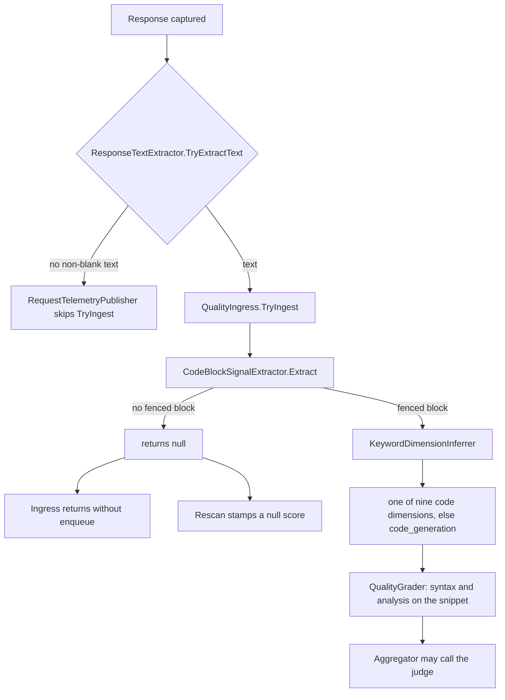
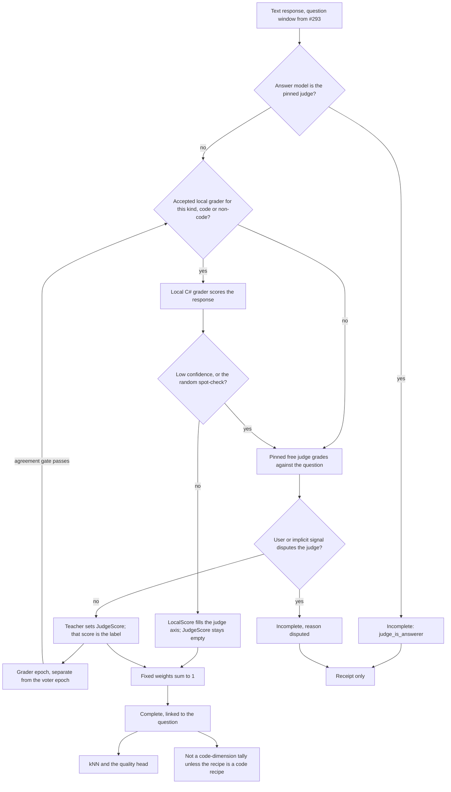
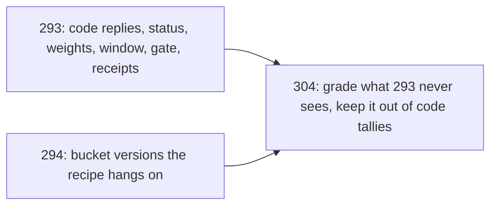

# Plan: Grade non-coding responses (#304)

**Status:** Approved by David on 2026-10-23 (chat sign-off). [ADR-0027](../adr/0027-grade-non-coding-responses-on-a-bootstrap-recipe-and-keep-them-out-of-code-tallies.md) records the decision. Phases 0–2 landed in [#334](https://github.com/davidpizon/TotallyHot-ArcRouter/pull/334); phase 3 in [#339](https://github.com/davidpizon/TotallyHot-ArcRouter/pull/339); phase 4 in [#341](https://github.com/davidpizon/TotallyHot-ArcRouter/pull/341). Phase 6 records `deferred_to_loop` and `loop_unlinked` only. Grading the final text against the starting question waits on the parent-plan chain ADR. Phase 5 is not part of that change. On 2026-10-23 David fixed phase 4 dispute deletes: always remove `response_vectors`, remove the kNN row only when present, one transaction, named tests in [§4](#4-phases). The same day he limited phase-4 `spot_check` to the column only; the 5% draw stays phase 8. The same day, David withdrew the phase 3 allowance that an expired pending question vector may be recomputed with the frozen ONNX session. A miss is a missing feature, stored as `grade_receipts.question_vector_missing` ([§3.3](#33-grading-methods), [§3.7](#37-storage-and-migration)). Decisions through 2026-10-23 are folded into the design below, including [§12](#12-local-scores-are-unjudged) (a local-grader score is unjudged), [§10](#10-confirmed-configuration-defaults) (the numeric defaults, confirmed as written), and David's review of [#332](https://github.com/davidpizon/TotallyHot-ArcRouter/pull/332) the same day: unknown cost is null on every new row, including a code recipe, and the judge-axis check is the four cases in [§3.2](#32-who-grades). The same day he limited phase 3's response embed: a `response_vectors` row is written only for a non-blank reply whose receipt has `JudgeScore` or `LocalScore`, and phase 4 deletes that row with the embedding row when the receipt is `disputed` ([§3.7](#37-storage-and-migration)). [§11](#11-todos) is follow-up, not a blocker. [#293](https://github.com/davidpizon/TotallyHot-ArcRouter/issues/293) has landed ([#307](https://github.com/davidpizon/TotallyHot-ArcRouter/pull/307)).
**Verified:** Against `main` at `88ef8bc2` on 2026-10-23, by code search, and re-checked the same way for the [#332](https://github.com/davidpizon/TotallyHot-ArcRouter/pull/332) review. The expired-vector correction was checked the same day against `main` at `267d38c5` by code search: `PendingValueCache.TryPeek` returns false for an expired entry, a capacity eviction, and a key that was never stored; `RoutingOptions.PendingEmbeddingCacheTtlSeconds` defaults to 300 and `PendingEmbeddingCacheCapacity` to 2,000; `RequestTelemetryPublisher` is what `Set`s the pending question vector. CodeGraph MCP (`user-codegraph`) and Serena MCP (`plugin-serena-serena`, `find_symbol` / `find_referencing_symbols`) were not available for either pass. The receipt-column pass was checked the same day against `main` at `bfc53e08` by code search. `QualityIngress.CreateBootstrapRequest` sets `Dimension` to empty and `QualityGrader` copies it onto the result; `GradeReceiptRecordObserver` writes `result.Dimension` and sets `AnswerModel` from `result.Model`; `grade_receipts.dimension` is `TEXT NOT NULL`. `CompositeRouterScoreObserver` invokes `EmbeddingMemoryScoreObserver` before `GradeReceiptRecordObserver`, and that observer's `TryTake` consumes the pending vector. CodeGraph MCP and Serena MCP were not available for this pass either. The response-embed gate was checked the same day against `main` at `6e9f8ec3` by code search. `IncompleteReasons` already names `queue_full`, `no_text`, `empty`, `no_judge`, and `judge_is_answerer`, and `GradeReceiptRecord` stores no question text and no response text. `response_vectors` is not in the tree yet. CodeGraph had no `.codegraph/` index for this checkout, and Serena MCP failed tool discovery, so this pass did not use either engine.
**Issue:** [#304](https://github.com/davidpizon/TotallyHot-ArcRouter/issues/304) — prose, Q&A, writing, and analysis get no grade today. Priority P0.
**Parent plan:** [router-evaluator-and-live-pricing.md](router-evaluator-and-live-pricing.md). This plan does not replace it. It fills the hole that plan's [§14](router-evaluator-and-live-pricing.md#14-grades-293) leaves open: a live grade is only useful once it exists for the work the router actually sees, and today that work is not only code.
**Builds on:** [#293](https://github.com/davidpizon/TotallyHot-ArcRouter/issues/293) ([#307](https://github.com/davidpizon/TotallyHot-ArcRouter/pull/307): grade status, fixed weights, question window, `grade_receipts`, learning gate). [#319](https://github.com/davidpizon/TotallyHot-ArcRouter/issues/319) ([#327](https://github.com/davidpizon/TotallyHot-ArcRouter/pull/327), [#328](https://github.com/davidpizon/TotallyHot-ArcRouter/pull/328): `IsJudgeScored` is `JudgeScore.HasValue`, plus the one-time purge). [#326](https://github.com/davidpizon/TotallyHot-ArcRouter/issues/326) ([#330](https://github.com/davidpizon/TotallyHot-ArcRouter/pull/330): `UnjudgedRowPolicy`, `UnjudgedRowWeight`, `UnjudgedRowWeighting.ResolveWeight`, `RoutingOptions.ResolveRowWeight`; a judged row always weighs 1.0). [#294](https://github.com/davidpizon/TotallyHot-ArcRouter/issues/294) (fingerprint, dynamic buckets, `has_tool_calls` as a label). [#290](https://github.com/davidpizon/TotallyHot-ArcRouter/issues/290) is still open. [#291](https://github.com/davidpizon/TotallyHot-ArcRouter/issues/291) and [#292](https://github.com/davidpizon/TotallyHot-ArcRouter/issues/292) consume the grades this plan produces.
**ADR:** [ADR-0027](../adr/0027-grade-non-coding-responses-on-a-bootstrap-recipe-and-keep-them-out-of-code-tallies.md) (accepted 2026-10-23). [ADR-0026](../adr/0026-grade-a-response-only-against-its-question-and-learn-only-from-complete-grades.md) stays the code-reply decision. ADR-0027 cites it and does not reopen it.
**Research used:** [papers/README.md](../research/papers/README.md), [code-quality-metrics-assessment.md](../research/code-quality-metrics-assessment.md), [2303.16634v3.md](../research/2303.16634v3.md) (G-Eval). Bias magnitudes below are the ones that assessment already recorded. This plan does not add a new paper.

## Summary

- A reply with no fenced code block is dropped before any grader runs, including the judge. A prose question that does get a fence is filed under one of nine coding dimensions, default `code_generation`. Both facts are in the code cited in [§1](#1-where-non-coding-responses-fall-through).
- **Code-reply contracts have landed.** [#293](https://github.com/davidpizon/TotallyHot-ArcRouter/issues/293) ([#307](https://github.com/davidpizon/TotallyHot-ArcRouter/pull/307)) supplies status, weights that sum to 1, the question window, the receipt, and the learning gate. [#319](https://github.com/davidpizon/TotallyHot-ArcRouter/issues/319) and [#326](https://github.com/davidpizon/TotallyHot-ArcRouter/issues/326) have landed too. This plan calls those contracts and does not reopen them. Implementation of this issue is its own pull request, and it waits on sign-off of this file.
- **What kind a request is** comes from its meaning fingerprint and the current bucket version ([#294](https://github.com/davidpizon/TotallyHot-ArcRouter/issues/294)), not from `KeywordDimensionInferrer` and not from a hand-written list of topics. The stable thing Eq. 8 needs is a **weight vector over grader axes**, stored on the bucket version. The axes are the instruments (judge, syntax, analysis). The bucket chooses the mix. Topic names are not the kind. In the steady state a code fence does not flip the kind.
- **Bootstrap, until bucket versions exist.** A fenced reply keeps #293's code weights and code tallies. Unfenced text is judge-only (weight 1 on the judge axis) and never touches a code tally. Tool-only turns and missing text are `Incomplete` with a reason. They do not learn.
- Every grade is still computed against the original question, under #293's window, HMAC, and `Complete`-only learning gate. A prose grade never updates a `live:` + `RouterDimension` tally.
- **Who grades.** A fixed free judge grades first. Its grades train two local C# graders, one for code recipes and one for non-code recipes. After a grader clears its own gate, phase 7 accepts the artifact and keeps scoring in shadow. Takeover, when that local score becomes the grade of record and fills the judge axis of the unified score, is phase 8. That score is unjudged: `QualityResult.JudgeScore` stays empty, so `IsJudgeScored` is false ([§12](#12-local-scores-are-unjudged)). The judge then spot-checks 5% of rows and every low-confidence local grade. Those teacher scores are what set `JudgeScore`. The confidence floor puts about a fifth of rows below it by construction, so roughly a quarter of rows still reach the judge after takeover. Feedback that contradicts the judge marks the row `Incomplete`. Detail in [§3.2](#32-who-grades) and [§3.8](#38-the-grader-epoch).
- **No new grade statuses.** Only #293's `Complete`, `StructureOnly`, and `Incomplete`. A miss, a tool-only turn, and a disputed judge label are `Incomplete` plus `incomplete_reason`.
- **No historical rescan.** `ScorerVersion` stays at #293's 3.0. The rescan re-sweeps every row whose `scorer_version` differs from the current value, so a bump would itself be a historical rescan. The receipt's `weights_version`, `prompt_version`, `grade_source`, and `local_grader_version` already say which rules produced a grade. Rows already stored are left as they are.
- The judge is one pinned model. It is free (`ProviderOptions.IsFree`), it is not a routing candidate, and a response it produced is not graded. That is the exclusion in [§3.4](#34-judge-cost-and-bias), not a preference for "some other model." No paid model, no Python, no third-party hosted evaluator, BGE stays frozen ONNX. Cost in the reward is the recorded cost ([#290](https://github.com/davidpizon/TotallyHot-ArcRouter/issues/290)). An unknown cost is null on every new row, including a code-recipe cache miss. A reported zero stays zero. Rows already written stay #290's backfill.

## 1. Where non-coding responses fall through

Verified against `main` at `88ef8bc2` on 2026-10-23. [#293](https://github.com/davidpizon/TotallyHot-ArcRouter/issues/293), [#319](https://github.com/davidpizon/TotallyHot-ArcRouter/issues/319), and [#326](https://github.com/davidpizon/TotallyHot-ArcRouter/issues/326) have landed. The prose drop below is still the live path. Where those three issues changed a sentence from the 2026-10-14 draft, the sentence says so.



1. **The extractor refuses anything that is not a fence.** `CodeBlockSignalExtractor.Extract` parses with `FencedCodeBlockParser` and returns `null` when `blocks.Count == 0` (`src/TotallyHotArcRouter.Quality/Extraction/CodeBlockSignalExtractor.cs`). Whitespace-only text also returns `null`.
2. **Ingress drops that null.** `QualityIngress.TryIngest` returns immediately when the extractor returns `null` (`src/TotallyHotArcRouter.Quality/Ingress/QualityIngress.cs`). Nothing is enqueued. The judge is not a separate entry point: `QualityGradingService` only grades what the queue delivers, and `QualityScoreAggregator.SubmitAsync` is what asks `IJudgeAvailability` whether to call the judge. A prose reply never reaches either.
3. **The caller hands over a tool-only body.** `ResponseTextExtractor.TryExtractText` returns false for a tool-only body and still sets `hasToolCalls` (`src/TotallyHotArcRouter/Telemetry/ResponseTextExtractor.cs`). Phase 6 passes that body to `TryIngest`. The receipt is `Incomplete` reason `deferred_to_loop`. It does not learn. `has_tool_calls` is already a column: the same parse writes `TranscriptRecord.HasToolCalls` onto `request_transcripts`. It records that fact and is not a grade. [#176](https://github.com/davidpizon/TotallyHot-ArcRouter/issues/176) is still open for the Sessions layout; the flag itself is in the tree.
4. **Rescan stamps the hole and moves on.** `QualityRescanService.RescanOneAsync` calls the same extractor. A null request is `MarkQualityRescannedAsync` with a null score (`src/TotallyHotArcRouter/Transcripts/QualityRescanService.cs`). The comment there says why: a run of prose rows would otherwise occupy every batch. The stamp is a cursor, not a grade. Those rows are not "graded and found wanting."
5. **The dimension is always a coding dimension.** `KeywordDimensionInferrer.Infer` returns one of `RouterDimension.AllDimensions` and falls through to `code_generation` (`src/TotallyHotArcRouter.Quality/Extraction/KeywordDimensionInferrer.cs`). `HeuristicRequestClassifier` uses that same inferrer for the live routing key (`src/TotallyHotArcRouter/Router/Classification/HeuristicRequestClassifier.cs`), and `RequestInterceptor` writes `RouterDimension.ToLiveKey` from it. A question the keywords do not recognise is `code_generation` before any grade exists. `code_understanding` is the keyword branch for "explain" / "how does", which catches some prose and files it as a coding dimension anyway.
6. **Two of the three axes need code.** `QualityGrader.GradeAsync` runs `IStructuralParser` and `CompositeStaticAnalyzer` on `QualityRequest.Code` (`src/TotallyHotArcRouter.Quality/Grading/QualityGrader.cs`). `QualityRequest` is "one extracted code block" (`src/TotallyHotArcRouter.Quality/QualityRequest.cs`). There is no prose request shape.
7. **A `Complete` score is written as a live dimension tally.** `RouterMemoryScoreObserver.ObserveAsync` calls `AddScoreAsync` under `RouterDimension.ToLiveKey` only when `result.GradeStatus` is `Complete` (`src/TotallyHotArcRouter/Router/RouterMemoryScoreObserver.cs`). That is #293's gate, and it is in the tree. It does not, by itself, stop a `Complete` prose row from landing in `live:code_generation` when `result.Dimension` is still that name. `TranscriptScoreObserver.UpdateOutcomeAsync` writes `request_transcripts.score` and `is_judge_scored` (`JudgeScore.HasValue`) and does not stamp `scorer_version`. `SqliteTranscriptStore.LoadPendingQualityRescanAsync` selects `scorer_version IS NOT` the current value, and that comparison includes NULL, so an unstamped live score is still a rescan candidate. Phase 1 stamps the version in the same update.

`GEvalJudgeClient.DimensionHints` replaced the old `DimensionCriteria` map. It is keyed on every `RouterDimension.AllDimensions` value (`code_generation`, `algorithm_design`, `bug_fixing`, `code_completion`, `code_refactoring`, `data_science`, `multi_language`, `code_understanding`, `test_generation`). Anything else uses the generic coding-task line from `ResolveDimensionHint` (`src/TotallyHotArcRouter/Judge/GEvalJudgeClient.cs`). #304 does not add topic names to that dictionary.

## 2. Decisions this plan treats as already made

| Source | What #304 keeps |
|---|---|
| #293, David 2026-10-14, landed in [#307](https://github.com/davidpizon/TotallyHot-ArcRouter/pull/307) | Grade status `Complete` / `StructureOnly` / `Incomplete`. Only `Complete` trains. Weights fixed per recipe and sum to 1. No silent renormalization. Question window, HMAC-SHA-256, no question text in SQLite. Judge sees relevance, correctness, completeness. Code-task weights are judge 0.60, syntax 0.25, analysis 0.15 (`QualityOptions` / `DimensionWeightOptions.Default`). `ScorerVersion` is `3.0`. `WeightsVersion` default is `3.0-judge-heavy`. |
| #293 plan §9 | Non-coding grades are out of #293. This file is that work. |
| #294, David 2026-10-13 | Fingerprint is the BGE vector plus a separate pre-routing tool block. No bucket id and no taxonomy label inside the vector. Predictors take the vector, not the bucket. Buckets are recomputed each epoch and may split, merge, or move. `has_tool_calls` and other post-response tool facts are labels, not routing inputs. |
| Parent plan §12.2, #290 | κ is `actual`, else `computed`, else `catalog`, else null. Null skips the cost term. Null is not zero. |
| Parent plan §13 | Epoch and every new fit stay in C# on `net10.0`. No Python. BGE stays the frozen ONNX session (`OnnxEmbeddingClient`). |
| Parent plan §14 | Live grades do not train the quality head until they were computed with the question. Tool success is not a grade. |
| [code-quality-metrics-assessment.md](../research/code-quality-metrics-assessment.md) §5.3 | No BLEU or reference-answer metric on live traffic. No embedding-similarity grader (BERTScore and the like measured worse). Pairwise judging was deferred there because the papers disagree and position reversals exceeded 40 percentage points. |
| ADR-0019, ADR-0020 | SQLite stays text-free. Question text lives in the passkey-gated session file. No grade-time reader opens that file or re-embeds the question text. Both ADRs are unchanged. |
| David, 2026-10-14, on this issue | The judge teaches. A local C# grader takes over. Feedback catches judge errors. The judge model is fixed, free, and never an agent being graded. After takeover the judge spot-checks a small random sample and every low-confidence local grade. Fitting or refitting that local grader is a grader epoch, separate from #292. |
| David, 2026-10-14, on the review of this plan's pull request | `ScorerVersion` is not bumped. An agent switch counts only when the client explicitly picked the other model. There are two local graders, code and non-code; a bucket re-form does not reset them, and a change of teacher prompt, teacher model, or embedding model does. After takeover, a failed teacher call makes a low-confidence row `Incomplete` and leaves a spot-check row on its local score. Response vectors are stored for the grader epoch, beside the question vectors, deleted with their session, tagged with the embedder, and encrypted with AES-256-GCM under their own key ([§3.7](#37-storage-and-migration)). Which replies are written, and deletion on dispute, is the 2026-10-23 response-embed row. Encrypting the existing question vectors is [#306](https://github.com/davidpizon/TotallyHot-ArcRouter/issues/306), still open. `fingerprint_ref` stays null until #294's routing receipt exists. `GradeReceiptRecord` still documents that reservation. |
| #319, landed in [#327](https://github.com/davidpizon/TotallyHot-ArcRouter/pull/327) and [#328](https://github.com/davidpizon/TotallyHot-ArcRouter/pull/328) | `IsJudgeScored` is `QualityResult.JudgeScore.HasValue`. `EmbeddingMemoryScoreObserver` and `TranscriptScoreObserver` both stamp that boolean. A `Complete` grade with no judge score is still stored, with the flag false. The one-time purge marker is `schema_meta` key `issue-319-untrusted-judge-provenance-purge`. #304 does not rerun it and does not change the stamp. |
| #326, landed in [#330](https://github.com/davidpizon/TotallyHot-ArcRouter/pull/330), [ADR-0026 Amendment 1](../adr/0026-grade-a-response-only-against-its-question-and-learn-only-from-complete-grades.md#amendment-1-2026-10-22-the-row-policy-applies-to-unjudged-rows) | The policy is `UnjudgedRowPolicy` and `UnjudgedRowWeight`. The rule is `UnjudgedRowWeighting.ResolveWeight`, forwarded by `RoutingOptions.ResolveRowWeight`. A judge-scored row always weighs 1.0. The policy applies only to unjudged rows. The default policy is `Include`, so an unjudged row also weighs 1.0 until the operator changes it. `UnjudgedRowWeight` defaults to 0.5 and is used only under `DownWeight`. The retired names are not settings: `JudgeScoredRowPolicy`, `JudgeScoredRowWeight`, `JudgeRowPolicy`, `JudgeRowWeighting`, `ResolveJudgeRowWeight`. A configuration that still sets `Routing:JudgeScoredRowPolicy` or `Routing:JudgeScoredRowWeight` fails startup. |
| David, 2026-10-23 | [§12](#12-local-scores-are-unjudged) is decided: a local-grader score is unjudged. The [§10](#10-confirmed-configuration-defaults) rows dated 2026-10-23 are confirmed as written. Rows dated 2026-10-25 in that table are proposed with the phase 7 plan and are not part of this confirmation. |
| David, 2026-10-23, review of [#332](https://github.com/davidpizon/TotallyHot-ArcRouter/pull/332) | Unknown cost is null on every new row, including a code-recipe cache miss. A reported zero stays zero. Rows already stored as zero stay [#290](https://github.com/davidpizon/TotallyHot-ArcRouter/issues/290)'s backfill. `GradeStatusCalculator.Calculate` fills the judge axis in four cases, in order, each with a DEBUG log and a test ([§3.2](#32-who-grades)). |
| David, 2026-10-23, expired pending question vector | A grade whose pending question vector expired, was evicted, or was never stored is a missing feature. Those three misses are indistinguishable, so `question_vector_missing` is one flag, not a status enum. The vector is never a zero, and the receipt does not gain a vector column. No grade-time reader opens a session file or re-embeds the question text. Detail in [§3.3](#33-grading-methods) and [§3.7](#37-storage-and-migration). |
| David, 2026-10-23, `answer_model` | `answer_model` equals `model` for now; it is kept deliberately next to `judge_model` ([§3.7](#37-storage-and-migration)). |
| David, 2026-10-23, response embed | Phase 3 writes a `response_vectors` row only when the reply has non-blank text and the receipt has `JudgeScore` or `LocalScore`. No row when `incomplete_reason` is `no_text`, `empty`, `deferred_to_loop`, `loop_unlinked`, `judge_is_answerer`, `no_judge`, or `queue_full` and neither score is set. `judge_is_answerer` is not graded ([ADR-0027](../adr/0027-grade-non-coding-responses-on-a-bootstrap-recipe-and-keep-them-out-of-code-tallies.md)). A low-confidence row whose teacher call failed keeps its vector, because the local grader stored `LocalScore`; the epoch skips that row because it is `Incomplete`. Phase 4 deletes the vector in the same step as the embedding row when it marks the receipt `disputed`. Detail in [§3.7](#37-storage-and-migration). |
| David, 2026-10-23, phase 4 dispute deletes | On `disputed`, always delete `response_vectors` for the `correlation_id`; delete the kNN `memory_entries` row only when one exists. Both deletes run in one transaction. A missing kNN row is a no-op, not an error. Phase 5 must not write a kNN row for that disputed receipt. DEBUG log names which rows were deleted and includes no question or response text. Named tests: `Dispute_DeletesEmbeddingAndResponseVector_WhenBothExist`, `Dispute_DeletesResponseVectorOnly_WhenNoKnnRow` ([§4](#4-phases)). |
| David, 2026-10-25, phase 7, proposed until this plan's pull request is approved | Gate pass accepts the artifact and leaves it in shadow. Takeover is phase 8. The holdout is the 50 newest eligible labels per kind, with session siblings kept out of training. The paired bootstrap runs only against a comparable live artifact. The fingerprint reservoir is capped, sealed, and rebuilt from rows that still exist. The first artifact's null previous id rolls back to the teacher. Spot-check rollback ships in phase 8 with the 5% draw. Tool counts are not in feature schema version 1. Detail and the named tests: [phase 7 plan](issue-304-phase-7-grader-epoch.md). |

#293 removed the old drop-the-axis behavior. `QualityScorer.Score` multiplies each axis by its fixed weight and contributes 0 when `JudgeScore` or `AnalysisScore` is null. It does not divide by the remaining weight. This plan does not bring that division back. An axis with weight 0 is not in the recipe. An axis with nonzero weight that did not run changes the status, not the denominator. The one change to the judge term is in [§3.2](#32-who-grades): when the local grader is the grade of record, `LocalScore` supplies that term and is not copied into `JudgeScore`.

## 3. Design



### 3.1 How a request is recognized, without a fixed list

The fingerprint does not contain the words "prose" or "code". [Parent plan §6](router-evaluator-and-live-pricing.md#6-meaning-fingerprint-294) forbids a dimension label in the vector. Dynamic buckets are not a stable task type either: membership changes when an epoch accepts a new partition ([#294](https://github.com/davidpizon/TotallyHot-ArcRouter/issues/294#issuecomment-6161020785)). Eq. 8 still wants weights that are fixed for a type and sum to 1.

The resolution:

- **The type is the bucket version's grading recipe**, not a topic name. A recipe is a map from grader key to a weight. The keys are `judge`, `syntax`, and `analysis` (the same three `GraderKeys`). The weights are nonnegative and sum to 1. They are fixed for the life of that bucket version. A later epoch may propose a new vector. The old vector stays on the old version so a stored grade still says which rules produced it.
- **Assignment uses the fingerprint the router already computed.** `RequestInterceptor.TryComputeEmbeddingAsync` embeds the newest user message with frozen BGE and returns the vector. `RequestTelemetryPublisher` stores it in `PendingValueCache<float[]>` once the correlation id exists. When a bucket version exists, grade-time assignment is cosine to that version's centroids, off the request path, using that vector. It does not call a second embedder and it does not keyword-match the prompt. The pre-routing tool block ([parent plan §6.1](router-evaluator-and-live-pricing.md#61-tool-call-side-features-294)) may apply the bucket's accepted tool split. `has_tool_calls` does not. A child bucket inherits its parent's recipe until its own vector is accepted, the same borrowing rule David set for calibration on [#292](https://github.com/davidpizon/TotallyHot-ArcRouter/issues/292#issuecomment-6161157727). Building the centroids, the cosine lookup, and that inheritance is [#294](https://github.com/davidpizon/TotallyHot-ArcRouter/issues/294). This plan only reads `bucket_version_id` and the recipe stored on it. Until that version exists, the bootstrap table below is the whole assignment. A `TryPeek` miss (the entry expired, was evicted, or was never stored) does not recompute that vector, does not open a session file, and does not cosine-match a zero vector. That row is a missing question-vector feature. Phase 3 persists `question_vector_missing` = 1, as [§3.3](#33-grading-methods) defines it. Phases 0–2 do not write the column. `bucket_version_id` stays null, so the row keeps the bootstrap recipe.
- **The response does not choose the recipe.** A code fence in a writing answer does not flip the row onto a code recipe. A prose answer to a question whose recipe has syntax weight does not flip the row onto a prose recipe. Response shape is stored (`response_has_code`, and the existing tool-call label) so an audit can see it. It is not an input to the next route.
- **`KeywordDimensionInferrer` stays for the code path #293 already owns** until the epoch replaces that use. #304 does not add prose keywords to it, and does not add a parallel list (`writing`, `qa`, `analysis`, `mixed`).

**Syntax weight and a response with no code.** David settled this. When the recipe's syntax weight is 0, the parser is not a weighted axis. When the syntax weight is greater than 0 and the response has no fenced block, syntax score is 0, "no code in the response." That is a measurement, so the grade can still be `Complete`. An abstention is a parser failure or an unsupported language where the checker cannot run; that yields `Incomplete` and does not learn. Analysis follows the same rule. `GradeStatusCalculator.Calculate` currently applies `MinimumSyntaxConfidenceForComplete` (0.70) before it looks at syntax weight. A recipe with syntax weight 0 skips that gate. The parser did not run, so its confidence is not a reason to withhold `Complete`.

**Bootstrap, before any bucket version exists.** #294's epoch is parent-plan phase 7. #304 does not wait for it. David settled the split:

| Response the current extractor would do | Recipe | Status | `RouterDimension` tally |
|---|---|---|---|
| Fenced block, grader runs | #293's code weights, 0.60 / 0.25 / 0.15, keyed by the existing dimension | #293's rules | Unchanged from #293 |
| Text, no fenced block, newest request turn is the user's own text | `bootstrap`: judge 1.0, syntax 0, analysis 0. `weights_version = bootstrap` | `Complete` when the judge axis is filled | Never |
| Text, newest request turn is tool results | none | `Incomplete`, reason `loop_unlinked`. Phase 6 does not recover the starting question | Never |
| No text, tool call seen | none | `Incomplete`, reason `deferred_to_loop` | Never |
| No text, no tool call, body unreadable | none | `Incomplete`, reason `no_text` | Never |

The bootstrap is a versioned recipe, not a topic list. It is the current extractor's gate, kept only so #293's code weights keep working until a bucket version is accepted. The steady state deletes that split: every text response, fenced or not, takes the bucket recipe. The acceptance test in [§8](#8-evaluation-and-acceptance) covers both, and the bootstrap test is deleted when the steady state ships.

**What may change a recipe's weights.** Syntax and analysis weights move only inside #292's voter epoch, and only when held-out cost-adjusted reward clears that epoch's significance band. The first accepted syntax or analysis weight on a non-code recipe starts at 0. A coefficient whose held-out interval includes 0 stays at its previous accepted value. The grader epoch in [§3.8](#38-the-grader-epoch) does not edit those weights. It replaces how the judge axis is produced. CodeJudge, ICE-Score, and RACE stay code-portfolio graders. They are not added to a recipe whose syntax weight is 0.

### 3.2 Who grades

David settled this on 2026-10-14. Three roles, in order. They are not three simultaneous judges.

1. **Teacher.** A strong LLM judge grades the response against the question. Those grades are the labels.
2. **Local grader.** Two C# models, one for code recipes and one for non-code recipes ([§3.8](#38-the-grader-epoch)), train on `Complete` teacher labels of their kind (a row whose `JudgeScore` has a value). Phase 7 accepts an artifact and writes `LocalScore` in shadow beside the teacher score. Takeover (phase 8) is when `LocalScore` fills the judge axis without calling the LLM. The number they write is `LocalScore`. It is not `JudgeScore`.
3. **Feedback.** A user or implicit signal that contradicts the teacher sets the row to `Incomplete` with reason `disputed`. Those rows do not train the local grader and do not enter router learning. Phase 4 deletes the `response_vectors` row in the same step as the embedding row ([§3.7](#37-storage-and-migration)), so the disputed reply stays out of every fit. The signal has no score of its own.

**Teacher phase.** Until takeover (phase 8), every eligible text response is graded by the pinned judge, including after phase 7 has accepted an artifact. Once an accepted artifact for that kind matches the current teacher model, teacher `prompt_version`, and BGE model id, phase 7 writes a shadow `LocalScore` beside that teacher score and logs it. The shadow score is not the grade of record. `JudgeScore` stays set, so the row is judge-scored. Router learning reads the unified score, whose judge axis is that teacher score. `LocalScore` never fills `JudgeScore`. Before any artifact is accepted, `LocalScore` stays null. Detail is in the [phase 7 plan](issue-304-phase-7-grader-epoch.md).

**Takeover (phase 8).** Phase 7 accepts an artifact only when the agreement gate in [§3.8](#38-the-grader-epoch) passes, and acceptance leaves the teacher as the grade of record. Takeover is the later step. After takeover, `LocalScore` fills the judge axis of the unified score. `QualityResult.JudgeScore` stays empty, so the row is unjudged ([§12](#12-local-scores-are-unjudged)). The unified score is still the recipe's weighted sum. On a bootstrap recipe the judge weight is 1, so `LocalScore` is the unified score. On a code recipe `LocalScore` replaces only the 0.60 judge axis; syntax and analysis stay. The local grader is trained to predict the teacher's judge score, never the already-blended unified score and never its own earlier output, so syntax is not counted twice.

**Where the judge axis comes from.** `QualityScorer.Score` today sets that term from `JudgeScore` alone, and a null contributes 0 (`src/TotallyHotArcRouter.Quality/Scoring/QualityScorer.cs`). This plan changes the term, not the property:

- `JudgeScore` when it has a value. That is a real pinned-teacher score: the teacher phase, a 5% spot-check the teacher answered, or a low-confidence row the teacher graded.
- Otherwise `LocalScore`, and only when the local grader is the grade of record (a high-confidence takeover row that was not sampled, or a spot-check whose teacher call produced no score).
- Otherwise the axis did not run. Status changes. The denominator does not.

`LocalScore` is never assigned to `JudgeScore`. `QualityScoreAggregator.ApplyGraderScore` is the writer of `JudgeScore`, and only for `GraderKeys.Judge`. The local grader does not complete through that key. A shadow score during the teacher phase may be stored in `LocalScore` and logged. It is not the grade of record, and it is not added on top of `JudgeScore`. When both numbers exist, the axis is `JudgeScore` and `LocalScore` is the pair kept for the next fit.

**How `GradeStatusCalculator.Calculate` changes.** This is the only statement of the rule. The phase table and the [§8](#8-evaluation-and-acceptance) fixtures point here.

Today the judge-weight check refuses `Complete` when the judge weight is greater than 0 and `JudgeScore` is null. Verified at `src/TotallyHotArcRouter.Quality/Grading/GradeStatusCalculator.cs` lines 45–46:

```csharp
if (weights.Judge > 0.0 && result.JudgeScore is null)
    return llmGraderWasAvailable ? GradeStatus.Incomplete : GradeStatus.StructureOnly;
```

The only production caller is `QualityScoreAggregator.WriteAsync` (`src/TotallyHotArcRouter.Quality/Grading/QualityScoreAggregator.cs` lines 476–485). `Calculate` is static and has no logger. The aggregator already holds `ILogger<QualityScoreAggregator>`. Phase 8 passes that logger into `Calculate`. The question-present check, the syntax-confidence gate, and the analysis check above line 45 stay as they are. A recipe with syntax weight 0 still skips the syntax-confidence gate. The four cases below replace only the judge-weight check, and only once those earlier gates have passed. `LocalScore` is never copied into `JudgeScore`.

After takeover a helper grade has `JudgeScore` empty and `LocalScore` set. The judge axis is filled under exactly four cases, evaluated in this order:

1. **Teacher score.** `JudgeScore.HasValue`. The axis is filled. The row is judge-scored (`IsJudgeScored` true). Same as today. A shadow `LocalScore` stored beside that teacher score does not change the case.
2. **Local grade of record.** No `JudgeScore`, `LocalScore` has a value, and this row's local score is the grade of record. That is true only when the local grader for this kind (code or non-code) is the accepted authority and the row rules below allow this row to keep the score: a high-confidence row that was not sampled, or a spot-check whose teacher call produced no score. The axis is filled. The row is unjudged (`IsJudgeScored` false, because the stamp stays `JudgeScore.HasValue`).
3. **Local score present, not the grade of record.** No `JudgeScore`, `LocalScore` has a value, and this row's local score is not the grade of record. That covers a low-confidence row whose teacher produced no score (authority for the kind may already be local; this row still distrusts the score). A phase 7 shadow is not this case: the teacher score is set, so it is case 1. The axis is not filled. The score never satisfies it, so the row is not `Complete`. Status stays the current branch: `Incomplete` when an LLM grader was expected, `StructureOnly` when it was not. The row does not learn.
4. **Neither.** No `JudgeScore` and no in-authority `LocalScore`. The axis is not filled. The row is `Incomplete` when an LLM grader was expected and `StructureOnly` when it was not. That is the existing reason semantics at lines 45–46. The row does not learn. Same as today.

Each case emits one DEBUG log when it is hit, through the `ILogger` passed in from the aggregator. Four static message templates, one per case, so the template names the case. No interpolation and no `string.Format`. Every template carries the correlation id (`QualityResult.RequestCorrelationId`), the recipe `weights_version`, the grader kind (code or non-code), and the resulting status. Cases 2 and 3 also carry `local_grader_version`. Cases 1 and 4 omit it. The log never includes question text, response text, or vectors. `QualityResult` already has `LocalScore`, and it is `init`-only (`src/TotallyHotArcRouter.Quality/QualityResult.cs`). It does not have `weights_version`, grader kind, or `local_grader_version`. Phase 7 makes `LocalScore` settable and adds `LocalGraderVersion` and `LocalConfidence`, the same way `QuestionVectorMissing` is settable, so a shadow score can be stamped before the receipt is written. Phase 8 passes the recipe label, the kind, the artifact id, and a per-row `localScoreIsGradeOfRecord` flag into `Calculate`. Kind-level authority is not enough: a low-confidence teacher miss can have an accepted artifact and still pass the flag false. Those arguments are the log properties. They are not read back out of SQLite at log time. The flag is one of the properties on cases 2 and 3.

One test per case, added beside the existing cases in `src/TotallyHotArcRouter.Quality.Tests/GradeStatusCalculatorTests.cs`. Each test asserts the resulting status and `IsJudgeScored` (`true` only in case 1) and that a capturing test logger recorded that case's DEBUG template. The quality tests today pass `NullLogger`, which drops the message. These four follow the capturing-logger tests already in the router suite (for example `CostReconciliationServiceTests`). The two existing judge-absent tests stay. They are case 4 with no `LocalScore`.

**Unjudged weight.** Leaving `JudgeScore` empty is what makes `IsJudgeScored` false. #319's stamp stays: `EmbeddingMemoryScoreObserver` and `TranscriptScoreObserver` pass `result.JudgeScore.HasValue`. This plan does not add a second stamp. Those unjudged rows are weighted by `UnjudgedRowPolicy` and `UnjudgedRowWeight` ([#326](https://github.com/davidpizon/TotallyHot-ArcRouter/issues/326), [#330](https://github.com/davidpizon/TotallyHot-ArcRouter/pull/330)). `UnjudgedRowWeighting.ResolveWeight` returns 1.0 for a judged row before the policy switch runs. The default policy is `Include`, so an unjudged row also weighs 1.0 until the operator sets `DownWeight` or `Exclude`. `UnjudgedRowWeight` defaults to 0.5 and applies only under `DownWeight`. `RoutingOptions.ResolveRowWeight` forwards `UnjudgedRowWeighting.ResolveWeight`. `EmbeddingMemory.FindNearest` drops a neighbor when that returns null and does not scale by a fractional weight. `MemoryKnnVoter` then multiplies similarity by the resolved weight. `EmbeddingLogRegTrainingService`, `ClusterTrainingService`, `ClusterLedger`, and `TaxonomyComparisonService` call the same resolver. `RouterMemoryScoreObserver` does not. A code-recipe `Complete` row still enters the `live:` tally at full strength. A bootstrap or non-code recipe never calls `AddScoreAsync`, so the policy is not how prose is kept out of that tally.

**Steady-state oversight.** After takeover the pinned judge still runs, on two sets only:

- A random sample of responses the local grader already scored, probability 0.05, drawn per response, stored on the receipt as `spot_check`. David set 5%. Teacher-phase sampling stays 1.0 so the local grader has labels.
- Every response whose local confidence is low, as [§3.5](#35-calibration-and-confidence) defines it. This set is not sampled.

On those rows the teacher score replaces `LocalScore` as the grade of record and is what sets `JudgeScore`. The pair (`LocalScore`, `JudgeScore`) is kept. The row is judge-scored, so it weighs 1.0 even when `UnjudgedRowPolicy` is `Exclude`. The next grader epoch is fired by the random spot-check window in [§3.8](#38-the-grader-epoch), which is an unbiased sample. Low-confidence pairs are teacher labels for that fit. They are not mixed into the spot-check MAE, because those rows were chosen for being far from the training fingerprints. Rows the judge did not see keep `LocalScore` as the grade of record, leave `JudgeScore` empty, and are unjudged. `grade_source` is `spot_check` only for the random draw, and `low_confidence` when the cosine floor called the teacher. The `spot_check` column is true only for the random draw, so a low-confidence row is not counted in the 5%.

**When the teacher call fails after takeover.** David settled this on 2026-10-14. The teacher call can fail with a full queue, a timeout, an abstention, or a pin that is missing or switched off.

- A low-confidence row whose teacher call produces no score is `Incomplete`. That row is judge-axis case 3: `LocalScore` is stored and `JudgeScore` stays empty. The kind's artifact may already be accepted. This row's `localScoreIsGradeOfRecord` is still false, because the score is the one this rule distrusts. A pin that is missing, paid, or switched off uses `incomplete_reason` `no_judge`. A full queue uses `queue_full`. A timeout, abstention, eviction, or failed call stays in `abstained_graders`, the column #293 already uses, and is not copied into `incomplete_reason`. The row does not train. Phase 3 still writes the `response_vectors` row, because `LocalScore` is set. The grader epoch skips the row ([§3.7](#37-storage-and-migration)).
- A random spot-check row whose teacher call produces no score keeps `LocalScore` as the grade of record. That row is judge-axis case 2: `Complete`, `grade_source = local`, `JudgeScore` empty (unjudged), and `spot_check` stays true. No pair is recorded, and the row does not count toward the spot-check MAE window. The draw was an audit, and a missed audit does not void the local grade.
- A high-confidence row that was not drawn never calls the teacher, so a missing pin does not change its status. That row is judge-axis case 2. `JudgeScore` stays empty. The row is unjudged.

**Code recipes use the same teacher.** The exclusion rule in [§3.4](#34-judge-cost-and-bias) applies to every judge call, including #293's code path. Takeover of the judge axis applies to non-code recipes first. A code recipe keeps the LLM on its judge axis until the code-kind grader artifact clears the gate on code-recipe labels. One artifact does not cover both. A prose model that has learned to imitate prose grades is not applied to code.

### 3.3 Grading methods

The axes below feed the weighted sum. The teacher is one call to the pinned model. Nothing else is a hosted service.

**Rubric judge (the teacher).** The #293 judge: one 1–5 grade, logprob-weighted the way `GEvalJudgeClient.TryComputeWeightedScore` already does, normalized with `(mean - 1) / 4`. The prompt carries the question window and the three criteria (relevance, correctness, completeness). A response that fails relevance scores low regardless of fluency. For a recipe whose syntax weight is 0, the dimension hint is one fixed sentence: judge the response as an answer to the question, and do not reward code that the question did not ask for. That sentence is not a topic classifier. The rubric stays #293's three criteria. No tone, safety, or search-factuality axis. Instruction-following stays inside completeness. It is not a fourth call. After takeover this call happens only for the spot-check and for low confidence.

**Local grader (the student).** A new prediction head, not a change to `EmbeddingLogRegTrainer`. The parent plan's [§13.1](router-evaluator-and-live-pricing.md#131-light-models-in-c-no-onnx) and [§21](router-evaluator-and-live-pricing.md#21-package-choices) put new prediction heads on `Microsoft.ML` 5.0.0. The fit is written as coefficients on the versioned artifact. It is not an ONNX graph, and it does not replace `EmbeddingLogRegModelArtifact`. The cosine floor and the length correlation stay hand-rolled C#. The agreement gate's Spearman uses the existing `RankCorrelation.Spearman`, which [§21](router-evaluator-and-live-pricing.md#21-package-choices) keeps for judge correlation. No Python. Features, all known without another LLM:

- The frozen BGE vector of the question, the one kNN already computed. `RequestInterceptor.TryComputeEmbeddingAsync` embeds the newest user message on the frozen BGE session (`OnnxEmbeddingClient`). The correlation id is not known there. `RequestTelemetryPublisher` is what `Set`s `PendingValueCache<float[]>` once that id exists. Grade-time readers (this feature and the bucket lookup) read it with `PendingValueCache.TryPeek`. `EmbeddingMemoryScoreObserver` stays the only `TryTake` of that cache, so the kNN write still finds the vector, and no reader re-embeds a vector the request path already computed. `TryPeek` returns false when the entry has expired (`RoutingOptions.PendingEmbeddingCacheTtlSeconds`, default 300), when capacity eviction has dropped it (`PendingEmbeddingCacheCapacity`, default 2,000, oldest first), or when the request path never stored one. The reader cannot tell those three misses apart. Each is a missing feature: `grade_receipts.question_vector_missing` is 1, and the vector is never a zero. A hit sets the column to 0. The column is that one flag, not a status enum, and it is not a vector. That `TryPeek` runs before `EmbeddingMemoryScoreObserver`'s `TryTake` ([§4](#4-phases)). No grade-time reader opens a session file or re-embeds the question text, so SQLite stays text-free and [ADR-0019](../adr/0019-store-conversation-text-in-encrypted-per-session-files.md) and [ADR-0020](../adr/0020-require-passkey-verification-for-conversation-content.md) are unchanged. The response vector in the next bullet is a first embed of response text the grade path already holds. It is not this recovery.
- A frozen BGE vector of the response, computed off the request path at grade time, on the same character budget the judge sees, and only when [§3.7](#37-storage-and-migration) writes a `response_vectors` row. The column is that sealed vector, not the response text. This is an input feature. It is not an embedding-similarity score. The metrics assessment rejected BERTScore-style similarity as a grader. It did not reject a vector as a feature of a model trained to imitate the judge.
- Syntax and analysis scores when those checkers ran, plus `response_has_code` and response length. Length is a feature the fit can down-weight. It is not added to the score. Feature schema version 1 does not include the pre-routing tool-block counts (`tool_definition_count`, `prior_tool_call_count`, `prior_tool_result_count`, the `other` and `unknown` counts, and the five kind counts in [parent plan §6.1](router-evaluator-and-live-pricing.md#61-tool-call-side-features-294)). Those counts are not on `grade_receipts`. [#294](https://github.com/davidpizon/TotallyHot-ArcRouter/issues/294) owns them. Schema version 1 does not zero-fill them, does not add an always-missing column, does not store them, and does not reconstruct them from session files. They arrive with a new feature-schema version once #294 saves them, and that version retires the schema-1 artifact. Syntax is not a stored score today (`GraderKeys.Syntax` has no writer). Schema version 1 adds a nullable `syntax_score` that is null when the parser did not run, including every bootstrap row, and is `1.0` or `0.0` only when the code recipe actually ran the parser. A null syntax score is a missing feature, not 0. `QualityResult.SyntaxValid` defaults to false and is not read back as a feature. Analysis is the `grader_scores` row whose key is `GraderKeys.Analysis`, when exactly one such row exists.
- Missing features use the same missingness indicator as the parent plan's tool block ([§6.1](router-evaluator-and-live-pricing.md#61-tool-call-side-features-294)). They are not filled with zero. For the question vector, the missing value lives in `grade_receipts.question_vector_missing`, not in a NULL vector column. The receipt does not store the vector. Parent [§6.1](router-evaluator-and-live-pricing.md#61-tool-call-side-features-294) applies through this flag. At fit time and at serve time the indicator is 1 when `question_vector_missing = 1` or when no `memory_entries` row has that `correlation_id`. A flag of 1 sets it even if a memory row is present. The grader epoch also sets the indicator when `memory_entries.embedding_model` is null or is not the current BGE id. It does not call `MemoryEntry.MatchesEmbeddingModel`, because that method treats a null model id as a match. The feature passed to the model then takes the training-window mean. The stored flag is not rewritten to that mean. The indicator is 0 when the flag is not 1 and that memory row is present. A NULL flag is not a stored hit and does not by itself set the indicator; a NULL flag with a memory row is indicator 0, and a NULL flag with no memory row is indicator 1. When the indicator is 0, the feature is that row's vector. "Never a zero" forbids a literal zero `float[]` at grade time and at cosine time. It does not add a second missingness rule.

**Pending question vector gone.** David settled this on 2026-10-23, and withdrew the phase 3 allowance that a new grade whose pending vector had expired may recompute that one vector with the frozen ONNX session. Phase 3 records the miss in `question_vector_missing` ([§3.7](#37-storage-and-migration)). The column makes the miss rate measurable. That measurement is the observed-cost evidence [ADR-0008 Amendment 1](../adr/0008-codegraph-serena-dual-engine-code-smell-pipeline.md#amendment-1-2026-09-02-stop-rules) requires before anyone raises `PendingEmbeddingCacheTtlSeconds`. This plan does not raise that setting. If the measured rate shows frequent expiry, the first remedy is raising it. Any future recompute must read the [ADR-0019](../adr/0019-store-conversation-text-in-encrypted-per-session-files.md) session file's newest-user-message extract under an ADR-0019 note, never a second text store.

The target is the teacher's normalized score. Rows that are `Incomplete`, including reason `disputed`, are left out of the fit. A disputed row's `response_vectors` row is already deleted ([§3.7](#37-storage-and-migration)). Confidence and the agreement gate are in [§3.5](#35-calibration-and-confidence) and [§3.8](#38-the-grader-epoch).

**Reference-free checks.**

| Check | When it runs | What it is not |
|---|---|---|
| Syntax and analysis, existing | Recipe weight greater than 0 | Not run on a judge-only recipe. Not a similarity between the question and the prose. |
| Non-empty, non-whitespace text | Always, as a gate before the teacher or the local grader | A blank reply is `Incomplete` reason `empty`. No score is invented. |
| Format parsers (JSON, bullet lists, word caps) | Not in this issue | A list of format keywords would be the fixed list this plan refuses. Revisit only if a local measurement shows the judge missing explicit formats. |
| Reference answer, BLEU, or a similarity score used as the grade | Never on live traffic | Rejected in the metrics assessment. A frozen BGE vector may be a feature of the local grader. It is not itself the grade. |
| Web search or a hosted factuality API | Never | A third-party evaluator must not decide a grade. |

**Pairwise comparison.** Not in this issue. The metrics assessment deferred it: the papers disagree, and swapping which answer is shown first moved results by more than 40 percentage points. Pointwise G-Eval has no left/right slot. Revisiting pairwise is a [§11](#11-todos) item, under the broader judge-bias follow-up, not a grader in this plan.

**User and implicit signals.** David settled which events count. The signal catches teacher errors. It is not an axis and it has no 1–5 score.

Counted:

- **Agent switch.** A later request whose newest user message has the same question HMAC, where the client explicitly named a different model than the one that served the graded response (an explicit pick, as [ADR-0005](../adr/0005-protect-explicit-provider-selections-from-silent-substitution-on-any-circuit-trip.md) defines it). David settled this on 2026-10-14. Two cases are excluded:
  - A request the router routed itself (`auto`, including an exploratory route) is not a switch, even when it lands on a different model. The user did not choose that model.
  - A request that continues a tool chain under the parent plan's [§6.2](router-evaluator-and-live-pricing.md#62-recording-beyond-the-yesno-flag) rule is not a switch. Every turn of a tool loop carries the same newest user message, and a handoff inside a loop is normal.

  A repeated question to the same model is a re-ask and is not a signal.
- **Thanks.** The next user message in the session is short (80 characters or fewer after trim) and, with case and surrounding punctuation removed, is one of `thanks`, `thank you`, `that worked`, `that works`. It attaches to the immediately preceding graded response in that session.

Not counted: re-asks, and copy or apply (nothing in this plan treats clipboard, an editor apply, or the user pasting the answer as feedback).

A counted event is stored on `user_signal` (`agent_switch` or `thanks`). It contradicts the teacher when a negative event meets a grade of record at or above 0.5, or a thanks meets a grade of record below 0.5. The 0.5 cutoff is the midpoint of the normalized score, configurable, and confirmed in [§10](#10-confirmed-configuration-defaults). On a contradiction the receipt becomes `Incomplete` with reason `disputed`. The scores stay for audit. The row leaves the grader-epoch fit and router learning. The `response_vectors` row and the kNN `memory_entries` row are separate stores keyed by `correlation_id`. Phase 4 deletes them in one transaction: always delete `response_vectors` for that id; delete the kNN row only when one exists. Each delete is a no-op when its row is absent, so a missing kNN row (common for prose before phase 5 writes one) is normal and not an error. A disputed receipt must not later gain a kNN row (phase 5 skips it). One DEBUG log names which of the two rows were deleted and carries no question text and no response text. Named tests: `Dispute_DeletesEmbeddingAndResponseVector_WhenBothExist` and `Dispute_DeletesResponseVectorOnly_WhenNoKnnRow` ([§4](#4-phases) phase 4). Prose grades are not written into `RouterMemory` aggregates, so there is no tally to subtract. A code-recipe row is different. #293's path has already added it to a `live:` `RouterDimension` tally through `AddScoreAsync`, and that running sum cannot subtract one row (#293 plan §6). The dispute marks the receipt and deletes the kNN row (when present) and the response vector, and the tally contribution stays. That residue is listed in [§7](#7-risks). A corroborating event (switch after a low grade, thanks after a high grade) keeps the row `Complete` and records the signal.

A thumbs up or down from the user's harness is not one of these events. Whether the router can poll or intercept one is a [§11](#11-todos) feasibility note. This plan does not add a rating control.

**Tool-driven turns.** Phase 6 records the two turns that cannot be graded yet. Grading a later text answer against the question that started the loop waits on the parent-plan chain ADR. This phase does not read tool-call ids, same-agent prefixes, or loop totals, and it does not invent a starting question. Tool success, error, and retry counts stay labels ([parent plan §6.2](router-evaluator-and-live-pricing.md#62-recording-beyond-the-yesno-flag)).

- A turn with no extracted text and `hasToolCalls == true` is `Incomplete`, reason `deferred_to_loop`. It is stored so the dashboard can count it. It does not learn. No teacher call, no memory row, no response vector, no code tally.
- A text reply whose request's newest turn is tool results is `Incomplete`, reason `loop_unlinked`. The newest turn is trailing `role: tool` or legacy `role: function` messages, or a `role: user` message whose content blocks are only `tool_result`. A user message that carries the user's own text is a new question, even when older tool results remain above it, and that reply stays on the existing grade path. The unlinked row does not learn.
- Recovering the starting question and grading the final text against it is a later step. It depends on the parent-plan chain ADR. Until that ADR these receipts stay `Incomplete`.

**Question trace.** #293's rules apply to the new rows, whether the judge axis came from the teacher or from the local grader:

- The judge input is the conversation window (newest user message plus up to six earlier text messages, 16,384 characters, secrets obscured). System prompt, tool output, file contents, and images stay out.
- `grade_receipts.question_hmac` is the HMAC of the whitespace-normalized newest user message. The fingerprint is that same message's BGE vector, the one `RequestInterceptor` already computes. David settled this: embed the newest user message only. The #293 window is what the teacher reads. It is not a second embedding on the hot path. A grade-time `TryPeek` miss does not embed that message again ([§3.3](#33-grading-methods)). The local grader's response vector is a separate off-path inference of the frozen BGE session, and it is not the routing fingerprint.
- No question text and no response text in SQLite.
- A missing question window fails closed: `Incomplete`, not a score. A missing question vector is the feature miss in [§3.3](#33-grading-methods), not this failure.
- `prompt_version` bumps when the non-code hint sentence is added, so a code-recipe grade and a bootstrap grade are distinguishable.

### 3.4 Judge cost and bias

**The judge model is fixed, and it is not an agent.** David settled this on 2026-10-14, resolving the earlier same-model question by exclusion rather than by preference.

- One pinned name, the operator's `JudgeOptions.ModelName`. `JudgeModelSelector` today falls back to the first eligible free model when the pin is missing or ineligible. That fallback is removed for grading. A missing pin, a paid pin, or a pin that is switched off means the teacher abstains. It does not call some other configured agent.
- The pin must be free (`ProviderOptions.IsFree`, a known zero). A model the catalog merely cannot price is not free enough. "Strong" is the operator's choice of which free model to pin. The router does not rank free models by a strength score it does not have.
- The pinned model is removed from the auto-route candidate set, so the router does not choose it as an agent. An explicit client pick still reaches it ([ADR-0005](../adr/0005-protect-explicit-provider-selections-from-silent-substitution-on-any-circuit-trip.md)). That response is `Incomplete` with reason `judge_is_answerer`. No grade is stored, and the row does not train the local grader or the router. There is no second judge for that row.
- The pin is the teacher for code recipes and for non-code recipes. #293's judge path uses this same rule once this plan lands. A code reply written by the pinned model is ungraded too.

**Volume.** During the teacher phase the judge runs on eligible text responses. `QualityOptions.SamplingRate` stays 1.0 in that phase so the local grader has labels. That property is the quality ingress sampler, not the 5% spot-check. After takeover the judge runs only for the 5% spot-check and for low confidence ([§3.2](#32-who-grades)). The cosine floor in [§3.5](#35-calibration-and-confidence) is the 20th percentile of holdout similarity, so about 20% of in-distribution rows fall below it by construction. Expected teacher load after takeover is therefore about 24% of eligible rows (the 20% below the floor, plus 5% of the other 80%), not 5%. The quality queue stays the backpressure: `QualityOptions.QueueCapacity` 256, `WorkerConcurrency` 2, `JudgeJoinTimeoutMs` 60000. Those are not `JudgeOptions.QueueCapacity`, which is 500. A drop writes `Incomplete` reason `queue_full` instead of the debug log `QualityIngress` writes today, and it writes a row.

`ScorerVersion` stays at #293's 3.0. `SqliteTranscriptStore.LoadPendingQualityRescanAsync` selects every row whose `scorer_version` is not the current value, so a bump would make every stored row pending again and would itself be a historical rescan. There is no historical rescan. `QualityRescanService` keeps the code-only `ISignalExtractor` and is not taught to call the teacher, and a null stamp already on a stored row stays a null stamp.

**Bias.** Magnitudes are the ones already in the metrics assessment.

| Bias | What this plan does |
|---|---|
| Verbosity, the largest measured effect there (−30.63 pp on their code audit) | The teacher prompt says a longer answer is not a better one. Length is stored and is a local-grader feature, not a bonus added to the score. The grader epoch reports the correlation of teacher score with length. Stored grades are not changed because of that correlation. Whether to do anything with the report is a [§11](#11-todos) item. |
| Position | Not applicable to the pointwise teacher. Pairwise stays off. |
| Self-preference | Closed by the exclusion above. The teacher never grades a response it wrote, and it is not in the agent pool, so a same-model label cannot be created. G-Eval's caveat in [2303.16634v3.md](../research/2303.16634v3.md) is met by not training on the teacher's opinion of itself. |
| Teacher bias copied by the student | The local grader imitates the teacher, including the teacher's mistakes, until feedback marks rows disputed and the next grader epoch refits without them. Spot-checks are what make those mistakes visible. |
| Judge-only weight | Bootstrap weight on the judge axis is 1 until a bucket earns syntax or analysis. After takeover that axis is `LocalScore`, still weight 1, and the row is unjudged. The teacher audits rather than scoring every row. A row the teacher does score is judged and weighs 1.0. |

The answering model is not asked whether its own answer is correct. AutoMix's self-check is that pattern, and parent-plan §12.8 keeps it off this path.

### 3.5 Calibration and confidence

Two different confidences. They are not interchangeable.

**Teacher confidence.** The logprob mass `TryComputeWeightedScore` already computes, stored as `judge_logprob_weighted` and the probability sum on the score digits. A fallback digit with no logprobs is still `Complete`, with `judge_logprob_weighted = false`. That flag is not the local grader's low-confidence rule. Platt scaling of routing probabilities stays in #292's epoch. It does not rewrite a stored grade.

**Local-grader confidence, which decides the spot-check after takeover.** The grader artifact stores a reservoir of question fingerprints and a cosine floor. Phase 7 builds both. The reservoir is capped at 5,000 question vectors (a configuration default), filled only from training rows that have a usable question vector, never from holdout rows, and sealed with the same vector key and AES-256-GCM blob layout as `response_vectors`. A missing question vector (`question_vector_missing` = 1, or no `memory_entries` row, or a null or different BGE model id) is not in the reservoir. The reservoir is rebuilt from rows that still exist at each fit. The floor is the 20th percentile of cosine-to-nearest-neighbor on the holdout, measured against that same reservoir, which is also the reservoir a live row is checked against. A live row whose question vector sits below that floor is low confidence. About 20% of in-distribution rows land below that floor by construction, which is most of the teacher's load after takeover ([§3.4](#34-judge-cost-and-bias)). Calling the teacher for low confidence is phase 8. Phase 7 stores the floor and, once a matching artifact is accepted, stores `LocalScore` with `local_confidence` when the cosine can be computed. It does not call the teacher because a row is below the floor. On a low-confidence row after takeover, the teacher score is the grade of record and sets `JudgeScore`, so the row is judge-scored. `LocalScore` is the pair, not `JudgeScore`. A missing question vector is not low confidence: there is no vector to compare, and a zero vector is not substituted ([§3.3](#33-grading-methods)). `local_confidence` stays null. The miss does not force the low-confidence teacher call. After takeover that row follows the same path as a high-confidence local grade, so the teacher runs only when the random spot-check draws it ([§3.2](#32-who-grades)). Null confidence is not a third teacher set. The sample, the cap, and the seal are specified in the [phase 7 plan](issue-304-phase-7-grader-epoch.md).

Routing conformal sets stay on the voter side. A low-confidence grade is not a routing abstention. The voter can still abstain later, under #292, for its own reasons.

No third-party calibrator.

### 3.6 How the grade is used

Only `Complete` rows pass #293's learning gate. On top of that gate:

| Consumer | What it may read | What it must not do |
|---|---|---|
| Reward \(r = \varepsilon_1 s + \varepsilon_2 \kappa\) (#291) | \(s\) is the `Complete` unified score. \(\kappa\) is the recorded cost for that request, or the loop sum when this request is the start of a chain and every part has a cost. | Do not use a catalog rate when a recorded cost exists. Do not treat a missing cost as 0, on a code recipe or any other. Today `RequestTelemetryPublisher` does `PendingValueCache<decimal>.Set(correlationId, estimatedCostUsd ?? 0m)` (`src/TotallyHotArcRouter/Proxy/RequestTelemetryPublisher.cs` line 693) before any recipe is known, so a null estimate is stored as zero and `EmbeddingMemoryScoreObserver` reads a hit. The same observer sets `recoveredCost = 0.0` when `TryTake` misses (`src/TotallyHotArcRouter/Router/EmbeddingMemoryScoreObserver.cs` lines 97–105). Phase 5 stops both for every row. The decimal cache cannot hold null, so a null estimate is not `Set`; absence means unknown. A reported zero is still `Set`, and a cached zero is still stored as zero. A cache miss stores null cost for every recipe, including code. The reward skips \(\kappa\). Rows already written stay [#290](https://github.com/davidpizon/TotallyHot-ArcRouter/issues/290)'s backfill. #290 is still open. This work does not wait for it. The types that have to accept that null are listed under this table. |
| kNN memory | The existing task embedding (newest user message) plus the `Complete` score. Neighbors stay cosine over BGE. Weight is `ResolveRowWeight(IsJudgeScored)`. | Do not key these rows by a `RouterDimension` string. Do not copy `LocalScore` into `JudgeScore`. Under the default `Include` an unjudged row already weighs 1.0. |
| `RouterMemory` / dim_best live tallies | Code-recipe `Complete` rows only, through the #293 path. | A bootstrap or non-code recipe never calls `AddScoreAsync` with a `RouterDimension` key. `code_understanding` is one of those keys. A prose "explain" question does not update it. |
| logreg, cluster_best, quality head | At the next voter epoch, from stored `Complete` grades and the fingerprint, weighted by `ResolveRowWeight`. Not on the request that was just graded, except kNN, which already learns per score. | Do not fit the quality head on `StructureOnly` or `Incomplete`, whatever the reason. Do not fit it on tool-success counts. A local grade of record is unjudged input to this fit. A row the teacher scored is judged and weighs 1.0. |
| Voter epoch (#292) | Reads `Complete` grades after they exist, whatever filled the judge axis. May refit recipe weights for syntax and analysis. The #326 weight applies. | Does not fit the local grader, does not roll it back, and does not call the teacher. Does not copy `LocalScore` into `JudgeScore`. |
| Grader epoch ([§3.8](#38-the-grader-epoch)) | Fits the local grader on undisputed teacher labels: `Complete` rows whose `JudgeScore` has a value. | Does not fit on a `Complete` row whose grade of record is `LocalScore`. Does not re-form buckets, does not change voter weights, does not change \(\varepsilon\), and does not rewrite old grades. |

`UnjudgedRowPolicy` is not applied inside `RouterMemoryScoreObserver`. That observer still adds every code-recipe `Complete` row to the `live:` tally at full strength, including a code-recipe takeover row. Keeping prose out of the tally is the "never call `AddScoreAsync`" rule above, not the row-weight policy.

**Null cost, including code recipes.** David decided this on review of [#332](https://github.com/davidpizon/TotallyHot-ArcRouter/pull/332). A cache miss stores null for every new `memory_entries` row, code recipes included. A reported zero stays zero. Rows already stored as zero stay #290's backfill.

These cannot represent a null cost today, so phase 5 changes each of them. Verified by code search against `main` at `88ef8bc2`:

- `RequestTelemetryPublisher` line 693, the `estimatedCostUsd ?? 0m` write above. Stop it for every row.
- `EmbeddingMemoryScoreObserver` lines 97–105. A miss leaves cost null, including a code-recipe row. The miss log today says the entry is recorded with cost 0. That log changes with the write.
- `memory_entries.cost` is `REAL NOT NULL` in the create statement (`src/TotallyHotArcRouter/Router/RouterMemoryDatabase.cs` line 40). `ALTER TABLE ... ADD COLUMN` cannot drop that `NOT NULL`. Phase 5 rebuilds the table so new rows may store NULL, and copies every existing numeric cost unchanged.
- `MemoryEntry.Cost` is a non-nullable `double` (`src/TotallyHotArcRouter/Router/MemoryEntry.cs` line 59). It becomes `double?`.
- `EmbeddingMemory.AddEntryAsync` takes `double cost` (`src/TotallyHotArcRouter/Router/EmbeddingMemory.cs` line 161) and copies it onto the record (line 174). The parameter becomes `double?`.
- `SqliteMemoryEntryStore.AppendAsync` binds `entry.Cost` with no null (`src/TotallyHotArcRouter/Router/SqliteMemoryEntryStore.cs` line 68). A null cost binds `DBNull`.
- `SqliteMemoryEntryStore.ReadEntry` uses `reader.GetDouble(4)` (line 168), which throws on NULL. A null column reads back as null.
- `EmbeddingBackfillService` writes `Cost: (double)(transcript.Cost ?? 0.0m)` (`src/TotallyHotArcRouter/Transcripts/EmbeddingBackfillService.cs` line 171). Left as it is, a backfill of a code row with an unknown transcript cost would put 0 back into memory. A null transcript cost backfills a null memory cost.

These do not read `MemoryEntry.Cost`, so a null on a code row does not change their behavior:

- `MemoryKnnVoter` weights similarity by `ResolveRowWeight`. It does not read cost.
- `ClusterLedger`. The word "cost" there is a comment about the bookkeeping pass. It does not read memory cost.
- `EmbeddingLogRegTrainingService` and `ClusterTrainingService`. No cost field.

These already skip a missing cost, and they read `request_transcripts.cost` (`decimal?`), not `memory_entries.cost`:

- `TaxonomyComparisonService.EstimateRegret` returns null when `transcript.Cost` is null (`src/TotallyHotArcRouter/Transcripts/TaxonomyComparisonService.cs` lines 576–585). `EstimateCounterfactual` returns before pricing when `transcript.Cost` is null (line 663). No new null-skip is required there.
- `RewardWeights.ComputeReward` and `ComputeEstimatedRegret` take a non-nullable `double` (`src/TotallyHotArcRouter/CodeRouterBench/Evaluation/RewardWeights.cs`). They have no null skip of their own. `EstimateRegret` returns before calling them when cost is missing. Their signatures stay. A new reader of `MemoryEntry.Cost`, including the #291 reward on a kNN row, skips \(\kappa\) when that cost is null and does not pass 0 for unknown.

`request_transcripts.cost` is already nullable. The transcript insert stores `Cost: estimatedCostUsd` without collapsing null (`RequestTelemetryPublisher` around line 798). That insert is not in the change list.

Voter weights move only inside #292, on cost-adjusted reward, using recorded costs. This plan does not change `Epsilon1` or `Epsilon2` (`RoutingOptions`, defaults 1.0 and -0.1). A disputed grade is `Incomplete` reason `disputed`. `RouterMemoryScoreObserver` and `EmbeddingMemoryScoreObserver` skip every `Incomplete` row. A `Complete` unjudged row is not skipped. Its weight, where #326 applies, is the resolver. `TranscriptScoreObserver` still backfills `score` and `is_judge_scored` for a result that has a correlation id, including an `Incomplete` one.

### 3.7 Storage and migration

Extend #293's `grade_receipts`. Do not add a second grade table. The #293 columns are already in the table (`RouterMemoryDatabase`, `GradeReceiptRecord`): `grade_status`, `unified_score`, `question_hmac`, `question_chars`, `context_messages`, `question_truncated`, `fingerprint_ref`, `scorer_version`, `prompt_version`, `weights_version`, `abstained_graders`. This plan sets values on the ones it shares and does not add them again. Every other row below is a new column. `local_score` is one of those new columns. It is the helper's number. It is not `QualityResult.JudgeScore`, and it is not a `grader_scores` row under `GraderKeys.Judge`. `GraderScoreRecordObserver` writes that judge row only when `JudgeScore` has a value.

**What non-code rows write in `dimension`.** `grade_receipts.dimension` is a #293 column (`TEXT NOT NULL` in `src/TotallyHotArcRouter/Router/RouterMemoryDatabase.cs`). It is not in the table below, and this plan does not add a topic name to it. A non-code row writes an empty string. That is `''`, not NULL, not `bootstrap`, and not a `RouterDimension` name such as `code_generation`. The recipe stays in `weights_version` (`bootstrap`, or later the bucket-version id). This is the value the landed code already stores: `QualityIngress.CreateBootstrapRequest` sets `QualityRequest.Dimension` to empty because the recipe is not a topic name (ADR-0027), `QualityGrader` copies `request.Dimension` onto the result, terminal incomplete results leave `QualityResult.Dimension` at its default empty string, and `GradeReceiptRecordObserver` writes `result.Dimension`. The same empty string is what `grader_scores.dimension` receives when a grader row is written, because that observer copies `result.Dimension` too. A code-recipe row still writes the `RouterDimension` `CodeBlockSignalExtractor` inferred, including the bootstrap leak where a fenced reply still takes the code recipe. Phases 0–2 apply the empty string only when `RecipeId` is `bootstrap`. A later bucket recipe whose syntax weight is 0 keeps that empty string too: the fence does not put a code dimension on a non-code receipt. That steady-state step is this plan's reading of ADR-0027, which says a recipe is not a `RouterDimension`. `memory_entries.dimension` is a different column. `EmbeddingMemoryScoreObserver` copies it from the pending provenance cache, and this plan does not clear it.

| Column | Purpose |
|---|---|
| `grade_status` (#293) | Only #293's three values: `Complete`, `StructureOnly`, `Incomplete`. |
| `weights_version` (#293) | `bootstrap`, or the bucket-version id the recipe was copied from. |
| `bucket_version_id` | Null until #294 writes one. |
| `fingerprint_ref` (#293) | Reserved by #293, and null in this plan. It is a pointer to where the question's fingerprint is stored, not a copy of the vector. The one place every request's fingerprint will be stored is the routing receipt that #294 writes (parent plan [§6](router-evaluator-and-live-pricing.md#6-meaning-fingerprint-294), phase 2). Until that exists it stays null, as #293's plan says. It does not point at a `memory_entries` row: those exist only for `Complete` grades, FIFO eviction removes them, and a dispute deletes them, so the pointer would dangle. #304 joins question vectors by `correlation_id` instead (below). Once #294 writes routing receipts, new grades point at them. Historical rows are not backfilled. |
| `response_has_code` | Shape label. Not a routing input. |
| `judge_model`, `answer_model` | The pin, and the model that wrote the response. `answer_model` equals `model` for now; kept deliberately next to `judge_model`. Reason `judge_is_answerer` is `Incomplete`, not a learned row. |
| `question_vector_missing` | Nullable INTEGER, 0 or 1, in SQLite. `bool?` on `GradeReceiptRecord`. Phase 3 sets 1 when the grade-time `PendingValueCache<float[]>.TryPeek` missed and 0 when it hit. Expired, capacity-evicted, and never stored are indistinguishable, so this is one flag, not a status enum. NULL only on rows stored before the column exists: receipts from before #304, and any #304 receipt phases 0–2 already wrote. Those rows are not backfilled, because the peek cannot be replayed. Every receipt phase 3 and later writes is 0 or 1. The column holds no text and no vector. The question vector, when the peek hit and the kNN observer stored it, stays in `memory_entries`. |
| `local_score` | The helper's normalized score (`QualityResult.LocalScore`). Null when the local grader did not run. Set for a shadow score, a takeover, and a teacher/local pair. Populating it does not set `JudgeScore` and does not make `IsJudgeScored` true. |
| `grade_source` | `teacher`, `local`, `spot_check` (the 5% draw, teacher scored it), or `low_confidence` (the cosine floor called the teacher). A spot-check draw whose teacher call failed is `local` ([§3.2](#32-who-grades)). `local` means `JudgeScore` is empty and the row is unjudged. `teacher`, `spot_check`, and `low_confidence` mean the teacher produced `JudgeScore`. Null when the status is `Incomplete` and no score was produced. |
| `local_grader_version`, `local_confidence` | Null before an artifact exists. |
| `spot_check` | True when this row was in the random sample. |
| `user_signal` | `agent_switch`, `thanks`, or null. A contradiction sets `incomplete_reason` to `disputed` and the status to `Incomplete`, and phase 4 deletes the `response_vectors` row with the embedding row. |
| `judge_logprob_weighted`, `judge_confidence` | Teacher confidence. Null when the teacher did not run, including a takeover row whose grade of record is `LocalScore`. |
| `recorded_cost_usd`, `cost_source` | Null cost when unknown, for every recipe, including code. Source is #290's label when that column already exists; this plan does not invent a parallel cost store. #290 has not landed. The receipt may copy the telemetry estimate and must mark it `catalog`, or leave both null. It must not write 0. A null `estimatedCostUsd` is absence on the pending cost cache, not a stored zero ([§3.6](#36-how-the-grade-is-used)). A reported zero stays zero. |
| `incomplete_reason` | Empty on `Complete`. When this plan sets it, the value is one of `queue_full`, `no_text`, `empty`, `no_judge`, `judge_is_answerer`, `deferred_to_loop`, `loop_unlinked`, `disputed`. A grader abstention #293 already records in `abstained_graders` (judge timeout, abstention, eviction, failed call, parser abstention, missing question) stays in that column and is not copied here. A low-confidence teacher miss uses `no_judge` or `queue_full` when those are the failure, and `abstained_graders` for a timeout, abstention, eviction, or failed call ([§3.2](#32-who-grades)). The dashboard's count by reason reads both columns. |

Migration is `ALTER TABLE ... ADD COLUMN` guarded by `PRAGMA table_info`, matching `RouterMemoryDatabase`. `question_vector_missing` is added there with no default: the create statement in `src/TotallyHotArcRouter/Router/RouterMemoryDatabase.cs` gains `question_vector_missing INTEGER NULL`, and an existing database gets `ALTER TABLE grade_receipts ADD COLUMN question_vector_missing INTEGER NULL`. A default of 0 would mark old rows as hits. `GradeReceiptRecord` carries the value as `bool?`. `GradeReceiptRecordObserver` (`src/TotallyHotArcRouter/Judge/GradeReceiptRecordObserver.cs`) persists 0 or 1 on every new receipt. It does not peek. Phase 3 captures the grade-time `TryPeek` before `EmbeddingMemoryScoreObserver`'s `TryTake` ([§4](#4-phases)). At today's fan-out position this observer runs after that take, which consumes the pending slot, so a peek added only here would store 1 on a hit. A read of a row stored before the column returns null. There is no rescan of history. Existing null stamps stay null. They are not backfilled with a guessed score. New embedding-memory rows written from a grade carry `correlation_id` so a later dispute can delete that one neighbor. `MemoryEntry` and `memory_entries` do not have that column today. The columns they do have beyond the original create are `is_exploratory`, `propensity`, `dimension`, `is_judge_scored`, and `embedding_model`. `is_judge_scored` stays the #319 stamp. A #304 takeover row writes it false because `JudgeScore` is empty. Phase 5 also makes `memory_entries.cost` nullable for every new row whose cost is unknown, code recipes included. The column is `REAL NOT NULL` today, so that change is a table rebuild that copies existing numbers unchanged, not an `ADD COLUMN`. Existing numeric zeros stay as they are. They are #290's backfill.

#293's purge has already run. Its `schema_meta` key is `issue-293-live-learning-purge`. #319's purge has already run. Its key is `issue-319-untrusted-judge-provenance-purge`. #304 does not run either again. Prose rows did not learn before this plan, so there is no prose tally to purge.

`QualityRequest` gains an optional response-text field and a recipe id. `QualityResult` gains `LocalScore` (`double?`). `Code` and `Language` are empty when the recipe does not run syntax. The structural parser is not called in that case.

Each local grader's accepted artifact lives outside `grade_receipts`: its kind (code or non-code), coefficients, feature-schema version, BGE model id, teacher model, teacher `prompt_version`, cosine floor, sealed fingerprint reservoir, data-window counts, held-out MAE and Spearman correlation, and the id of the previous accepted artifact. It is not an ONNX file. It is not the #292 voter artifact. Rolling one back does not roll the other back. Phase 7's status for an accepted artifact is `accepted, shadow`. The reservoir cap, the sample, and the seal are in the [phase 7 plan](issue-304-phase-7-grader-epoch.md).

**Response vectors are stored for the grader epoch.** David settled the table on 2026-10-14, and on 2026-10-23 he limited which replies are embedded. The epoch fits on per-row features, and the response vector is the one feature `grade_receipts` cannot hold. Re-deriving it at fit time would mean reading every training response back out of its session file and re-running BGE-large on it. Phase 3 writes one frozen BGE vector, at grade time, only when the reply has non-blank text and a grader actually scored it: the receipt has `JudgeScore` or `LocalScore`. The same off-path inference that feeds the local grader embeds response text the grade path already holds. It does not open a session file, it does not store question text or response text, and it is not a recompute of a missing question vector. The write follows the scores. In the teacher phase, an eligible reply the teacher scores has `JudgeScore`, and a shadow `LocalScore` may sit beside it. A shadow-only row, `LocalScore` set and `JudgeScore` empty, is judge-axis case 3 and still gets a vector. `no_text`, `empty`, `deferred_to_loop`, `loop_unlinked`, and `judge_is_answerer` never carry `JudgeScore` or `LocalScore`, so none of them gets a row. `judge_is_answerer` is the [ADR-0027](../adr/0027-grade-non-coding-responses-on-a-bootstrap-recipe-and-keep-them-out-of-code-tallies.md) exclusion: the judge is not called, and the response is not graded. A teacher-phase `no_judge` or `queue_full` receipt also has neither score, and it gets no row. After takeover, a low-confidence row whose teacher call failed still has `LocalScore` ([§3.2](#32-who-grades), judge-axis case 3), including when `incomplete_reason` is `no_judge` or `queue_full` and when the failure stays in `abstained_graders` and is not copied into `incomplete_reason`. That row keeps its vector. The grader epoch still skips it, because the status is `Incomplete` ([§3.8](#38-the-grader-epoch)). `disputed` is not a grade-time skip: the row was scored, so phase 3 wrote the vector, and phase 4 deletes it with the embedding row. Four rules apply:

- **It lives beside the question vectors, in its own table.** It goes in a new `response_vectors` table in `RouterMemoryDatabase`, next to `memory_entries`. It is keyed by `correlation_id`. The little-endian `float32` layout `SqliteMemoryEntryStore` already uses is sealed before it is written (below). It is about 4 KB a row. It is not text, but a vector can leak hints of the text it came from, so it is encrypted. Question vectors in `memory_entries` are not. Two bounds apply, and they are not the same rule. Session deletion is the next bullet. Age and row count follow the grade-receipt retention already wired to `IGradeReceiptStore`: `JudgeOptions.GraderScoreRetentionDays` and `JudgeOptions.GraderScoreMaxRows` (defaults 30 and 200,000). Those are not `JudgeOptions.RetentionDays` and `MaxRows`, which bound `judge_shadow_scores` (defaults 30 and 50,000). This table is not trimmed by `RoutingOptions.EmbeddingMemoryCapacity` (default 20,000). That FIFO applies to `memory_entries` only.
- **It is deleted with its session.** `SessionMaintenance` already deletes a session's linked `memory_entries` rows when the session is deleted (`OnSessionsDeleted` / `DeleteByArchiveSessions`), when archive turns are removed (`DeleteTurnRows` / `DeleteByArchiveTurns`), and when null-archive rows are purged (`PurgeNullArchiveRows` / `DeleteNullArchiveRows`). Those three queries return `memory_entry_id` only. `memory_entries` has no `correlation_id`. `response_vectors` is keyed by `correlation_id`, so each of those deletes also returns `request_transcripts.correlation_id` before the transcript row is removed, and the same three `SessionMaintenance` paths delete the matching `response_vectors` rows by that id. Deletion is final under [ADR-0024](../adr/0024-protect-the-machine-shared-data-directory-and-make-deletion-final.md). A vector never outlives the text it was made from. When phase 4 marks the receipt `disputed`, it deletes the `response_vectors` row in the same step as the embedding-memory row for that `correlation_id`, so the disputed reply stays out of every fit. The receipt keeps its scores for audit.
- **It records which embedder made it.** Each row stores the BGE model id. A row from a different embedder is not used in a fit. That matches the reset rule in [§3.8](#38-the-grader-epoch) and the abstention rule `MemoryEntry.EmbeddingModel` already enforces.
- **It is encrypted.** David asked for this on 2026-10-14, because text can sometimes be partly rebuilt from a vector. The details are below.

**How a response vector is encrypted.** Each row is sealed on its own with AES-256-GCM, the cipher the session files already use (`SessionKeyMaterial`, `SessionChunkCodec`).

- **Key.** One random 256-bit vector key, generated on first use and held as its own entry in the protected secret store (`secrets.dat`, `ProtectedSecretStore`) under the machine-shared data directory ([ADR-0024](../adr/0024-protect-the-machine-shared-data-directory-and-make-deletion-final.md)). ADR-0015's ACL choice for that store is superseded by ADR-0024. The session master keys sit in the same store. The vector key is not one of them, because the session master key rotates on every session deletion, and a key wrapped under it would have to be re-wrapped in `transcripts.db`'s rotation transaction from a different database. The plaintext key lives only in memory. It is read once at startup, the same way `SessionStore` caches its master key.
- **Blob.** The `vector` column holds `nonce (12 bytes) || tag (16 bytes) || ciphertext`, using a fresh random nonce for every write. The associated data is the table name plus `correlation_id` and the BGE model id. A sealed vector copied onto another row, or relabeled as another embedder's, fails authentication. A row that fails authentication is not used. It is logged and deleted, not guessed at.
- **Cost.** About 28 bytes a row, under 1% of the 4 KB vector. Sealing or opening one vector with hardware AES takes microseconds. The BGE inference that produces it takes tens to hundreds of milliseconds, so the write path does not change measurably. The grader epoch opens each row once per fit. That costs milliseconds for tens of thousands of rows, which is small next to the fit itself.
- **Deletion.** A deleted row follows [ADR-0024](../adr/0024-protect-the-machine-shared-data-directory-and-make-deletion-final.md) in the memory database (`secure_delete`, then the WAL truncated). The vector key does not rotate on each deletion: re-sealing every row on each session delete costs a full table rewrite, and secure deletion already leaves no readable copy. `ShredConversationsCommand` destroys the vector key along with the session master keys. After a shred, the router finds no key, deletes every `response_vectors` row, and starts a new key.
- **What it protects.** A copied database file, a backup, or another account reading the machine-shared data directory sees only ciphertext. It does not protect against code running as the router, which must open the vectors to use them. The session files have the same limit.

The question vectors in `memory_entries` are not encrypted today. Encrypting them is [#306](https://github.com/davidpizon/TotallyHot-ArcRouter/issues/306), with its own plan, because it migrates an existing table. When that lands it reuses this vector key and blob format. Until then, #304 does not write an unencrypted question vector anywhere new. The grader epoch reads question vectors from `memory_entries` at fit time. The one copy it stores is the fingerprint reservoir on the accepted artifact, sealed with the same vector key and AES-256-GCM blob layout as `response_vectors` ([phase 7 plan](issue-304-phase-7-grader-epoch.md)). That reservoir is not a plaintext column and it is not a `memory_entries` migration.

The epoch reads features from `grade_receipts`, `response_vectors`, and the question vectors in `memory_entries`, joined by `correlation_id`. The question-vector fit indicator is `question_vector_missing = 1` or no `memory_entries` row for that `correlation_id`, the same rule as [§3.3](#33-grading-methods). Either case is a missing feature, not a zero. A flag of 1 sets the indicator even if a memory row is present. The flag is 1 for a grade-time `TryPeek` miss (expired, evicted, or never stored). The memory-row half covers a flag that is not 1 when `memory_entries` no longer has the vector: the kNN observer skipped the write, FIFO eviction removed the row, or a dispute deleted it. A NULL flag is a row stored before the column. It is not a stored hit, and it does not by itself set the indicator. The stored flag is not rewritten. The epoch never opens a session file. No grade-time reader does either, and none re-embeds the question text, so SQLite stays text-free. The passkey gate on text reads ([ADR-0020](../adr/0020-require-passkey-verification-for-conversation-content.md)) is not involved, and [ADR-0019](../adr/0019-store-conversation-text-in-encrypted-per-session-files.md) is unchanged. The new ADR this plan requires records the table, because it is new data derived from user text.

### 3.8 The grader epoch

Fitting the local grader, and refitting it, is its own epoch. David required that split on 2026-10-14. It is a hosted job on the router, the same kind of background work as `LogRegRetrainHostedService`. It does not run on the request path. It does not call Python. It is not a step inside #292.

**Scope.** There are two artifacts. One covers code recipes (syntax weight greater than 0) and one covers non-code recipes (syntax weight 0), matching the two judge hints in [§3.3](#33-grading-methods). David settled this on 2026-10-14. The local grader predicts the judge axis, and the recipe weights are applied after it. So an accepted #292 epoch that re-forms buckets, or moves a recipe's syntax and analysis weights, does not reset either artifact. A change of what the student imitates does reset it: the teacher prompt, the teacher model, or the embedding model.

**Trigger.** A clock may wake the job. The clock does not force a fit. The job logs the skip reason unless one of these holds:

- No artifact is accepted for a kind, at least 200 eligible `Complete` teacher grades exist for that kind, and at least 50 of them can be held out. Eligible means the current teacher model, the current teacher `prompt_version`, and the current BGE model id, undisputed, with a judge score. The [phase 7 plan](issue-304-phase-7-grader-epoch.md) is the list.
- The teacher `prompt_version`, the teacher model (`JudgeOptions.ModelName`, stored as `judge_model`), the BGE model id, or the feature-schema version no longer matches the accepted artifact. Stored vectors from another embedder are not scored. The artifact is retired. The teacher is the grade of record, which in phase 7 it already was, and shadow scoring stops until a new artifact is accepted. Labels from a different teacher model are not mixed into the next fit. The retired files stay for audit and are not the next artifact's previous-artifact id.

The spot-check trigger is not in this list. A window of at least 50 spot-check rows whose MAE against the teacher is worse than 0.10 returns authority to the teacher, and that trigger ships in phase 8 with the 5% draw and takeover. Phase 7 logs, on every tick, that the spot-check window is not active.

The counts 200 and 50, the MAE 0.10, and the Spearman floor 0.60 below are confirmed configuration defaults ([§10](#10-confirmed-configuration-defaults)). The bootstrap sample count, the confidence level, the seed, and the reservoir cap are proposed configuration defaults in that same section. They are not constants buried in code.

**Fit.** A `Microsoft.ML` 5.0.0 regression head in C#, as [§3.3](#33-grading-methods) describes. The question-vector fit indicator is `question_vector_missing = 1` or no `memory_entries` row for that `correlation_id` ([§3.7](#37-storage-and-migration)). A null or different `memory_entries.embedding_model` is the same miss. `MemoryEntry.MatchesEmbeddingModel` is not used, because a null model id matches anything there. The router project does not reference `Microsoft.ML` 5.0.0 today. It does reference `Microsoft.ML.OnnxRuntime` 1.31.0 for the frozen BGE session. Phase 7 adds the parent plan's `Microsoft.ML` pin. Coefficients are stored on the versioned artifact. Training rows are undisputed `Complete` teacher labels of that kind, from the current teacher model and `prompt_version`, and from the current BGE model id, only. A teacher label is a row with exactly one `grader_scores` row whose `grader_key` is `GraderKeys.Judge`. The label is that score, not `unified_score`. A `Complete` row whose only score is `LocalScore` is not a label. The holdout is the 50 newest eligible labels of that kind. Ties break by `correlation_id`. Any other label from a session that has a holdout row is excluded from training and is not added to the holdout. The holdout itself is not in the fit. `Incomplete` rows, including reason `disputed` and reason `judge_is_answerer`, are not labels. A `disputed` row has no `response_vectors` row left to join, because phase 4 deleted it with the embedding row. A `judge_is_answerer` row never received one ([§3.7](#37-storage-and-migration)). If the newest 50 teacher scores have zero variance, Spearman is null and the gate fails. Each run reports the correlation of teacher score with response length and does not rewrite grades from that correlation. The agreement gate's Spearman is `RankCorrelation.Spearman`, and its MAE is `RankCorrelation.MeanAbsoluteDifference`. Both are `internal` in the router assembly, the same assembly as `LogRegRetrainHostedService`. The job stays there so it can call them. Feature schema version 1 excludes tool counts ([§3.3](#33-grading-methods)).

**Agreement gate.** The candidate becomes the accepted artifact, still in shadow, only when, on the holdout:

- mean absolute error against the teacher is at most 0.10, and
- Spearman correlation with the teacher is at least 0.60, and a null correlation fails the gate (`RankCorrelation.Spearman` returns null when either sample has zero variance, for example a holdout the teacher scored all 1.0), and
- if a comparable live artifact exists (same teacher model, same teacher `prompt_version`, same BGE model id), the paired bootstrap on that holdout has a lower end greater than 0. `d_i` is the old absolute error minus the new absolute error. The job resamples with replacement `B = 2000` times from a fixed seed and takes the 2.5th through 97.5th percentile. `B`, the confidence level, and the seed are configuration defaults. The log records both ends. If the live artifact is not comparable, it has already been retired and only the two absolute bars apply.

Failing the gate leaves the live artifact in place. If there is no live artifact, none is written. The teacher stays the grade of record. A candidate that only looks close and does not clear the bar is not accepted and does not take over.

**Authority.** Phase 7 acceptance does not move authority. The teacher score stays the grade of record for every grade. New eligible answers also get a shadow `LocalScore` once the accepted artifact matches the current teacher model, `prompt_version`, and BGE model id, with `local_grader_version` set to that artifact id. Router learning reads the teacher score only. `LocalScore` never fills `JudgeScore` and is never a training label. Takeover, where new grades of that kind use the local score except where [§3.2](#32-who-grades) calls the teacher, is phase 8. Old receipts are not rewritten.

**Rollback.** The previous accepted artifact is kept when the new one replaced a comparable artifact. The first accepted artifact for a kind, and the first one after a teacher-model, prompt, or BGE retirement, stores a null previous-artifact id. Rolling that artifact back returns authority to the teacher and does not throw. From the second comparable acceptance on, the previous file is the rollback copy: rollback clears the accepted pointer, leaves the file, and does not promote the copy. A later fit may restore it only by clearing the gate again. The spot-check rule that starts this rollback, a window of at least 50 rows with MAE worse than 0.10, is phase 8. A voter-epoch rollback does not do this, and this rollback does not restore old voter weights.

**What the job logs.** Whether it ran, why it skipped, the old and new artifact ids, holdout MAE, Spearman correlation, both bootstrap ends or null, row counts, the status `accepted, shadow` when it accepted, and that the spot-check window is not active. The learning dashboard shows that record next to the #292 epoch record, labeled as the grader epoch so the two cannot be mistaken. The dashboard panel is phase 9. Phase 7 writes the log.

## 4. Phases

Each phase leaves the build warning-free, tests green, and coverage at or above 80%. New public members get XML docs. Judge tests use a recorded double. No live provider. Heavy tests stay under 5 seconds.

| Phase | Work | Done when |
|---|---|---|
| 0 | This plan signed off, and the ADR accepted. | David's comment on #304 or on the plan PR. |
| 1 | Stop the silent drop on the live path. A new text response with no fence becomes a request through an ingress-only path. The singleton `ISignalExtractor` (`CodeBlockSignalExtractor`) is shared with `QualityRescanService`, so it stays code-only. Ingress enqueues the new request. The receipt is `Incomplete` until phase 2 wires the judge. A reply with no extractable text and no tool call writes `Incomplete` reason `no_text`, or `empty` when the text was blank. `RouterMemoryScoreObserver` ignores these rows. Historical rescan behavior is unchanged: already-stored rows are not sent to the teacher. The live path writes `request_transcripts.score` without a `scorer_version` stamp, and the sweep visits every unstamped row. So when the live path writes a non-code grade to the transcript row, it stamps the current `scorer_version` in the same update, and the code-only sweep does not overwrite that grade with a null. | A fixture with no fence produces a receipt whose `dimension` is an empty string, and zero `AddScoreAsync` calls on a `RouterDimension` key. A no-text fixture produces a `no_text` receipt with that same empty `dimension`. A pre-existing null stamp is not rewritten. A rescan sweep leaves a live prose score in place, and the rescan never calls the grader on a prose row. |
| 2 | Teacher path for the bootstrap recipe, #293 window and gate, `prompt_version` bump. Pinned free model only. No fallback to another agent. Remove the pin from the auto-route candidate set. `judge_is_answerer` writes `Incomplete` and does not learn. | A prose fixture with a judge double stores `Complete`, HMAC set, `dimension` an empty string, and does not touch a code tally. `answer_model` equals `model`. An auto-routed request never selects the pin. A fixture whose answerer is the pin, reached by an explicit pick, stores `Incomplete` reason `judge_is_answerer` and does not call the judge. No pin stores `Incomplete` reason `no_judge`. |
| 3 | Grade-time readers take the question vector from the pending BGE cache with `TryPeek`. `EmbeddingMemoryScoreObserver` keeps the only `TryTake`. A miss — expired (`RoutingOptions.PendingEmbeddingCacheTtlSeconds`, default 300), evicted, or never stored — is a missing question-vector feature. The receipt records `question_vector_missing` = 1, and the vector is never a zero. A hit records 0. The grade-time `TryPeek` runs before `EmbeddingMemoryScoreObserver`'s `TryTake`. Today `CompositeRouterScoreObserver` invokes that observer before `GradeReceiptRecordObserver`, and `TryTake` consumes the pending slot, so a peek left after the take would store 1 on a hit. A test asserts the peek runs first. No grade-time reader opens a session file or re-embeds the question text, so SQLite stays text-free and [ADR-0019](../adr/0019-store-conversation-text-in-encrypted-per-session-files.md) and [ADR-0020](../adr/0020-require-passkey-verification-for-conversation-content.md) are unchanged ([§3.3](#33-grading-methods)). `fingerprint_ref` stays null in this plan ([§3.7](#37-storage-and-migration)). Response embedding off the request path, written to `response_vectors` only when the reply has non-blank text and the receipt has `JudgeScore` or `LocalScore` ([§3.7](#37-storage-and-migration)). No row when `incomplete_reason` is `no_text`, `empty`, `deferred_to_loop`, `loop_unlinked`, `judge_is_answerer`, `no_judge`, or `queue_full` and neither score is set. `judge_is_answerer` is not graded. A low-confidence row whose teacher call failed keeps its row because `LocalScore` is set; the epoch skips it because the receipt is `Incomplete`. The stored value is the sealed vector, not question text or response text. The row is deleted with its session. That response embed is not a recovery of the question vector. Already-stored rows are not walked. | On a `TryPeek` hit, the local grader and the bucket lookup use the same question vector kNN used. On a miss, the grade does not call the frozen ONNX session for the question, does not open a session file, and does not write a zero vector; the receipt has `question_vector_missing` = 1. On a hit the receipt has `question_vector_missing` = 0. A test asserts the grade-time `TryPeek` runs before `EmbeddingMemoryScoreObserver`'s `TryTake`, and the kNN write still finds the vector after that peek. Every new receipt has `fingerprint_ref` null. The response vector is stored sealed with AES-256-GCM under the vector key, with its BGE model id, never as text or plaintext floats, and it is not a second embedder. Deleting the session deletes it. One test per excluded reason (`no_text`, `empty`, `deferred_to_loop`, `loop_unlinked`, `judge_is_answerer`, `no_judge`, `queue_full`) asserts no row when neither `JudgeScore` nor `LocalScore` is set. The keep check in this phase is a synthetic receipt: `LocalScore` set, `JudgeScore` empty, status `Incomplete`, and the embed writes the row. The three post-takeover fixtures (`no_judge`, `queue_full`, and `abstained_graders`) and the epoch skip are [§8](#8-evaluation-and-acceptance). |
| 4 | `user_signal`, spot-check flag (column only in this phase; the 5% draw stays phase 8), queue-full receipts, length stored and reported, not added to the score. Agent-switch detector (explicit client picks only) and thanks detector. A contradicting signal marks the receipt `Incomplete` with reason `disputed`. **Dispute deletes (David, 2026-10-23):** the `response_vectors` row and the kNN `memory_entries` row are separate. On dispute, always delete the `response_vectors` row for that `correlation_id`, and delete the kNN row only when one exists. Run both deletes inside one transaction keyed by `correlation_id`. Each delete is a no-op when its row is absent, so a missing kNN row (common for prose before phase 5) is normal and not an error. Phase 5 must not write a kNN row for a disputed receipt, or it would bring the grade back. Emit one DEBUG log naming which of the two rows were deleted; the log carries no question text and no response text. | A contradicting signal sets `Incomplete` reason `disputed`, records `user_signal`, and is excluded from the trainer. A re-ask to the same model and a copy/apply are not signals. An auto-routed re-ask that lands on another model, and a tool-chain continuation served by another model, are not signals. Named tests (copy these names into the suite): `Dispute_DeletesEmbeddingAndResponseVector_WhenBothExist` — both rows present; after dispute neither remains, status is `Incomplete` reason `disputed`, and a code-recipe `live:` tally is not decremented. `Dispute_DeletesResponseVectorOnly_WhenNoKnnRow` — only `response_vectors` exists; after dispute that row is gone, the missing kNN delete is a no-op (not an error), and the DEBUG log reports vector deleted and kNN absent. |
| 5 | kNN write for `Complete` non-code rows. Skip any receipt whose status is `Incomplete` reason `disputed` (phase 4): do not write a kNN row that would resurrect a disputed grade. `RequestTelemetryPublisher` does not `Set` a null `estimatedCostUsd` for any row (the decimal cache cannot hold null; absence means unknown). `EmbeddingMemoryScoreObserver` leaves cost null on a cache miss for every recipe, including code, instead of `recoveredCost = 0.0`. A reported zero stays zero. `memory_entries.cost`, `MemoryEntry.Cost`, `AddEntryAsync`, the SQLite read and write, and `EmbeddingBackfillService` accept null, as [§3.6](#36-how-the-grade-is-used) lists. The row's `is_judge_scored` follows `JudgeScore.HasValue`. | Memory kNN sees the non-code row. A disputed receipt never gains a kNN row. A takeover row is stored with `IsJudgeScored` false. dim_best does not see it. A code-recipe cache miss stores null cost, and the reward skips \(\kappa\). A reported zero stays zero. A row already stored as 0 is not rewritten. |
| 6 | Tool-only turns are `Incomplete` reason `deferred_to_loop`. A text reply whose newest request turn is tool results is `Incomplete` reason `loop_unlinked`. The check uses only that request: trailing tool-result messages, and a non-blank reply. It does not use tool-call ids, same-agent prefixes, or loop totals. Grading the final text against the starting question waits on the parent-plan chain ADR and is not this phase. | A tool-only fixture learns nothing: no teacher call, no memory row, no response vector, no code tally. A text reply after tool results is `Incomplete` reason `loop_unlinked` and learns nothing. A plain-text reply, including one whose history still holds an older tool result under a new user message, stays on the existing grade path. The test does not invent a question. The linked-final-answer check is the later ADR step. |
| 7 | Grader epoch in shadow. Detail: [phase 7 plan](issue-304-phase-7-grader-epoch.md). Two artifacts (code and non-code). Fit on undisputed `Complete` teacher labels (a `grader_scores` row whose key is `GraderKeys.Judge`). The question-vector fit indicator is `question_vector_missing` = 1, or no `memory_entries` row, or a null or different BGE model id ([§3.7](#37-storage-and-migration)). The holdout is the 50 newest eligible labels of that kind. Passing the gate saves the candidate as the accepted artifact with status `accepted, shadow` and keeps a comparable previous artifact as the rollback copy. The teacher remains the grade of record for every grade in this phase. Passing the gate does not move authority. Takeover is phase 8. The job does not rewrite grades and does not change voter weights. Feature schema version 1 has no tool-count field. | A fixture under the MAE or Spearman bar does not accept an artifact. A fixture that clears the bar, including the paired bootstrap when a comparable live artifact exists, writes an artifact whose status is `accepted, shadow` and a rollback copy, leaves every stored grade unchanged, and does not change voter weights. `JudgeScore` is still the grade of record. A row with `question_vector_missing` = 1, and a row whose flag is not 1 but which has no usable `memory_entries` vector, are both fit with the question vector missing, not as a zero. A bucket re-form leaves an accepted artifact in place. A change of teacher model, teacher `prompt_version`, or BGE model id retires the artifact. A first artifact whose previous-artifact id is null rolls back to the teacher without error. The spot-check window does not run; the log says it is not active. Fit and scoring never read a tool-count field or write a zero for one. An `Incomplete` row, including a low-confidence teacher-failure row whose `response_vectors` row was kept, is not a training label. |
| 8 | Takeover. High-confidence rows do not call the teacher. Low-confidence rows and the random 5% sample do. A failed teacher call makes a low-confidence row `Incomplete` and leaves a spot-check row on its local score. The spot-check rollback ships here with the 5% draw and takeover: a window of at least 50 spot-check rows whose MAE against the teacher is worse than 0.10 returns authority to the teacher. Phase 7 does not run that window. `GradeStatusCalculator.Calculate` uses the four judge-axis cases in [§3.2](#32-who-grades), and each case logs DEBUG through the aggregator's `ILogger`. | The three paths and both teacher-failure cases are asserted. A local grade of record has `local_score` set, `JudgeScore` empty, and `IsJudgeScored` false, and the unified score uses `local_score` on the judge axis. A teacher answer on a spot-check or low-confidence row sets `JudgeScore`, keeps `local_score`, and stamps `IsJudgeScored` true. No `grader_scores` row uses `GraderKeys.Judge` for a local score. A #292 artifact is unchanged by the grader rollback. One test per judge-axis case asserts the status, `IsJudgeScored`, and that case's DEBUG template. A shadow `LocalScore` does not return `Complete`. Missing both scores does not return `Complete`. A spot-check window of at least 50 rows with MAE worse than 0.10 clears the accepted artifact and returns authority to the teacher. The previous artifact file is still on disk. A window under 50 rows does not roll back. |
| 9 | Docs: `docs/how-it-learns.md`, parent plan §14 notes the teacher, the local grader, and the separate epoch. Dashboard counts `Incomplete` by reason. | The docs describe teacher phase and takeover separately, and they say history is not rescanned. |

Phase 5 edits the post-response cost cache in `RequestTelemetryPublisher` and the miss path in `EmbeddingMemoryScoreObserver`. It does not change route selection. The phase 8 grade-status logs are static templates. Phase 3's response embed is off-request and uses the frozen BGE session on response text the grade path already holds, and only when that reply is non-blank and the receipt has `JudgeScore` or `LocalScore`. It does not recompute an expired or evicted question vector, and it does not open a session file. The question fingerprint stays the newest user message already computed on the request path. A `TryPeek` miss sets `question_vector_missing` to 1 ([§3.3](#33-grading-methods)). The column makes that miss rate measurable, which is the observed cost [ADR-0008 Amendment 1](../adr/0008-codegraph-serena-dual-engine-code-smell-pipeline.md#amendment-1-2026-09-02-stop-rules) requires before raising `PendingEmbeddingCacheTtlSeconds`. This plan does not raise it. Phase 2's removal of the pin from the auto-route candidate set does touch routing. That edit re-runs CodeGraph on `RequestInterceptor` callers, keeps Serilog templates static, and runs the golden-path smoke.

## 5. Relationship to #293



- **Do not combine the designs.** #293's plan already lists this issue as out of scope and keeps a single code-task weight row. Folding prose into that pull request would change the weight table, the extractor contract, and the tally key in the same change as the learning gate.
- **Do sequence the work.** #304's phase 2 calls #293's window, HMAC, status, and gate. It does not reimplement them. Those contracts are in the tree ([#307](https://github.com/davidpizon/TotallyHot-ArcRouter/pull/307)). This plan's implementation still waits on sign-off of this file.
- **The remaining implementation pull request.** David settled the split. #293 has landed. #304 adds columns to `grade_receipts` in its own migration. It consumes #319's `JudgeScore.HasValue` stamp and #326's `ResolveRowWeight` and does not rename either back.
- **#288** stays code-specific. The prompt-test extractor is not a prose grader.
- **#294** does not have to ship first, and this plan does not build its centroids or its inheritance rule. `bucket_version_id` stays null and the recipe stays `bootstrap` until a version exists. When one exists, new grades read the recipe stored on it. A `TryPeek` miss does not recompute a vector in order to read one, so that row's `bucket_version_id` stays null ([§3.3](#33-grading-methods)). Old bootstrap grades keep their `weights_version` and are not rewritten.
- **#291** reads `Complete` grades and skips `Incomplete` and `StructureOnly`. This plan does not implement the reward.
- **#292** does not train the local grader. Its epoch may refit voter weights and bucket recipes from grades this plan has already stored. The grader epoch does not take a turn inside that job. The two artifacts roll back independently.

## 6. Constraints

- C# / .NET 10 only. The local grader is a new prediction head on `Microsoft.ML` 5.0.0, matching the parent plan's package rule. `EmbeddingLogRegTrainer` and `SphericalKMeansTrainer` stay as they are. No Python, no notebook, no ONNX training session.
- BGE-large stays frozen ONNX. The question vector is the one kNN computed. A grade whose pending copy expired or was evicted does not recompute it. The response vector is a second inference of that same ONNX session, off the request path, on response text the grade path already holds, and only when [§3.7](#37-storage-and-migration) writes a row. It is not a re-embed of the question and it does not open a session file. This plan does not fine-tune BGE and does not load another embedder.
- The grade of record is the pinned free teacher, or the local grader after takeover, or `Incomplete` with a reason. The teacher is a model the operator already runs. It is not a third-party grading API. No AutoMix-style extra generation, no search API.
- Reward cost is the recorded cost. Catalog is only the fallback label #290 already defines. Unknown is null on every new row, including a code recipe. A reported zero stays zero. Rows already written stay #290's backfill.

## 7. Risks

- **Bootstrap leak.** Until buckets exist, a fenced answer to a prose question still takes the code recipe and can enter a code tally. David accepted that split. The steady-state test is what retires it. The bootstrap fixture must keep failing if a fence on a prose question is treated as the steady-state rule.
- **The student copies the teacher.** Until feedback disputes bad labels, takeover repeats the teacher's verbosity and its mistakes, only cheaper. Spot-checks are the detection. They are not a correction until the next grader epoch drops those rows.
- **Quota.** The teacher phase grades eligible new text, which spends the free pin faster than today's code-only path. After takeover the pin still sees about 24% of eligible rows: the 5% sample, plus the roughly 20% below the cosine floor. A teacher-load estimate built on 5% under-provisions the pin about fivefold. Queue-full receipts make a teacher-phase drop visible. History is not graded later to fill those gaps.
- **A pin that is also the only strong model.** Excluding it from the agent pool means that model never answers user traffic. If the operator has no other model they trust, routing quality and grading quality are different fleets on purpose. Putting the pin back into the candidate set would recreate same-model grading, which this plan refuses.
- **Wrong question on a tool loop.** Grading a tool result as the user question teaches the router that agents answer tool JSON well. The chain rule is the mitigation. Guessing a session-wide question is the failure this plan refuses.
- **Bucket churn changes the recipe.** A split that does not clear the regret bar must not change weights. The epoch's existing accept/reject rule is the mitigation. A grade stores the version it used so a later split does not rewrite it.
- **A disputed code row stays in its tally.** A dispute removes a code-recipe row from the kNN memory, deletes its `response_vectors` row, and keeps it out of the grader epoch. Its earlier contribution to the `live:` `RouterDimension` running sum cannot be subtracted (#293 plan §6). The tally keeps that grade, and the router learns slightly from a row the receipt marks `disputed`.
- **Prose in a code tally.** One missed predicate in `RouterMemoryScoreObserver` recreates the bug this issue exists to stop. The phase 1 test is that predicate, and it stays in the suite after the bootstrap is gone.
- **Cost stored as zero.** Unknown cost becomes zero in three places today. `RequestTelemetryPublisher` writes `estimatedCostUsd ?? 0m` into `PendingValueCache<decimal>` before the recipe is known (line 693). `EmbeddingMemoryScoreObserver` leaves `recoveredCost` at 0.0 when that cache misses (lines 97–105). `EmbeddingBackfillService` writes `transcript.Cost ?? 0.0m` (line 171). #291 would read any of those zeros as a free request. Phase 5 stops all three for every recipe, including code. A miss stores null. A reported zero stays zero. Rows already written are #290's backfill, not a second purge. The readers that already skip a null transcript cost, and the ones that do not read memory cost, are listed in [§3.6](#36-how-the-grade-is-used).
- **Fingerprint and judge text differ.** kNN and the recipe assignment embed the newest user message. The teacher reads the #293 window. A follow-up whose newest message is "the other one" has a weak fingerprint and a better teacher input. David chose the newest message as the only embedding. This plan does not start embedding the window.
- **Expired question vector treated as zero, or recomputed from text.** A `TryPeek` miss is a missing feature. Filling it with a zero vector, or re-embedding the question from a session file inside this issue, would teach the grader that the origin is a real question and would put conversation text on a grade-time read. Phase 3 asserts the miss by storing `question_vector_missing` = 1. The miss rate on that column is what makes expiry measurable. Raising `PendingEmbeddingCacheTtlSeconds` waits on that observed cost ([ADR-0008 Amendment 1](../adr/0008-codegraph-serena-dual-engine-code-smell-pipeline.md#amendment-1-2026-09-02-stop-rules), [§3.3](#33-grading-methods)). This plan does not raise the setting.

## 8. Evaluation and acceptance

Recorded judge double only. No live provider in CI.

| Fixture | Pass |
|---|---|
| Prose answer, no fence, teacher returns a score, no local artifact yet | Receipt `Complete`, `grade_source = teacher`, HMAC set, `dimension` an empty string, `answer_model` equal to `model`, unified score equals the teacher score, `AddScoreAsync` not called with any `RouterDimension` value. |
| Answerer is the pinned judge, reached by an explicit pick | `Incomplete` reason `judge_is_answerer`. The judge client is not called. Nothing learns. |
| Auto-route candidate set | The pin is not in it. An auto-routed request never selects the pin. |
| Pin missing, paid, or switched off, before takeover | `Incomplete` reason `no_judge`. No fallback model is called. |
| Same question HMAC, later request is an explicit client pick of another model, grade of record at or above 0.5 | `user_signal = agent_switch`, status `Incomplete` reason `disputed`. Covered by `Dispute_DeletesEmbeddingAndResponseVector_WhenBothExist` when both rows exist, or `Dispute_DeletesResponseVectorOnly_WhenNoKnnRow` when only the vector exists ([§4](#4-phases) phase 4). |
| Same question HMAC, later auto-routed request lands on another model | Not a signal. Status unchanged. |
| Tool-chain continuation served by another model | Not a signal. Status unchanged. |
| Code-recipe row disputed | `Incomplete` reason `disputed`. `Dispute_DeletesEmbeddingAndResponseVector_WhenBothExist` deletes kNN and `response_vectors` in one transaction and asserts the `live:` tally is not decremented, so the residue in [§7](#7-risks) stays visible. |
| Next short message is "that worked", grade of record below 0.5 | `user_signal = thanks`, status `Incomplete` reason `disputed`. Same delete rules and named tests as the agent-switch dispute row above. |
| Same question HMAC, same model again | Not a signal. Status unchanged. |
| Fallback digit, no logprobs | `Complete`, `judge_logprob_weighted = false`. |
| Holdout under the agreement bar | Phase 7 does not accept an artifact. There is no takeover. Teacher stays the grade of record. Voter weights unchanged. |
| Phase 7 gate pass, shadow score beside the teacher | The teacher still runs. Status stays the teacher-phase result. `JudgeScore` is set. `LocalScore` and `local_grader_version` are set. `grade_source` stays `teacher`. `IsJudgeScored` is true. This is judge-axis case 1 in [§3.2](#32-who-grades). The unified score's judge axis is the teacher score. Router learning does not read `LocalScore`. |
| Phase 8, after takeover: holdout cleared the bar, high local confidence, not sampled | Status is `Complete`. No teacher call. `grade_source = local`. `local_score` is set. `JudgeScore` is empty. This is judge-axis case 2 in [§3.2](#32-who-grades): `GradeStatusCalculator` returns `Complete` and `IsJudgeScored` is false. The unified score's judge axis is `local_score`. No `grader_scores` row uses `GraderKeys.Judge`. The case-2 DEBUG template is logged, including `local_grader_version`. Phase 7 does not do this row. |
| Same, local confidence below the cosine floor | Teacher runs. `grade_source = low_confidence`. `spot_check` is false. `JudgeScore` is the grade of record. `local_score` is kept beside it and is not added again. `IsJudgeScored` is true. |
| Same, confidence high, row drawn in the random sample | Teacher runs. `grade_source = spot_check`. `spot_check` is true. `JudgeScore` is set. The pair is kept for the next grader epoch. The row weighs 1.0 even when `UnjudgedRowPolicy` is `Exclude`. |
| After takeover, teacher call fails on a low-confidence row | `Incomplete` with the teacher's failure reason. `local_score` is stored, `JudgeScore` is empty, and `local_score` is not the grade of record. The `response_vectors` row is kept ([§3.7](#37-storage-and-migration)). The grader epoch does not fit the row. |
| After takeover, teacher call fails on a spot-check row | `Complete`, `grade_source = local`, `spot_check` true, `JudgeScore` empty, unjudged. No pair. The row is not in the spot-check MAE window. |
| After takeover, pin switched off, high-confidence row not drawn | `Complete`, `grade_source = local`, `JudgeScore` empty. The missing pin does not change the status. |
| Takeover row, `UnjudgedRowPolicy` is `Exclude` | `ResolveRowWeight` returns null. kNN, logreg, and the cluster ledger drop the row. A judged spot-check row beside it stays at weight 1.0. The default `Include` still weighs the takeover row at 1.0. |
| Holdout where the teacher scored every row the same | Spearman is null. The gate fails. Phase 7 does not accept an artifact, and there is no takeover. |
| Accepted #292 epoch re-forms buckets | Both grader artifacts stay accepted. |
| Operator re-pins the teacher to another free model | Authority returns to the teacher. Labels from the old teacher model are not in the next fit. |
| A supplied bucket version whose recipe has syntax weight 0, response contains a fence | That recipe is used. `response_has_code` is true. `dimension` is still an empty string. No code tally. This fixture does not build centroids; it only reads a version #294 would have written. |
| Phase 8 spot-check window of at least 50 rows, MAE worse than 0.10 | Authority returns to the teacher. The previous artifact is still on disk. The #292 artifact is untouched. Phase 7 does not run this window. It logs that the window is not active, and the same MAE leaves the accepted artifact in place. |
| Tidy code block answering a different request than the question | On a code recipe, the #293 ranking test still holds. On a non-code recipe, the judge double's low relevance score is the unified score. The row does not enter `live:code_generation`. |
| Writing question whose answer contains a fence | Steady state: non-code recipe, `dimension` an empty string, fence stored as `response_has_code`, no code tally. Bootstrap: the code recipe, so `dimension` is the inferred `RouterDimension`, a documented exception asserted separately so it cannot pass unnoticed. |
| Tool-only body | `Incomplete` reason `deferred_to_loop`. No teacher call, no memory row, no response vector, no code tally. |
| Linked final answer after a tool call | Not phase 6. Waits on the parent-plan chain ADR. This phase does not recover a starting question. |
| Text reply whose newest request turn is tool results | `Incomplete` reason `loop_unlinked`. No teacher call, no memory row, no response vector, no code tally. The check does not use tool-call ids. A new user message above older tool results is not this row. |
| Queue full | Receipt `Incomplete` reason `queue_full`. |
| Syntax weight greater than 0, response has no fence | Syntax score 0. The grade can be `Complete`. |
| Syntax weight 0 | The parser is not run. `MinimumSyntaxConfidenceForComplete` does not withhold `Complete`. |
| No historical rescan | `ScorerVersion` is unchanged from #293's value. A stored prose row with a null stamp is not sent to the teacher and keeps its null stamp. A live prose score on a transcript row survives a rescan sweep. |
| Judge axis, case 1 ([§3.2](#32-who-grades)) | `JudgeScore` has a value. Other gates permitting, status is `Complete`. `IsJudgeScored` is true. The capturing logger records the case-1 DEBUG template. A shadow `LocalScore` beside the teacher score does not change the case. |
| Judge axis, case 2 | No `JudgeScore`. `LocalScore` is set. `localScoreIsGradeOfRecord` is true (kind authority is local, and this row may keep the score). Status is `Complete`. `IsJudgeScored` is false. The case-2 DEBUG template includes `local_grader_version` and the flag. |
| Judge axis, case 3 | No `JudgeScore`. `LocalScore` is set. `localScoreIsGradeOfRecord` is false. Cover a low-confidence teacher miss whose kind artifact is already accepted. A phase 7 shadow is not this row: its `JudgeScore` is set, so it is case 1. Status is not `Complete`: `Incomplete` when an LLM grader was expected, `StructureOnly` when it was not. `IsJudgeScored` is false. The row does not learn. The case-3 DEBUG template includes the flag. |
| Judge axis, case 4 | No `JudgeScore` and no in-authority `LocalScore`. Status is the current branch at `GradeStatusCalculator.cs` lines 45–46. `IsJudgeScored` is false. The row does not learn. The case-4 DEBUG template is logged. The log has no question text, response text, or vector. |
| Unknown cost | A null telemetry estimate is not written as 0, for a code recipe or any other. Stored cost is null. A reward helper skips \(\kappa\). A reported zero stays zero. |
| Code-recipe cache miss | The pending cost cache has no value for a code-recipe `Complete` row. The memory row stores null cost. The reward skips \(\kappa\). A reported zero on that same path stays zero. |
| Weights | Every recipe in the fixture sums to 1. An abstaining weighted axis does not change the weights; it changes the status. |
| Text in SQLite | A scan of the new columns, and of `response_vectors`, finds no question text and no response text. `question_vector_missing` is 0 or 1 or NULL, not a vector and not text. |
| Response vectors | A row is written only when the reply has non-blank text and the receipt has `JudgeScore` or `LocalScore`. It carries its BGE model id, is sealed, and holds no question text and no response text. One test per `incomplete_reason` `no_text`, `empty`, `deferred_to_loop`, `loop_unlinked`, `judge_is_answerer`, `no_judge`, and `queue_full` asserts no row on the receipt that has neither score. The `judge_is_answerer` test also asserts the judge was not called. A low-confidence teacher-failure keep is asserted three ways, each with `LocalScore` set and `JudgeScore` empty: `incomplete_reason` `no_judge`, `incomplete_reason` `queue_full`, and an `abstained_graders` failure with no `incomplete_reason`. Each keeps the row, and the grader epoch does not fit that `Incomplete` row. Marking the receipt `disputed` deletes the `response_vectors` row in the same step as the embedding row. Deleting the session deletes the row. A row from another embedder is not in the fit. The grader epoch fits without opening a session file. The response embed does not recover a missing question vector. |
| Pending question vector expired, evicted, or never stored | `TryPeek` misses. The grade does not call the frozen ONNX session for the question, does not open a session file, and does not write a zero vector. The receipt has `question_vector_missing` = 1. `bucket_version_id` stays null. `local_confidence` stays null. After takeover the miss does not by itself call the teacher; the teacher runs on that row only when the random spot-check draws it. |
| Response-vector encryption | The stored blob is not the plaintext `float32` bytes, and it opens back to the same vector. Copying a blob onto another `correlation_id`, or changing its model id, fails authentication, and the row is deleted rather than used. Two writes of the same vector produce different blobs. After the vector key is destroyed, startup deletes every row and makes a new key. Sealing and opening 10,000 rows stays inside the 5-second test bound. |

Acceptance for the issue's done-when line: a prose reply has a grade linked to its question, the weights for that recipe sum to 1, the learning gate matches #293, and no prose grade is written under a code dimension key. On that receipt `dimension` is an empty string.

## 9. Out of scope

- Re-deciding #293's code weights, purge, or static-checker blindness.
- Building #292's voter epoch, the bucket partition, or the cost-aware voter. This plan stores the columns those need and defines the grader epoch as a separate job.
- #288's prompt-test extractor.
- A new rating control in the GUI. Harness thumbs are a feasibility TODO in [§11](#11-todos), not a control in this plan.
- Safety classification, tone scoring, or a factuality search.
- Pairwise judging as a live axis. Revisiting it is [§11](#11-todos).
- Fine-tuning BGE, SetFit, TorchSharp, or a second embedder.
- Recomputing a missing question vector, or storing question text beside the session file so a grade can re-embed it. A future recompute, if traffic shows the cost, is an ADR-0019 note ([§3.3](#33-grading-methods)), not this issue.
- A historical rescan of prose, or of any grade stored before this plan ships. That is why `ScorerVersion` is not bumped.
- Any Python.

## 10. Confirmed configuration defaults

David confirmed the 2026-10-23 rows on that date, as written. The 2026-10-25 rows are proposed with the [phase 7 plan](issue-304-phase-7-grader-epoch.md) and are not confirmed until he approves that pull request. All of them are configuration defaults on `GraderEpochOptions` (section `GraderEpoch`), not constants buried in code. Changing a number later does not change the rest of the plan. The spot-check rollback row is a phase 8 setting. Phase 7 does not read it.

| Setting | Default | Since |
|---|---|---|
| Undisputed `Complete` teacher labels before the first grader-epoch fit | 200 | 2026-10-23, confirmed |
| Holdout size (the 50 newest eligible labels per kind) | 50 | 2026-10-23, confirmed |
| Spot-check window that can roll authority back (phase 8) | 50 | 2026-10-23, confirmed |
| Holdout MAE against the teacher, at most | 0.10 on the 0–1 score | 2026-10-23, confirmed |
| Holdout Spearman correlation with the teacher, at least | 0.60. Null fails the gate. | 2026-10-23, confirmed |
| Rollback when a later spot-check window's MAE is worse than (phase 8) | 0.10 | 2026-10-23, confirmed |
| Cosine floor for low confidence | 20th percentile of holdout cosine to the nearest reservoir neighbor ([§3.5](#35-calibration-and-confidence)). This sets about 20% of rows to call the teacher after takeover, so it is the main quota lever. Phase 7 stores the floor. Phase 8 acts on it. | 2026-10-23, confirmed |
| Contradiction cutoff | 0.5, the midpoint of the normalized score ([§3.3](#33-grading-methods)) | 2026-10-23, confirmed |
| Thanks detector, maximum message length | 80 characters after trim | 2026-10-23, confirmed |
| Paired-bootstrap resamples `B` | 2,000 | 2026-10-25, proposed |
| Paired-bootstrap confidence | 0.95 (2.5th through 97.5th percentile). Replace only when the lower end is greater than 0. | 2026-10-25, proposed |
| Reservoir and bootstrap seed | `20261025`, one `int`. Each procedure constructs its own `System.Random`. | 2026-10-25, proposed |
| Fingerprint reservoir cap | 5,000 question vectors per artifact | 2026-10-25, proposed |

Spot-check probability is not in this table. David set it at 0.05. It is phase 8, with the spot-check rollback.

## 11. Todos

Not in this issue's implementation. They are the follow-ups David asked to record.

1. **Catch judge bias.** One follow-up, not several one-off patches.
   - Revisit pairwise judging. It stays out of this plan because the metrics assessment found the papers in conflict and position reversals above 40 percentage points. The follow-up has to say how order swap and abstention-on-disagreement would work before any pairwise score can train the router.
   - Use the length correlation the grader epoch already reports. This plan records length and does not change stored grades. The follow-up decides whether a measured length skew should change training, and how, without silently rewriting old receipts.
2. **Harness thumbs.** Assess whether the router can poll or intercept a thumbs up or down from the user's harness. Do not build a rating control as part of that assessment. Agent switch and thanks are the feedback events until that assessment says a thumb is available and trustworthy. Re-asks and copy/apply stay excluded either way.

## 12. Local scores are unjudged

David decided this on 2026-10-23. It closes the question [#326](https://github.com/davidpizon/TotallyHot-ArcRouter/issues/326) deferred here on 2026-10-22. #326 has since landed ([#330](https://github.com/davidpizon/TotallyHot-ArcRouter/pull/330)). There is no open question left in this plan.

A local-grader (helper) score is unjudged. A takeover write fills the judge axis of the unified score and leaves `QualityResult.JudgeScore` empty, so `IsJudgeScored` is false. That matches #319: judge-scored means `JudgeScore.HasValue`, a real pinned-teacher score. Only those teacher scores set `JudgeScore`:

- the teacher phase, before a local artifact is the grade of record,
- the 5% random spot-checks the teacher answered,
- the low-confidence rows the teacher graded.

`LocalScore` and `grade_receipts.local_score` hold the helper's number. They are not `JudgeScore`, and they are not a `grader_scores` row under `GraderKeys.Judge`. A shadow score may occupy `LocalScore` during the teacher phase. It does not become the axis while `JudgeScore` has a value.

Unjudged rows are weighted by `UnjudgedRowPolicy` and `UnjudgedRowWeight`. The default policy is `Include`, which weighs an unjudged row at 1.0. A judged row always weighs 1.0. `UnjudgedRowWeight` (default 0.5) applies only when the policy is `DownWeight`.

The non-code recipes in this plan do not start the judge axis at weight 0. A bootstrap `Complete` grade in the teacher phase has a teacher score, so it is judged. The same recipe after takeover, when the local grader is the grade of record, is unjudged. Whether that fill makes the row `Complete` is the four-case check in [§3.2](#32-who-grades). A shadow `LocalScore` does not. Detail is also in [§3.6](#36-how-the-grade-is-used) and [§3.7](#37-storage-and-migration).
