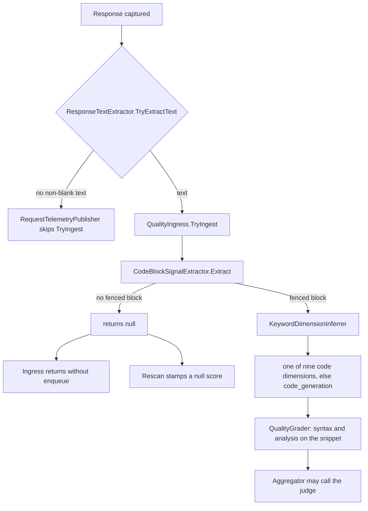
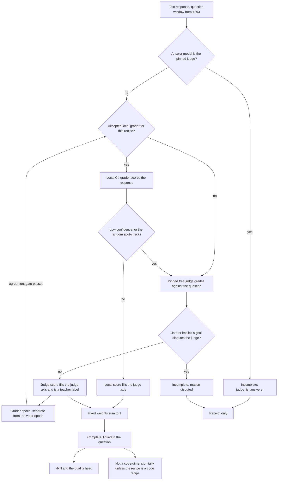
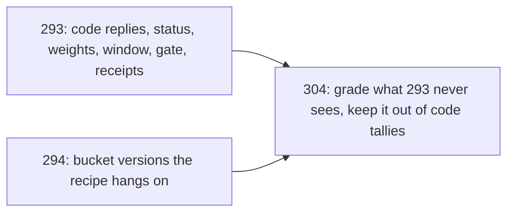

# Plan: Grade non-coding responses (#304)

**Status:** Draft, awaiting David's sign-off. His answers are folded into the design below. [§10](#10-confirm-during-review) lists numeric defaults to confirm during review. [§11](#11-todos) is follow-up, not a blocker. No implementation until this plan is signed off ([standing rule](../router/standing-rules.md)). Implementation is a separate pull request after [#293](https://github.com/davidpizon/TotallyHot-ArcRouter/issues/293).
**Issue:** [#304](https://github.com/davidpizon/TotallyHot-ArcRouter/issues/304) — prose, Q&A, writing, and analysis get no grade today. Priority P0.
**Parent plan:** [router-evaluator-and-live-pricing.md](router-evaluator-and-live-pricing.md). This plan does not replace it. It fills the hole that plan's [§14](router-evaluator-and-live-pricing.md#14-grades-293) leaves open: a live grade is only useful once it exists for the work the router actually sees, and today that work is not only code.
**Builds on:** [#293](https://github.com/davidpizon/TotallyHot-ArcRouter/issues/293) and its plan [issue-293-graders-judge-against-the-question.md](issue-293-graders-judge-against-the-question.md) (grade status, fixed weights, question window, `grade_receipts`, learning gate). [#294](https://github.com/davidpizon/TotallyHot-ArcRouter/issues/294) (fingerprint, dynamic buckets, `has_tool_calls` as a label). [#290](https://github.com/davidpizon/TotallyHot-ArcRouter/issues/290), [#291](https://github.com/davidpizon/TotallyHot-ArcRouter/issues/291), [#292](https://github.com/davidpizon/TotallyHot-ArcRouter/issues/292) consume the grades this plan produces.
**ADR:** A new ADR is required before code, because this changes what the router learns from. Do not assign a number in this file. [ADR-0026](../adr/0026-grade-a-response-only-against-its-question-and-learn-only-from-complete-grades.md) stays the code-reply decision. The new ADR cites it and does not reopen it.
**Research used:** [papers/README.md](../research/papers/README.md), [code-quality-metrics-assessment.md](../research/code-quality-metrics-assessment.md), [2303.16634v3.md](../research/2303.16634v3.md) (G-Eval). Bias magnitudes below are the ones that assessment already recorded. This plan does not add a new paper.

## Summary

- A reply with no fenced code block is dropped before any grader runs, including the judge. A prose question that does get a fence is filed under one of nine coding dimensions, default `code_generation`. Both facts are in the code cited in [§1](#1-where-non-coding-responses-fall-through).
- **Two pull requests.** [#293](https://github.com/davidpizon/TotallyHot-ArcRouter/issues/293) first, then this issue. #293 stays the code-reply plan: status, weights that sum to 1, the question window, the receipt, the learning gate. This plan depends on those contracts and does not reopen them.
- **What kind a request is** comes from its meaning fingerprint and the current bucket version ([#294](https://github.com/davidpizon/TotallyHot-ArcRouter/issues/294)), not from `KeywordDimensionInferrer` and not from a hand-written list of topics. The stable thing Eq. 8 needs is a **weight vector over grader axes**, stored on the bucket version. The axes are the instruments (judge, syntax, analysis). The bucket chooses the mix. Topic names are not the kind. In the steady state a code fence does not flip the kind.
- **Bootstrap, until bucket versions exist.** A fenced reply keeps #293's code weights and code tallies. Unfenced text is judge-only (weight 1 on the judge axis) and never touches a code tally. Tool-only turns and missing text are `Incomplete` with a reason. They do not learn.
- Every grade is still computed against the original question, under #293's window, HMAC, and `Complete`-only learning gate. A prose grade never updates a `live:` + `RouterDimension` tally.
- **Who grades.** A fixed free judge grades first. Its grades train a local C# grader. After that grader clears its own gate, it is the grade of record. The judge then spot-checks 5% of rows and every low-confidence local grade. Feedback that contradicts the judge marks the row `Incomplete`. Detail in [§3.2](#32-who-grades) and [§3.8](#38-the-grader-epoch).
- **No new grade statuses.** Only #293's `Complete`, `StructureOnly`, and `Incomplete`. A miss, a tool-only turn, and a disputed judge label are `Incomplete` plus `incomplete_reason`.
- **No historical rescan.** `ScorerVersion` becomes 4.0 so a new grade is recognizable. Rows already stored are left as they are.
- The judge is one pinned model. It is free (`ProviderOptions.IsFree`), it is not a routing candidate, and a response it produced is not graded. That is the exclusion in [§3.4](#34-judge-cost-and-bias), not a preference for "some other model." No paid model, no Python, no third-party hosted evaluator, BGE stays frozen ONNX. Cost in the reward is the recorded cost ([#290](https://github.com/davidpizon/TotallyHot-ArcRouter/issues/290)), and an unknown cost is not stored as zero.

## 1. Where non-coding responses fall through

Verified against the tree on 2026-10-14. This is the current behavior, not the #293 design.

1. **The extractor refuses anything that is not a fence.** `CodeBlockSignalExtractor.Extract` parses with `FencedCodeBlockParser` and returns `null` when `blocks.Count == 0` (`src/TotallyHotArcRouter.Quality/Extraction/CodeBlockSignalExtractor.cs`). Whitespace-only text also returns `null`.
2. **Ingress drops that null.** `QualityIngress.TryIngest` returns immediately when the extractor returns `null` (`src/TotallyHotArcRouter.Quality/Ingress/QualityIngress.cs`). Nothing is enqueued. The judge is not a separate entry point: `QualityGradingService` only grades what the queue delivers, and `QualityScoreAggregator.SubmitAsync` is what asks `IJudgeAvailability` whether to call the judge. A prose reply never reaches either.
3. **The caller never hands over an empty body.** `RequestTelemetryPublisher` calls `TryIngest` only when `responseText` is non-empty. `ResponseTextExtractor.TryExtractText` returns false for a tool-only body and still sets `hasToolCalls` (`src/TotallyHotArcRouter/Telemetry/ResponseTextExtractor.cs`). A tool-call turn with no prose is invisible to grading. `has_tool_calls` on the transcript, once issue-176 writes it, records that fact and is not a grade.
4. **Rescan stamps the hole and moves on.** `QualityRescanService.RescanOneAsync` calls the same extractor. A null request is `MarkQualityRescannedAsync` with a null score (`src/TotallyHotArcRouter/Transcripts/QualityRescanService.cs`). The comment there says why: a run of prose rows would otherwise occupy every batch. The stamp is a cursor, not a grade. Those rows are not "graded and found wanting."
5. **The dimension is always a coding dimension.** `KeywordDimensionInferrer.Infer` returns one of `RouterDimension.AllDimensions` and falls through to `code_generation` (`src/TotallyHotArcRouter.Quality/Extraction/KeywordDimensionInferrer.cs`). `HeuristicRequestClassifier` uses that same inferrer for the live routing key (`src/TotallyHotArcRouter/Router/Classification/HeuristicRequestClassifier.cs`), and `RequestInterceptor` writes `RouterDimension.ToLiveKey` from it. A question the keywords do not recognise is `code_generation` before any grade exists. `code_understanding` is the keyword branch for "explain" / "how does", which catches some prose and files it as a coding dimension anyway.
6. **Two of the three axes need code.** `QualityGrader.GradeAsync` runs `IStructuralParser` and `CompositeStaticAnalyzer` on `QualityRequest.Code` (`src/TotallyHotArcRouter.Quality/Grading/QualityGrader.cs`). `QualityRequest` is "one extracted code block" (`src/TotallyHotArcRouter.Quality/QualityRequest.cs`). There is no prose request shape.
7. **Whatever score comes out is written as a live dimension tally.** `RouterMemoryScoreObserver.ObserveAsync` always calls `AddScoreAsync` under `ToLiveKey(prefix, result.Dimension)` (`src/TotallyHotArcRouter/Router/RouterMemoryScoreObserver.cs`). #293's gate will refuse non-`Complete` rows. It will not, by itself, stop a `Complete` prose row from landing in `live:code_generation` if the dimension string is still that name.

`GEvalJudgeClient.DimensionCriteria` is a second, smaller mismatch already owned by #293: its keys are `algorithm`, `bug_fixing`, `test_generation`, `code_review`, `design`, `explanation`, and everything else uses a generic line (`src/TotallyHotArcRouter/Judge/GEvalJudgeClient.cs`). #304 does not grow that dictionary with topic names.

## 2. Decisions this plan treats as already made

| Source | What #304 keeps |
|---|---|
| #293 plan, David 2026-10-14 | Grade status `Complete` / `StructureOnly` / `Incomplete`. Only `Complete` trains. Weights fixed per recipe and sum to 1. No silent renormalization. Question window, HMAC-SHA-256, no question text in SQLite. Judge sees relevance, correctness, completeness. Code-task starting weights 0.60 / 0.25 / 0.15. |
| #293 plan §9 | Non-coding grades are out of #293. This file is that work. |
| #294, David 2026-10-13 | Fingerprint is the BGE vector plus a separate pre-routing tool block. No bucket id and no taxonomy label inside the vector. Predictors take the vector, not the bucket. Buckets are recomputed each epoch and may split, merge, or move. `has_tool_calls` and other post-response tool facts are labels, not routing inputs. |
| Parent plan §12.2, #290 | κ is `actual`, else `computed`, else `catalog`, else null. Null skips the cost term. Null is not zero. |
| Parent plan §13 | Epoch and every new fit stay in C# on `net10.0`. No Python. BGE stays the frozen ONNX session (`OnnxEmbeddingClient`). |
| Parent plan §14 | Live grades do not train the quality head until they were computed with the question. Tool success is not a grade. |
| [code-quality-metrics-assessment.md](../research/code-quality-metrics-assessment.md) §5.3 | No BLEU or reference-answer metric on live traffic. No embedding-similarity grader (BERTScore and the like measured worse). Pairwise judging was deferred there because the papers disagree and position reversals exceeded 40 percentage points. |
| ADR-0019, ADR-0020 | SQLite stays text-free. The question is reached through the passkey-gated session file. |
| David, 2026-10-14, on this issue | The judge teaches. A local C# grader takes over. Feedback catches judge errors. The judge model is fixed, free, and never an agent being graded. After takeover the judge spot-checks a small random sample and every low-confidence local grade. Fitting or refitting that local grader is a grader epoch, separate from #292. |

#293's drop-the-axis behavior in `QualityScorer` (divide by the remaining weight) is removed by that plan. This plan does not bring it back for prose. An axis with weight 0 is not in the recipe. An axis with nonzero weight that did not run changes the status, not the denominator.

## 3. Design

### 3.1 How a request is recognized, without a fixed list

The fingerprint does not contain the words "prose" or "code". [Parent plan §6](router-evaluator-and-live-pricing.md#6-meaning-fingerprint-294) forbids a dimension label in the vector. Dynamic buckets are not a stable task type either: membership changes when an epoch accepts a new partition ([#294](https://github.com/davidpizon/TotallyHot-ArcRouter/issues/294#issuecomment-6161020785)). Eq. 8 still wants weights that are fixed for a type and sum to 1.

The resolution:

- **The type is the bucket version's grading recipe**, not a topic name. A recipe is a map from grader key to a weight. The keys are `judge`, `syntax`, and `analysis` (the same three `GraderKeys`). The weights are nonnegative and sum to 1. They are fixed for the life of that bucket version. A later epoch may propose a new vector. The old vector stays on the old version so a stored grade still says which rules produced it.
- **Assignment uses the fingerprint the router already computed.** `RequestInterceptor` embeds the newest user message with frozen BGE and caches it (`TryComputeEmbeddingAsync`, then `PendingValueCache<float[]>`). When a bucket version exists, grade-time assignment is cosine to that version's centroids, off the request path, using that vector. It does not call a second embedder and it does not keyword-match the prompt. The pre-routing tool block ([parent plan §6.1](router-evaluator-and-live-pricing.md#61-tool-call-side-features-294)) may apply the bucket's accepted tool split. `has_tool_calls` does not. A child bucket inherits its parent's recipe until its own vector is accepted, the same borrowing rule David set for calibration on [#292](https://github.com/davidpizon/TotallyHot-ArcRouter/issues/292#issuecomment-6161157727). Building the centroids, the cosine lookup, and that inheritance is [#294](https://github.com/davidpizon/TotallyHot-ArcRouter/issues/294). This plan only reads `bucket_version_id` and the recipe stored on it. Until that version exists, the bootstrap table below is the whole assignment.
- **The response does not choose the recipe.** A code fence in a writing answer does not flip the row onto a code recipe. A prose answer to a question whose recipe has syntax weight does not flip the row onto a prose recipe. Response shape is stored (`response_has_code`, and the existing tool-call label) so an audit can see it. It is not an input to the next route.
- **`KeywordDimensionInferrer` stays for the code path #293 already owns** until the epoch replaces that use. #304 does not add prose keywords to it, and does not add a parallel list (`writing`, `qa`, `analysis`, `mixed`).

**Syntax weight and a response with no code.** David settled this. When the recipe's syntax weight is 0, the parser is not a weighted axis. When the syntax weight is greater than 0 and the response has no fenced block, syntax score is 0, "no code in the response." That is a measurement, so the grade can still be `Complete`. An abstention is a parser failure or an unsupported language where the checker cannot run; that yields `Incomplete` and does not learn. Analysis follows the same rule.

**Bootstrap, before any bucket version exists.** #294's epoch is parent-plan phase 7. #304 does not wait for it. David settled the split:

| Response the current extractor would do | Recipe | Status | `RouterDimension` tally |
|---|---|---|---|
| Fenced block, grader runs | #293's code weights, 0.60 / 0.25 / 0.15, keyed by the existing dimension | #293's rules | Unchanged from #293 |
| Text, no fenced block | `bootstrap`: judge 1.0, syntax 0, analysis 0. `weights_version = bootstrap` | `Complete` when the judge axis is filled | Never |
| No text, tool call seen | none | `Incomplete`, reason `deferred_to_loop` | Never |
| No text, no tool call, body unreadable | none | `Incomplete`, reason `no_text` | Never |

The bootstrap is a versioned recipe, not a topic list. It is the current extractor's gate, kept only so #293's code weights keep working until a bucket version is accepted. The steady state deletes that split: every text response, fenced or not, takes the bucket recipe. The acceptance test in [§8](#8-evaluation-and-acceptance) covers both, and the bootstrap test is deleted when the steady state ships.

**What may change a recipe's weights.** Syntax and analysis weights move only inside #292's voter epoch, and only when held-out cost-adjusted reward clears that epoch's significance band. The first accepted syntax or analysis weight on a non-code recipe starts at 0. A coefficient whose held-out interval includes 0 stays at its previous accepted value. The grader epoch in [§3.8](#38-the-grader-epoch) does not edit those weights. It replaces how the judge axis is produced. CodeJudge, ICE-Score, and RACE stay code-portfolio graders. They are not added to a recipe whose syntax weight is 0.

### 3.2 Who grades

David settled this on 2026-10-14. Three roles, in order. They are not three simultaneous judges.

1. **Teacher.** A strong LLM judge grades the response against the question. Those grades are the labels.
2. **Local grader.** A C# model trains on `Complete` teacher labels and, once accepted, fills the judge axis without calling the LLM.
3. **Feedback.** A user or implicit signal that contradicts the teacher sets the row to `Incomplete` with reason `disputed`. Those rows do not train the local grader and do not enter router learning. The signal has no score of its own.

**Teacher phase.** Until a local grader is accepted for that recipe, every eligible text response is graded by the pinned judge. The local grader may be fit and scored on a holdout, and those shadow scores are logged. They are not the grade of record. Router learning reads the judge score.

**Takeover.** The grader epoch accepts an artifact only when the agreement gate in [§3.8](#38-the-grader-epoch) passes. After that, the local score fills the judge axis. The unified score is still the recipe's weighted sum. On a bootstrap recipe the judge weight is 1, so the local score is the unified score. On a code recipe the local score replaces only the 0.60 judge axis; syntax and analysis stay. The local grader is trained to predict the judge axis, never the already-blended unified score, so syntax is not counted twice.

**Steady-state oversight.** After takeover the pinned judge still runs, on two sets only:

- A random sample of responses the local grader already scored, probability 0.05, drawn per response, stored on the receipt as `spot_check`. David set 5%. Teacher-phase sampling stays 1.0 so the local grader has labels.
- Every response whose local confidence is low, as [§3.5](#35-calibration-and-confidence) defines it. This set is not sampled.

On those rows the judge score replaces the local score as the grade of record. The pair (local, judge) is kept. The next grader epoch is fired by the random spot-check window in [§3.8](#38-the-grader-epoch), which is an unbiased sample. Low-confidence pairs are teacher labels for that fit. They are not mixed into the spot-check MAE, because those rows were chosen for being far from the training fingerprints. Rows the judge did not see keep the local score. `grade_source` is `spot_check` only for the random draw, and `low_confidence` when the cosine floor called the teacher. The `spot_check` column is true only for the random draw, so a low-confidence row is not counted in the 5%.

**Code recipes use the same teacher.** The exclusion rule in [§3.4](#34-judge-cost-and-bias) applies to every judge call, including #293's code path. Takeover of the judge axis applies to non-code recipes first. A code recipe keeps the LLM on its judge axis until a grader artifact cleared the gate on code-recipe labels. One artifact does not cover both. A prose model that has learned to imitate prose grades is not applied to code.

### 3.3 Grading methods

The axes below feed the weighted sum. The teacher is one call to the pinned model. Nothing else is a hosted service.

**Rubric judge (the teacher).** The #293 judge: one 1–5 grade, logprob-weighted the way `GEvalJudgeClient.TryComputeWeightedScore` already does, normalized with `(mean - 1) / 4`. The prompt carries the question window and the three criteria (relevance, correctness, completeness). A response that fails relevance scores low regardless of fluency. For a recipe whose syntax weight is 0, the dimension hint is one fixed sentence: judge the response as an answer to the question, and do not reward code that the question did not ask for. That sentence is not a topic classifier. The rubric stays #293's three criteria. No tone, safety, or search-factuality axis. Instruction-following stays inside completeness. It is not a fourth call. After takeover this call happens only for the spot-check and for low confidence.

**Local grader (the student).** A new prediction head, not a change to `EmbeddingLogRegTrainer`. The parent plan's [§13.1](router-evaluator-and-live-pricing.md#131-light-models-in-c-no-onnx) and [§21](router-evaluator-and-live-pricing.md#21-package-choices) put new prediction heads on `Microsoft.ML` 5.0.0. The fit is written as coefficients on the versioned artifact. It is not an ONNX graph, and it does not replace `EmbeddingLogRegModelArtifact`. The cosine floor and the length correlation stay hand-rolled C#. The agreement gate's Spearman uses the existing `RankCorrelation.Spearman`, which [§21](router-evaluator-and-live-pricing.md#21-package-choices) keeps for judge correlation. No Python. Features, all known without another LLM:

- The frozen BGE vector of the question, the one kNN already computed.
- A frozen BGE vector of the response, computed off the request path at grade time, on the same character budget the judge sees. This is an input feature. It is not an embedding-similarity score. The metrics assessment rejected BERTScore-style similarity as a grader. It did not reject a vector as a feature of a model trained to imitate the judge.
- Syntax and analysis scores when those checkers ran, plus `response_has_code`, response length, and the pre-routing tool-block counts. Length is a feature the fit can down-weight. It is not added to the score.
- Missing features use the same missingness indicator as the parent plan's tool block. They are not filled with zero.

The target is the teacher's normalized score. Rows that are `Incomplete`, including reason `disputed`, are left out of the fit. Confidence and the agreement gate are in [§3.5](#35-calibration-and-confidence) and [§3.8](#38-the-grader-epoch).

**Reference-free checks.**

| Check | When it runs | What it is not |
|---|---|---|
| Syntax and analysis, existing | Recipe weight greater than 0 | Not run on a judge-only recipe. Not a similarity between the question and the prose. |
| Non-empty, non-whitespace text | Always, as a gate before the teacher or the local grader | A blank reply is `Incomplete` reason `empty`. No score is invented. |
| Format parsers (JSON, bullet lists, word caps) | Not in this issue | A list of format keywords would be the fixed list this plan refuses. Revisit only if a local measurement shows the judge missing explicit formats. |
| Reference answer, BLEU, or a similarity score used as the grade | Never on live traffic | Rejected in the metrics assessment. A frozen BGE vector may be a feature of the local grader. It is not itself the grade. |
| Web search or a hosted factuality API | Never | A third-party evaluator must not decide a grade. |

**Pairwise comparison.** Not in this issue. The metrics assessment deferred it: the papers disagree, and swapping which answer is shown first moved results by more than 40 percentage points. Pointwise G-Eval has no left/right slot. Revisiting pairwise is a [§11](#11-todos) item, under the broader judge-bias follow-up, not a grader in this plan.

**User and implicit signals.** David settled which events count. The signal catches teacher errors. It is not an axis and it has no 1–5 score.

Counted:

- **Agent switch.** A later request whose newest user message has the same question HMAC, served by a different model than the graded response. A repeated question to the same model is a re-ask and is not a signal.
- **Thanks.** The next user message in the session is short (80 characters or fewer after trim) and, with case and surrounding punctuation removed, is one of `thanks`, `thank you`, `that worked`, `that works`. It attaches to the immediately preceding graded response in that session.

Not counted: re-asks, and copy or apply (nothing in this plan treats clipboard, an editor apply, or the user pasting the answer as feedback).

A counted event is stored on `user_signal` (`agent_switch` or `thanks`). It contradicts the teacher when a negative event meets a grade of record at or above 0.5, or a thanks meets a grade of record below 0.5. The 0.5 cutoff is the midpoint of the normalized score, configurable, and listed in [§10](#10-confirm-during-review). On a contradiction the receipt becomes `Incomplete` with reason `disputed`. The scores stay for audit. The row leaves the grader-epoch fit and router learning. If an embedding-memory row was already written for that `correlation_id`, it is deleted. Prose grades are not written into `RouterMemory` aggregates, so there is no tally to subtract. A corroborating event (switch after a low grade, thanks after a high grade) keeps the row `Complete` and records the signal.

A thumbs up or down from the user's harness is not one of these events. Whether the router can poll or intercept one is a [§11](#11-todos) feasibility note. This plan does not add a rating control.

**Tool-driven turns.** Grade the loop's final text, not the tool call and not "the tool returned ok."

- A turn with no extracted text and `hasToolCalls == true` is `Incomplete`, reason `deferred_to_loop`. It is stored so the dashboard can count it. It does not learn. Tool success, error, and retry counts stay labels ([parent plan §6.2](router-evaluator-and-live-pricing.md#62-recording-beyond-the-yesno-flag)).
- The grade attaches to the first later turn in the same-agent prefix whose body has non-blank text. The question is the user message that started the chain, not the tool result. #293's window already drops tool-result blocks; the judge must still be given the starting question, recovered from the chain, or the grade is `Incomplete`.
- If the chain cannot be reconstructed, do not sum the session and do not grade the tool-result text as if it were the question. Status `Incomplete`, reason `loop_unlinked`.
- This waits on the chain rule in the parent plan. Until that chain exists, tool-only turns stay `Incomplete` reason `deferred_to_loop`, and a later text turn is graded against its own #293 window. The receipt says the chain was not available, so those grades are not described as loop grades. Do not guess a starting question.

**Question trace.** #293's rules apply to the new rows, whether the judge axis came from the teacher or from the local grader:

- The judge input is the conversation window (newest user message plus up to six earlier text messages, 16,384 characters, secrets obscured). System prompt, tool output, file contents, and images stay out.
- `grade_receipts.question_hmac` is the HMAC of the whitespace-normalized newest user message. The fingerprint is that same message's BGE vector, the one `RequestInterceptor` already computes. David settled this: embed the newest user message only. The #293 window is what the teacher reads. It is not a second embedding on the hot path. The local grader's response vector is a separate off-path inference of the frozen BGE session, and it is not the routing fingerprint.
- No question text and no response text in SQLite.
- A missing question fails closed: `Incomplete`, not a score.
- `prompt_version` bumps when the non-code hint sentence is added, so a code-recipe grade and a bootstrap grade are distinguishable.

### 3.4 Judge cost and bias

**The judge model is fixed, and it is not an agent.** David settled this on 2026-10-14, resolving the earlier same-model question by exclusion rather than by preference.

- One pinned name, the operator's `JudgeOptions.ModelName`. `JudgeModelSelector` today falls back to the first eligible free model when the pin is missing or ineligible. That fallback is removed for grading. A missing pin, a paid pin, or a pin that is switched off means the teacher abstains. It does not call some other configured agent.
- The pin must be free (`ProviderOptions.IsFree`, a known zero). A model the catalog merely cannot price is not free enough. "Strong" is the operator's choice of which free model to pin. The router does not rank free models by a strength score it does not have.
- The pinned model is removed from the auto-route candidate set, so the router does not choose it as an agent. An explicit client pick still reaches it ([ADR-0005](../adr/0005-protect-explicit-provider-selections-from-silent-substitution-on-any-circuit-trip.md)). That response is `Incomplete` with reason `judge_is_answerer`. No grade is stored, and the row does not train the local grader or the router. There is no second judge for that row.
- The pin is the teacher for code recipes and for non-code recipes. #293's judge path uses this same rule once this plan lands. A code reply written by the pinned model is ungraded too.

**Volume.** During the teacher phase the judge runs on eligible text responses. `SamplingRate` stays 1.0 in that phase so the local grader has labels. After takeover the judge runs only for the 5% spot-check and for low confidence ([§3.2](#32-who-grades)). The existing queue (`QueueCapacity` 256, `WorkerConcurrency` 2, `JudgeJoinTimeoutMs`) stays the backpressure. A drop writes `Incomplete` reason `queue_full` instead of a debug log and no row. `ScorerVersion` becomes 4.0. There is no historical rescan: `QualityRescanService` is not taught to call the teacher on rows already stored, and a null stamp already on those rows stays a null stamp.

**Bias.** Magnitudes are the ones already in the metrics assessment.

| Bias | What this plan does |
|---|---|
| Verbosity, the largest measured effect there (−30.63 pp on their code audit) | The teacher prompt says a longer answer is not a better one. Length is stored and is a local-grader feature, not a bonus added to the score. The grader epoch reports the correlation of teacher score with length. Stored grades are not changed because of that correlation. Whether to do anything with the report is a [§11](#11-todos) item. |
| Position | Not applicable to the pointwise teacher. Pairwise stays off. |
| Self-preference | Closed by the exclusion above. The teacher never grades a response it wrote, and it is not in the agent pool, so a same-model label cannot be created. G-Eval's caveat in [2303.16634v3.md](../research/2303.16634v3.md) is met by not training on the teacher's opinion of itself. |
| Teacher bias copied by the student | The local grader imitates the teacher, including the teacher's mistakes, until feedback marks rows disputed and the next grader epoch refits without them. Spot-checks are what make those mistakes visible. |
| Judge-only weight | Bootstrap weight on the judge axis is 1 until a bucket earns syntax or analysis. After takeover that axis is the local grader, still weight 1, with the teacher auditing rather than scoring every row. |

The answering model is not asked whether its own answer is correct. AutoMix's self-check is that pattern, and parent-plan §12.8 keeps it off this path.

### 3.5 Calibration and confidence

Two different confidences. They are not interchangeable.

**Teacher confidence.** The logprob mass `TryComputeWeightedScore` already computes, stored as `judge_logprob_weighted` and the probability sum on the score digits. A fallback digit with no logprobs is still `Complete`, with `judge_logprob_weighted = false`. That flag is not the local grader's low-confidence rule. Platt scaling of routing probabilities stays in #292's epoch. It does not rewrite a stored grade.

**Local-grader confidence, which decides the spot-check.** The grader artifact stores a reservoir of the question fingerprints it trained on (vectors only, capped, no text) and a cosine floor. The floor is the 20th percentile of cosine-to-nearest-training-neighbor on the held-out slice. A live row whose question vector sits below that floor is low confidence. Low confidence always calls the teacher. It is not sampled. The local score is still stored, with `local_confidence`, and it is not the grade of record on that row.

Routing conformal sets stay on the voter side. A low-confidence grade is not a routing abstention. The voter can still abstain later, under #292, for its own reasons.

No third-party calibrator.

### 3.6 How the grade is used

Only `Complete` rows pass #293's learning gate. On top of that gate:

| Consumer | What it may read | What it must not do |
|---|---|---|
| Reward \(r = \varepsilon_1 s + \varepsilon_2 \kappa\) (#291) | \(s\) is the `Complete` unified score. \(\kappa\) is the recorded cost for that request, or the loop sum when this request is the start of a chain and every part has a cost. | Do not use a catalog rate when a recorded cost exists. Do not treat a missing cost as 0. `EmbeddingMemoryScoreObserver` does that today when the pending cost cache misses (`recoveredCost = 0.0`). A #304 row writes null cost on a miss and the reward skips \(\kappa\). This work does not wait for #290. |
| kNN memory | The existing task embedding (newest user message) plus the `Complete` score. Neighbors stay cosine over BGE. | Do not key these rows by a `RouterDimension` string. |
| `RouterMemory` / dim_best live tallies | Code-recipe `Complete` rows only, through the #293 path. | A bootstrap or non-code recipe never calls `AddScoreAsync` with a `RouterDimension` key. `code_understanding` is one of those keys. A prose "explain" question does not update it. |
| logreg, cluster_best, quality head | At the next voter epoch, from stored `Complete` grades and the fingerprint. Not on the request that was just graded, except kNN, which already learns per score. | Do not fit the quality head on `StructureOnly` or `Incomplete`, whatever the reason. Do not fit it on tool-success counts. |
| Voter epoch (#292) | Reads `Complete` grades after they exist, whatever filled the judge axis. May refit recipe weights for syntax and analysis. | Does not fit the local grader, does not roll it back, and does not call the teacher. |
| Grader epoch ([§3.8](#38-the-grader-epoch)) | Fits the local grader on undisputed teacher labels. | Does not re-form buckets, does not change voter weights, does not change \(\varepsilon\), and does not rewrite old grades. |

Voter weights move only inside #292, on cost-adjusted reward, using recorded costs. This plan does not change `Epsilon1` or `Epsilon2`. A disputed grade is `Incomplete` reason `disputed`. Both observers skip every `Incomplete` row.

### 3.7 Storage and migration

Extend #293's `grade_receipts`. Do not add a second grade table.

| Column | Purpose |
|---|---|
| `grade_status` | Only #293's three values: `Complete`, `StructureOnly`, `Incomplete`. |
| `weights_version` | `bootstrap`, or the bucket-version id the recipe was copied from. |
| `bucket_version_id` | Null until #294 writes one. |
| `fingerprint_ref` | Already reserved by #293. The BGE vector id of the newest user message. Null if that vector was not cached. Historical rows are not backfilled. |
| `response_has_code` | Shape label. Not a routing input. |
| `judge_model`, `answer_model` | The pin, and the model that wrote the response. Reason `judge_is_answerer` is `Incomplete`, not a learned row. |
| `grade_source` | `teacher`, `local`, `spot_check` (the 5% draw), or `low_confidence` (the cosine floor called the teacher). Null when the status is `Incomplete` and no score was produced. |
| `local_grader_version`, `local_confidence` | Null before an artifact exists. |
| `spot_check` | True when this row was in the random sample. |
| `user_signal` | `agent_switch`, `thanks`, or null. A contradiction sets `incomplete_reason` to `disputed` and the status to `Incomplete`. |
| `judge_logprob_weighted`, `judge_confidence` | Teacher confidence. Null when the teacher did not run. |
| `recorded_cost_usd`, `cost_source` | Null cost when unknown. Source is #290's label when that column already exists; this plan does not invent a parallel cost store. If #290 has not landed, the receipt may copy the telemetry estimate and must mark it `catalog`, or leave both null. It must not write 0. |
| `incomplete_reason` | Empty on `Complete`. Otherwise `queue_full`, `no_text`, `empty`, `no_judge`, `judge_is_answerer`, `deferred_to_loop`, `loop_unlinked`, `disputed`, or a parser-abstention reason #293 already records. |

Migration is `ALTER TABLE ... ADD COLUMN` guarded by `PRAGMA table_info`, matching `RouterMemoryDatabase`. There is no rescan of history. Existing null stamps stay null. They are not backfilled with a guessed score. New embedding-memory rows written from a grade carry `correlation_id` so a later dispute can delete that one neighbor. `MemoryEntry` does not have that column today.

#293 deletes pre-change live learning once. #304 does not delete it again. If both ship in one upgrade, there is one purge, owned by #293's migration, and the marker is the same `schema_meta` row. Prose rows did not learn before this plan, so there is no prose tally to purge.

`QualityRequest` gains an optional response-text field and a recipe id. `Code` and `Language` are empty when the recipe does not run syntax. The structural parser is not called in that case.

The local grader's accepted artifact lives outside `grade_receipts`: coefficients, feature-schema version, BGE model id, teacher `prompt_version`, cosine floor, fingerprint reservoir, data-window counts, held-out MAE and Spearman correlation, and the id of the previous accepted artifact. It is not an ONNX file. It is not the #292 voter artifact. Rolling one back does not roll the other back.

### 3.8 The grader epoch

Fitting the local grader, and refitting it, is its own epoch. David required that split on 2026-10-14. It is a hosted job on the router, the same kind of background work as `LogRegRetrainHostedService`. It does not run on the request path. It does not call Python. It is not a step inside #292.

**Trigger.** A clock may wake the job. The clock does not force a fit. The job logs the skip reason unless one of these holds:

- No artifact is accepted for a recipe, at least 200 `Complete` teacher grades exist for that recipe, and at least 50 of them can be held out.
- An artifact is accepted, and the spot-check rows since that acceptance have MAE against the teacher worse than 0.10 on the 0–1 score, on at least 50 spot-check rows.
- The teacher `prompt_version` or the BGE model id no longer matches the accepted artifact. Stored vectors from another embedder are not scored. The grader abstains, the same way kNN abstains, and the teacher is the grade of record again until a new artifact is accepted.

The counts 200 and 50, the MAE 0.10, and the Spearman floor 0.60 below are the proposed defaults. They are configuration, not constants buried in code. Confirm them during review ([§10](#10-confirm-during-review)).

**Fit.** A `Microsoft.ML` 5.0.0 regression head in C#, as [§3.3](#33-grading-methods) describes. Coefficients are stored on the versioned artifact. Training rows are `Complete` teacher labels for that recipe only. The holdout is not in the fit. `Incomplete` rows, including reason `disputed` and reason `judge_is_answerer`, are not labels. Each run reports the correlation of teacher score with response length and does not rewrite grades from that correlation.

**Agreement gate.** The candidate replaces the live artifact only when, on the holdout:

- mean absolute error against the teacher is at most 0.10, and
- Spearman correlation with the teacher is at least 0.60, and
- if a live artifact exists, the candidate's MAE is better by more than a paired bootstrap interval on that holdout.

Failing the gate leaves the live artifact in place. If there is no live artifact, the teacher stays the grade of record. A candidate that only looks close and does not clear the bar does not take over.

**Authority.** Takeover means new grades for that recipe use the local score except where [§3.2](#32-who-grades) calls the teacher. Old receipts are not rewritten. `local_grader_version` on a new receipt is the artifact id that scored it.

**Rollback.** The previous accepted artifact is kept. If a later spot-check window of at least 50 rows has MAE worse than 0.10, authority returns to the teacher: the local grader goes back to shadow, and router learning reads the teacher again. The coefficients are not deleted. The next fit may promote a new candidate or restore the previous one if it still clears the gate on the new holdout. A voter-epoch rollback does not do this, and this rollback does not restore old voter weights.

**What the job logs.** Whether it ran, why it skipped, the old and new artifact ids, holdout MAE, Spearman correlation, row counts, and whether authority moved. The learning dashboard shows that record next to the #292 epoch record, labeled as the grader epoch so the two cannot be mistaken.

## 4. Phases

Each phase leaves the build warning-free, tests green, and coverage at or above 80%. New public members get XML docs. Judge tests use a recorded double. No live provider. Heavy tests stay under 5 seconds.

| Phase | Work | Done when |
|---|---|---|
| 0 | This plan signed off, and the ADR accepted. | David's comment on #304 or on the plan PR. |
| 1 | Stop the silent drop on the live path. A new text response with no fence becomes a request. Ingress enqueues it. The receipt is `Incomplete` until phase 2 wires the judge. `RouterMemoryScoreObserver` ignores these rows. Historical rescan behavior is unchanged: already-stored rows are not sent to the teacher. | A fixture with no fence produces a receipt and zero `AddScoreAsync` calls on a `RouterDimension` key. A pre-existing null stamp is not rewritten. |
| 2 | Teacher path for the bootstrap recipe, #293 window and gate, `prompt_version` bump. Pinned free model only. No fallback to another agent. `judge_is_answerer` writes `Incomplete` and does not learn. | A prose fixture with a judge double stores `Complete`, HMAC set, and does not touch a code tally. A fixture whose answerer is the pin stores `Incomplete` reason `judge_is_answerer` and does not call the judge. No pin stores `Incomplete` reason `no_judge`. |
| 3 | Fingerprint ref from the pending BGE vector. Response embedding off the request path for the local grader's features. A new grade whose pending vector has expired may recompute that one vector with the frozen ONNX session. Already-stored rows are not walked. | A grade row points at the question vector kNN used. A missing question vector leaves `fingerprint_ref` null. The response vector is not written into SQLite as text, and it is not a second embedder. |
| 4 | `user_signal`, spot-check flag, queue-full receipts, length stored and reported, not added to the score. Agent-switch and thanks detectors. | A contradicting signal sets `Incomplete` reason `disputed`, deletes the embedding row for that correlation id, and is excluded from the trainer. A re-ask to the same model and a copy/apply are not signals. |
| 5 | kNN write for `Complete` non-code rows. Null cost on a cache miss, not 0. | Memory kNN sees the row. dim_best does not. Reward math skips \(\kappa\) when cost is null. |
| 6 | Tool-only turns are `Incomplete` reason `deferred_to_loop`. When the parent-plan chain exists, grade the final text against the starting question. | A tool-only fixture learns nothing. A linked final answer grades the starting question. An unlinked text turn is `Incomplete` reason `loop_unlinked`. The test does not invent a question. |
| 7 | Grader epoch in shadow. Fit on undisputed teacher labels. Authority stays with the teacher until the gate passes. | A fixture under the MAE and correlation bar does not take over. A fixture that clears the bar writes an artifact and a rollback copy, and does not change voter weights. |
| 8 | Takeover. High-confidence rows do not call the teacher. Low-confidence rows and the random sample do. A bad spot-check window returns authority to the teacher. | The three paths are asserted. A #292 artifact is unchanged by the grader rollback. |
| 9 | Docs: `docs/how-it-learns.md`, parent plan §14 notes the teacher, the local grader, and the separate epoch. Dashboard counts `Incomplete` by reason. | The docs describe teacher phase and takeover separately, and they say history is not rescanned. |

Phase 5 touches the score observer, which is not the proxy hot path. Phase 3's response embed is off-request and uses the frozen BGE session. The question fingerprint stays the newest user message already computed on the request path. Phase 2's removal of the pin from the auto-route candidate set does touch routing. That edit re-runs CodeGraph on `RequestInterceptor` callers, keeps Serilog templates static, and runs the golden-path smoke.

## 5. Relationship to #293

- **Do not combine the designs.** #293's plan already lists this issue as out of scope and keeps a single code-task weight row. Folding prose into that pull request would change the weight table, the extractor contract, and the tally key in the same change as the learning gate.
- **Do sequence the work.** #304's phase 2 calls #293's window, HMAC, status, and gate. It does not reimplement them. If #293's plan is still unsigned when this one is reviewed, implementation of either waits. The plans can be signed off together.
- **Two implementation pull requests.** David settled this. #293 first, then #304. This plan's implementation does not start until #293's plan is signed off and its contracts exist to call. Shared schema (`grade_receipts`) is #293's table. #304 adds columns in its own migration after that table exists.
- **#288** stays code-specific. The prompt-test extractor is not a prose grader.
- **#294** does not have to ship first, and this plan does not build its centroids or its inheritance rule. `bucket_version_id` stays null and the recipe stays `bootstrap` until a version exists. When one exists, new grades read the recipe stored on it. Old bootstrap grades keep their `weights_version` and are not rewritten.
- **#291** reads `Complete` grades and skips `Incomplete` and `StructureOnly`. This plan does not implement the reward.
- **#292** does not train the local grader. Its epoch may refit voter weights and bucket recipes from grades this plan has already stored. The grader epoch does not take a turn inside that job. The two artifacts roll back independently.

## 6. Constraints

- C# / .NET 10 only. The local grader is a new prediction head on `Microsoft.ML` 5.0.0, matching the parent plan's package rule. `EmbeddingLogRegTrainer` and `SphericalKMeansTrainer` stay as they are. No Python, no notebook, no ONNX training session.
- BGE-large stays frozen ONNX. The question vector is the one kNN computed. The response vector is a second inference of that same session, off the request path. This plan does not fine-tune BGE and does not load another embedder.
- The grade of record is the pinned free teacher, or the local grader after takeover, or `Incomplete` with a reason. The teacher is a model the operator already runs. It is not a third-party grading API. No AutoMix-style extra generation, no search API.
- Reward cost is the recorded cost. Catalog is only the fallback label #290 already defines. Unknown is null.

## 7. Risks

- **Bootstrap leak.** Until buckets exist, a fenced answer to a prose question still takes the code recipe and can enter a code tally. David accepted that split. The steady-state test is what retires it. The bootstrap fixture must keep failing if a fence on a prose question is treated as the steady-state rule.
- **The student copies the teacher.** Until feedback disputes bad labels, takeover repeats the teacher's verbosity and its mistakes, only cheaper. Spot-checks are the detection. They are not a correction until the next grader epoch drops those rows.
- **Quota.** The teacher phase grades eligible new text, which spends the free pin faster than today's code-only path. After takeover the pin sees 5% plus the low-confidence rows. Queue-full receipts make a teacher-phase drop visible. History is not graded later to fill those gaps.
- **A pin that is also the only strong model.** Excluding it from the agent pool means that model never answers user traffic. If the operator has no other model they trust, routing quality and grading quality are different fleets on purpose. Putting the pin back into the candidate set would recreate same-model grading, which this plan refuses.
- **Wrong question on a tool loop.** Grading a tool result as the user question teaches the router that agents answer tool JSON well. The chain rule is the mitigation. Guessing a session-wide question is the failure this plan refuses.
- **Bucket churn changes the recipe.** A split that does not clear the regret bar must not change weights. The epoch's existing accept/reject rule is the mitigation. A grade stores the version it used so a later split does not rewrite it.
- **Prose in a code tally.** One missed predicate in `RouterMemoryScoreObserver` recreates the bug this issue exists to stop. The phase 1 test is that predicate, and it stays in the suite after the bootstrap is gone.
- **Cost stored as zero.** A miss in `EmbeddingMemoryScoreObserver` currently records cost 0, which #291 would read as a free request. Phase 5 stops that for the new rows. Rows already written are #290's backfill problem, not a second purge.
- **Fingerprint and judge text differ.** kNN and the recipe assignment embed the newest user message. The teacher reads the #293 window. A follow-up whose newest message is "the other one" has a weak fingerprint and a better teacher input. David chose the newest message as the only embedding. This plan does not start embedding the window.

## 8. Evaluation and acceptance

Recorded judge double only. No live provider in CI.

| Fixture | Pass |
|---|---|
| Prose answer, no fence, teacher returns a score, no local artifact yet | Receipt `Complete`, `grade_source = teacher`, HMAC set, unified score equals the teacher score, `AddScoreAsync` not called with any `RouterDimension` value. |
| Answerer is the pinned judge | `Incomplete` reason `judge_is_answerer`. The judge client is not called. Nothing learns. |
| Pin missing, paid, or switched off | `Incomplete` reason `no_judge`. No fallback model is called. |
| Same question HMAC, later request served by another model, grade of record at or above 0.5 | `user_signal = agent_switch`, status `Incomplete` reason `disputed`. Embedding row for that correlation id is deleted. |
| Next short message is "that worked", grade of record below 0.5 | `user_signal = thanks`, status `Incomplete` reason `disputed`. |
| Same question HMAC, same model again | Not a signal. Status unchanged. |
| Fallback digit, no logprobs | `Complete`, `judge_logprob_weighted = false`. |
| Holdout under the agreement bar | No takeover. Teacher stays the grade of record. Voter weights unchanged. |
| Holdout clears the bar, high local confidence, not sampled | No teacher call. `grade_source = local`. |
| Same, local confidence below the cosine floor | Teacher runs. `grade_source = low_confidence`. `spot_check` is false. Teacher score is the grade of record. |
| Same, confidence high, row drawn in the random sample | Teacher runs. `grade_source = spot_check`. `spot_check` is true. The pair is kept for the next grader epoch. |
| A supplied bucket version whose recipe has syntax weight 0, response contains a fence | That recipe is used. `response_has_code` is true. No code tally. This fixture does not build centroids; it only reads a version #294 would have written. |
| Spot-check window MAE worse than 0.10 | Authority returns to the teacher. The previous artifact is still on disk. The #292 artifact is untouched. |
| Tidy code block answering a different request than the question | On a code recipe, the #293 ranking test still holds. On a non-code recipe, the judge double's low relevance score is the unified score. The row does not enter `live:code_generation`. |
| Writing question whose answer contains a fence | Steady state: non-code recipe, fence stored as `response_has_code`, no code tally. Bootstrap: documented exception, asserted separately so it cannot pass unnoticed. |
| Tool-only body | `Incomplete` reason `deferred_to_loop`. No teacher call. |
| Linked final answer after a tool call | Judge prompt contains the starting user message and does not contain the tool payload. |
| Unlinked text after tools | `Incomplete` reason `loop_unlinked`. No learning. |
| Queue full | Receipt `Incomplete` reason `queue_full`. |
| Syntax weight greater than 0, response has no fence | Syntax score 0. The grade can be `Complete`. |
| No historical rows | A database that already has null rescan stamps is not walked, and `ScorerVersion` 4.0 does not enqueue them. |
| Cost cache miss | Stored cost is null, not 0. A reward helper skips \(\kappa\). |
| Weights | Every recipe in the fixture sums to 1. An abstaining weighted axis does not change the weights; it changes the status. |
| Text in SQLite | A scan of the new columns finds no question text and no response text. |

Acceptance for the issue's done-when line: a prose reply has a grade linked to its question, the weights for that recipe sum to 1, the learning gate matches #293, and no prose grade is written under a code dimension key.

## 9. Out of scope

- Re-deciding #293's code weights, purge, or static-checker blindness.
- Building #292's voter epoch, the bucket partition, or the cost-aware voter. This plan stores the columns those need and defines the grader epoch as a separate job.
- #288's prompt-test extractor.
- A new rating control in the GUI. Harness thumbs are a feasibility TODO in [§11](#11-todos), not a control in this plan.
- Safety classification, tone scoring, or a factuality search.
- Pairwise judging as a live axis. Revisiting it is [§11](#11-todos).
- Fine-tuning BGE, SetFit, TorchSharp, or a second embedder.
- A historical rescan of prose, or of any grade stored before `ScorerVersion` 4.0.
- Any Python.

## 10. Confirm during review

David asked that these stay the proposed defaults, be configuration, and be confirmed during review. They are not open design questions. Changing a number does not change the rest of the plan.

| Setting | Default |
|---|---|
| Undisputed `Complete` teacher labels before the first grader-epoch fit | 200 |
| Holdout size, and the later spot-check window that can roll authority back | 50 |
| Holdout MAE against the teacher, at most | 0.10 on the 0–1 score |
| Holdout Spearman correlation with the teacher, at least | 0.60 |
| Rollback when a later spot-check window's MAE is worse than | 0.10 |
| Cosine floor for low confidence | 20th percentile of holdout neighbor similarity ([§3.5](#35-calibration-and-confidence)) |
| Contradiction cutoff | 0.5, the midpoint of the normalized score ([§3.3](#33-grading-methods)) |
| Thanks detector, maximum message length | 80 characters after trim |

Spot-check probability is not in this table. David set it at 0.05.

## 11. Todos

Not in this issue's implementation. They are the follow-ups David asked to record.

1. **Catch judge bias.** One follow-up, not several one-off patches.
   - Revisit pairwise judging. It stays out of this plan because the metrics assessment found the papers in conflict and position reversals above 40 percentage points. The follow-up has to say how order swap and abstention-on-disagreement would work before any pairwise score can train the router.
   - Use the length correlation the grader epoch already reports. This plan records length and does not change stored grades. The follow-up decides whether a measured length skew should change training, and how, without silently rewriting old receipts.
2. **Harness thumbs.** Assess whether the router can poll or intercept a thumbs up or down from the user's harness. Do not build a rating control as part of that assessment. Agent switch and thanks are the feedback events until that assessment says a thumb is available and trustworthy. Re-asks and copy/apply stay excluded either way.
