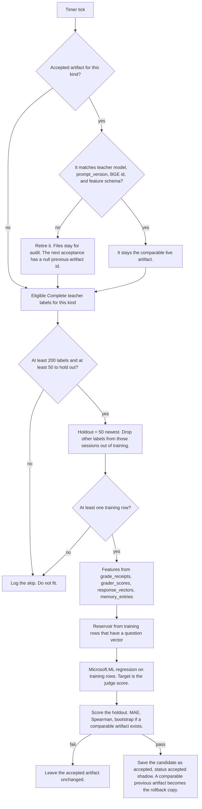
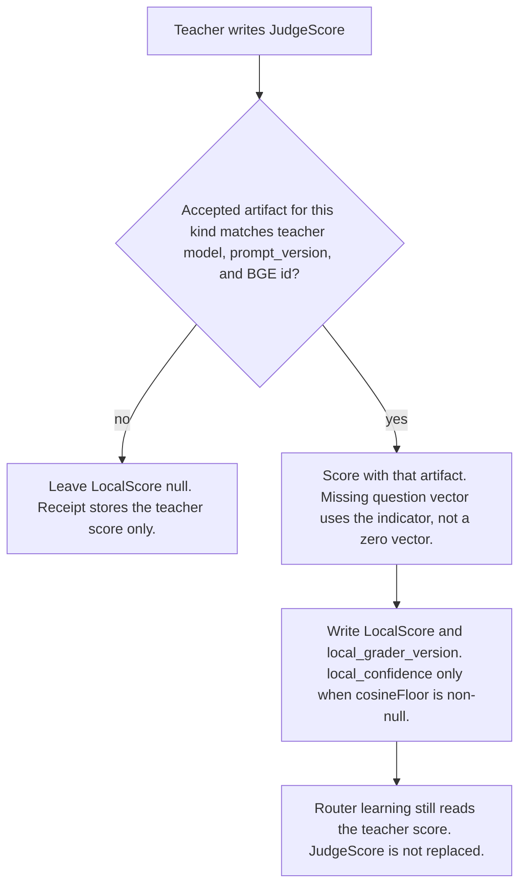

# Plan: #304 phase 7 — grader epoch in shadow

**Status:** Proposed. David asked these questions on 2026-10-25. The decisions below record the recommendations he is reviewing. They are not approved until he says so on this pull request. Do not start the phase 7 code until that approval. The implementation pull request must link this file.

**Issue:** [#304](https://github.com/davidpizon/TotallyHot-ArcRouter/issues/304). **Parent plan:** [`issue-304-grade-non-coding-responses.md`](issue-304-grade-non-coding-responses.md) §3.3, §3.5, §3.8, §4 phase 7, and §10. **ADR:** [ADR-0027](../adr/0027-grade-non-coding-responses-on-a-bootstrap-recipe-and-keep-them-out-of-code-tallies.md). This phase does not change that ADR. Decision 3 there says that after the grader epoch accepts an artifact, the artifact fills the judge axis and leaves `JudgeScore` empty, and it also says takeover is a later phase of the same plan. This file uses the parent plan's split of that sentence: phase 7 acceptance is shadow, and the fill-the-axis step is phase 8 takeover. No ADR amendment is required for that split, because the ADR already parks takeover in a later phase.

**This pull request is docs only.** It does not change source, tests, project files, or workflows.

## Decisions

Each row is David, 2026-10-25, and stays proposed until he approves this pull request. The 2026-10-26 rules in the body are decided: null `local_confidence` when the floor is null, `Sdca`, the `code` and `non-code` folders, failed-candidate retention, `GraderEpochArtifactStore.RollbackToTeacher`, and `GraderEpochLabelQuery.LoadForKindAsync`.

| # | Decision |
|---|---|
| A | **Gate pass means accepted, and the grader stays in shadow.** When a candidate clears the agreement gate, phase 7 saves it as the accepted artifact for its kind and keeps the previous accepted artifact as the rollback copy. The log records the scores, the row counts, the old and new artifact ids, and the status `accepted, shadow`. The teacher remains the grade of record for every grade in phase 7. Takeover, where the local score becomes the grade of record, is phase 8. Phase 7 never rewrites a stored grade and never changes voter weights. |
| B | **The holdout is the 50 newest labels of that kind.** Per kind (code or non-code), the holdout is the 50 most recently graded eligible teacher labels. Ties in time are broken by `correlation_id`, so the split is deterministic. A whole session stays on one side: any other eligible label from a session that already has a row in the holdout is left out of the training pile. It is not added to the holdout. Everything older, aside from those session siblings, trains. If the newest 50 teacher scores have zero variance, Spearman is null and the gate fails. Nothing is accepted, and nothing takes over. The job waits for more data. Holdout size stays a configuration default of 50. |
| C | **The paired bootstrap is the luck range, and it runs only against a comparable live artifact.** Comparable means the live artifact was trained for the same teacher model, the same teacher `prompt_version`, and the same BGE model id. Otherwise the old artifact is already retired, and only the absolute bars apply. When the check runs, both artifacts score the same holdout. For each row, `d_i` is the old absolute error minus the new absolute error. The job resamples those rows with replacement `B = 2000` times from a fixed seed, takes the mean of `d` each time, and uses the 2.5th through 97.5th percentile as the 95% interval. The candidate replaces the live artifact only when the lower end is greater than 0. `B`, the confidence level, and the seed are configuration defaults, not constants in the fit. The log records both ends of the interval. |
| D | **The fingerprint reservoir is capped and sealed.** The cap is 5,000 question vectors per artifact, a configuration default. The reservoir is filled only from training rows, never from holdout rows. When more than 5,000 training rows have a usable question vector, the job keeps a uniform reservoir sample drawn with a fixed seed. The cosine floor is the 20th percentile of the holdout's cosine to the nearest neighbor in that same reservoir, which is also the reservoir live rows are checked against. A row whose question vector is missing (`question_vector_missing = 1`, or no `memory_entries` row) is not in the reservoir. The reservoir is sealed with the same vector key and the same AES-256-GCM blob layout as `response_vectors`. Phase 7 does not write an unencrypted question vector anywhere. Unencrypted question vectors in `memory_entries` stay [#306](https://github.com/davidpizon/TotallyHot-ArcRouter/issues/306). The reservoir is rebuilt from rows that still exist at each fit, so a deleted session drops out at the next fit. A vector is about 4 KB (`EmbeddingOptions.EmbeddingDimension` defaults to 1024 floats). A full reservoir is about 20 MB per artifact, plus 28 bytes of nonce and tag per vector. |
| E | **The first artifact's spare is the teacher.** The first accepted artifact for a kind stores a null previous-artifact id. Rollback of that artifact returns authority to the teacher (the local grader goes back to shadow) and does not throw. From the second accepted artifact on, the previous accepted artifact is the rollback copy: its file stays, and its id is the previous-artifact id. A later fit may restore that copy only by clearing the gate again. Rollback itself does not promote the copy to accepted. Spot-check rollback is phase 8 (decision G). Phase 7 still has the rollback operation, because a teacher-model, prompt, or BGE change retires the artifact, and because the null-previous test has to call it. |
| F | **Shadow practice scores start once an artifact is accepted.** After an accepted artifact exists for the kind, and it matches the current teacher model, teacher `prompt_version`, and BGE model id, each new eligible answer the teacher grades also gets `LocalScore` written beside `JudgeScore`. `local_grader_version` is that artifact's id. The teacher score stays the grade of record. Router learning reads only that teacher score. `LocalScore` never fills `JudgeScore`, and a `LocalScore` is never a training label. If the artifact does not match, `LocalScore` stays null. A missing question vector uses the missingness indicator, never a zero vector. Before any artifact is accepted, the local grader writes nothing. |
| G | **Spot-check rollback moves to phase 8.** The rule "a spot-check window of at least 50 rows with MAE worse than 0.10 returns authority to the teacher", the trigger that watches that window, and the tests for that trigger ship with the 5% draw and with takeover. Phase 7 keeps the resets that can fire now: a change of teacher model, teacher `prompt_version`, or BGE model id retires the artifact. A feature-schema version mismatch retires it the same way (decision H). It also keeps the previous-artifact field. Every phase 7 run logs that the spot-check window is not active yet. A bad spot-check MAE does not retire anything in this phase. |
| H | **Tool counts stay out of feature schema version 1.** The pre-routing tool-block counts in the parent plan's [§6.1](router-evaluator-and-live-pricing.md#61-tool-call-side-features-294) (`tool_definition_count`, `prior_tool_call_count`, `prior_tool_result_count`, the `other` and `unknown` counts, and the five kind counts) are not columns on `grade_receipts`. [#294](https://github.com/davidpizon/TotallyHot-ArcRouter/issues/294) owns them. Schema version 1 leaves them out entirely. They are not zero-filled, not an always-missing column, not stored by #304, and not reconstructed from session files. When #294 saves them, a new feature-schema version includes them, and that version retires a schema-1 artifact the same way a BGE model-id change does. |

One reading this plan applies so the decisions can be coded against today's tree. It is part of the proposal, not a separate approval.

**Kind of a receipt.** There is no kind column. `GradeReceiptRecordObserver` stores `weights_version` as `GradingRecipes.Bootstrap` (`bootstrap`) or as `QualityOptions.WeightsVersion` (default `3.0-judge-heavy`). Those two strings are the syntax-weight split in the parent plan §3.8 today: `bootstrap` is syntax weight 0 (non-code), and `3.0-judge-heavy` is the code recipe (syntax weight greater than 0). Phase 7 treats `bootstrap` as non-code. It treats a `weights_version` equal to the current `QualityOptions.WeightsVersion` as code. Any other `weights_version`, including a future #294 bucket id, is not a label for either artifact until a later change can read that version's syntax weight. `GradingRecipes.IsCodeRecipe` is not used for this split: that method treats a null or empty recipe id as code, and it compares to `GradingRecipes.Code` (`code`), which is not the string stored in `weights_version`. A bucket re-form still does not reset an artifact that is already accepted. The reset list is only teacher model, teacher `prompt_version`, BGE model id, and feature-schema version.

**What a teacher-model change does to the rollback copy.** If the accepted artifact's teacher model, `prompt_version`, BGE model id, or feature-schema version does not match the current values, phase 7 retires it before the gate. The retired files stay on disk for audit. They are not the previous-artifact id of the next acceptance, because a grader trained on a different teacher is not a spare for the new one. The next artifact that passes the gate therefore has a null previous-artifact id, the same as a first artifact. Decision C's "the old one is already retired" and decision E's "null previous id rolls back to the teacher" are the same case.

## Scope

Phase 7 builds the grader epoch and runs it in shadow.

- Two artifacts, one for code recipes and one for non-code recipes. The head predicts the teacher's judge score, not the blended unified score.
- A `Microsoft.ML` 5.0.0 regression head in C#, inside the router assembly (`TotallyHotArcRouter`), the same assembly as `LogRegRetrainHostedService` and `RankCorrelation`. `RankCorrelation.Spearman` is `internal`, so the job has to live there to call it. The default trainer is `Microsoft.ML.Trainers.SdcaRegressionTrainer`, created with `MLContext.Regression.Trainers.Sdca`. That type is not in this repo. It ships in the `Microsoft.ML` 5.0.0 package this phase adds, and its linear weights are the coefficient payload the artifact stores. `FastTree` is not the default: `FastTreeRegressionTrainer` is a separate `Microsoft.ML.FastTree` package and does not persist that coefficient vector. `GraderEpochOptions.Trainer` (proposed) defaults to `Sdca`. Phase 7 implements that one name. The call is `Trainers.Sdca()` with no extra options, so the L2 weight and iteration count are that method's defaults. Any other trainer name logs a skip and does not fit. The artifact records the trainer name. A different trainer, or a change to those defaults, is a new feature-schema version. The fit is not an ONNX graph and it does not replace `EmbeddingLogRegModelArtifact`.
- The package pin is new. `src/TotallyHotArcRouter/TotallyHotArcRouter.csproj` references `Microsoft.ML.OnnxRuntime` 1.31.0 and does not reference `Microsoft.ML`. Phase 7 adds `Microsoft.ML` 5.0.0 to that project only. BGE stays the frozen ONNX session (`OnnxEmbeddingClient`). This phase does not fine-tune it, does not load a second embedder, and does not call Python.
- A hosted service on the same pattern as `LogRegRetrainHostedService`: registered with `AddHostedService` in `src/TotallyHotArcRouter/Hosting/ServiceCollectionExtensions.cs`, woken by a `PeriodicTimer`, and unwilling to fit just because the timer fired. Each tick visits code and non-code independently. The loop waits for the tick to finish before the next wait, so a fit is not overlapped by the next tick.
- Training on undisputed `Complete` teacher labels of the current teacher model, current `prompt_version`, and current BGE model id. The label is the `grader_scores.score` row whose `grader_key` is `GraderKeys.Judge` (`judge`). It is not `grade_receipts.unified_score` and it is not `LocalScore`.
- The agreement gate: holdout MAE at most 0.10, Spearman at least 0.60 with null failing the gate, and the paired bootstrap when a comparable live artifact exists.
- Shadow `LocalScore` beside the teacher score once an accepted matching artifact exists.
- The sealed fingerprint reservoir and the cosine floor, stored for phase 8. Phase 7 does not call the teacher because a row is below the floor.
- Length correlation, reported and not applied.
- The columns and receipt fields this phase has to add because they are not in the tree yet: `local_score`, `local_grader_version`, `local_confidence`, and `syntax_score` on `grade_receipts`. `QualityResult` already has `LocalScore` (`init`-only). It does not have `LocalGraderVersion`, `LocalConfidence`, or a syntax score.

## Out of scope

- Takeover. `LocalScore` does not become the grade of record. `GradeStatusCalculator.Calculate` stays as it is. The four judge-axis cases in the parent plan §3.2 are phase 8.
- The 5% spot-check draw. `QualityResult.SpotCheck` and `grade_receipts.spot_check` already exist. Phase 4 persists the column and leaves it false. Phase 7 does not start drawing.
- The spot-check MAE rollback trigger (decision G). The rollback method exists so the null-previous test and the retirement path can call it. The window that calls it does not.
- Low-confidence teacher calls. The floor is computed and stored. A live row below the floor does not call the teacher in this phase.
- Rewriting any stored grade, unified score, or `grader_scores` row. Changing voter weights, `Epsilon1`, `Epsilon2`, or the #292 artifact. Resetting an artifact because buckets were re-formed.
- Tool-count features (decision H). Encrypting the question vectors already in `memory_entries` (#306). Opening a session file. Re-embedding question text. A historical rescan. Bumping `ScorerVersion`.
- The learning-dashboard panel for this epoch. Phase 7 writes the log record. Showing it next to the #292 epoch record is phase 9.
- Adding `Microsoft.ML.FastTree` or any trainer other than `SdcaRegressionTrainer`. The options property can name another trainer later. Phase 7 does not load it.

## Data flow

The fit does not run on the proxy request path. Shadow scoring runs in the quality grade pipeline, after the teacher score exists and before `GradeReceiptRecordObserver` writes the receipt. It does not run inside `RequestInterceptor`.

### Eligible label

All of the following. A miss is "not a label". It is never stored or trained as 0.

No store in the tree returns this join. `IGradeReceiptStore` reads one receipt. `IGraderScoreStore.GetAllAsync` reads every grader score with no receipt filter. `IMemoryEntryStore.LoadAllAsync` loads every memory row. `IResponseVectorStore` has no read method. `SqliteResponseVectorStore.TryOpen` opens one response row and deletes it when authentication fails. Phase 7 adds a proposed `GraderEpochLabelQuery` in `src/TotallyHotArcRouter/Judge/GraderEpochLabelQuery.cs`. It is not in the tree. `LoadForKindAsync(string kind, CancellationToken cancellationToken)` reads `RouterMemoryDatabase` (that type exists) and joins `grade_receipts` to the judge `grader_scores` row, the `response_vectors` row, and a left join to `memory_entries` on `correlation_id`. It opens each response blob with `ResponseVectorSeal.TryOpen`. A failed open excludes the label and does not delete the row. Shadow scoring of the one live row calls `SqliteResponseVectorStore.TryOpen`, so a live blob that fails authentication is still deleted by that existing method, and `LocalScore` stays null.

- `grade_receipts.grade_status` is `Complete`. `incomplete_reason` is null. That already drops `disputed`, `judge_is_answerer`, `no_judge`, `queue_full`, and the other incomplete reasons. An `Incomplete` row whose `response_vectors` row was kept (the parent plan's low-confidence teacher failure) is not a label.
- `prompt_version` equals `JudgeOptions.PromptVersion`, and `judge_model` equals `JudgeOptions.ModelName`. Both comparisons are ordinal. A null on the receipt is not a match. `GradeReceiptRecordObserver` writes those two only when `JudgeScore` has a value.
- The kind rule above matches this artifact's kind.
- Exactly one `grader_scores` row with `grader_key = GraderKeys.Judge` for that `correlation_id`. That row's `score` is the label. Zero rows, or more than one row, means the receipt is not a label. The job does not average judge rows and does not substitute `unified_score`. `grader_scores.score` is `REAL NOT NULL`; absence is a missing row, not a null score.
- A `response_vectors` row whose `embedding_model` equals `OnnxEmbeddingClient.ModelIdentity` (`EmbeddingOptions.ResolveModelIdentity()`), and `ResponseVectorSeal.TryOpen` succeeds with the key from `ResponseVectorKeyHolder.GetOrCreate()`. A missing row, a different model id, or a failed open excludes the row. `TryOpen` sets the output to an empty array on failure. That empty array is not a feature and is not a zero vector of embedding length.

`LocalScore`, even when it sits beside `JudgeScore`, is not the label. A row with only `LocalScore` is not a label.

### Holdout and training

Sort eligible labels by parsed `created_at_utc` descending (`SqliteGradeReceiptStore` writes `DateTimeOffset` with the `"O"` format), then by `correlation_id` ordinal ascending. Take the first `HoldoutSize` rows (default 50). That set is the holdout.

Session id for the sibling rule is `grade_receipts.session_id` when it is non-empty, otherwise `CorrelationIdParser.SessionIdOf(correlation_id)`. `GradeReceiptRecordObserver` stores a null session id when `QualityResult.SessionId` is empty, and the parser recovers `{sessionId}:{turnNumber}` when the correlation id has that shape. An id with no colon is its own session and does not pull other rows.

Any other eligible label with that session id is in neither set. The rest train. If that leaves no training row, log a skip and do not fit. Do not shrink the holdout to manufacture a training row. The 200-label trigger is checked before this split. After the split, one training row is enough to fit. There is no second minimum.

If the holdout's teacher scores have zero variance, `RankCorrelation.Spearman` returns null (it ranks both samples and returns `Pearson`, and `Pearson` returns null when either sample has zero variance). The gate fails. Do not accept.

### Features, schema version 1

The in-memory matrix may mark a missing slot with a non-numeric missing mark. Stored columns stay SQL NULL. A missing mark is never written as 0, and `QualityScorer`'s "null axis contributes 0" rule is not reused here.

| Order | Feature | Where it is read | When it is missing |
|---|---|---|---|
| 1 | Question-vector missing indicator, then the question vector | `grade_receipts.question_vector_missing` and `memory_entries` joined by `correlation_id` | Indicator 1 when the flag is 1, when no memory row exists, when `embedding_model` is null, or when `embedding_model` differs from the current identity. A NULL flag is a row stored before the column. It is not a stored hit and does not by itself set the indicator. NULL with no memory row is indicator 1. NULL with a memory row whose `embedding_model` is null or different is indicator 1. NULL with a memory row whose `embedding_model` equals the current BGE id is indicator 0. Do not use `MemoryEntry.MatchesEmbeddingModel`: that method treats a null model id as a match, and this job must not. The value slots are the mean of the training rows that have a vector. The flag on the receipt is not rewritten. |
| 2 | Analysis missing indicator, then the analysis score | `grader_scores` where `grader_key` is `GraderKeys.Analysis` | No row, or more than one row: indicator 1, value is the training mean of rows that have exactly one analysis score. |
| 3 | Syntax missing indicator, then the syntax score | New `grade_receipts.syntax_score` (nullable REAL, no default) | Null on every row stored before the column, and null when the parser did not run. The grade path writes `1.0` or `0.0` from `QualityResult.SyntaxValid` only when `GradingRecipes.IsCodeRecipe(result.RecipeId)` is true, because that is when the parser runs. Bootstrap leaves it null. `SyntaxValid` defaults to false and `SyntaxConfidence` defaults to `1.0`; neither default is a feature, and neither is read back from a receipt that has no column. |
| 4 | `response_has_code` | `grade_receipts.response_has_code` | Not missing. The column is `INTEGER NOT NULL`. `0` means no fence, which is a stored fact. |
| 5 | Length missing indicator, then `response_length_chars` | `grade_receipts.response_length_chars` | Null length: indicator 1, value is the training mean of present lengths. A null length is not 0. |
| 6 | Response vector | `response_vectors`, opened as above | A row without a usable response vector is not eligible. The vector is not mean-imputed and not zero-filled. |

`EmbeddingOptions.EmbeddingDimension` (default 1024) is the only legal vector length. A different length is unusable: the question vector is missing, or the response vector makes the row ineligible. `EmbeddingMemory.CosineSimilarity` throws when the lengths differ, and it returns 0 when either magnitude is 0. This job does not call it on those inputs. A zero-magnitude vector is unusable, same as missing. The 0 that method returns is not a cosine and is not a floor sample.

If a training window has no observed value for question, analysis, syntax, or length, that value and its indicator are dropped for this fit (an indicator that is 1 on every row is only an intercept). The artifact lists the dropped slots. Live scoring drops the same slots. They are not filled with 0. If the question-vector mean is undefined, the reservoir is empty and the cosine floor is null. The fit may still run on the response vector and the other features.

Tool-count names from the parent plan §6.1 are not in this list. The trainer's input width is the width of this list after drops. A test plants a tool-count value where a careless reader might look and asserts the fit never reads it and never writes a 0 coefficient for it.

CodeJudge, ICE-Score, and RACE stay out of schema version 1. They are portfolio graders, not features of this head.

Imputation means, the indicator layout, and the dropped-slot list are stored on the artifact and reused at score time. They are fit on training rows only. Holdout rows do not move the means.

### Reservoir and cosine floor

After the training set is fixed, take the training rows whose question vector is usable (indicator 0 and the current BGE id). Order them by `created_at_utc` ascending, then `correlation_id` ordinal ascending. If there are more than `ReservoirCapacity` (default 5000), keep a uniform sample with Vitter's Algorithm R driven by `new Random(RandomSeed)` created for this reservoir only. .NET 10's `System.Random` is the generator. A test locks the chosen ids for a fixed seed so a runtime change cannot pass silently.

Seal each kept vector with the key from `ResponseVectorKeyHolder.GetOrCreate()`. The blob layout is the one `ResponseVectorSeal` already uses: `nonce (12 bytes) || tag (16 bytes) || ciphertext`, AES-256-GCM, a fresh nonce every write. Do not call `ResponseVectorSeal.Seal` as it stands. Its associated data is hard-coded to the table name `response_vectors` plus the correlation id and the model id, so a response blob and a reservoir blob would authenticate as each other. Phase 7 adds a seal path with the same layout and the same key, and with length-prefixed associated data whose first field is the label `grader_fingerprint_reservoir`, then the artifact id, the source `correlation_id`, and the BGE model id. A blob copied from `response_vectors`, or onto another artifact, fails authentication. A failed open drops that reservoir entry at the next read. It is not guessed and it is not replaced with zeros.

The reservoir file is rewritten from the rows that still exist at each successful fit. Session deletion already removes `response_vectors` and, through the existing maintenance paths, the linked memory rows. The next fit simply does not see them. Phase 7 does not add a second delete path for the reservoir beyond that rebuild.

The cosine floor is the 20th percentile of cosine-to-nearest-reservoir-neighbor over holdout rows that have a usable question vector, measured against this reservoir. Sort those cosines ascending. With `n` of them, take the element at 0-based index `floor(0.20 * (n - 1))`. The `0.20` comes from `CosineFloorPercentile` (default 20), not from a literal in the method. Holdout rows with a missing question vector are not in the percentile. They are not low confidence. If `n` is 0, or the reservoir is empty, the floor is null. Do not store 0.

`local_confidence` on a shadow row is that row's cosine to its nearest reservoir neighbor when `cosineFloor` is non-null and the row has a usable question vector. Otherwise it stays null. David decided this on 2026-10-26: when `cosineFloor` is null, including a non-empty reservoir whose holdout contributed no usable cosine, `local_confidence` is NULL. It is never 0, even when that row's cosine could be computed. Phase 7 does not compare it to the floor to decide a teacher call.

### Agreement gate

Score every holdout row with the candidate. The number that enters the gate is the prediction clamped to `[0, 1]`, which is also the number shadow scoring will store. If any holdout row cannot be scored, the gate fails. Do not drop that row and score the rest.

- MAE is `RankCorrelation.MeanAbsoluteDifference` of the clamped predictions and the teacher scores. The bar is `<= MaxHoldoutMae` (default 0.10). An empty sample returns null and fails the gate.
- Spearman is `RankCorrelation.Spearman`. The bar is `>= MinSpearman` (default 0.60). Null fails the gate.
- When a comparable live artifact still exists, score the same holdout with it. `d_i = |old_i - teacher_i| - |new_i - teacher_i|`. Draw `B` resamples (default 2000) with a separate `new Random(RandomSeed)`, with replacement, in holdout order. Record the mean of `d` each time. Sort those means ascending. With confidence `c` (default 0.95), `tail = (1 - c) / 2`, `lowIndex = floor(tail * (B - 1))`, `highIndex = min(B - 1, ceil((1 - tail) * (B - 1)))`. With those defaults the indexes are 49 and 1950. Replace only when `means[lowIndex] > 0`. Equal to 0 does not replace. Log both `means[lowIndex]` and `means[highIndex]`. When the bootstrap does not run, log both ends as null. Do not log them as 0.

All required bars must pass. Failing leaves the accepted artifact where it was. If there was none, there is still none. The teacher stays the grade of record either way.

Passing writes the candidate as the accepted artifact for that kind, status `accepted, shadow`. If a comparable live artifact existed, its id is the new artifact's previous-artifact id and its files stay. If there was no comparable artifact, the previous-artifact id is null.

### Shadow scores

`QualityResult.LocalScore` is `init`-only today, so the grade pipeline cannot stamp it later. Phase 7 makes `LocalScore`, and new `LocalGraderVersion` and `LocalConfidence`, settable, the same way `QuestionVectorMissing` is settable. The stamp is a new `IQualityScoreObserver` in the router assembly. Register it with `AddSingleton` and insert it in the `CompositeRouterScoreObserver` list in `ServiceCollectionExtensions` after `ResponseVectorGradeObserver` and immediately before `GradeReceiptRecordObserver`. That fan-out already runs on the final result, after the teacher score exists (`PendingQuestionVectorGradeReader` is the pattern for a reader that mutates the result before a later observer persists it). Do not place it ahead of `GraderScoreRecordObserver` or `ResponseVectorGradeObserver`. The new observer does not change `GradeSource`. A teacher-scored row keeps `grade_source = teacher`. It does not run inside `RequestInterceptor`, and it does not run inside `QualityScoreAggregator` before the result is final. The receipt gains nullable columns with no default, added with `ALTER TABLE ... ADD COLUMN` guarded by `PRAGMA table_info`, matching `question_vector_missing`. A default of 0 would mark old rows as scored.

The stamp happens only when an accepted artifact for the row's kind matches the current teacher model, `prompt_version`, and BGE id. The kind is the same split the fit uses, applied to the `weights_version` `GradeReceiptRecordObserver` will store. `GradingRecipes.Bootstrap` selects the non-code artifact. A recipe the observer will stamp with the current `QualityOptions.WeightsVersion` selects the code artifact. Today's observer writes one of those two strings for every recipe it knows: bootstrap, or the current code weights version for anything else. A `weights_version` that is neither string is not scored and is not a training label. The live stamp does not invent a third kind. When no matching artifact is accepted, or the weights version is neither string, `LocalScore`, `LocalGraderVersion`, and `LocalConfidence` stay null. The artifact's coefficients are the ones that score. A missing question vector uses the schema-1 indicator and the artifact's stored mean. It does not build a zero `float[]`.

The response vector is not a field on `QualityResult`. `ResponseVectorGradeObserver`, which runs immediately before this observer, has already stored it when `JudgeScore` is set. The shadow observer reads that row from the response-vector store and opens it with the same `ResponseVectorSeal.TryOpen` rule the fit uses. It does not call the embedder. A missing row, a different model id, or a failed open leaves `LocalScore` null for that grade. It does not score on a partial feature vector and it does not write a zero vector. The question vector is read from `memory_entries` under the schema-1 rules, and the missingness flag is `QualityResult.QuestionVectorMissing`, the value the receipt will store. The pending cache has already been taken by `EmbeddingMemoryScoreObserver`. The shadow observer does not call `TryPeek` and does not re-embed the question.

The receipt columns this observer's successor has not written yet are taken from the result, under the same rules the fit will later read back. Syntax is `1.0` or `0.0` from `QualityResult.SyntaxValid` when `GradingRecipes.IsCodeRecipe(result.RecipeId)` is true, and missing otherwise. That is the `syntax_score` `GradeReceiptRecordObserver` will store. Analysis is `QualityResult.AnalysisScore` when that score has a value, which is the one `grader_scores` row `GraderScoreRecordObserver` has just written, and missing when it does not. `response_has_code` and `response_length_chars` are `QualityResult.ResponseHasCode` and `QualityResult.ResponseLengthChars`. A later fit of this same row reads the stored columns and gets the same numbers. Do not read `syntax_score` for the row being scored. That column does not exist yet, and a read would treat every live row as syntax-missing.

`GradeReceiptRecordObserver` keeps writing `JudgeScore`'s prompt and model as it does now. It additionally persists `LocalScore`, `local_grader_version`, and `local_confidence`. It also persists `syntax_score`: `1.0` or `0.0` from `QualityResult.SyntaxValid` when `GradingRecipes.IsCodeRecipe(result.RecipeId)` is true, and null otherwise, including every bootstrap row. It does not copy `LocalScore` into `JudgeScore`. `GraderScoreRecordObserver` does not write a `grader_scores` row under `GraderKeys.Judge` for the local score. `EmbeddingMemoryScoreObserver` and `RouterMemoryScoreObserver` are not changed to read `LocalScore`.

`local_confidence` is the cosine described above, or null. A null floor stores NULL, never 0. It is not a teacher call.

### Retirement and rollback

At the start of each tick, for each kind, if the accepted artifact's stored teacher model, teacher `prompt_version`, BGE model id, or feature-schema version differs from the current values, clear the accepted pointer. Leave the files. Log which field differed. Do not restore a previous artifact across that change.

Rollback is `GraderEpochArtifactStore.RollbackToTeacher(kind)`. That type and method are proposed. They are not in the tree. Phase 8 calls the same method. The store lives next to the hosted service, in `src/TotallyHotArcRouter/Judge/GraderEpochArtifactStore.cs`. Retirement uses the same store to clear `accepted.json`. The method:

- No accepted artifact: success. Authority is already the teacher.
- Accepted artifact with a null previous-artifact id: clear the accepted pointer. Do not throw. Authority is the teacher, which in phase 7 means shadow scoring stops.
- Accepted artifact with a previous-artifact id: clear the accepted pointer. Do not delete the previous artifact's files. Do not make that id the accepted artifact. A later fit may accept it again only by clearing the gate on a new holdout.

Phase 7 does not count `spot_check` rows and does not compare their MAE to 0.10. The log line that says the window is not active is emitted on every tick, including ticks that skip the fit.

### Length

On each fit that trains, report `RankCorrelation.Pearson` of the training rows' teacher scores and their `response_length_chars`, using only rows whose length is non-null. Null correlation (zero variance, or no lengths) is logged as null, not as 0. No grade, coefficient, or receipt is edited because of that number.

### Bucket re-form

Nothing in the retirement check reads a bucket id. Changing weights other than the teacher identity above does not clear the accepted pointer. `bucket_version_id` is not a `grade_receipts` column today. This phase does not add one.

## Artifact contents

One directory per kind, under a new `StorageOptions` path. The new property follows `LogRegModelPath` / `ResolveLogRegModelPath`: default `%PROGRAMDATA%\grader-epoch`, resolved by a new `ResolveGraderEpochDirectory()` with the same token rules. The kind folders are exactly the `kind` strings: `code` and `non-code`.

- `%PROGRAMDATA%\grader-epoch\code\accepted.json` and `%PROGRAMDATA%\grader-epoch\non-code\accepted.json` — the accepted artifact id, or absent when none is accepted. Replaced last, by writing a temp file in that kind directory and renaming it, so a reader never sees a half-written pointer.
- `%PROGRAMDATA%\grader-epoch\code\{id}.json` and the same under `non-code` — no vectors and no question or response text. Retired artifacts stay here. They are not deleted when a newer one is accepted.
- `%PROGRAMDATA%\grader-epoch\code\{id}.reservoir` and the same under `non-code` — sealed question vectors only, in reservoir-sample order. Layout, little-endian: 4 bytes magic `THGR`, a `uint32` count, then that many records. Each record is a `uint32` byte length, the UTF-8 `correlation_id`, a `uint32` byte length, and the sealed blob. No plaintext floats. A reader that sees a bad magic, a truncated record, or a failed open drops that entry and does not substitute a zero vector.
- `%PROGRAMDATA%\grader-epoch\code\failed\{id}.json` and `%PROGRAMDATA%\grader-epoch\code\failed\{id}.reservoir`, and the same pair under `non-code\failed`. A candidate that was fit and failed the gate is moved here after the gate result is known. `accepted.json` is not created or replaced. Shadow scoring does not load this directory. The files are diagnostics. `GraderEpochOptions.FailedCandidateRetention` (proposed) defaults to 3 per kind. When a new failure is filed, delete the oldest failed ids in that kind beyond 3, ordered by `createdAtUtc` on the JSON, then by id ordinal. Accepted and retired files outside `failed` are not in this cap. A fit that throws deletes any `*.tmp` it created in that kind directory and does not leave a temp file as `accepted.json`. A failed candidate never becomes the live artifact. Only a later fit that clears the gate writes `accepted.json`.

`id` is `Guid.NewGuid().ToString("N")`.

The JSON carries:

- `artifactId`, `kind` (`code` or `non-code`), `status` (`accepted, shadow` is the only status phase 7 writes)
- `featureSchemaVersion` (`1`)
- `teacherModel` (`JudgeOptions.ModelName`), `teacherPromptVersion` (`JudgeOptions.PromptVersion`), `bgeModelId` (`EmbeddingOptions.ResolveModelIdentity()`)
- `previousArtifactId` (string or null)
- coefficient payload: the `Sdca` weight vector and bias, in schema-version-1 order after dropped slots, plus the trainer name, the imputation means, the feature order, and the dropped slots. The training table has one vector column named `Features` and one float column named `Label` (the judge score). Scoring is the dot product of those weights with the same feature vector, plus the bias, then clamped to `[0, 1]`. The JSON does not store an ML.NET pipeline.
- `cosineFloor` (number or null), `reservoirCount`, `reservoirCapacity`, `randomSeed`
- `eligibleCount`, `holdoutCount`, `trainingCount`, `sessionExcludedCount`
- `holdoutMae`, `spearman` (number or null)
- `bootstrapLow`, `bootstrapHigh` (numbers, or null when the bootstrap did not run)
- `lengthCorrelation` (number or null)
- `createdAtUtc`

The JSON is not `EmbeddingLogRegModelArtifact` and is not an ONNX file. Rolling it back does not touch the logreg file `StorageOptions.ResolveLogRegModelPath()` points at.

## Configuration defaults

New type `GraderEpochOptions` in `src/TotallyHotArcRouter/Judge/GraderEpochOptions.cs`, section name `GraderEpoch`. Register it the way `JudgeCalibrationOptions` is registered in `JudgeServiceCollectionExtensions.AddJudge`: `AddOptions`, bind `GetSection(SectionName)`, `ValidateDataAnnotations`. A missing section keeps the property defaults. Do not put these on `JudgeOptions`. That type's operational bounds are documented as not overridable from `appsettings.json`.

The 2026-10-23 defaults already in the parent plan §10 stay. The rows below are the 2026-10-25 proposal.

| Property | Default | Role |
|---|---|---|
| `Enabled` | `true` | When false, each tick logs that the job is off and does not fit. A fresh install still no-ops until 200 labels exist. |
| `CheckIntervalMinutes` | `5` | How often the timer wakes. The same period `LogRegRetrainHostedService` uses, but as a setting. The wake does not force a fit. |
| `MinimumLabels` | `200` | Eligible labels of that kind before the first fit. Already confirmed 2026-10-23. |
| `HoldoutSize` | `50` | Newest-label holdout. Already confirmed. The phase 8 spot-check window reuses the number 50 and is a different counter. |
| `MaxHoldoutMae` | `0.10` | Holdout MAE bar, inclusive. |
| `MinSpearman` | `0.60` | Spearman bar, inclusive. Null fails. |
| `BootstrapSamples` | `2000` | `B`. |
| `BootstrapConfidence` | `0.95` | Central interval. Default tails are 2.5% and 97.5%. |
| `RandomSeed` | `20261025` | `System.Random` seed for the reservoir and, separately, for the bootstrap. One `int`. Each procedure constructs its own `Random` so the draws do not move each other. |
| `ReservoirCapacity` | `5000` | Question vectors sealed per artifact. |
| `CosineFloorPercentile` | `20` | Already the parent plan's floor. Phase 8 is what acts on it. |
| `Trainer` | `Sdca` | Selects `Microsoft.ML.Trainers.SdcaRegressionTrainer`. The only name phase 7 fits. Recorded on the artifact. |
| `FailedCandidateRetention` | `3` | Failed candidates kept per kind under `failed`. Decided 2026-10-26. |

`SpotCheckRollbackMae` is not read in phase 7. The parent plan's 0.10 rollback bar stays in §10 for phase 8.

## Logging

Serilog, through the hosted service's `ILogger`. Every template is a static string literal. No interpolation and no `string.Format`. No question text, no response text, and no vector contents.

| When | Level | What the template includes |
|---|---|---|
| Job disabled, or a tick skipped | Information | The skip reason: disabled, below the label count, holdout shorter than `HoldoutSize`, or no training row after session exclusion. Include the kind and the counts that were known. |
| Spot-check window | Information | Every tick, for each kind: the spot-check window is not active in phase 7. This line is not conditional on a fit. |
| Retirement | Information | Kind, artifact id, and which field mismatched: teacher model, prompt version, BGE model id, or feature schema. |
| Gate failed | Information | Kind, holdout MAE, Spearman (or a null marker), eligible / holdout / training / session-excluded counts, bootstrap ends or null, and that the accepted artifact was left unchanged. |
| Gate passed | Information | Kind, old artifact id or null, new artifact id, the same scores and counts, both bootstrap ends or null, and the status `accepted, shadow`. |
| Length | Information | Kind, artifact id, and the correlation or a null marker. |
| Shadow score | Debug | Correlation id, artifact id, and `LocalScore`. One line per stamp. |
| Rollback | Information | Kind, artifact id, previous-artifact id or null, and that authority is the teacher. |
| Reservoir auth failure | Warning | Artifact id and source correlation id. The entry is dropped. No bytes. |

A fit that throws is caught the way `LogRegRetrainHostedService.ExecuteAsync` catches a non-cancellation exception: log it and keep the loop. Do not leave a temp file as the accepted pointer.

## Tests

New test class `GraderEpochPhase7Tests` in `src/TotallyHotArcRouter.Tests`, beside `ResponseVectorPhase3Tests` and `GradeDisputePhase4Tests`. Recorded fixtures only. No live provider, no BGE download, and no ONNX session. Vectors in the fixture are short arrays with an `EmbeddingOptions.EmbeddingDimension` override, except one test that asserts the production default 1024 is what a default options object reports. Each test stays under 5 seconds. Bootstrap on 50 rows for 2000 draws is arithmetic and stays inside that bound. Reservoir tests set `ReservoirCapacity` to a handful; one test asserts the default property is 5000 without building a 5000-vector sample.

`RankCorrelation` is `internal`. The test project already sees the router assembly's internals the same way the judge tests call into it. The new tests use that access. They do not duplicate Spearman.

| Test | What it asserts |
|---|---|
| `GateFail_BelowBar_DoesNotAcceptOrRewriteGrades` | MAE above 0.10, or Spearman below 0.60, writes no accepted artifact. Stored grades and the file from `ResolveLogRegModelPath` are unchanged. |
| `GatePass_AcceptsShadowArtifact_KeepsPreviousAsRollbackCopy` | A candidate that clears MAE, Spearman, and a positive bootstrap lower bound becomes accepted with status `accepted, shadow`. The previous artifact id is the old one. Its file remains. Grades are unchanged. Voter weights and the logreg file are unchanged. `JudgeScore` is still the only grade of record. |
| `GatePass_FirstArtifact_PreviousIdIsNull` | The first acceptance stores a null previous-artifact id. |
| `Holdout_TakesFiftyNewestPerKind_TieBreakCorrelationId` | Per kind, the holdout is the 50 newest. Equal timestamps break by `correlation_id` ordinal ascending. The other kind's rows are not in this holdout. |
| `Holdout_ExcludesSessionSiblingsFromTraining` | A sibling session row is in neither the holdout nor the training set. |
| `Holdout_ZeroVariance_SpearmanNull_GateFails` | Every holdout teacher score equal. Spearman is null. Nothing is accepted. |
| `Bootstrap_NotRun_WhenNoComparableLiveArtifact` | A live artifact with a different teacher model, prompt version, or BGE id is retired first. The gate uses only MAE and Spearman. The log's interval ends are null. |
| `Bootstrap_ReplacesOnlyWhenLowerBoundGreaterThanZero` | Lower end `> 0` replaces. Lower end `<= 0` leaves the live artifact in place. Both ends are in the log. |
| `Reservoir_BuiltFromTrainingRowsOnly_ExcludesHoldoutAndMissingVectors` | Holdout correlation ids are absent. Rows with `question_vector_missing = 1` are absent. Rows with no `memory_entries` row are absent. Rows whose `embedding_model` is null or different are absent. |
| `Reservoir_SealedWithVectorKey_NotPlaintext` | The reservoir bytes are not the plaintext float layout. They open with `ResponseVectorKeyHolder`'s key. A `response_vectors` blob does not open as a reservoir entry. |
| `Reservoir_RebuildDropsDeletedSession` | After the session's rows are gone, the next accepted reservoir does not contain that correlation id. |
| `CosineFloor_UsesTheReservoirLiveRowsSee` | The floor's neighbor set is the reservoir just sealed, not a second sample. A missing question vector contributes no cosine. An empty reservoir stores a null floor, not 0. |
| `Rollback_FirstArtifact_NullPreviousId_ReturnsToTeacher` | `GraderEpochArtifactStore.RollbackToTeacher` on a first artifact does not throw. The accepted pointer is gone. A later grade leaves `LocalScore` null. |
| `Rollback_KeepsPreviousFile_AndDoesNotPromoteIt` | Rollback of a second artifact leaves the previous file on disk and does not mark it accepted. |
| `ShadowScore_WritesLocalScoreBesideJudgeScore_WhenArtifactMatches` | `LocalScore` is set, `local_grader_version` is the artifact id, `grade_source` stays `teacher`, `JudgeScore` is unchanged, `IsJudgeScored` stays true, and no new `grader_scores` row uses `GraderKeys.Judge` for the local score. The embedding client is not called by the shadow observer. |
| `ShadowScore_LocalScoreNull_WhenNoArtifactOrArtifactMismatch` | Nothing accepted, or the accepted artifact's teacher model, prompt, or BGE id differs: `LocalScore` stays null. |
| `ShadowScore_MissingQuestionVector_UsesIndicator_NotZeroVector` | A missing question vector still scores. No zero-length or zero-filled vector is passed in. `local_confidence` stays null. The shadow observer does not call `PendingValueCache.TryPeek` and does not re-embed the question. |
| `ShadowScore_NullFloor_StoresLocalConfidenceNull` | The accepted artifact's `cosineFloor` is null and the live row has a usable question vector. `LocalScore` is set. `local_confidence` is NULL. It is not 0. |
| `QuestionVectorMissing_NullFlag_FollowsMemoryRow` | A NULL `question_vector_missing` with a memory row on the current BGE id trains with indicator 0. NULL with no memory row, or with a null or different `embedding_model`, trains with indicator 1. The flag column is not rewritten. No zero vector is built. |
| `GateFail_KeepsCandidateUnderFailed_DoesNotTouchAccepted` | A failed gate writes `code\failed\{id}.json` or `non-code\failed\{id}.json` and the matching reservoir. `accepted.json` is unchanged. Shadow scoring does not load that id. A fourth failure deletes the oldest failed id in that kind. The kept files are not promoted. |
| `ShadowScore_UnusableResponseVector_LeavesLocalScoreNull` | No stored response vector, a different BGE id, or a failed `TryOpen` leaves `LocalScore` null. The empty array `TryOpen` returns is not scored and is not treated as a zero vector. |
| `ShadowScore_SyntaxComesFromTheResult_NotTheUnwrittenColumn` | A code row with `SyntaxValid` true scores syntax as `1.0` before `GradeReceiptRecordObserver` writes `syntax_score`. A bootstrap row scores syntax as missing. Neither path reads a zero from the default `SyntaxValid` of false. |
| `LocalScore_IsNeverTheTrainingLabel` | A `Complete` row whose only score is `LocalScore` is not a label. A row with both uses the judge `grader_scores` score as `y`. |
| `Retirement_TeacherModelPromptBgeOrFeatureSchema_RetiresArtifact` | A mismatch of teacher model, teacher `prompt_version`, BGE model id, or stored `featureSchemaVersion` clears the accepted pointer and does not install the retired id as the next previous-artifact id. |
| `SpotCheckWindow_IsNotActive_DoesNotRetire` | The not-active template is logged. Fifty spot-check rows with a terrible MAE leave the accepted artifact in place. |
| `FitAndScore_DoNotReadOrZeroFillToolCounts` | Schema version 1 has no tool-count slot. The fixture row bag includes `tool_definition_count = 3` and `prior_tool_call_count = 1` as extra keys that are not `grade_receipts` columns. A spy accessor throws if either key is read. The feature builder's output names are the schema version 1 list, and the coefficient vector's length is that list's width. No coefficient is stored under a tool-count name, and no 0 is written for one. |
| `SyntaxDefault_IsNotAFeature` | A bootstrap row with `SyntaxValid` false and `SyntaxConfidence` 1.0 stores null `syntax_score`. The fit does not treat that null as 0. |
| `BucketReform_DoesNotResetArtifact` | A weights change that is not the teacher model, the teacher prompt, the BGE id, or the feature schema leaves the accepted artifact in place. |
| `LengthCorrelation_IsReported_GradesUnchanged` | The log contains the Pearson figure or a null marker. Receipt scores are byte-for-byte the same. |
| `IncompleteDisputedAndJudgeIsAnswerer_AreNotLabels` | Those statuses contribute no training row and no holdout row, including an `Incomplete` row that still has a response vector. |
| `QuestionVectorMissing_FitsWithIndicator_NotZero` | Flag 1, and flag 0 with no memory row, both train with the indicator. Neither path builds a zero vector. |
| `UnknownWeightsVersion_IsNotALabel` | A `weights_version` other than `bootstrap` and the current `QualityOptions.WeightsVersion` is in neither artifact's fit. |
| `ShadowScore_UnknownWeightsVersion_LeavesLocalScoreNull` | The same unknown `weights_version` does not receive `LocalScore`, even when an accepted artifact exists for both kinds. |
| `MultipleJudgeRows_AreNotALabel` | Two `grader_key = judge` rows for one correlation id exclude it. They are not averaged. |

## Done when

- This file has David's approval, and the implementation pull request links it.
- The build is warning-free with `TreatWarningsAsErrors`, new public members have XML docs, and the new tests pass in under 5 seconds each.
- For each kind, a candidate under the MAE or Spearman bar does not become accepted.
- A candidate that clears the gate, including the bootstrap when a comparable artifact exists, is stored with status `accepted, shadow`, a previous-artifact id when there was a comparable predecessor, and a null previous-artifact id when there was not.
- No stored grade is rewritten. The logreg artifact and voter weights are unchanged. `JudgeScore` remains the grade of record. Router learning does not read `LocalScore`.
- The holdout is the 50 newest eligible labels of that kind, ties broken by `correlation_id`, with session siblings excluded from training.
- Zero variance in the holdout yields a null Spearman and a failed gate.
- The reservoir holds at most the configured cap, comes only from training rows that have a current-model question vector, is sealed, and is the reservoir the cosine floor and live shadow rows use.
- A missing question vector is the indicator, never a zero vector. Tool counts are absent from schema version 1.
- A first artifact with a null previous id rolls back to the teacher without error.
- A change of teacher model, teacher `prompt_version`, BGE model id, or feature-schema version retires the artifact and does not install that id as the next previous-artifact id. A bucket re-form does not.
- The log says the spot-check window is not active, and a bad spot-check window does not retire the artifact.
- Shadow scores appear only after a matching accepted artifact exists, with `local_grader_version` equal to that id, and they are not training labels.

## Names checked against the tree

Checked with CodeGraph (index built for this pass) and Serena. These exist and are the ones this plan means:

- `LogRegRetrainHostedService` in `src/TotallyHotArcRouter/Hosting/LogRegRetrainHostedService.cs`, registered from `ServiceCollectionExtensions`.
- `RankCorrelation.Spearman`, `Pearson`, and `MeanAbsoluteDifference` in `src/TotallyHotArcRouter/Judge/RankCorrelation.cs`. Spearman returns null when a sample has zero variance.
- `PendingValueCache<T>` in `src/TotallyHotArcRouter/PendingValueCache.cs`. `EmbeddingMemoryScoreObserver` in `src/TotallyHotArcRouter/Router/EmbeddingMemoryScoreObserver.cs`.
- `JudgeOptions.ModelName` and `PromptVersion` in `src/TotallyHotArcRouter/Judge/JudgeOptions.cs`. `JudgeOptions` is not bound from `appsettings.json`.
- `GradeReceiptRecord` and `SqliteGradeReceiptStore`. Columns on `grade_receipts` today include `prompt_version`, `judge_model`, `weights_version`, `question_vector_missing`, `session_id`, `spot_check`, `response_has_code`, and `response_length_chars`. They do not include `local_score`, `local_grader_version`, `local_confidence`, `syntax_score`, or a tool-count column.
- `QualityResult.LocalScore` exists and is `init`-only. `GraderScoreRecordObserver` writes `GraderKeys.Judge` and `GraderKeys.Analysis`. `GraderKeys.Syntax` has no writer.
- `ResponseVectorSeal` (associated data is hard-coded to `response_vectors`), `ResponseVectorKeyHolder.GetOrCreate`, and `SqliteResponseVectorStore`. `EmbeddingOptions.ResolveModelIdentity` is the BGE id stored on artifacts and on `response_vectors.embedding_model`. `OnnxEmbeddingClient.ModelIdentity` returns that value through `IEmbeddingClient.ModelIdentity`. `EmbeddingOptions.EmbeddingDimension` defaults to 1024. `EmbeddingMemory.CosineSimilarity` returns 0 when either magnitude is 0; this plan does not use that 0 as a cosine. `CorrelationIdParser.SessionIdOf`, `GradingRecipes`, `StorageOptions.ResolveLogRegModelPath`. `IQualityScoreObserver` is the fan-out seam. `GradeReceiptRecordObserver` is the last observer in the list built in `ServiceCollectionExtensions`. `InternalsVisibleTo` includes `TotallyHotArcRouter.Tests`.

Proposed names that are not in the tree yet: `GraderEpochOptions`, `GraderEpochHostedService`, `GraderEpochArtifactStore.RollbackToTeacher`, `GraderEpochLabelQuery`, `StorageOptions.ResolveGraderEpochDirectory`, and the four new receipt columns. `Microsoft.ML.Trainers.SdcaRegressionTrainer` is the package type phase 7 will construct. That package is not referenced, so the type is not in this repo. `SqliteResponseVectorStore.TryOpen`, `ResponseVectorSeal.TryOpen`, `RouterMemoryDatabase`, `IGradeReceiptStore`, `IGraderScoreStore`, and `IMemoryEntryStore` are in the tree. None of those stores returns the eligibility join.
