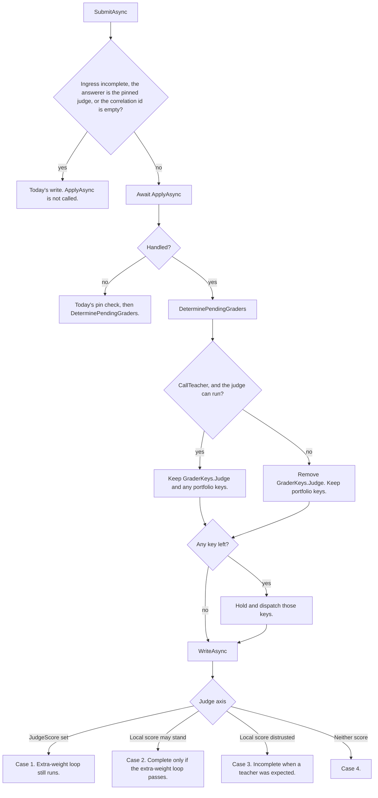

# Plan: #304 phase 8 — local grader takeover with spot-check rollback

> **For agentic workers:** David approved P1–P9 and the epoch history on 2026-10-26. The implementation pull request links this file. Steps in the implementation use the tests named below.

**Status:** Approved by David on 2026-10-26. P1 and P9 differ from the first draft of this file: takeover defaults on, and a teacher, prompt, BGE, or feature-schema change does not delete `rollback.json`. A type name or file path marked proposed is not in the tree yet. This pull request does not add that code.

**Goal:** After an accepted grader-epoch artifact exists for a kind, confident in-distribution answers of that kind keep `LocalScore` as the grade of record and skip the pinned teacher. The teacher still grades a 5% sample and every low-confidence row. A spot-check window that is too far from the teacher clears the accepted pointer so later grades call the teacher again.

**Architecture:** Phase 7 already fits two artifacts, accepts them in shadow, and stamps `LocalScore` beside the teacher score. Phase 8 does not add a second model. It decides, per grade and per kind, whether that shadow score is allowed to stand alone. The decision runs in `QualityScoreAggregator.SubmitAsync` before the judge is enqueued, because `GradeStatusCalculator.Calculate` runs in `WriteAsync` before any `IQualityScoreObserver`. Skipping the teacher removes only `GraderKeys.Judge`. CodeJudge, ICE-Score, and RACE still join when `PortfolioGraderAvailability.DetermineGraderKeys` returns them. The spot-check window runs on the existing `GraderEpochHostedService` tick.

**Tech stack:** C# / .NET 10. The head stays `Microsoft.ML` 5.0.0 `Sdca`, already referenced by `src/TotallyHotArcRouter/TotallyHotArcRouter.csproj`. BGE stays the frozen ONNX session (`OnnxEmbeddingClient`). No Python. No second embedder. No fine-tune.

**Issue:** [#304](https://github.com/davidpizon/TotallyHot-ArcRouter/issues/304). **Parent plan:** [`issue-304-grade-non-coding-responses.md`](issue-304-grade-non-coding-responses.md) §3.2, §3.5, §3.8, §4 phase 8, §10, and §12. **Phase 7 plan:** [`issue-304-phase-7-grader-epoch.md`](issue-304-phase-7-grader-epoch.md), approved and implemented in [#346](https://github.com/davidpizon/TotallyHot-ArcRouter/pull/346) (plan PR [#344](https://github.com/davidpizon/TotallyHot-ArcRouter/pull/344)). **ADR:** [ADR-0027 Amendment 2](../adr/0027-grade-non-coding-responses-on-a-bootstrap-recipe-and-keep-them-out-of-code-tallies.md#amendment-2-2026-10-26-phase-7-acceptance-stays-in-shadow) (accepted; shadow only) and [Amendment 3](../adr/0027-grade-non-coding-responses-on-a-bootstrap-recipe-and-keep-them-out-of-code-tallies.md#amendment-3-2026-10-26-phase-8-takeover-is-approved) (accepted by David on 2026-10-26). Same plan, not a second ADR.

**This pull request is docs only.** It does not change source, tests, project files, or workflows.

## Global constraints

- C# / .NET 10 only. BGE-large stays frozen ONNX. Do not fine-tune it, do not load another embedder, and do not call Python.
- `TreatWarningsAsErrors` stays on. New public members get XML docs that describe the behavior this phase ships.
- Serilog only. Every message template is a static string literal. No question text, no response text, and no vector contents in a log.
- Unknown cost is null. A skipped teacher call does not write 0 into any cost column. A reported zero stays zero.
- A `LocalScore` is never a grader-epoch training label. The label stays the judge `grader_scores` row, as phase 7 loads it.
- Old receipts are not rewritten when authority moves.
- Each new test stays under 5 seconds. Recorded fixtures only. No live provider and no BGE download.
- `QualityOptions.SamplingRate` stays 1.0. That property is the ingress sampler. It is not the 5% spot-check. Lowering it would drop grades before this phase can score them.
- `ScorerVersion` stays `3.0`. No historical rescan.

## Decisions already made

These are inherited. This phase implements them. They are not open questions. Both-kinds takeover is not in this table. It is P4.

| Topic | Rule | Where |
|---|---|---|
| What takeover means | `LocalScore` fills the judge axis of the unified score. `JudgeScore` stays empty, so `IsJudgeScored` is false. | Parent §3.2 and §12 |
| Who still calls the teacher | A random 5% sample, and every row whose question vector sits below the stored cosine floor. | Parent §3.2 and §3.5. David set 5% and the 20th-percentile floor. |
| Null floor | No row is low confidence. `local_confidence` stays NULL, never 0. The teacher runs only on the random sample for those rows. | David, 2026-10-26. Parent §3.5. |
| Missing question vector | Not low confidence. No zero vector. The teacher runs on that row only when the random sample draws it. | Parent §3.5 |
| Teacher failure | A low-confidence miss is `Incomplete` and the local score is not the grade of record. A spot-check miss keeps the local score as the grade of record, `spot_check` true, and the row is not in the MAE window. A confident row that was not drawn never calls the teacher, so a missing pin does not change it. | Parent §3.2 |
| Spot-check column | `spot_check` is true only for the random draw. A low-confidence row is not counted in the 5%. | Parent §3.2 |
| Rollback bar | A window of at least 50 spot-check rows whose MAE against the teacher is worse than 0.10 returns authority to the teacher. The number 50 and the bar 0.10 are confirmed. | Parent §4 phase 8 and §10 |
| What rollback does to files | `GraderEpochArtifactStore.RollbackToTeacher` clears `accepted.json`. It does not promote a previous file, does not delete retired files, and does not throw. | Phase 7, in the tree |
| Training labels | `GraderEpochLabelQuery.LoadForKindAsync` loads undisputed `Complete` teacher labels. A row whose only score is `LocalScore` is not a label. | Phase 7 |
| Two kinds | `code` and `non-code`, from `weights_version`. One artifact does not cover both. A code recipe does not use the non-code artifact. | Parent §3.2 and phase 7 |
| Disputes | A contradicting signal compares `UnifiedScore` with `QualityOptions.ContradictionCutoff` (default 0.5). On a contradiction the receipt becomes `Incomplete` reason `disputed`, and phase 4 deletes `response_vectors` and the kNN row when one exists. | `UserGradeFeedbackService` calls `GradeDisputeService.ApplySignal` with `prior.UnifiedScore` |
| Cost | A null estimate is not `Set`. `RequestTelemetryPublisher` lines 713–715 `Set` only when `estimatedCostUsd` has a value. `EmbeddingMemoryScoreObserver` lines 96–104 store null on a cache miss. `isJudgeScored` is `JudgeScore.HasValue` (line 136). | Phase 5, in the tree |
| Judge axis cases | The four cases in parent §3.2, in that order, with one DEBUG template each. | Parent §3.2 |

## Approved decisions

David approved these on 2026-10-26. P1 and P9 replace the first draft of this file. The implementation uses these rows.

| # | Approved | Rule |
|---|---|---|
| P1 | **Takeover starts on.** | Add `GraderEpochOptions.TakeoverEnabled`, default `true`. David changed the first draft, which defaulted this to `false`. A matching accepted artifact takes over as soon as the gate passes, when that kind has no `rollback.json`. `false` is the emergency off: the next grade does not skip the teacher, `accepted.json` and the artifact files stay, old receipts are not rewritten, and `rollback.json` is not deleted. The 5% draw and the spot-check window still run, so a bad window can still clear the pointer. While the switch is off, `AllowLocalGradeOfRecord` is false, including on a drawn spot-check. A teacher miss is case 3, not a local grade of record. The hosted service reads `IOptionsMonitor<GraderEpochOptions>.CurrentValue` on each tick. The grade path reads it on each `SubmitAsync`. Neither caches the flag in a field. `GraderEpochOptions.Enabled` remains the fit switch. `Enabled` false still logs `Grader epoch is disabled; this tick will not fit.` and still enters the kind loop for retirement and the window, then returns before the trainer check. The early return at `RunTickAsync` lines 98–102 is removed. It no longer skips the window. |
| P2 | **The first accepted artifact may take over immediately.** | When `TakeoverEnabled` is true, a kind has an accepted artifact that matches the current teacher model, teacher `prompt_version`, and BGE id, and that kind has no `rollback.json`, confident unsampled rows skip the teacher at once. The holdout gate is the admission test. This matches parent §4. There is no extra wait for 50 clean spot-checks before the first takeover. |
| P3 | **After a spot-check rollback, the next artifact auditions in shadow.** | The rollback writes `rollback.json` in that kind's directory. While the file exists, a later accepted artifact still stamps `LocalScore`, the teacher still grades every eligible row, and the 5% draw still runs so the window can fill. Takeover for that artifact begins only when its own newest `SpotCheckWindowSize` spot-check rows have MAE `<= SpotCheckRollbackMae`. The implementation then deletes `rollback.json`. Rows graded during the audition keep the teacher score they already stored. A window that fails again calls `RollbackToTeacher` and rewrites the marker. |
| P4 | **Both kinds, one switch.** | Code and non-code each take over only from their own accepted artifact. Rolling back one kind does not touch the other kind, the #292 logreg file, or voter weights. Phase 8 does not defer code takeover to a later phase. An older parent sentence said takeover applies to non-code recipes first. That sentence meant a prose artifact is never applied to a code recipe, which phase 7 already enforces. This pull request rewrites it so it does not read as "code waits for a later phase." |
| P5 | **The 5% draw is a hash of the correlation id.** | Proposed `SpotCheckDraw.IsDrawn`. SHA-256 over the UTF-8 correlation id. The first four bytes, read with `BinaryPrimitives.ReadUInt32LittleEndian`, modulo 10,000, are the bucket. The row is drawn when `bucket < (int)Math.Round(SpotCheckRate * 10000, MidpointRounding.AwayFromZero)`. The default rate 0.05 draws buckets 0–499. The same id always draws the same way. The draw does not use `GraderEpochOptions.RandomSeed`. That seed stays the reservoir and bootstrap seed. Rate 0 draws nothing. Rate 1 draws every eligible row. |
| P6 | **The window is the newest 50 spot-checks of the accepted artifact, and the bar is strict.** | Sort by parsed `created_at_utc` descending, then `correlation_id` ordinal ascending. Take `SpotCheckWindowSize` (default 50). MAE is `RankCorrelation.MeanAbsoluteDifference` of `local_score` and the judge `grader_scores.score` (`GraderKeys.Judge`). It is not `unified_score`, because a code recipe's unified score blends syntax and analysis. Fewer than the window size does not roll back. MAE `>` `SpotCheckRollbackMae` (default 0.10) rolls back. MAE equal to 0.10 does not. An empty window logs a null MAE, not 0. A missing score is not a 0 and is not in the window. |
| P7 | **Below the floor is strict.** | Low confidence means `local_confidence` and `cosineFloor` are both non-null and `local_confidence < cosineFloor`. Equal to the floor is confident. Null confidence is not low confidence. |
| P8 | **`grade_source` is the record of who graded.** | No new receipt column. Proposed constants on the existing `GradeSources` class: `Local` = `local`, `SpotCheck` = `spot_check`, `LowConfidence` = `low_confidence`. `GradeSources.Teacher` already exists. |
| P9 | **A teacher, prompt, BGE, or feature-schema change does not delete `rollback.json`.** | David changed the first draft, which deleted the marker on retirement. `TryRetireMismatch` still clears `accepted.json` when the teacher model, teacher `prompt_version`, BGE id, or feature-schema version does not match. It does not call `ClearRollbackMarker`, and it does not create a marker when none exists. An existing marker stays until that kind's live window passes under P3. If no marker exists, the next artifact that passes the gate may take over under P2. A bucket re-form does not retire the artifact and does not touch the marker. |

## Naming: `RollbackToTeacher`

`GraderEpochArtifactStore.RollbackToTeacher` is in the tree. Phase 7's XML doc says phase 8 calls the same method. The method clears `accepted.json`, does not promote a previous file, and does not throw. In phase 7 the teacher was already the grade of record, so the clear did not move authority. The test `Rollback_FirstArtifact_NullPreviousId_ReturnsToTeacher` in `src/TotallyHotArcRouter.Tests/Judge/GraderEpochPhase7Tests.cs` asserts that clear. The name "returns to the teacher" describes phase 8, when an accepted pointer is what lets the local grader skip the teacher. Clearing it is how authority returns.

Phase 8 does not rename the method and does not rename that test. The implementation updates the method's XML doc so it says both things: phase 7 callers clear a pointer while the teacher already has authority; phase 8 callers clear it so later grades call the teacher again. Parent §4's phase 7 done-when sentence is updated in this pull request to say the pointer is cleared. The phase 8 test that moves authority is `SpotCheckWindow_MaeWorseThanBar_ClearsAcceptedPointer`.

`RollbackToTeacher` does not write `rollback.json`. The hosted service writes the marker after it calls the method, so existing phase 7 tests that call the method stay free of a marker.

## Scope

- Per kind, when P1–P4 hold, skip the pinned teacher for a row the local grader may keep.
- Call the teacher for a low-confidence row and for a `SpotCheckDraw` hit.
- The four judge-axis cases in parent §3.2, including the DEBUG templates.
- `QualityScorer` uses `LocalScore` on the judge axis only when that row's local score is the grade of record and `JudgeScore` is empty.
- The spot-check window on the epoch tick, and `RollbackToTeacher` when P6 fails.
- Receipt `grade_source` values in P8. `spot_check`, `local_score`, `local_grader_version`, and `local_confidence` stay the columns phase 4 and phase 7 already added.
- One append-only `grader_epoch_events` row per authority change, per kind.
- Tests named below.

## Out of scope

- Renaming `RollbackToTeacher` or the phase 7 test.
- A new trainer, a new feature-schema version, or any change to the fit, the holdout, the reservoir, or the agreement gate.
- Rewriting stored grades, unified scores, or `grader_scores` rows when authority moves.
- Putting a `LocalScore` into `GraderEpochLabelQuery.LoadForKindAsync`.
- Changing `RouterMemoryScoreObserver`'s predicate. A code-recipe `Complete` row still calls `AddScoreAsync`. A bootstrap row still does not.
- Changing `EmbeddingMemoryScoreObserver`'s `isJudgeScored: result.JudgeScore.HasValue` or `TranscriptScoreObserver`'s use of the same stamp.
- A judge-cost column. The dashboard chart (phase 9). `docs/how-it-learns.md` (phase 9). Phase 8 stores the epoch rows the chart reads.
- Tool-count features, #306, and BGE changes.
- Setting `QualityOptions.SamplingRate` to 0.05.

## Pipeline

Today the judge is chosen before anyone can score locally, and the local score is stamped too late to affect status.

`QualityGradingService` runs this on a worker, off the proxy request path. `QualityGrader.GradeAsync` builds a `QualityResult` with no judge score. `QualityScoreAggregator.SubmitAsync` (`src/TotallyHotArcRouter.Quality/Grading/QualityScoreAggregator.cs`) decides the judge. `DeterminePendingGraders` adds `GraderKeys.Judge` when `IJudgeAvailability.WillJudge` is true, then adds portfolio keys from `IPortfolioGraderAvailability.DetermineGraderKeys`. `WriteAsync` (lines 503–531) calls `GradeStatusCalculator.Calculate` and `QualityScorer.Score`, then the observer fan-out. The fan-out order in `ServiceCollectionExtensions.AddQualityAndObservability` is `PendingQuestionVectorGradeReader`, `RouterMemoryScoreObserver`, `EmbeddingMemoryScoreObserver`, `TranscriptScoreObserver`, `GraderScoreRecordObserver`, `ResponseVectorGradeObserver`, `ShadowLocalScoreObserver`, `GradeReceiptRecordObserver`.

`ResponseVectorGradeObserver` embeds the response only when `JudgeScore` or `LocalScore` is already set. `ShadowLocalScoreObserver` reads that stored vector and stamps `LocalScore` after `Calculate` has already returned. A takeover row that skipped the teacher would reach `Calculate` with both scores empty and would become `Incomplete` before the shadow stamp. Phase 8 moves the stamp earlier. It does not start the judge from an observer. That trigger deadlocked before (`IAsyncGraderDispatcher` exists so the judge starts at hold time).

`AddJudge()` runs before `AddQuality()` in `AddQualityAndObservability`. The comment above the pending-cache registration says a service registered before `AddQuality` wins over a `TryAdd` default. Phase 8 uses that order.



Proposed `ILocalGradeTakeover` in `src/TotallyHotArcRouter.Quality/Grading/ILocalGradeTakeover.cs`:

```csharp
public readonly record struct LocalGradeDecision(bool Handled, bool CallTeacher, string? TeacherCallReason);

public interface ILocalGradeTakeover
{
    Task<LocalGradeDecision> ApplyAsync(QualityResult result, CancellationToken cancellationToken);
}
```

The method is asynchronous because it calls `IEmbeddingClient.EmbedAsync` and `IResponseVectorStore.UpsertAsync`. `SubmitAsync` awaits it. It does not block on `.GetAwaiter().GetResult()` or `.Result`. `TeacherCallReason` is null, `GradeSources.LowConfidence`, or `GradeSources.SpotCheck`. Proposed `NoLocalGradeTakeover` in that same file returns `Task.FromResult(new LocalGradeDecision(false, false, null))`. `QualityServiceCollectionExtensions.AddQuality` does `TryAddSingleton<ILocalGradeTakeover, NoLocalGradeTakeover>`. `JudgeServiceCollectionExtensions.AddJudge` registers `AddSingleton<ILocalGradeTakeover, LocalGradeTakeover>` before `AddQuality`, so the real type wins in the host. The aggregator's constructor gains an optional last parameter `ILocalGradeTakeover? localGradeTakeover = null` and uses `localGradeTakeover ?? new NoLocalGradeTakeover()`. It stays last so a positional `TimeProvider` argument still binds. Existing named-argument call sites keep compiling.

Proposed `LocalGradeTakeover` in `src/TotallyHotArcRouter/Judge/LocalGradeTakeover.cs`. `ApplyAsync` mutates the result it is given. It does not call the judge, does not `TryTake` the question-vector cache, and does not open a session file.

`Handled` is false, and the result is left unchanged, when any of these hold:

- `TakeoverEnabled` is not a reason to return `Handled` false. The switch is read after a score is stamped. `false` forces `CallTeacher` true and `AllowLocalGradeOfRecord` false, and the draw still runs.
- The weights version `GraderEpochKinds.WeightsVersionThatWillBeStored` would write is neither kind (`TryForWeights` returns null).
- No accepted artifact for that kind, or `MatchesTeacher` is false against the current `JudgeOptions.ModelName`, `JudgeOptions.PromptVersion`, and `EmbeddingOptions.ResolveModelIdentity()`.
- The grade path has no non-blank response text in `PendingResponseTextCache`, the embed throws, or the response vector is unusable. The teacher path then runs as it does today. No zero vector is stored.

When `Handled` is true, `ApplyAsync` has stored the response vector, scored it, and stamped `LocalScore`, `LocalGraderVersion`, and `LocalConfidence` with the same feature rules as `ShadowLocalScoreObserver`, with one timing difference. Observers have not run, so `memory_entries` does not have this correlation id yet and `QuestionVectorMissing` is still unset. The question vector is `PendingValueCache<float[]>.TryPeek`. A hit is indicator 0 and that vector. A miss is indicator 1 and the artifact's stored question mean. The unset flag is not read as a miss by itself, and `GraderEpochLabelQuery.TryReadQuestion` is not called on this path. A peek hit is the same vector `EmbeddingMemoryScoreObserver` will `TryTake` and store. A later fit that reads the receipt and the memory row sees the same indicator.

The response vector is embedded once, here, with `IEmbeddingClient.EmbedAsync` on the peeked response text, and stored with `IResponseVectorStore.UpsertAsync` under the current `ModelIdentity`. Scoring uses that vector. `ApplyAsync` stamps `LocalScore` only when `GraderEpochArtifact.Score` returns a value. When the score is null, `ApplyAsync` returns `Handled` false and does not stamp `LocalScore`. The stored vector stays. The teacher path's observer sees the model id and does not embed a second time, and `ShadowLocalScoreObserver` may stamp from that vector as it does today. A teacher-phase row that has no vector yet still embeds in the observer, as today.

`TryReadEmbeddingModel` is internal on `SqliteResponseVectorStore` today (line 182) and is not on `IResponseVectorStore`. `ResponseVectorGradeObserver` depends on `IResponseVectorStore`, so this phase adds the method to that interface with the existing signature `bool TryReadEmbeddingModel(string correlationId, out string modelId)`. The `out` parameter stays `string`, not `string?`. `SqliteResponseVectorStore` implements it by promoting the current internal method. `ResponseVectorGradeObserver` calls the interface. When the call returns true and the stored model id equals `IEmbeddingClient.ModelIdentity` (ordinal), it skips `EmbedAsync` and does not upsert again. A missing row, or a different model id, still embeds and upserts. The observer does not take a `SqliteResponseVectorStore` constructor parameter. `ShadowLocalScoreObserver` already injects the concrete store and may keep calling the method after it is public.

`ShadowLocalScoreObserver.Apply` returns without rescoring when `LocalScore` is already set and `LocalGraderVersion` equals the accepted artifact id. The decision-time numbers are the ones the receipt stores. When `LocalScore` is null, the observer keeps today's shadow path.

Proposed settable properties on `QualityResult`, none of them receipt columns:

- `SpotCheck` becomes settable. It is `init` today and grade-time writes leave it false. `ApplyAsync` sets it true only for a random draw.
- `TeacherCallReason` (`string?`). The value `ApplyAsync` returns, also stored on the result so `WriteAsync` can see it after the teacher joins.
- `AllowLocalGradeOfRecord` (`bool`). True when this row may keep `LocalScore` if the teacher produces no score. True for a skip and for a spot-check. False for low confidence and for an audition row that was not drawn.

`WriteAsync` (lines 503–531) today calls `Calculate` and `Score` on the incoming instance, then builds a `with` copy for the observers. The collapsed flag has to be on that instance before either call. A `with` copy made first would let `Score` read the pre-collapse flag. The steps, in order:

1. Set `result.AllowLocalGradeOfRecord` to the collapsed value below. This mutates the instance `WriteAsync` received.
2. Call `GradeStatusCalculator.Calculate` with that same bool, the aggregator's logger, the weights version, and the kind.
3. Choose `grade_source` from the status `Calculate` just returned and from the collapsed flag. The choice needs the status, so it follows `Calculate`.
4. Call `QualityScorer.Score` on that same instance. `Score` reads `AllowLocalGradeOfRecord`. It does not gain a new parameter, so existing call sites keep compiling. It is not called on a `with` copy.
5. Build the `with` copy that sets `GradeStatus`, `UnifiedScore`, `GradeSource`, and `IncompleteReason`. The copy keeps the collapsed flag because the property was set in step 1. When status is `Incomplete`, `TeacherCallReason` is `GradeSources.LowConfidence`, and `JudgeScore` is empty, set `IncompleteReason` here. A missing pin or a disabled judge uses `IncompleteReasons.NoJudge`. The grader-queue shed is the existing degraded reason `judge-not-dispatched` (`GraderDispatcher` drops the key when `TryEnqueue` returns false, and `DispatchPendingGradersAsync` uses the same token when dispatch throws). On a low-confidence row that token becomes `IncompleteReasons.QueueFull`. Any other `GraderDegradedReasons` entry (timeout, abstention, eviction) stays out of `IncompleteReason`. Do not set `IncompleteReason` before `Calculate`. Line 36 returns `Incomplete` before the judge-axis cases, so a reason stamped first would skip the case-3 log. An ingress `IncompleteReason`, including ingress `queue_full`, was already returned before `ApplyAsync` and is unchanged.
6. Fan out observers on that copy.

The collapsed value is:

- `JudgeScore` has a value: the flag is false. Case 1.
- No `JudgeScore`, `LocalScore` has a value, `AllowLocalGradeOfRecord` was true: the flag is true. Case 2.
- No `JudgeScore`, `LocalScore` has a value, `AllowLocalGradeOfRecord` was false: the flag is false. Case 3.
- Neither score: case 4. The flag is false.

The judge-axis case replaces only the judge-weight `if` at `GradeStatusCalculator` lines 45–46. The extra-weight loop stays after that `if`. Cases 1 and 2 fall through into it. Case 2 does not return `Complete` before that loop. A positive extra weight with no matching `GraderScores` entry still returns `Incomplete` when `llmGraderWasAvailable` is true and `StructureOnly` when it is false. "Case 2, Complete" means the earlier gates and that loop all passed. Cases 3 and 4, where the judge weight is positive, `JudgeScore` is null, and the flag is false, still return inside the judge-weight `if` and do not reach the loop. A distrusted local score does not wait on extra weights to become `Incomplete`.

`grade_source` in step 3, replacing the assignment at lines 508–510:

- `Complete` and `JudgeScore` has a value and `SpotCheck`: `GradeSources.SpotCheck`.
- `Complete` and `JudgeScore` has a value and `TeacherCallReason` is `GradeSources.LowConfidence`: `GradeSources.LowConfidence`.
- `Complete` and `JudgeScore` has a value: `GradeSources.Teacher`.
- `Complete` and the case-2 flag: `GradeSources.Local`. A failed spot-check keeps `SpotCheck` true and still uses `Local` here.
- Otherwise null.

A low-confidence teacher miss passes `llmGraderWasAvailable: true` and leaves `IncompleteReason` empty until step 5. Step 5 then writes `no_judge` or `queue_full` as the parent already names, or leaves the failure in `GraderDegradedReasons` when that is the existing channel (timeout, abstention, eviction). Case 3 then refuses `Complete`. A spot-check miss does not set `IncompleteReason`. Case 2 is `Complete` with the flag true only when the extra-weight loop also passes.

The empty-correlation return, `judge_is_answerer`, and an ingress `IncompleteReason` stay in front of `ApplyAsync` and never take over. The pin-missing return (`IsJudgeEnabled` and `IsPinMissing`) moves behind `ApplyAsync`. When `Handled` is false, that pin-missing return stays as it is today, including its skip of portfolio keys, and the method then continues into `DeterminePendingGraders` as it does now. Phase 8 does not change the unhandled path.

When `Handled` is true, `SubmitAsync` calls `DeterminePendingGraders`. `PortfolioGraderAvailability.DetermineGraderKeys` is that call's portfolio half. Takeover does not disable those keys.

- `CallTeacher` false: remove `GraderKeys.Judge`. A missing pin or `JudgeOptions.Enabled == false` does not stamp `no_judge`.
- `CallTeacher` true and the judge can run (`WillJudge` is true): keep `GraderKeys.Judge` and the portfolio keys. Dispatch all of them. This is today's hold.
- `CallTeacher` true and the judge cannot run (pin missing, `JudgeOptions.Enabled` false, or `WillJudge` false): remove `GraderKeys.Judge`. Do not enqueue the teacher. Remember the teacher-miss for step 5 of `WriteAsync`. Do not stamp `IncompleteReason` yet. `low_confidence` keeps the local score and the flag false. `spot_check` does not ask for `IncompleteReason`.

If any key remains, hold and `DispatchPendingGradersAsync` for that set only, then `WriteAsync` when the set empties. The hold sets `llmGraderWasAvailable` true, as today's hold does. If none remain, `WriteAsync` immediately. A low-confidence miss with no remaining key passes `llmGraderWasAvailable: true`, so it is `Incomplete` and not `StructureOnly`. A confident skip or a spot-check miss with no remaining key passes `llmGraderWasAvailable: false`. Portfolio keys are removed only by completion or abandonment, never because the teacher was skipped.

## Confidence and the draw

`local_confidence` stays the cosine `ShadowLocalScoreObserver.Confidence` already computes: null when `cosineFloor` is null, when the question vector is missing, or when no neighbor cosine is finite. `GraderEpochVectors.Cosine` returns null for a zero magnitude or a non-finite result. That null is not a cosine and not a floor. Proposed `GraderEpochConfidence.Nearest(float[] question, IEnumerable<float[]> neighbors)` in `src/TotallyHotArcRouter/Judge/GraderEpochConfidence.cs` returns the largest finite cosine, or null when every neighbor cosine is null. The caller still returns null when `cosineFloor` is null or the question vector is missing, and still opens the reservoir. `ShadowLocalScoreObserver` and `LocalGradeTakeover` both call it. `GraderEpochVectors.Cosine` stays the pairwise function.

Low confidence is P7. Those rows set `CallTeacher` true, `TeacherCallReason` to `low_confidence`, `SpotCheck` false, and `AllowLocalGradeOfRecord` false. They are not passed to `SpotCheckDraw`.

Every other handled row is in the draw population, including a null-confidence row. `SpotCheckDraw.IsDrawn` at `SpotCheckRate` (default 0.05) sets `SpotCheck` true, `CallTeacher` true, `TeacherCallReason` to `spot_check`, and `AllowLocalGradeOfRecord` true. A row that is not drawn and is not low confidence sets `CallTeacher` false and `AllowLocalGradeOfRecord` true.

While `rollback.json` exists for the kind, `CallTeacher` is true for every handled row. The draw still runs on the same population, so the audition window is the same 5% the live window uses. Undrawn audition rows set `AllowLocalGradeOfRecord` false. They are teacher grades with a shadow `LocalScore`. Low-confidence rows stay out of the draw during the audition too. They are teacher labels. They are not added to the MAE as a block. Parent §3.2 keeps that split because those rows were chosen for sitting far from the reservoir.

Expected teacher load after a live takeover, with the default floor, stays the parent's figure: about 20% below the floor, plus 5% of the other 80%. The audition grades 100% and still marks 5% `spot_check`.

## Spot-check window

On each tick, per kind, after the existing mismatch retirement. The window runs whether `TakeoverEnabled` is true or false. It also runs when `Enabled` is false. There is no steady-state log that says the window is not active.

- No accepted matching artifact: log count 0, a null MAE, and authority `teacher`. Do not invent a 0 MAE. Do not roll back.
- An accepted matching artifact: load pairs, apply P6, and log count, MAE or null, and authority. Authority is `local` only when `TakeoverEnabled` is true, the artifact matches, and `rollback.json` is absent. Otherwise it is `teacher`, including during an audition and while the emergency switch is off.

`Enabled` false logs `Grader epoch is disabled; this tick will not fit.` and does not return at lines 98–102. The kind loop still runs retirement and this window, then returns before the trainer check. `SpotCheckWindow_IsNotActive_DoesNotRetire` seeds 50 spot-check rows whose local score is 0 and whose judge score is 1, then expects the not-active template and an unchanged pointer. That premise is gone. The implementation updates that test: the not-active template is absent, and this fixture clears the accepted pointer and writes `rollback.json`. The phase 8 test `SpotCheckWindow_MaeWorseThanBar_ClearsAcceptedPointer` is the same outcome.

Proposed `GraderEpochLabelQuery.LoadSpotCheckPairsAsync(string kind, string artifactId, CancellationToken)` returns proposed `GraderEpochSpotCheckPair` (`CorrelationId`, `CreatedAtUtc`, `LocalScore`, `JudgeScore`). A row qualifies when all of these hold: `spot_check` is 1, `grade_status` is `Complete`, `local_grader_version` equals the artifact id, `local_score` is non-null, the kind rule matches, and exactly one `grader_scores` row has `grader_key` `GraderKeys.Judge`. Zero judge rows or two judge rows drop the pair. The judge score is that row's `score`. A low-confidence receipt has `spot_check` 0, so it is not loaded. A spot-check whose teacher produced no score has no judge row, so it is not loaded. A pair from an older artifact id is not loaded.

Rollback calls `RollbackToTeacher(kind)`, then writes proposed `rollback.json` in the kind directory by the same temp-file-and-rename `accepted.json` uses. The JSON fields are `rolledBackArtifactId`, `mae`, `windowSize`, and `atUtc`. Proposed `GraderEpochRollbackMarker` is that record. Proposed store methods `TryReadRollbackMarker`, `WriteRollbackMarker`, and `ClearRollbackMarker` live on `GraderEpochArtifactStore`. `ClearRollbackMarker` is a no-op when the file is absent. `TryRetireMismatch` does not call `ClearRollbackMarker` and does not write a marker.

A healthy audition window (`count >= SpotCheckWindowSize` and MAE `<= SpotCheckRollbackMae`) calls `ClearRollbackMarker` and does not replace the accepted artifact. The next grade of that kind may skip the teacher under P2.

The window does not run the agreement gate and does not fit. When `Enabled` is true, the fit on the same tick is unchanged. A rollback earlier in the tick means the fit sees no accepted artifact. When `Enabled` is false, the fit is skipped after the window.

## Epoch history

David added this on 2026-10-26. Every time a kind's local grader begins grading on its own, that is one epoch. Every time the teacher takes charge again, that is another epoch of the same history. Phase 9 draws those rows on a time graph next to token efficiency. This phase only stores them. The graph does not say the epoch caused the efficiency change. It lets David see whether they line up. Unknown cost stays null, never 0. A null token count stays null, never 0.

The live authority stays the files phase 7 already uses: `accepted.json` and proposed `rollback.json`, written by temp-file-and-rename in `GraderEpochArtifactStore` (`CommitAccepted` is lines 125–144). The history is not those files. Those files are replaced. The history is append-only, and it lives in the router-memory database file, so a restart still has every row.

Proposed table `grader_epoch_events` in `RouterMemoryDatabase`, the same database as `grade_receipts`. `EnsureCreated` already runs `SchemaSql` on startup (`RouterMemoryDatabase.EnsureCreated`, lines 384–386 assign that script and execute it). A new `CREATE TABLE IF NOT EXISTS` in that script creates the table on an existing install. This repo has no migration framework. Additive columns use `PRAGMA` checks. A new table does not need one. Do not register the table with `ScoreTableRetentionService`. That service already has four registrations in `ServiceCollectionExtensions` (lines 208–239): `IJudgeShadowScoreStore`, `IGraderScoreStore`, `IGradeReceiptStore`, and `SqliteResponseVectorStore`. A fifth registration would purge this history. `SqliteGraderEpochEventStore` does not implement `IScoreRetentionStore`. Rows are never updated and never deleted.

```sql
CREATE TABLE IF NOT EXISTS grader_epoch_events (
    id INTEGER PRIMARY KEY AUTOINCREMENT,
    at_utc TEXT NOT NULL,
    kind TEXT NOT NULL,
    epoch_type TEXT NOT NULL,
    cause TEXT NOT NULL,
    artifact_id TEXT NULL,
    previous_artifact_id TEXT NULL,
    window_size INTEGER NULL,
    mean_miss REAL NULL
);
CREATE INDEX IF NOT EXISTS ix_grader_epoch_events_at ON grader_epoch_events (at_utc, id);
```

`at_utc` is `TimeProvider.GetUtcNow()` formatted with the round-trip `"O"` format the other tables use. `kind` is `GraderEpochKinds.Code` (`code`) or `GraderEpochKinds.NonCode` (`non-code`). `epoch_type` is `local_takeover` or `teacher_resumed`. `cause` is one of `gate_pass`, `live_check_pass`, `spot_check_rollback`, `switch_off`, `switch_on`, `teacher_mismatch`. `artifact_id` is the grader that just took charge, or the grader that just stopped when the teacher resumes. A written row always has it. `previous_artifact_id` is the grader that was in charge before this row, and it is null when there was none. `window_size` and `mean_miss` are set only for `spot_check_rollback` and `live_check_pass`. Every other cause stores both as NULL, never 0. No column holds question text, response text, or a vector.

Proposed `IGraderEpochEventStore` in `src/TotallyHotArcRouter/Judge/IGraderEpochEventStore.cs`. Proposed `SqliteGraderEpochEventStore` beside it. `Append` is `INSERT` only. There is no update method and no delete method. `ListForPlot` runs the phase 9 read:

```sql
SELECT id, at_utc, kind, epoch_type, cause, artifact_id, previous_artifact_id, window_size, mean_miss
FROM grader_epoch_events
ORDER BY at_utc, id;
```

Phase 9 reads that list and, separately, `request_transcripts` in `TranscriptDatabase` (`created_at_utc`, `input_tokens`, `output_tokens`, `cost`). Those are two database files. Phase 9 does not join them in SQL. It places both series on one time axis. `cost` is `REAL NULL`. `input_tokens` and `output_tokens` are `INTEGER NULL`.

Authority for a kind is `local` only when `TakeoverEnabled` is true, an accepted artifact matches, and `rollback.json` is absent. Otherwise it is `teacher`. An append happens when that picture differs from the latest row for that kind. No rows means the kind is in the teacher phase, and a teacher result writes nothing. A local result with no rows appends `local_takeover`. A later gate pass that replaces the artifact, while the switch is on and no marker exists, appends another `local_takeover` even though authority was already local. That new artifact is a new student beginning to grade on its own. The latest row matches only when a `local_takeover` row's `artifact_id` is the accepted id, or a `teacher_resumed` row is the latest row and authority is still `teacher`. A committed row that already matches is not inserted again.

| Transition | epoch_type | cause |
|---|---|---|
| Gate pass, switch on, no marker, including a later artifact that replaces one already in charge | `local_takeover` | `gate_pass` |
| Live window passes and the marker is cleared | `local_takeover` | `live_check_pass` |
| Switch turns on, artifact matches, no marker, and the teacher was in charge | `local_takeover` | `switch_on` |
| Spot-check MAE over the bar | `teacher_resumed` | `spot_check_rollback` |
| Switch turns off while the local grader was in charge | `teacher_resumed` | `switch_off` |
| Retirement clears an accepted pointer that was the grade of record | `teacher_resumed` | `teacher_mismatch` |

A switch change while the teacher is already in charge does not append. Retirement while the teacher is already in charge does not append, and it still leaves an existing marker in place. A gate pass while a marker exists does not append `local_takeover`.

The file rename and the insert are one unit of work, which is the same-transaction rule this phase can keep. SQLite cannot enlist a file rename, so the two writes are ordered inside `GraderEpochArtifactStore`'s existing `_gate` and one database transaction. `GradeDisputeService.ApplySignal` is the transaction pattern: `EnsureCreated`, `OpenConnection`, `BeginTransaction` (line 49), writes, `Commit`.

1. Take `_gate`. Begin a transaction and `INSERT` the event.
2. Rename the authority files, still holding `_gate`.
3. `Commit`, then release `_gate`.
4. If the rename throws, roll the transaction back and delete temp files, the way `CommitAccepted` already does. The files are unchanged because the rename did not finish.
5. If the process stops after the rename and before `Commit`, the uncommitted insert is gone and the files have the new authority. The next tick compares the current authority and the accepted artifact id to the latest row and inserts the missing event once. A committed row that already matches is not inserted again.

The emergency switch has no file. `IOptionsMonitor<GraderEpochOptions>.OnChange` runs the same compare under `_gate` when the new value changes authority. The next tick repeats that compare, so a restart after the config change still writes the row once. `OnChange` and the tick cannot both insert, because both take `_gate` before they read the latest row.

## Receipts, kNN, labels, disputes, cost

The receipt already has `grade_source`, `spot_check`, `local_score`, `local_grader_version`, `local_confidence`, and `unified_score`. Phase 8 fills `grade_source` as above and sets `spot_check` from the result. `GradeReceiptRecordObserver` already copies those properties. It does not gain a column.

`QualityScorer.Score` (`src/TotallyHotArcRouter.Quality/Scoring/QualityScorer.cs` line 32) today takes the judge term from `JudgeScore` and uses 0 when that score is null. After step 1 above, the scorer uses `JudgeScore` when the collapsed flag is false and `JudgeScore` has a value. It uses `LocalScore` only when the flag is true. Otherwise the term is 0 and the status cases refuse `Complete`. The two numbers are never added. On a bootstrap recipe the judge weight is 1, so a case-2 `LocalScore` is the unified score. On a code recipe it replaces only the 0.60 judge axis. Syntax and analysis stay on their existing terms. Extra weights stay on their existing terms.

`GradeStatusCalculator.Calculate` gains optional parameters after the three it has: `ILogger? logger = null`, `bool localScoreIsGradeOfRecord = false`, `string? weightsVersion = null`, `string? graderKind = null`. The three-argument call sites keep compiling. A null logger writes nothing, so the existing tests stay quiet. `WriteAsync` passes the aggregator's logger, the flag, the weights version the receipt will store, and the kind. The weights version is `GradingRecipes.Bootstrap` when `RecipeId` is bootstrap, otherwise `QualityOptions.WeightsVersion`. The kind is `non-code` for bootstrap and `code` otherwise. That pair matches `GraderEpochKinds.WeightsVersionThatWillBeStored` and `TryForWeights`. The four templates, each a static literal:

- Case 1: `Judge axis case 1 teacher score for correlation {CorrelationId} weights {WeightsVersion} kind {Kind} status {Status}.`
- Case 2: `Judge axis case 2 local grade of record for correlation {CorrelationId} weights {WeightsVersion} kind {Kind} status {Status} local grader {LocalGraderVersion} flag {LocalScoreIsGradeOfRecord}.`
- Case 3: `Judge axis case 3 local score not of record for correlation {CorrelationId} weights {WeightsVersion} kind {Kind} status {Status} local grader {LocalGraderVersion} flag {LocalScoreIsGradeOfRecord}.`
- Case 4: `Judge axis case 4 neither score for correlation {CorrelationId} weights {WeightsVersion} kind {Kind} status {Status}.`

Cases 1 and 4 omit `LocalGraderVersion`. The log level is Debug. No question text, response text, or vector. Log once, with the status `Calculate` actually returns. Cases 1 and 2 log after the extra-weight loop, so `{Status}` is `Complete` only when that loop passed. Cases 3 and 4 log at the judge-weight return and do not reach the loop. The pre-existing gates above line 45 do not log a judge-axis case.

kNN: `EmbeddingMemoryScoreObserver` already writes a `Complete` row with `isJudgeScored` from `JudgeScore.HasValue` and cost from the pending cache or null. A case-2 row is stored with `is_judge_scored` 0 and the unified score. Under the default `UnjudgedRowPolicy` of `Include` it weighs 1.0. `RouterMemoryScoreObserver` is unchanged: the code-recipe `Complete` row still updates the `live:` tally at full strength, and a bootstrap row still skips `AddScoreAsync`. Phase 5's rule stands: a disputed receipt gains no new kNN row.

Labels: `LoadForKindAsync` is unchanged. A case-2 row has no judge `grader_scores` row. `GraderScoreRecordObserver` does not write `GraderKeys.Judge` for a local score. The row is not a training label. A spot-check or low-confidence row whose teacher answered has a judge score. That judge score is the label. The `LocalScore` beside it is not the label. The next fit still uses the phase 7 eligibility list.

Disputes: no new comparison. `UserGradeFeedbackService` already passes `UnifiedScore` and `ContradictionCutoff`. Once the scorer puts `LocalScore` on the judge axis, that unified score is the grade of record a later signal contradicts. A shadow row still has `JudgeScore`, so its unified score stays the teacher score. A dispute still deletes `response_vectors` and the kNN row in one transaction and leaves the row out of the fit. Phase 8 does not subtract a `live:` tally.

Cost: skipping the teacher does not `Set` a cost and does not write 0. The memory row's cost is the request's estimated cost when `RequestTelemetryPublisher` stored one, including a reported zero, and null when it did not. There is no judge-cost column to zero-fill. The reward's \(\kappa\) rule is unchanged: null skips \(\kappa\).

## Logging

Static templates. Information unless noted.

| When | Template includes |
|---|---|
| Skip the teacher | Debug. Correlation id, kind, artifact id, local score. |
| Low confidence calls the teacher | Debug. Correlation id, kind, artifact id. |
| Spot-check draw | Debug. Correlation id, kind, artifact id. |
| Window | Kind, artifact id or a null marker, count, MAE or a null marker, authority `local` or `teacher`. This line replaces the phase 7 not-active sentence on every tick. The tick does not also emit that sentence. |
| MAE over the bar | Kind, artifact id, MAE, the bar. Then the existing rollback template from `RollbackToTeacher`. |
| Audition cleared | Kind, artifact id, MAE. |
| Embed or score failed closed | Debug. Correlation id and the reason token `no_response_text`, `embed_failed`, or `unusable_vector`. No bytes. |

`LocalGradeTakeover` does not log the vector or the response text. A thrown fit on the tick stays inside the hosted service's existing non-cancellation catch. New templates, each a static literal:

- Skip: `Local grader skipped the teacher for correlation {CorrelationId} kind {Kind} artifact {ArtifactId} local score {LocalScore}.`
- Low confidence: `Local grader called the teacher for low confidence on correlation {CorrelationId} kind {Kind} artifact {ArtifactId}.`
- Spot-check draw: `Local grader drew a spot-check for correlation {CorrelationId} kind {Kind} artifact {ArtifactId}.`
- Window: `Grader epoch spot-check window for kind {Kind} artifact {ArtifactId} count {Count} mae {Mae} authority {Authority}.` `ArtifactId` and `Mae` are strings. A missing value is the existing `Marker` result `null`, not a formatted zero.
- MAE over the bar: `Grader epoch spot-check MAE {Mae} for kind {Kind} artifact {ArtifactId} is above the bar {Bar}.` Then `RollbackToTeacher` logs its existing template. Do not change that template. Phase 7 asserts `Shadow scores stay off`.
- Audition cleared: `Grader epoch audition cleared the rollback marker for kind {Kind} artifact {ArtifactId} mae {Mae}.`

## Configuration

New properties on `GraderEpochOptions`, section `GraderEpoch`. A missing key keeps the default. Do not put them on `JudgeOptions`.

| Property | Default | Role |
|---|---|---|
| `TakeoverEnabled` | `true` | P1. Approved 2026-10-26. Emergency off when false. |
| `SpotCheckRate` | `0.05` | P5. David set the number. Approved 2026-10-26. `[Range(0d, 1d)]`. |
| `SpotCheckWindowSize` | `50` | P6. The confirmed window size. A different counter from `HoldoutSize`. `[Range(1, int.MaxValue)]`. |
| `SpotCheckRollbackMae` | `0.10` | P6. The confirmed bar. The phase 7 plan reserved this name and did not read it. The property is not on `GraderEpochOptions` today. `[Range(0d, 1d)]`. |

`appsettings.json` does not gain a `Serilog:WriteTo` entry and does not need a `GraderEpoch` section. An operator stops skips by setting `GraderEpoch:TakeoverEnabled` to false. The default is on.

## Files

| File | Change |
|---|---|
| `src/TotallyHotArcRouter.Quality/Grading/ILocalGradeTakeover.cs` | Proposed. Interface, decision record, `NoLocalGradeTakeover`. |
| `src/TotallyHotArcRouter.Quality/Grading/QualityScoreAggregator.cs` | Reorder the early returns: ingress `IncompleteReason`, `judge_is_answerer`, and an empty correlation id stay before `ApplyAsync`. Move the pin-missing return to after `ApplyAsync`, and keep it only when `Handled` is false. Today the pin-missing return (lines 155–161) is before the empty-id return (lines 169–173). Await `ApplyAsync`. Drop `GraderKeys.Judge` without dropping portfolio keys. Run the `WriteAsync` steps above. Update the class remarks that still say the judge is the only pending-key producer. |
| `src/TotallyHotArcRouter.Quality/Grading/GradeStatusCalculator.cs` | Four cases. The judge-weight check falls through to the extra-weight loop when the local score is the grade of record. |
| `src/TotallyHotArcRouter.Quality/Scoring/QualityScorer.cs` | Judge term as above. |
| `src/TotallyHotArcRouter.Quality/QualityResult.cs` | `SpotCheck` settable. Proposed `TeacherCallReason` and `AllowLocalGradeOfRecord`. |
| `src/TotallyHotArcRouter.Quality/GradingRecipes.cs` | Proposed `GradeSources.Local`, `SpotCheck`, `LowConfidence`. |
| `src/TotallyHotArcRouter.Quality/DependencyInjection/QualityServiceCollectionExtensions.cs` | `TryAddSingleton` the no-op. |
| `src/TotallyHotArcRouter/Judge/LocalGradeTakeover.cs` | Proposed. |
| `src/TotallyHotArcRouter/Judge/SpotCheckDraw.cs` | Proposed. |
| `src/TotallyHotArcRouter/Judge/GraderEpochConfidence.cs` | Proposed. Shared nearest-cosine. |
| `src/TotallyHotArcRouter/Judge/GraderEpochOptions.cs` | Four `get; init;` properties, matching the existing properties. `TakeoverEnabled` defaults true. Update the `Enabled` XML doc: a disabled fit still visits kinds for the window. |
| `src/TotallyHotArcRouter/Judge/GraderEpochLabelQuery.cs` | Proposed `LoadSpotCheckPairsAsync`. |
| `src/TotallyHotArcRouter/Judge/GraderEpochSpotCheckPair.cs` | Proposed record. |
| `src/TotallyHotArcRouter/Judge/GraderEpochArtifactStore.cs` | Marker methods. XML doc on `RollbackToTeacher`. Leave its two log templates unchanged. |
| `src/TotallyHotArcRouter/Judge/GraderEpochRollbackMarker.cs` | Proposed record. |
| `src/TotallyHotArcRouter/Judge/ShadowLocalScoreObserver.cs` | Leave an existing matching stamp in place. Call `GraderEpochConfidence.Nearest`. |
| `src/TotallyHotArcRouter/Judge/JudgeServiceCollectionExtensions.cs` | Register `LocalGradeTakeover` before `AddQuality`. |
| `src/TotallyHotArcRouter/Hosting/GraderEpochHostedService.cs` | Remove the `Enabled` early return. The window always runs. Retirement does not clear `rollback.json`. Update the `RunTickAsync` XML doc. |
| `src/TotallyHotArcRouter/Router/ResponseVectorGradeObserver.cs` | Skip embed when `IResponseVectorStore.TryReadEmbeddingModel` already equals the current model id. |
| `src/TotallyHotArcRouter/Router/IResponseVectorStore.cs` | Add `TryReadEmbeddingModel`. Proposed on the interface. The method body already exists. |
| `src/TotallyHotArcRouter/Router/SqliteResponseVectorStore.cs` | Promote the internal method to the interface implementation. |
| `src/TotallyHotArcRouter/Router/RouterMemoryDatabase.cs` | Add `grader_epoch_events` to `SchemaSql`. Do not add a `ScoreTableRetentionService` registration for it. |
| `src/TotallyHotArcRouter/Hosting/ServiceCollectionExtensions.cs` | Leave the four retention registrations (lines 208–239) as they are. |
| `src/TotallyHotArcRouter/Judge/IGraderEpochEventStore.cs` | Proposed. `Append` and `ListForPlot` only. |
| `src/TotallyHotArcRouter/Judge/SqliteGraderEpochEventStore.cs` | Proposed. `INSERT` only. |

## Tests

New `GraderEpochPhase8Tests` in `src/TotallyHotArcRouter.Tests/Judge/`, beside `GraderEpochPhase7Tests`. Calculator cases go in `src/TotallyHotArcRouter.Quality.Tests/GradeStatusCalculatorTests.cs`. Scorer cases go in `src/TotallyHotArcRouter.Quality.Tests/QualityScorerTests.cs`. The four calculator tests use a capturing logger. The quality suite's `NullLogger` drops messages, so these four do not use it. Vectors are short, with `EmbeddingOptions.EmbeddingDimension` overridden. One test asserts the new option defaults without building a 50-row window. Window tests set `SpotCheckWindowSize` to 2 except the default-property test and one test that uses 50 only as a count of cheap rows if it stays under 5 seconds. Prefer the option override.

| Test | Asserts |
|---|---|
| `TakeoverOff_MatchesPhase7_TeacherStaysGradeOfRecord` | `TakeoverEnabled` false, accepted artifact present, no portfolio key pending. The teacher client is called. `grade_source` is `teacher`. `JudgeScore` is set. `LocalScore` is the shadow pair. `SpotCheck` may be true for a hash draw. `AllowLocalGradeOfRecord` is false, so a teacher miss is not case 2. The not-active template is absent. The window still runs. |
| `Takeover_HighConfidence_SkipsTeacher` | Handled, cosine at or above the floor, draw returns false, no portfolio key pending. The judge client is not called. `grade_source` is `local`. `JudgeScore` is empty. `IsJudgeScored` is false on the memory row. Status is `Complete`. Unified score's judge term is `LocalScore`. No `grader_scores` row uses `GraderKeys.Judge`. Case-2 template is logged. |
| `Takeover_SkipsJudge_StillDispatchesPortfolio` | The same confident row with `DimensionWeightOptions.ExtraWeights` containing `GraderKeys.CodeJudge` at a positive weight, and that key pending. The dimension weights still sum to 1. The judge client is not called. CodeJudge is dispatched. Status stays unwritten until that key completes or is abandoned. After it completes, status is `Complete` and the judge term is still `LocalScore`. If the key is abandoned, status is `Incomplete`, not `Complete`. |
| `Takeover_CodeRecipe_ReplacesOnlyJudgeAxis` | Judge weight 0.60, syntax and analysis unchanged, unified score equals `0.60 * LocalScore + 0.25 * syntax + 0.15 * analysis`. |
| `Takeover_Bootstrap_UnifiedScoreIsLocalScore` | Judge weight 1. Unified score equals `LocalScore`. `AddScoreAsync` is not called. |
| `Takeover_CodeRecipe_StillUpdatesLiveTally` | `RouterMemoryScoreObserver` still calls `AddScoreAsync` for a code-recipe case-2 row. |
| `LowConfidence_CallsTeacher_SpotCheckFalse` | Cosine strictly below the floor. Teacher runs. `grade_source` is `low_confidence`. `spot_check` is false. `JudgeScore` is the grade of record. `LocalScore` is kept and is not added again. `IsJudgeScored` is true. |
| `CosineEqualToFloor_IsNotLowConfidence` | Equality does not call the teacher unless the draw hits. |
| `NullFloor_IsNotLowConfidence` | `cosineFloor` null, usable question vector. `local_confidence` is null, not 0. Teacher runs only when the draw hits. |
| `MissingQuestionVector_IsNotLowConfidence_AndIsNotAZeroVector` | Peek miss. Indicator 1. No zero `float[]`. `local_confidence` null. Teacher runs only on a draw. |
| `SpotCheck_DrawsFromHash_NotFromRandomSeed` | A fixed correlation id draws the same way twice. `RandomSeed` does not change the draw. One id under the bucket and one over it. A low-confidence id is not drawn even if its bucket would hit. |
| `SpotCheck_TeacherAnswers_GradeSourceSpotCheck` | `spot_check` true. `JudgeScore` set. `grade_source` is `spot_check`. The pair is kept. The row weighs 1.0 when `UnjudgedRowPolicy` is `Exclude`. |
| `SpotCheck_TeacherMiss_KeepsLocalScore` | No portfolio key pending. No judge score. `Complete`, `grade_source` `local`, `spot_check` true, unjudged. The pair is absent from `LoadSpotCheckPairsAsync`. |
| `LowConfidence_TeacherMiss_IsIncomplete_NotALabel` | No portfolio key pending. `Incomplete` reason `no_judge` when the pin is missing. Reason `queue_full` when the judge key's degraded reason is `judge-not-dispatched`. The case-3 template is logged. `IncompleteReason` is still empty when `Calculate` runs. A timeout stays in `GraderDegradedReasons` and does not copy into `IncompleteReason`. `LocalScore` stored, flag false, not a `LoadForKindAsync` label. The response vector is kept. Ingress `queue_full` never reaches `ApplyAsync`. |
| `MissingPin_HighConfidence_StaysComplete` | No portfolio key pending. `JudgeOptions` pin missing or `Enabled` false. Case 2. Reason is not `no_judge`. |
| `JudgeIsAnswerer_DoesNotTakeOver` | `Incomplete` reason `judge_is_answerer`. `ApplyAsync` is not called. The judge client is not called. |
| `LocalScore_TakeoverRow_IsNeverTheTrainingLabel` | A case-2 `Complete` row is absent from `LoadForKindAsync`. A spot-check row with a judge score is present, and its label equals the judge score. |
| `Takeover_UnknownCost_StaysNull` | No pending cost. The memory row's cost is null. The judge client is not called. A reported zero on a second row stays zero. |
| `Dispute_UsesUnifiedScore_AfterTakeover` | A case-2 unified score at or above 0.5 plus an agent switch marks `disputed`, deletes the response vector and the kNN row, and does not decrement a `live:` tally. A shadow row still disputes against the teacher unified score. |
| `ResponseVector_EmbeddedOnce` | `EmbedAsync` is called once from `ApplyAsync`. The observer calls `IResponseVectorStore.TryReadEmbeddingModel`, sees the current model id, and does not embed again. |
| `DecisionTimeFeatures_MatchTheLaterFit` | The question indicator, syntax, analysis, length, and response vector used at `ApplyAsync` match what a fit reads back from the receipt, `grader_scores`, `response_vectors`, and `memory_entries`. |
| `ShadowObserver_DoesNotRescore_WhenTakeoverAlreadyStamped` | `LocalScore` after the fan-out equals the decision-time score. |
| `SpotCheckWindow_BelowCount_DoesNotRollBack` | Count is `SpotCheckWindowSize - 1`. `accepted.json` remains. |
| `SpotCheckWindow_MaeEqualToBar_DoesNotRollBack` | MAE equal to 0.10 leaves the pointer. |
| `SpotCheckWindow_MaeWorseThanBar_ClearsAcceptedPointer` | MAE greater than 0.10 calls `RollbackToTeacher`. The previous artifact file remains. It is not accepted. `rollback.json` names the cleared id. A later grade calls the teacher and leaves `LocalScore` null until a new artifact is accepted. The #292 path from `StorageOptions.ResolveLogRegModelPath` is unchanged. Stored grades are unchanged. |
| `SpotCheckWindow_UsesJudgeScore_NotUnifiedScore` | A code-recipe pair whose unified score differs from the judge score uses the judge score in the MAE. |
| `SpotCheckWindow_IgnoresOtherArtifactAndLowConfidence` | An older `local_grader_version` and a `spot_check` 0 row are not in the window. |
| `Probation_BlocksTakeover_UntilWindowIsHealthy` | Marker present, new accepted artifact. Confident rows still call the teacher. The gate pass does not append `local_takeover`. After a healthy window the marker is gone, the next confident row skips the teacher, and one `local_takeover` row with cause `live_check_pass` is stored, with `window_size` and `mean_miss` set. |
| `Probation_UnhealthyWindow_RollsBackAgain` | The audition artifact is cleared. The marker now names that id. |
| `Retirement_KeepsRollbackMarker` | A teacher-model mismatch clears the accepted pointer and leaves `rollback.json` in place. It does not create a marker when none exists. The next gate pass does not take over while the marker exists. |
| `KillSwitch_Off_StopsNewSkips_KeepsArtifact` | `TakeoverEnabled` flipped to false after a takeover. The next grade calls the teacher. `accepted.json` remains. `rollback.json` is not created. Old receipts are unchanged. One `teacher_resumed` row with cause `switch_off`, and `mean_miss` null. Turning it back on, with no marker, appends one `local_takeover` row with cause `switch_on`. |
| `Kinds_RollBackIndependently` | A bad non-code window clears `non-code/accepted.json` and leaves `code/accepted.json`. It appends one `teacher_resumed` row whose `kind` is `non-code` and does not append a `code` row. |
| `Calculator_Case1_Through_Case4` | One test per parent §3.2 case. Status, `IsJudgeScored` true only in case 1, and that case's DEBUG template. Case 2 with a positive extra weight and no `GraderScores` entry is `Incomplete`, not `Complete`. Case 3 covers a low-confidence miss whose artifact is accepted. The two existing judge-absent tests stay and remain case 4 with no `LocalScore`. |
| `FitOff_TakeoverOn_StillRunsWindow` | `Enabled` false. The disabled line is logged. The kind loop runs. A bad window clears the pointer. The fit does not run. `TakeoverEnabled` false does not skip that loop. |
| `Defaults_SpotCheckRateAndWindow` | A default `GraderEpochOptions` reports `TakeoverEnabled` true, `SpotCheckRate` 0.05, `SpotCheckWindowSize` 50, `SpotCheckRollbackMae` 0.10. |
| `EpochEvent_OnTakeover_AppendsLocalTakeover` | A gate pass with the switch on and no marker appends one `local_takeover` row, cause `gate_pass`, with the new artifact id and the previous artifact id. A later gate pass that replaces that artifact appends a second `local_takeover` row. It does not append `teacher_resumed` between them. |
| `EpochEvent_OnRollback_AppendsTeacherResumed` | MAE over the bar appends one `teacher_resumed` row, cause `spot_check_rollback`, with `window_size` 50 or the test's override and `mean_miss` equal to that MAE. |
| `EpochEvent_OnSwitchOff_AppendsTeacherResumed` | Flipping `TakeoverEnabled` to false after a takeover appends one `teacher_resumed` row, cause `switch_off`. `mean_miss` is null, not 0. A second read of the same switch value does not append again. |
| `EpochEvent_OnTeacherMismatch_AppendsTeacherResumed` | While the local grader is in charge, a teacher-model mismatch clears the pointer, leaves an existing `rollback.json` in place, does not create a marker when none exists, and appends one `teacher_resumed` row, cause `teacher_mismatch`. `window_size` and `mean_miss` are null, not 0. |
| `EpochEvent_RetirementWhileTeacher_DoesNotAppend` | A mismatch while the teacher is already in charge (switch off, or a marker already present) does not append. It still does not create a marker. |
| `EpochEvent_CrashAfterRename_NextTickInsertsOnce` | The rename finishes and the process stops before `Commit`. The next tick inserts one row. A second tick does not insert another. |
| `EpochEvent_AppendOnly` | The store has no update method and no delete method. A second takeover appends a second row. The first row is unchanged. No `ScoreTableRetentionService` registration names this table. |
| `EpochEvent_NoQuestionOrResponseText` | The table's SQL and the inserted parameters contain no question text and no response text. |

`Rollback_FirstArtifact_NullPreviousId_ReturnsToTeacher` stays green: `RollbackToTeacher` still does not write `rollback.json`. `SpotCheckWindow_IsNotActive_DoesNotRetire` does not stay as written. Its 50 bad rows now clear the pointer, and the not-active template is absent. The other phase 7 tests stay green.

## Rollout

1. David approved this file on 2026-10-26, including P1 and P9 as changed that day.
2. The implementation pull request links this file. It builds with no warnings, and the tests above pass.
3. The build ships with `TakeoverEnabled` true. The first matching accepted artifact for each kind takes over under P2. The other kind waits until its own artifact is accepted.
4. The tick logs the window. A MAE over 0.10 clears that kind's pointer, writes `rollback.json`, and appends `teacher_resumed`.
5. To stop skips without deleting the artifact or the marker, set `TakeoverEnabled` to false. The next grade calls the teacher. The window still runs. One `teacher_resumed` row is stored.

## Done when

- David has approved this file, and the implementation pull request links it.
- With `TakeoverEnabled` true and no `rollback.json`, a confident unsampled row of a kind whose accepted artifact matches does not call the teacher. `local_score` is set, `JudgeScore` is empty, `grade_source` is `local`, `IsJudgeScored` is false, and the unified score uses `local_score` on the judge axis only. A pending CodeJudge, ICE-Score, or RACE key is still dispatched. `Complete` waits until those keys resolve and the extra-weight loop passes. One `local_takeover` row is stored for that transition.
- With `TakeoverEnabled` false, new grades call the teacher, the artifact file stays, and the window still runs. The phase 7 not-active template is not the steady state.
- A low-confidence row and a drawn spot-check call the teacher. `spot_check` is true only for the draw. A teacher answer sets `JudgeScore` and keeps `local_score`.
- A low-confidence teacher miss is `Incomplete` and is not a training label. A spot-check teacher miss stays `Complete` on the local score and is not in the MAE window. A missing pin does not change a confident undrawn row.
- A window of at least `SpotCheckWindowSize` rows with MAE greater than `SpotCheckRollbackMae` clears the accepted pointer, leaves the previous file on disk, does not promote it, writes `rollback.json`, and does not rewrite stored grades. A shorter window does not clear the pointer. MAE equal to the bar does not clear it.
- While `rollback.json` exists, the teacher grades every eligible row of that kind. A healthy window for the new artifact deletes the marker and appends `local_takeover` with cause `live_check_pass`. The other kind is untouched. The #292 artifact is untouched.
- A teacher, prompt, BGE, or feature-schema mismatch clears the accepted pointer and does not delete `rollback.json`. It does not create a marker that was not already there.
- Each move between local and teacher, and each new artifact that takes over while the switch is on and no marker exists, appends one `grader_epoch_events` row in the same unit of work as the file change. Rows are not updated or deleted. They contain no question text and no response text. `mean_miss` is null when the transition was not a window.
- A `LocalScore` never becomes a `LoadForKindAsync` label. A skipped teacher never stores cost 0. Unknown cost stays null.
- The four calculator cases log the four templates. A shadow `LocalScore` beside a teacher score stays case 1.
- The `RunTickAsync` XML doc no longer says a disabled tick never visits the kinds, and it no longer says an enabled tick always logs that the spot-check window is not active. That doc is on `RunTickAsync` (lines 89–93). `RunKindAsync` has no separate doc. The `Enabled` property doc on `GraderEpochOptions` matches the same rule.
- The build is warning-free. New public members have XML docs. Each new test finishes in under 5 seconds.

## Names checked against the tree

Checked with CodeGraph (`npx @colbymchenry/codegraph init` in this pass; `codegraph_explore` on the router project) and Serena (`find_symbol`, `search_for_pattern`, session against `/workspace`). Both tools returned source. These bullets describe the tree today. The phase 8 changes are in Pipeline, Files, and Tests. A bullet that only describes today is not the future behavior.

- `GraderEpochOptions` in `src/TotallyHotArcRouter/Judge/GraderEpochOptions.cs`, section `GraderEpoch`. Registered in `JudgeServiceCollectionExtensions` with `AddOptions`, `Bind`, and `ValidateDataAnnotations`. Properties in the tree: `Enabled`, `CheckIntervalMinutes`, `MinimumLabels`, `MinimumTrainingRows`, `HoldoutSize`, `MaxHoldoutMae`, `MinSpearman`, `BootstrapSamples`, `BootstrapConfidence`, `RandomSeed`, `ReservoirCapacity`, `CosineFloorPercentile`, `Trainer`, `FailedCandidateRetention`. `TakeoverEnabled`, `SpotCheckRate`, `SpotCheckWindowSize`, and `SpotCheckRollbackMae` are not on the type.
- `GraderEpochHostedService.RunKindAsync` today logs `Grader epoch spot-check window is not active in phase 7 for kind {Kind}.` Phase 8 removes that template. The window log replaces it on every tick.
- `GraderEpochHostedService.RunTickAsync` lines 98–102 today log `Grader epoch is disabled; this tick will not fit.` and return when `Enabled` is false, before the kind loop. Phase 8 deletes that return. The disabled log stays. The kind loop still runs.
- `GraderEpochArtifactStore.RollbackToTeacher` clears `accepted.json` and does not promote a file. `TryReadAccepted`, `TryRetireMismatch`, `CommitAccepted`.
- `GraderEpochArtifact.AcceptedShadowStatus` is `accepted, shadow`. `MatchesTeacher`. `Score`.
- `GraderEpochKinds.Code` is `code`, `NonCode` is `non-code`. `WeightsVersionThatWillBeStored`, `TryForWeights`, `Both`.
- `GraderEpochLabelQuery.LoadForKindAsync` and `TryReadQuestion`. `ShadowLocalScoreObserver` implements `IQualityScoreObserver` and stamps `LocalScore` only after the response vector is stored.
- `GraderEpochVectors.Cosine` returns null when a magnitude is 0 or the result is non-finite.
- `GradeSources.Teacher` is the only constant on that class. `IncompleteReasons` includes `NoJudge`, `QueueFull`, `JudgeIsAnswerer`, `Disputed`.
- `QualityResult.LocalScore`, `LocalGraderVersion`, and `LocalConfidence` are settable. `SpotCheck` is `init` and false. `GradeSource` and `JudgeScore` are `init`. `IsJudgeScored` is not a property of `QualityResult`. Call sites use `JudgeScore.HasValue`.
- `GradeStatusCalculator.Calculate` is the three-argument method. The judge-weight check is lines 45–46.
- `QualityScorer.Score` line 32 uses `JudgeScore` and 0 when it is null.
- `QualityScoreAggregator.SubmitAsync` today returns early for an ingress incomplete reason, for `judge_is_answerer`, for a missing pin while the judge is enabled (lines 155–161), and then for an empty correlation id (lines 169–173). Phase 8 moves the pin-missing return to after `ApplyAsync` and keeps it only when `Handled` is false. The empty-id return stays before `ApplyAsync`. See the Files row. `WriteAsync` is lines 503–531. `DeterminePendingGraders` adds `GraderKeys.Judge` when `IJudgeAvailability.WillJudge` is true, then adds every key from `IPortfolioGraderAvailability.DetermineGraderKeys`. The host implementation is `PortfolioGraderAvailability` in `src/TotallyHotArcRouter/Judge/PortfolioGraderAvailability.cs`.
- `GradeStatusCalculator` lines 48–53 are the extra-weight loop. They run after the judge-weight check. Line 36 returns `Incomplete` when `IncompleteReason` is already set, before that check.
- `DispatchPendingGradersAsync` abandons a key the dispatcher did not accept with the reason `{key}-not-dispatched`. For `GraderKeys.Judge` that string is `judge-not-dispatched`. `GraderDispatcher` takes that path when `TryEnqueue` returns false.
- `RouterMemoryDatabase.SchemaSql` creates tables with `CREATE TABLE IF NOT EXISTS`. `EnsureCreated` assigns that script and executes it at lines 384–386, then additive column migrations. `GradeDisputeService.ApplySignal` is the transaction pattern: `EnsureCreated`, `OpenConnection`, `BeginTransaction` at line 49, writes, `Commit`. `ScoreTableRetentionService` is registered four times in `ServiceCollectionExtensions` lines 208–239, for `IJudgeShadowScoreStore`, `IGraderScoreStore`, `IGradeReceiptStore`, and `SqliteResponseVectorStore`. The store parameter type is `IScoreRetentionStore`.
- `TranscriptDatabase` table `request_transcripts` has `created_at_utc` (`TEXT NOT NULL`), `input_tokens` (`INTEGER NULL`), `output_tokens` (`INTEGER NULL`), and `cost` (`REAL NULL`). It is a different database file from `RouterMemoryDatabase`. The same table also has `prompt_text` and `response_text`. The epoch table does not copy those columns.
- `GraderEpochArtifactStore.CommitAccepted` is lines 125–144. It writes the artifact pair, then replaces `accepted.json` by temp file and rename, inside `_gate`. A throw calls `DeleteTempsLocked` and rethrows.
- `IResponseVectorStore` has `UpsertAsync` and `DeleteByCorrelationIds` only. `SqliteResponseVectorStore.TryReadEmbeddingModel(string correlationId, out string modelId)` is internal, at line 182. `ResponseVectorGradeObserver.ObserveAsync` returns when both scores are null, then embeds. It does not call `TryReadEmbeddingModel`.
- `JudgeAvailability.WillJudge` returns false when the correlation id is empty, when `JudgeOptions.Enabled` is false, or when `JudgeModelSelector.Resolve` returns null.
- `EmbeddingMemoryScoreObserver` lines 96–104 store null cost on a miss. Line 136 sets `isJudgeScored` from `JudgeScore.HasValue`. `RequestTelemetryPublisher` lines 713–715 `Set` a cost only when the estimate has a value.
- `RouterMemoryScoreObserver` calls `AddScoreAsync` only when status is `Complete` and `GradingRecipes.IsCodeRecipe`.
- `QualityOptions.SamplingRate` defaults to 1.0. `ContradictionCutoff` defaults to 0.5.
- `GradeDisputeService.ApplySignal(correlationId, userSignal, contradicts)`. The caller passes `UnifiedScore`.
- `ServiceCollectionExtensions.AddQualityAndObservability` calls `AddJudge()` before `AddQuality()`. `QualityServiceCollectionExtensions` `TryAddSingleton<IQualityScoreAggregator, QualityScoreAggregator>`.
- `Microsoft.ML` 5.0.0 and `Microsoft.ML.OnnxRuntime` 1.31.0 are both package references on the router project.
- `StorageOptions.ResolveGraderEpochDirectory` and `ResolveLogRegModelPath`.

Proposed names that are not in the tree: `ILocalGradeTakeover`, `LocalGradeDecision`, `NoLocalGradeTakeover`, `LocalGradeTakeover`, `SpotCheckDraw`, `GraderEpochConfidence`, `GraderEpochSpotCheckPair`, `GraderEpochLabelQuery.LoadSpotCheckPairsAsync`, `GraderEpochRollbackMarker`, `GraderEpochArtifactStore.TryReadRollbackMarker`, `WriteRollbackMarker`, `ClearRollbackMarker`, `QualityResult.TeacherCallReason`, `QualityResult.AllowLocalGradeOfRecord`, the four `GraderEpochOptions` properties above, `IGraderEpochEventStore`, `SqliteGraderEpochEventStore`, and the table `grader_epoch_events`. `GradeSources.Local`, `GradeSources.SpotCheck`, and `GradeSources.LowConfidence` are proposed constants. `rollback.json` is a proposed file. `IResponseVectorStore.TryReadEmbeddingModel` is proposed as a promotion of the existing internal method, not a new algorithm.

## Approved answers

David answered these on 2026-10-26. They are the rules in the table above. Nothing in this list is still open.

1. **Should the new grader start doing the grading by itself the moment this ships, or wait until you flip a switch?** It starts on. `TakeoverEnabled` defaults true. The switch stays as an emergency off. Turning it off stops new skips, keeps the saved grader, and the live checks still run.
2. **The first time a grader passes its test, can it start grading alone right away?** Yes, when that kind has no rollback mark.
3. **If those live checks later show it is too wrong, does the next grader have to prove itself on live grades before it may grade alone again?** Yes. The average miss of its newest 50 spot-checks must be at or under 0.10.
4. **Can both the code grader and the prose grader take over in this phase, each for its own answers?** Yes. Each has its own window and its own rollback.
5. **How do we pick the 5 answers out of every 100 that the teacher still checks?** A fixed hash of the answer's id, not the training seed.
6. **Which spot-checks count as "too wrong," and how bad is too bad?** The latest 50 checks of the grader in charge. The average miss against the teacher's judge score must be bigger than 0.10. Exactly 0.10 stays. Fewer than 50 does nothing.
7. **If a question lands exactly on the confidence line, do we trust the local grader?** Yes. Only strictly below calls the teacher. A missing vector is not below the line.
8. **Do we need a new database column to remember who graded the row?** No. Reuse `grade_source`.
9. **When a teacher change throws the old grader out, does the punishment from the old spot-checks still block the new one?** Yes. The rollback mark stays until a grader passes the live 5% check. The change does not delete it, and it does not create a mark that was not already there.

## Open questions for David

None. The epoch history uses the router-memory database because that is where durable grade rows already live, and the file rename plus the insert are one unit of work as written above.
