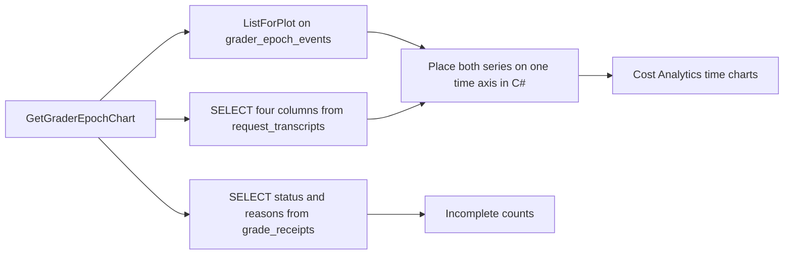

# Plan: #304 phase 9 — grader epoch marks on existing charts

**Status:** Draft. Q1, Q2, Q3, and the unit switch are answered (David, 2026-10-26). This pull request is docs only. It does not change source, tests, project files, or workflows. Implementation waits until David signs off this plan.

**Goal:** Show each local-grader takeover, each teacher retake, and each teacher, BGE, or feature-schema change as a point-in-time mark on charts that already exist, including a token-efficiency series. Count `Incomplete` receipts by reason. The marks do not say they caused a line to move. Unknown cost stays blank. There is no new grader-epoch chart.

**Architecture:** Phase 8 already appends `grader_epoch_events` in the router-memory database. Token counts and cost already sit on `request_transcripts` in the transcript database. Those are two files. Phase 9 reads each list on its own and places both on one time axis in C#. It does not join them in SQL. The ratio is computed once, on the router, so the page cannot invent a second formula. The dots copy the Context Buffer drawing in `optionThresholdLine`. They are a separate series. They are not the red breach dots.

**Tech stack:** C# / .NET 10. Charts already render through Apache ECharts (`EChart.razor` plus `wwwroot/js/echarts-interop.js`). BGE stays the frozen ONNX session (`OnnxEmbeddingClient`). No Python. No second embedder. No fine-tune. No new NuGet package.

**Issue:** [#304](https://github.com/davidpizon/TotallyHot-ArcRouter/issues/304). **Parent plan:** [`issue-304-grade-non-coding-responses.md`](issue-304-grade-non-coding-responses.md) §3.8, §4 phase 9. **Phase 7:** [`issue-304-phase-7-grader-epoch.md`](issue-304-phase-7-grader-epoch.md), implemented in [#346](https://github.com/davidpizon/TotallyHot-ArcRouter/pull/346). **Phase 8:** [`issue-304-phase-8-grader-takeover.md`](issue-304-phase-8-grader-takeover.md), implemented in [#348](https://github.com/davidpizon/TotallyHot-ArcRouter/pull/348). **ADR:** [Amendment 4](../adr/0027-grade-non-coding-responses-on-a-bootstrap-recipe-and-keep-them-out-of-code-tallies.md#amendment-4-2026-10-26-phase-9-marks-existing-charts) records Q1, Q2, Q3, and the unit switch.

Checked against `main` at `5b00300b` (the #348 merge) with CodeGraph (`codegraph_explore` after `codegraph init`) and Serena (`find_symbol` on the router project).

## Global constraints

- C# / .NET 10 only. BGE-large stays frozen ONNX. Do not fine-tune it, do not load another embedder, and do not call Python.
- `TreatWarningsAsErrors` stays on. New public members get XML docs that describe the behavior this phase ships.
- Serilog only. Every message template is a static string literal. No question text, no response text, and no vector contents in a log or on the chart.
- Unknown cost is null. A null token count stays null. Neither is stored as 0, and neither is drawn as 0. A cost or a token count that was stored as 0 stays 0 in the database. Both chart views leave that row out of the sums, so it is not a point at 0.
- A `LocalScore` is never a training label. This phase does not fit, score, or take over.
- Old receipts and old transcripts are not rewritten.
- Each new test stays under 5 seconds. Recorded fixtures only. No live provider and no BGE download.
- `QualityOptions.ScorerVersion` stays `3.0`. No historical rescan is added.
- Do not add a method to `ManagementFacade`. Do not register `grader_epoch_events` with `ScoreTableRetentionService`.

## Decisions

### Q1. Tokens per dollar. Approved by David on 2026-10-26.

The default line is tokens per dollar. For one bucket, add `input_tokens + output_tokens` and add `cost` over the rows that are known, then divide the token sum by the cost sum. The default unit label is `tok/$`. The other view, dollars per 1,000 tokens, uses that same pair of sums. Its label is `$/1k tok`.

A row is known only when both token counts and the cost are present, the cost is greater than 0, and the two token counts sum to more than 0. Every other row is left out of both sums. That includes a null token count, a null cost, a zero cost, a negative cost, a zero token sum, and a negative token sum. Leaving a row out is not the same as adding 0. A bucket with no known row is a gap in both lines, not a point at 0. David added the zero-token blank on 2026-10-26 so both views share this one filter. An earlier draft kept a zero token count in the token-per-dollar sum. That draft is retired: dollars per 1,000 tokens cannot divide by a zero token sum, and the two views must blank the same buckets.

The columns are `request_transcripts.created_at_utc`, `input_tokens`, `output_tokens`, and `cost`. The grade (`score`) is not one of them. There is no judge-cost column.

### Q2. No new grader-epoch chart. David, 2026-10-26.

David's words: "The epochs should be represented in the existing charts. Epochs represent single points in time. There was a chart that displayed pulsating dots. Could that be repurposed for the epochs? Different types of epochs would be different colors. More information about each epoch would be available as a tooltip when the user mouses over them or clicks them."

What that decides:

- Do not add a separate grader-epoch chart, and do not add a Report Card row titled `Grader epoch`.
- An epoch is one instant. It is a marker on a chart that already has a time axis, including the token-efficiency series. It is not its own plot.
- Each epoch type has its own color and a legend. Hover and click both open the same detail. Click also works from the keyboard and from a touch.
- The detail comes from `grader_epoch_events`: time in a clearly labeled zone, type, kind, cause, artifact ids, and spot-check stats. No question text and no answer text.
- The marks do not claim they moved the line. Unknown cost stays blank.
- #292 voter-weight epochs stay out of this phase. Nothing in `src/TotallyHotArcRouter.Gui.Components` draws a voter epoch today. This phase does not add one.

### Q3. Copy the Context Buffer dot. Approved by David on 2026-10-26.

Copy the drawing and the animation from `optionThresholdLine` (kind `ThresholdLine`) in `echarts-interop.js`: `effectScatter`, `symbolSize` 16, `showEffectOn: "render"`, `rippleEffect: { scale: 4.5, brushType: "stroke" }`. Copy only that. Epoch markers never sit on the >90% context points and never reuse that series. Their colors are not `#ef4444`. The Tokens runaway dots (`optionRunawayArea`, `#f59e0b`) stay the runaway alert. They are not the epoch dots either.

There is no open product question. The host charts, colors, kind shapes, and tooltip are in [Chart behavior](#chart-behavior).

## Scope

- Token efficiency is tokens per dollar by default, as Q1 states. A sliding toggle on that chart also shows dollars per 1,000 tokens. The math is [Token efficiency](#token-efficiency). The line is a new pill on the existing Cost Analytics chart, not a new page.
- Epoch marks on the eight time charts named in [Chart behavior](#chart-behavior). One color per type. `code` is a circle and `non-code` is a diamond.
- Hover, click, keyboard, and touch show the same epoch detail. No question text and no answer text.
- A count of `Incomplete` receipts by `incomplete_reason`, plus the abstention tokens in `abstained_graders`. That count is a list on the Report Card, not a chart.
- The docs named under [Docs to update](#docs-to-update).

## Out of scope

- A new grader-epoch chart and a new Report Card row for epochs. Q2 retired that. The new `buildOption` kind is only `TokenEfficiencyLine`, a pill on the Cost Analytics chart that already exists. It is not a second page.
- Epoch marks on `LearningReportCardChartBuilder` (`SpendByModel`, `ScoreDelta`, `GradeMix`). Those are bars and a donut. They have no time axis.
- Epoch marks on `ModelDistribution` (histogram and donut) and on the Providers card (`RateLimitTrendChartBuilder` / `optionRateLimitTrendLine`, and the budget bars). Those charts are not the Cost Analytics time window, so a mark there would not line up with the token-efficiency line.
- Changing the red breach series or the amber runaway series. They keep their data and their colors.
- A #292 voter-epoch panel.
- Any change to the fit, the holdout, the reservoir, the agreement gate, takeover, the spot-check draw, or `RollbackToTeacher`.
- A judge-cost column, a new receipt column, or a new transcript column.
- Rewriting stored grades, unified scores, `grader_scores` rows, costs, or token counts.
- Reading `usage_rollup` for this chart. `UsageRollupStore.ApplyIncrement` already adds a null cost as `0m` and a null token count as `0`. That store cannot draw an unknown as a blank.
- `MockData` for this panel. The other three Report Card panels keep the fallback they have.
- Joining the two database files with `ATTACH`, or copying epoch rows into the transcript file.
- Filtering out `is_utility` rows. The parent names `request_transcripts` and does not add that filter. The subtitle says the line is the request's own tokens and cost, not the teacher's bill.
- Tool-count features, #306, BGE changes, and `QualityOptions.SamplingRate`.
- A new window, modal, or dialog. This is a panel on a tab that already exists, so it does not use `DialogShell`.
- Editing the phase 7 or phase 8 plan files. They describe the decisions those pull requests shipped.

## What the screen shows

Cost Analytics (`CostAnalytics.razor`) keeps its one chart and its metric pills. An eighth pill, `Token efficiency`, is added after `Context`. It does not open a new tab. The seven pills that already exist stay in `CostMetric` order.

The epoch dots sit in a thin strip above the plot on every Cost Analytics time chart, including Token efficiency. They use the same Hour / Day / Week / Month / All window as the pill (`CostChartBuilder.WindowStart`). A legend under the chart names the five colors and the two shapes. The legend is visible on every pill.

On the Token efficiency pill only, a sliding switch sits next to that legend. It starts on `Tokens per dollar`. The other side is `Dollars per 1,000 tokens`. The choice is a field on `CostAnalytics`, the same way `_metric` and `_range` are fields. It is not written to `localStorage`. A reload returns to tokens per dollar. The Sessions tab stores divider widths in `localStorage`. This switch is a chart choice, like the metric pill, so it does not use that store.

Choosing a dot, by mouse, by touch, or by keyboard, opens one detail region under the legend. The detail stays until another mark is chosen. Hover shows the same lines in the chart tooltip and does not replace the detail region.

There is no chart titled `Grader epoch`.

The incomplete-count list lands on the Report Card tab, beside the three panels that already exist. Title `Incomplete grades`. Subtitle: `Receipts that did not learn, counted by reason. A zero here means no receipt. It is not an unknown cost.` It uses the Report Card Day / Month / 3-Month / 6-Month / Year filter (`LearningReportCard.razor` `RangeFor`). A slower response for an older filter is dropped the same way the tab already drops a stale reload (`_reloadGeneration`). This list does not use `MockData`. If the RPC fails, the list says `Incomplete grade counts are unavailable.` It does not show zeros in place of a failed read.

If the epoch RPC fails, the Cost Analytics pills still draw. The strip is absent. A line of text says `Grader epoch marks are unavailable.` No demo dots. The token-efficiency pill, in that same failure, says `Token efficiency is unavailable.` It does not draw a line at 0. `CostAnalytics` already plots a null turn cost as `$0.00` (`Unknown_null_token_counts_and_cost_still_plot_as_zero`). The token-efficiency pill does not use that path. It uses `GraderEpochEfficiency` only.

## Files

`echarts-interop.js` gains one shared helper, `epochScatterSeries`, copied from the Context Buffer dot, and one new kind, `TokenEfficiencyLine`. It does not gain `GraderEpochTime`.

| File | Change |
|---|---|
| `src/Protos/admin.proto` | Add `GetGraderEpochChart` on `UsageAdminService`, next to `GetLearningReportCard`. Read-only, same management-token gate. |
| `src/TotallyHotArcRouter/Transcripts/TranscriptTokenCostReader.cs` | New. Reads `request_transcripts` for the four columns. |
| `src/TotallyHotArcRouter/Transcripts/TranscriptTokenCostPoint.cs` | New record: `Id`, `CreatedAtUtc`, `InputTokens`, `OutputTokens`, `Cost`. Token fields are `int?`. Cost is `decimal?`. |
| `src/TotallyHotArcRouter/Judge/IncompleteGradeCountQuery.cs` | New. Counts `Incomplete` receipts in a window. |
| `src/TotallyHotArcRouter/Proxy/Management/GraderEpochEfficiency.cs` | New. The bucket math. This is the only place that divides. |
| `src/TotallyHotArcRouter/Proxy/Management/GraderEpochChartQuery.cs` | New. Calls the three readers and returns one snapshot. |
| `src/TotallyHotArcRouter/Proxy/Management/UsageAdminGrpcService.cs` | Second constructor parameter `GraderEpochChartQuery? epochChart = null`, plus the new RPC method. The default exists so today's `new UsageAdminGrpcService(reporting)` lines in `UsageAdminGrpcServiceTests` still compile. A null query returns unavailable with the message `The grader epoch chart is not available.` That is the same `ManagementErrorType.Unavailable` shape `GetLearningReportCard` uses when both of its stores are null (`The learning report card is not available.`). |
| `src/TotallyHotArcRouter/Proxy/ProxyServerDependencies.cs` | Optional init properties on `ManagementApiDependencies`: `IGraderEpochEventStore? EpochEvents`, `TranscriptDatabase? Transcripts`, `RouterMemoryDatabase? GradeReceipts`. The inner web host has its own container and cannot resolve the outer singletons. This is the same hand-off `UsageRollupStore` already uses. |
| `src/TotallyHotArcRouter/Proxy/ProxyServiceCollectionExtensions.cs` | Set those three properties where `ManagementApi` is built (next to `UsageRollupStore`). `GetRequiredService` for `IGraderEpochEventStore`, `TranscriptDatabase`, and `RouterMemoryDatabase`. |
| `src/TotallyHotArcRouter/Proxy/ProxyServer.cs` | See [Inner-host wiring](#inner-host-wiring). Do not add a `ManagementFacade` method. |
| `src/TotallyHotArcRouter.Gui.Charts/EpochMarkerPalette.cs` | New. The five epoch colors and the two symbol names. No `ChartPalette` hash. |
| `src/TotallyHotArcRouter.Gui.Charts/DistributionChart.cs` | No change to `ChartJson`. It drops null properties (`WhenWritingNull`). A missing ratio must stay absent in JSON, so the chart cannot draw it as 0. |
| `src/TotallyHotArcRouter.Gui.Charts/CostChartBuilder.cs` | Add `CostMetric.TokenEfficiency` after `ContextBufferMargin`. Add `EpochMarker` and `EfficiencyPoint` (below). Append optional `Epochs` and `Efficiency` to `CostChartModel`, both defaulting to null, so today's named `new CostChartModel(...)` calls still compile. `CostChartPoint.Value` stays a non-nullable `decimal`. Do not store a gap there. `Build` does not compute the ratio. A null turn cost stays the zero the existing pills already plot. |
| `src/TotallyHotArcRouter.Gui.Web/wwwroot/js/echarts-interop.js` | Shared `epochScatterSeries`, copied from the Context Buffer dot. New kind `TokenEfficiencyLine`. No kind `GraderEpochTime`. |
| `src/TotallyHotArcRouter.Gui.Components/Components/CostAnalytics.razor` | The eighth pill, the legend, the switch, and the detail region. |
| `src/TotallyHotArcRouter.Gui.Components/Components/EChart.razor` | Optional click callback. Hover stays in the chart tooltip. |
| `src/TotallyHotArcRouter.Gui.Admin/UsageQueryClient.cs` | `GetGraderEpochChartAsync`, beside `GetLearningReportCardAsync`. Map a missing `tokens_per_dollar` or `dollars_per_thousand_tokens` to null, never to 0. |
| `src/TotallyHotArcRouter.Gui.Admin/ProviderAdminModels.cs` | View records for the snapshot, next to `GradeMixRowView`. |
| `src/TotallyHotArcRouter.Gui.Components/Services/UsageStore.cs` | `LoadGraderEpochChartAsync`. Uncached, same reason as `LoadLearningReportCardAsync`: the window is "now minus N" and new rows arrive. |
| `src/TotallyHotArcRouter.Gui.Components/Components/LearningReportCard.razor` | The incomplete-count list only. No epoch chart on this tab. |
| `docs/how-it-learns.md` | Teacher phase and takeover, and the no-rescan sentence. See [Docs](#docs-to-update). |
| `docs/plans/router-evaluator-and-live-pricing.md` | §14 note. |
| `docs/gui/dashboard.md` | Cost Analytics pills, the switch, and the epoch strip. Report Card incomplete list. |
| `docs/adr/0027-grade-non-coding-responses-on-a-bootstrap-recipe-and-keep-them-out-of-code-tallies.md` | Amendment 4. Already written in this docs pull request. The implementation pull request does not reopen it. |
| `docs/plans/issue-304-grade-non-coding-responses.md` | Phase 9 row links this file. Already written in this docs pull request. |

No change to `src/TotallyHotArcRouter/Judge/IGraderEpochEventStore.cs`. `ListForPlot` already returns every row, oldest first, with the phase 9 `SELECT`. Do not add a time filter to that method. The chart query filters in memory.

No change to `ITranscriptStore` or `IGradeReceiptStore`. Both have many callers. A new method on either would touch every test double. The two new reader types take the database objects the stores already use.

### Inner-host wiring

`UsageAdminGrpcService` is not constructed in `ProxyServer`. `endpoints.MapGrpcService<UsageAdminGrpcService>()` only reflects over the type. The inner Kestrel container constructs the service on the first RPC. That mapping already sits inside `if (managementApi is not null)`, and the constructor's `ManagementReportingService` is the singleton registered in the matching block just above (the block that does `new ManagementReportingService(...)` and `services.AddSingleton(reportingService)`).

In that same block, always construct one `GraderEpochChartQuery` from the three new `ManagementApiDependencies` properties and `services.AddSingleton` it, including when one of those properties is null. The inner container then resolves the chart query because it is registered. A registered query whose database property is null returns unavailable, and the service still activates.

The C# default is for the hand-built tests. It is also what the container uses when the singleton is missing. On `Microsoft.Extensions.DependencyInjection` 10.0.14, both `GetRequiredService` and `ActivatorUtilities.CreateInstance` pass null for an unregistered parameter that has a default. Forgetting `AddSingleton` does not throw on the first RPC. The chart stays unavailable, which is the same symptom as a null database property, and a test that only does `new UsageAdminGrpcService(reporting)` will not catch it. Register the query beside `ManagementReportingService` anyway. That is how the reporting service reaches this gRPC type today.

`ProxyServerTests` that build `ManagementApiDependencies` without the three new properties stay valid. The query is still registered, and its RPC returns unavailable.

## Data queries



The epoch read is the one phase 8 shipped on `SqliteGraderEpochEventStore.ListForPlot`:

```sql
SELECT id, at_utc, kind, epoch_type, cause, artifact_id, previous_artifact_id, window_size, mean_miss,
       previous_teacher_model, teacher_model, previous_prompt_version, prompt_version, rollback_mark_present,
       previous_bge_model, bge_model, previous_feature_schema_version, feature_schema_version
FROM grader_epoch_events
ORDER BY at_utc, id;
```

Keep rows whose parsed `at_utc` is `>= from` and `< to`. `at_utc` is the round-trip `"O"` text `TimeProvider.GetUtcNow` already uses. A row that does not parse is skipped. Log the event id at Warning. Do not plot it at time zero.

The transcript read is new, on `TranscriptTokenCostReader`. Copy the null-preserving reads in `SqliteTranscriptStore.ListSessionsAsync` (cost, input tokens, output tokens around the `IsDBNull` checks). Do not copy that method's query. It is "newest N rows" and it is not a time window.

```sql
SELECT id, created_at_utc, input_tokens, output_tokens, cost
FROM request_transcripts
WHERE created_at_utc >= $from AND created_at_utc < $to
ORDER BY created_at_utc, id;
```

`$from` and `$to` are `DateTimeOffset.ToUniversalTime()` formatted with `"O"`. After the read, parse `created_at_utc` and drop a row outside `[from, to)`. A row that does not parse is skipped. Log the transcript id. Do not plot it. `cost` is `REAL NULL`. Read it only when `IsDBNull` is false. A null stays null. Do not call `GetDouble` on a null, and do not coalesce to 0. The `SELECT` list does not contain `prompt_text` or `response_text`. Capture being off does not hide rows already stored. `ITranscriptStore` methods return empty when capture is disabled. This reader does not. The chart is a history of what was recorded.

The receipt read is new, on `IncompleteGradeCountQuery`, against `RouterMemoryDatabase` (the same file as `grader_epoch_events`):

```sql
SELECT incomplete_reason, abstained_graders
FROM grade_receipts
WHERE grade_status = 'Incomplete'
  AND created_at_utc >= $from AND created_at_utc < $to;
```

`grade_status` is the enum name `Incomplete`. `GradeReceiptRecordObserver` puts `result.GradeStatus` on the `GradeReceiptRecord`. `SqliteGradeReceiptStore.BindRecord` writes `record.GradeStatus.ToString()`, which stores `Incomplete`. `abstained_graders` is the comma-separated `grader:reason` list from `GradeReceiptRecordObserver.FormatAbstainedGraders`. A `Complete` row stores an empty string there, so it is not in this query. Do not select `question_hmac` or any text.

`GraderEpochChartQuery` calls these three and does not open one connection that attaches both files.

### RPC shape

`GetGraderEpochChartRequest`: `from`, `to`, and `width`. `width` is `hour` or `day`. The gRPC method does what `GetLearningReportCard` and `QueryRollup` already do, and nothing more: `ParseTimestamp` on `from` and `to` (a missing field throws `InvalidArgument` with `'{field}' is required.`), and an empty `width` becomes `day` (`string.IsNullOrEmpty(width) ? "day" : width`, copied from `UsageAdminGrpcService.QueryRollup`). `GraderEpochChartQuery` then checks the range. `to <= from` returns `ManagementErrorType.InvalidRequest` with `'to' must be after 'from'.`, copied from `GetLearningReportCardAsync`. Any width other than `hour` or `day` returns `InvalidRequest` with `width must be 'hour' or 'day'.`, copied from `GetUsageRollup`. `UsageAdminGrpcService.Unwrap` maps that `InvalidRequest` to `StatusCode.InvalidArgument`, the same way those two RPCs do. `GetLearningReportCard` has no width field. `from` is inclusive and `to` is exclusive. Cost Analytics sends the window `CostChartBuilder.WindowStart` already uses for the selected `MetricRange`, through `now`. `width` is `hour` for Hour and Day, and `day` for Week, Month, and All. The Report Card incomplete list sends its own `RangeFor` window. It does not draw the line.

`GraderEpochChartResponse`:

- `points`: `bucket_start_utc`, optional `tokens_per_dollar` (string), optional `dollars_per_thousand_tokens` (string), `known_rows`, `skipped_rows`. The two strings are omitted together. The page does not divide. The switch only chooses which string to plot.
- `markers`: the epoch columns above, with the same nullability. `mean_miss` is `optional double`. `window_size` is `optional int32`. `rollback_mark_present` is `optional int32`. `feature_schema_version` and `previous_feature_schema_version` are `optional int32`. A stored `1` is a real schema version. A missing field is null, not 0.
- `incomplete_receipts`: the number of `Incomplete` rows in the window.
- `incomplete_by_reason`: one entry per named reason, count included when it is 0.
- `abstained`: one entry per token that actually occurred.

Both ratios are optional strings, not doubles. Proto3 would otherwise treat a missing number as 0, and the chart would plot that 0. A gap omits both fields. This phase does not plot a real zero ratio: a zero token count is a blank, so the line never sends `"0"`. Money on this RPC family is already a string (`cost_usd` on `UsageRollupBucketRow`). No field on this RPC holds question text or response text.

## Token efficiency

Approved by David on 2026-10-26. Two views, one set of rows. The default view is tokens per dollar. The other view is dollars per 1,000 tokens.

`GraderEpochEfficiency` buckets the transcript points. It is the only place that divides.

- `hour`: bucket start is the UTC hour of `created_at_utc`.
- `day`: bucket start is the UTC midnight of that instant.

A row is **known** when `InputTokens` and `OutputTokens` and `Cost` all have values, `Cost > 0`, and `InputTokens + OutputTokens > 0`.

A row is **skipped** when it is not known. That is a null token count, a null cost, a cost that is not greater than 0 (zero or negative), or a token sum that is not greater than 0 (zero or negative). Skipped rows increment `skipped_rows` for the bucket they would have landed in. They add nothing to either sum. A null is not added as 0. A cost of 0 is not plotted as 0. A token sum of 0 is not plotted as 0, and it is not used as a divisor. The same skip list applies to both views.

When `known_rows > 0`, both sums are greater than 0. The two strings are:

- Tokens per dollar: `tokenSum / costSum`.
- Dollars per 1,000 tokens: `costSum / tokenSum * 1000`.

Format each with invariant culture, format `G29`, and no currency symbol, so the string parses back to the same decimal. A bucket with `known_rows == 0` omits both strings. It may still be a gap on the line when it sits between two known buckets. `known_rows` and `skipped_rows` are counts. A 0 count is a real count.

Worked example, one hour, four rows:

| Input | Output | Cost | In either view? |
|---|---|---|---|
| 100 | 50 | 0.25 | Yes. 150 tokens, 0.25 dollars. |
| null | 10 | 0.10 | No. The null token is not a 0. |
| 10 | 0 | null | No. The null cost is not a 0. |
| 20 | 0 | 0.10 | Yes. 20 tokens, 0.10 dollars. |

Token sum 170, cost sum 0.35. Tokens per dollar is `170 / 0.35`. Dollars per 1,000 tokens is `0.35 / 170 * 1000`. `known_rows` is 2. `skipped_rows` is 2.

A fifth row with cost `0` and 100 tokens is skipped in both views. A sixth row with cost `0.10` and both token counts `0` is skipped in both views. Neither becomes a point at 0.

The chart does not divide again. The switch chooses which of the two strings to plot. If the chosen string does not parse, that point is a gap, not 0.

### Unit switch

The switch is a two-position slide next to the token-efficiency legend, and only on that pill. It is a `<button role="switch">`. Tab reaches it. Space or Enter flips it. The pressed side has `aria-checked="true"`. Both names are visible text, not only an icon: `Tokens per dollar` and `Dollars per 1,000 tokens`. The selected side also says which way is better: `Up is better` on tokens per dollar, and `Down is better` on dollars per 1,000 tokens. The y-axis name is `tok/$` or `$/1k tok`, and it includes that same better-direction phrase. A point tooltip uses the active unit and that phrase. The epoch detail does not. Flipping the switch does not move epoch dots and does not ask the router again. The other seven pills do not render this control.

`CostAnalytics` keeps the choice in a private field, defaulting to tokens per dollar, the same way it keeps `_metric` and `_range`. It does not write `localStorage`.

## Chart behavior

The marks go on the Cost Analytics time charts. Each one is one pill, one `CostMetric`, one `buildOption` kind:

| Pill | `CostMetric` | Kind | Function |
|---|---|---|---|
| Routing ROI | `RoutingRoi` | `DualDirectionalBars` | `optionDualDirectionalBars` |
| Turn Cost | `TotalTurnCost` | `SteppedCumulativeArea` | `optionSteppedCumulativeArea` |
| Tokens | `Tokens` | `RunawayArea` | `optionRunawayArea` |
| Tool Steps | `ToolExecutionSteps` | `SegmentedStepBars` | `optionSegmentedStepBars` |
| Cache Hit | `CacheHitRate` | `CacheGradientLine` | `optionCacheGradientLine` |
| TTFT | `TimeToFirstToken` | `ZonedLatencyLine` | `optionZonedLatencyLine` |
| Context | `ContextBufferMargin` | `ThresholdLine` | `optionThresholdLine` |
| Token efficiency | `TokenEfficiency` | `TokenEfficiencyLine` | `optionTokenEfficiencyLine` |

`TokenEfficiency` is added at the end of the enum so the existing seven stay in their order. There is no kind `GraderEpochTime`.

The seven pills that already exist keep the series `CostChartBuilder.Build` makes today from `MetricTurnPoint`. They do not read the new ratio. The Token efficiency line does not read `MetricTurnPoint` and does not read `usage_rollup`. Its points are only the RPC `points`.

Cost Analytics and the Report Card each call `GetGraderEpochChart`. They do not share one response, because their windows differ.

- Cost Analytics sends `from` = `WindowStart` for the selected range, `to` = now, and `width` = `hour` for Hour and Day, else `day`. It uses `points` and `markers`. It ignores the incomplete counts.
- The Report Card sends `from` and `to` from `RangeFor`, and `width` = `day`. It uses `incomplete_receipts`, `incomplete_by_reason`, and `abstained`. It ignores `points` and `markers`. It does not draw the line or the dots.

On every Cost Analytics rebuild (a new pill, a new range, or a successful load), pass that same `markers` list into `CostChartModel.Epochs` for the pill on screen. The unit switch does not call the RPC again and does not replace `Epochs`. It rebuilds `Efficiency` (`Value`, `Gap`, and `Tip`) and `Unit` from the other wire string.

`EpochMarker` is `T` (Unix milliseconds of `at_utc`), `Id`, `Color`, `Symbol` (`circle` or `diamond`), and `Tip` (the string list from [Detail](#detail)). `EfficiencyPoint` is `T` (bucket start), `Gap`, `Value` (`decimal?`), and `Tip`. `Gap` is true when both wire strings are absent, or when the chosen string does not parse. `Value` is then null and `Tip` is empty. When `Gap` is false, `Value` is the invariant parse of the active string, and the chart JSON writes that parse as a number. `Tip` is one line: that same formatted string, the active unit (`tok/$` or `$/1k tok`), and the better-direction phrase. The page does not divide. `ChartJson` uses camelCase and `WhenWritingNull`, so a gap point is `{"t":…,"gap":true,"tip":[]}` with no `value` property. `optionTokenEfficiencyLine` reads `m.efficiency`, not `m.points`. The other seven kinds ignore `m.efficiency`.

`m.unit` for this kind is the whole y-axis name: `tok/$ · Up is better` or `$/1k tok · Down is better`. `optionTokenEfficiencyLine` sets `yAxis.name` to `m.unit`. It does not pass `m.unit` to `numberFmt`. That helper has no case for these units, and its default is `toFixed(0)`, which would draw a ratio as an integer. Tick labels use `(v) => String(v)`. The point tooltip is `tooltipBox` on `tip`. Flipping the switch rebuilds `Efficiency` and `Unit` only.

`epochScatterSeries` is appended by each of those eight functions when `m.epochs` is non-empty. It copies the Context Buffer dot: `type: "effectScatter"`, `symbolSize: 16`, `showEffectOn: "render"`, `rippleEffect: { scale: 4.5, brushType: "stroke" }`, `shadowBlur: 14`, `z: 10`. `itemStyle.color` and `shadowColor` are the epoch color, not `#ef4444`. The series name is `epochs`. Its tooltip is on. The breach series inside `optionThresholdLine` stays as it is, including `tooltip: { show: false }`, `shadowBlur: 14`, and color `#ef4444`. The runaway series inside `optionRunawayArea` stays amber `#f59e0b`. Epoch rows are not pushed into either of those arrays.

The epoch dots use their own grid, a strip about 18 pixels tall above the metric plot. Their y is `1` on a hidden axis that only that strip uses. The metric, including a context point at or above 90%, stays on the lower grid. Both time axes share one min and one max, so a dot lines up with the metric time and still does not use the metric's y. An empty epoch list leaves the chart as it is today, with one grid.

`connectNulls` stays false on the token-efficiency line. `ChartJson` omits nulls. The script checks `p.gap === true` before it reads a value. `Number(null)` is 0, so a gap is the flag, not a missing number.

### Colors and kind

Fixed colors in `EpochMarkerPalette`. Not `ChartPalette.ColorFor`. None of them is the amber alert `#f59e0b` or the red alert `#ef4444`.

| `epoch_type` | Color | Legend |
|---|---|---|
| `local_takeover` | `#1ed760` | Local grader took over |
| `teacher_resumed` | `#3b82f6` | Teacher took charge again |
| `teacher_changed` | `#a855f7` | Teacher model or prompt changed |
| `bge_changed` | `#14b8a6` | Embedding model changed |
| `feature_schema_changed` | `#6366f1` | Feature list changed |

`code` uses symbol `circle`. `non-code` uses symbol `diamond`. Both ripple. The legend reads `circle = code, diamond = non-code`. An `epoch_type` outside the five is still drawn, in `#64748b`, with its raw type as the name. It is not dropped.

The mark's x is the event's own `at_utc`, not a bucket start. Two events in the same millisecond both draw. Order is `at_utc`, then `id`.

### Detail

One list of lines is built in C# and stored on the marker as `tip`. Hover, click, keyboard, and touch all show that same list. The script does not invent a line.

- `Time (UTC):` and the time `yyyy-MM-dd HH:mm:ss`. The zone word is `UTC`. The stored `at_utc` is already UTC. Do not shift it to the browser zone.
- Type, using the legend name.
- Kind, `code` or `non-code`.
- Cause.
- Artifact id. Previous artifact id, or the word `none` when that field is null.
- For cause `spot_check_rollback` or `live_check_pass`: window size, and mean miss. A null mean miss is the word `unknown`, not `0`. A null window size is `unknown`, not `0`.
- For `teacher_changed`: previous and new teacher model, previous and new prompt version. A null side is `unknown`.
- For `bge_changed`: previous and new BGE id.
- For `feature_schema_changed`: previous and new schema version. A stored `1` is shown as `1`. A null is `unknown`, not `0`.
- `rollback_mark_present` only when the field is present. `1` is `rollback mark: yes`. `0` is `rollback mark: no`. A null field omits the line.
- Last line, always: `This mark does not say it caused the line to move.`

No line contains question text or answer text.

Hover: the epoch series tooltip uses `tooltipBox` with `tip`. `triggerOn` is `mousemove|click`. The axis tooltip still shows the metric point. It is not the epoch detail.

Click and touch: ECharts fires `click` for a mouse click and for a tap. `EChart.razor` passes a .NET callback. When the series name is `epochs`, the page opens the detail region with that marker's `tip`. The region has `aria-live="polite"` and stays until another mark is chosen.

Keyboard: under the legend, one `<button>` per mark in the loaded window, in `at_utc` then `id` order, at least 44 pixels tall, inside a region that scrolls. Do not drop a mark to shorten the list, and do not paginate. Its accessible name includes the legend type and `Time (UTC)`. Enter or Space opens the same detail region. The canvas itself is not the keyboard path. The breach dots and the runaway dots stay non-focusable, as they are today.

## Incomplete counts

Eight named reasons, always shown, in the declaration order of `IncompleteReasons`: `queue_full`, `no_text`, `empty`, `no_judge`, `judge_is_answerer`, `disputed`, `deferred_to_loop`, `loop_unlinked`. A reason with no row shows `0`. That 0 is a count of receipts. The query's `grade_status = 'Incomplete'` leaves out `StructureOnly` and `Complete`. `StructureOnly` is a different enum value (`GradeStatus.StructureOnly`) and is not an incomplete reason.

A null or empty `incomplete_reason` is an extra row, `no reason stored`, and only when its count is at least 1. It is not a ninth permanent reason, and it is not shown as 0.

`abstained_graders` is split on commas. Each piece is one token, shown as stored (`judge:judge-join-timeout`). Empty pieces are ignored. A token is listed only when its count is at least 1. Do not invent a zero for a degraded reason that never occurred. The set of reasons is not closed. A piece with no colon is still counted. Do not drop it.

The headline is `incomplete_receipts`, the number of rows, not the sum of the two lists. A row with both a reason and an abstention token would be counted twice in that sum.

These counts are not a series on the time graph.

## Docs to update

Implementation pull request, after David signs off this plan. Q1, Q2, Q3, and the unit switch are answered.

`docs/how-it-learns.md`

- In Step 4, after the sweep paragraphs, add a short "Teacher phase and takeover" section in the same plain voice. The pinned free teacher grades first. Two local graders, one for code and one for prose, train on the teacher's judge score. Passing the gate in phase 7 writes a shadow score and does not take over. Takeover is later: a confident answer can skip the teacher. A 5% sample and a low-confidence answer still call the teacher. A spot-check window that is too far from the teacher gives the job back to the teacher. Say that a shadow score beside the teacher is not the grade of record.
- Keep the description of `QualityRescanService`. It still runs. It extracts a fenced snippet through `ISignalExtractor`. A prose row with no fence is stamped with a null score and is not sent to the teacher (`RescanOneAsync` stamps null when `Extract` returns null). Add one sentence: issue #304 does not bump `QualityOptions.ScorerVersion` (it stays `3.0`) and does not walk old receipts to grade them again. Already-stored grades are not rewritten when a local grader takes over.
- Do not delete the sentence that says bumping `ScorerVersion` re-marks the cabinet. That is the code sweep. Add that #304 does not do that bump.
- In Honest gaps, add that epoch marks on a time chart do not claim they moved the token line, and that an unknown cost is a blank. Do not call it a grader-epoch chart.

`docs/plans/router-evaluator-and-live-pricing.md` §14, three short bullets:

- The pinned free teacher grades live text. Two local graders, code and non-code, train on the teacher's judge score.
- The grader epoch is a separate job from the #292 voter epoch. It does not change voter weights. The voter epoch does not fit the local grader.
- History is not rescanned for this grade. `ScorerVersion` stays `3.0`.

`docs/gui/dashboard.md`: the eighth Cost Analytics pill, the switch, the epoch strip, and the Report Card incomplete list. Say the Context Buffer red dots and the Tokens amber dots stay alerts. Do not add a new design-spec file.

`docs/adr/0027` Amendment 4, in this pull request, records both units, the blanks, the Context Buffer dot copy, and that phase 9 does not add a new chart.

This pull request records Q1, Q2, and Q3 as answered, and the unit switch David added the same day. It also corrects two sentences that #346 and #348 made false: `GraderEpochOptions` now has `TakeoverEnabled`, `SpotCheckRate`, `SpotCheckWindowSize`, and `SpotCheckRollbackMae`, and the router project references `Microsoft.ML` 5.0.0.

## Tests

New `GraderEpochPhase9Tests` in `src/TotallyHotArcRouter.Tests/Proxy/Management/`, beside `LearningReportCardAggregatorTests`. The RPC mapping test goes in `UsageAdminGrpcServiceTests`. The client mapping test goes in `src/TotallyHotArcRouter.Gui.Admin.Tests/UsageQueryClientTests.cs`. Chart and switch tests go in `src/TotallyHotArcRouter.Gui.Charts.Tests/` and `src/TotallyHotArcRouter.Gui.Components.Tests/CostAnalyticsTests.cs`. The incomplete-list test goes in `LearningReportCardTests`.

Recorded fixtures. Short tables. No `usage_rollup` rows in the efficiency fixture. Each test under 5 seconds.

| Test | Asserts |
|---|---|
| `Efficiency_BothViews_MatchTheWorkedExample` | The four-row hour above. Tokens per dollar equals `170m / 0.35m`. Dollars per 1,000 tokens equals `0.35m / 170m * 1000m`. Both wire strings parse back to those decimals. `known_rows` is 2. `skipped_rows` is 2. |
| `Efficiency_NullCost_IsAGap_InBothViews` | A window whose only row has a null cost omits both strings. It does not send `"0"`. |
| `Efficiency_NullToken_IsAGap_InBothViews` | A null `input_tokens` or a null `output_tokens` is skipped in both views. The other column is not used alone, and it is not treated as 0. |
| `Efficiency_ZeroCost_IsAGap_InBothViews` | Cost `0` with a positive token count is skipped in both views. No point at 0 and no point at a huge ratio. The stored cost is left as 0. |
| `Efficiency_ZeroTokens_IsAGap_InBothViews` | Both token counts 0 and cost `0.10` are skipped in both views. The response omits both strings. |
| `Efficiency_DoesNotReadUsageRollup` | The query type has no `IUsageRollupStore` dependency. A rollup bucket whose cost was zero-filled is not an input. |
| `TokenCostQuery_SelectsFourColumns_NoText` | The command text contains `input_tokens`, `output_tokens`, `cost`, and `created_at_utc`. It does not contain `prompt_text` or `response_text`. A null cost round-trips as null. |
| `Markers_AllFiveTypes_AndBothKinds` | One fixture row per type, for `code` and for `non-code`. The snapshot has ten marks. Order is `at_utc`, then `id`. |
| `Markers_OutsideTheWindow_AreDropped` | An event before `from` or at `to` is absent. An event inside is present. |
| `Markers_NullMeanMiss_StaysNull` | A `teacher_resumed` row with a null `mean_miss` and a null `window_size` comes back with both fields unset. Not 0. |
| `Markers_SchemaVersionOne_IsNotNull` | A `feature_schema_changed` row with `feature_schema_version` 1 returns 1. |
| `Markers_RollbackMarkZero_IsZero` | `rollback_mark_present` 0 stays 0. A null on an authority row stays unset. |
| `IncompleteCount_NamedReasons_IncludeZero` | No `queue_full` rows. That reason is in the list with count 0. The headline is the row count. |
| `IncompleteCount_AbstainedToken_IsSeparate` | One row with reason `no_judge` and `abstained_graders` `judge:judge-join-timeout` counts once in the headline, once under `no_judge`, and once under that token. |
| `IncompleteCount_EmptyReason_OnlyWhenPresent` | A null `incomplete_reason` adds `no reason stored` with its count. The label is absent when every incomplete row has a reason. |
| `ChartQuery_ReadsTheTwoFilesSeparately` | The query calls `ListForPlot` and the transcript reader. It does not execute `ATTACH`. |
| `GetGraderEpochChart_NullQuery_IsUnavailable` | `UsageAdminGrpcService` constructed without the chart query returns unavailable and the message `The grader epoch chart is not available.` It does not return an empty success. |
| `GetGraderEpochChart_MissingFrom_IsInvalidArgument` | A request with no `from` throws `InvalidArgument` and the detail `'from' is required.` Same helper as `GetLearningReportCard`. |
| `GetGraderEpochChart_GapOmitsBothRatios` | A gap bucket has neither `tokens_per_dollar` nor `dollars_per_thousand_tokens`. It does not send `"0"`. |
| `UsageQueryClient_MissingRatio_IsNull` | A missing string is null on the view model. It is not 0. |
| `EfficiencyGap_OmitsValue` | Serialized JSON for a gap `EfficiencyPoint` has `"gap":true`, `"tip":[]`, and no `value` property. It is not a `CostChartPoint`. |
| `EpochOverlay_OnAllEightCostKinds` | Each of the eight kinds includes a series named `epochs` when markers are present. `GroupedBars`, `Donut`, and `RemainingLine` do not. |
| `EpochOverlay_NotOnContextBreachSeries` | The Context Buffer breach series is still the points at or above 90%, color `#ef4444`, and it contains no epoch id. Epoch y is `1` on the strip axis. |
| `EpochColors_OnePerType_NotAlertRedOrAmber` | The five colors above. None equals `#ef4444` or `#f59e0b`. |
| `EpochSymbol_CodeIsCircle_NonCodeIsDiamond` | Kind `code` is `circle`. Kind `non-code` is `diamond`. |
| `EpochLegend_ListsFiveTypes_AndBothShapes` | The legend text contains the five names and `circle = code, diamond = non-code`. |
| `EpochTooltip_HoverLines_IncludeUtcAndNoText` | `tip` starts with `Time (UTC):`, ends with the no-cause sentence, and does not contain a question or an answer. |
| `EpochTooltip_Click_ShowsTheSameLines` | Choosing the dot's click callback shows that same `tip` in the detail region. |
| `EpochTooltip_Keyboard_ShowsTheSameLines` | Activating the mark's button shows that same `tip`. |
| `EpochTooltip_Touch_UsesTheSameClickLines` | The click callback is the only canvas path, so a tap shows the same `tip` as a click. |
| `UnitSwitch_DefaultsToTokensPerDollar` | The switch is not pressed. The axis name contains `tok/$` and `Up is better`. |
| `UnitSwitch_FlipsAxisAndTooltip` | After the switch, the axis name contains `$/1k tok` and `Down is better`, and the point tooltip uses that unit. |
| `UnitSwitch_BlanksStayBlankInBothViews` | A gap bucket draws no point before the switch and no point after it. A negative cost and a negative token sum are gaps in both views too. |
| `UnitSwitch_EpochTimesStayPut` | The epoch `t` values are unchanged after the switch. |
| `UnitSwitch_OnlyOnTheTokenEfficiencyPill` | The other seven pills do not render the switch. |
| `UnitSwitch_VisibleLabel_KeyboardButton` | The control is a `button` with `role="switch"`. Both unit names are visible text. |
| `ReportCard_IncompleteList_DoesNotUseMockData` | When the load returns null, the incomplete list shows `Incomplete grade counts are unavailable.` It does not show `MockData` spend figures as counts. |

`EpochEvent_AppendOnly` and the other phase 8 epoch tests stay green. This phase does not add an update or a delete.

## Rollout

1. David signs off this plan. Q1, Q2, Q3, and the unit switch are already answered.
2. The implementation pull request links this file. It builds with no warnings. The tests above pass.
3. Nothing in grading changes when the chart ships. Takeover stays as phase 8 left it. No config flag. An operator does not turn the chart on.
4. No migration. `grader_epoch_events` and `request_transcripts` are already there. A database with no epoch rows shows the empty copy.
5. An older dashboard that does not call `GetGraderEpochChart` keeps working. The new RPC is read-only.

## Risks

- **A null plotted as zero.** `ChartJson` drops null properties. Proto3 drops a missing number into 0. `UsageRollupStore` already stored nulls as 0. The optional string, the `gap` flag, and the ban on the rollup are the three guards. A test covers each.
- **The line connecting across a hole.** Omitting an empty bucket makes ECharts draw a slope across the missing hour. Gap points between known buckets are what break that slope. `connectNulls` stays false.
- **The JS coerce.** `Number(null)` is 0. The host chart checks the gap flag before it reads the value.
- **A reader thinks the mark caused the move.** The last `tip` line says it did not. Hover, click, keyboard, and touch all show that line.
- **Conversation text on the admin RPC.** The transcript `SELECT` is four columns. The test fails if `prompt_text` or `response_text` appears.
- **Two database files.** A read cannot be one transaction across them. The chart can show an epoch that was committed a moment after the transcript snapshot. That is a display skew, not a write. The last `tip` line refuses a causal claim.
- **The inner web host cannot see outer singletons.** Forgetting the three `ManagementApiDependencies` properties makes the RPC permanently unavailable in the real server while unit tests that pass a database still pass. The wiring section above is the fix. Forgetting `services.AddSingleton` of `GraderEpochChartQuery` has the same symptom, not an activation error: the container supplies the constructor default null. A hand-built `UsageAdminGrpcService` test does not catch a missing registration. Register the query in the same block as `ManagementReportingService`.
- **`ListForPlot` loads every epoch.** The table is append-only and is not purged. Filtering in memory keeps the phase 8 contract. Do not "fix" growth by deleting rows.
- **The code sweep is still on.** A doc that says "history is not rescanned" without naming `QualityRescanService` would be wrong. The doc section above keeps the sweep and says #304 does not send old prose to the teacher.
- **A zero receipt count read as an unknown cost.** The incomplete panel's subtitle says a zero means no receipt.
- **Demo data that looks like a real takeover.** The incomplete list does not use `MockData`. Epoch dots are not drawn from `MockData` either.
- **Copying the breach dots onto the breach series.** The drawing is copied. The data is not. An epoch on the breach series would mark a takeover as "context is almost full."
- **A zero token count plotted as zero.** Dollars per 1,000 tokens would divide by zero. Both views skip that row. The switch must not reintroduce it on one side.
- **The switch remembered in the wrong store.** `localStorage` is for the Sessions divider, not for this chart. A private field matches the metric pill.

## Done when

- David has signed off this plan, and the implementation pull request links this file.
- Epoch marks sit on the eight Cost Analytics time charts, in a strip above the plot, using the Context Buffer dot drawing and the five colors above. There is no new grader-epoch chart. #292 voter epochs are absent. Hover, click, keyboard, and touch show the same detail.
- The token-efficiency pill defaults to tokens per dollar. The switch changes the axis, the unit, and the point tooltip to dollars per 1,000 tokens. Epoch times do not move. A null cost, a null token count, a zero cost, and a zero token count are gaps in both views, never points at 0. `usage_rollup` is not an input.
- `Incomplete` receipts in the Report Card window (`RangeFor`, not the Cost Analytics `WindowStart`) are counted by the eight named reasons, with a real 0 when a reason has no row, and abstention tokens are listed beside that. The headline is the row count.
- `docs/how-it-learns.md` describes the teacher phase and takeover as two steps, and it says #304 does not rescan history and does not bump `ScorerVersion`. §14 of the evaluator plan names the teacher, the local grader, and the separate epoch. Amendment 4 names both units, the Context Buffer dot, and says phase 9 does not add a new chart.
- No stored grade, cost, or token count is rewritten. `ManagementFacade` gains no method. `grader_epoch_events` is still not purged.
- The build is warning-free. New public members have XML docs. Each new test finishes in under 5 seconds.

## Names checked against the tree

Checked with CodeGraph and Serena at `5b00300b`. These exist:

- `IGraderEpochEventStore.ListForPlot` and `SqliteGraderEpochEventStore`, registered in `JudgeServiceCollectionExtensions`. `GraderEpochEventRow` keeps nulls. `Insert` is the only write.
- `IGraderEpochEventStore` constants: `LocalTakeover` `local_takeover`, `TeacherResumed` `teacher_resumed`, `TeacherChanged` `teacher_changed`, `BgeChanged` `bge_changed`, `FeatureSchemaChanged` `feature_schema_changed`.
- `GraderEpochOptions` includes `TakeoverEnabled`, `SpotCheckRate`, `SpotCheckWindowSize`, and `SpotCheckRollbackMae`.
- `UsageAdminService.GetLearningReportCard` in `src/Protos/admin.proto`. `UsageAdminGrpcService` takes `ManagementReportingService` and is constructed by the inner container, not by `ProxyServer`. `MapGrpcService<UsageAdminGrpcService>()` is inside `if (managementApi is not null)`. `ManagementReportingService` is `new`'d and `AddSingleton`'d in the matching block. `ManagementApiDependencies` is filled in `ProxyServiceCollectionExtensions`, which says the inner host cannot resolve outer singletons. `UsageAdminGrpcService.QueryRollup` maps an empty width to `day`. `GetUsageRollup` rejects any other width with `width must be 'hour' or 'day'.` `ParseTimestamp` rejects a missing timestamp. `IncompleteReasons` declaration order is `queue_full`, `no_text`, `empty`, `no_judge`, `judge_is_answerer`, `disputed`, `deferred_to_loop`, `loop_unlinked`.
- `ManagementFacade` is a different type. Reporting was split out of it. This phase does not add a method there.
- `request_transcripts` in `TranscriptDatabase`: `created_at_utc` `TEXT NOT NULL`, `input_tokens` `INTEGER NULL`, `output_tokens` `INTEGER NULL`, `cost` `REAL NULL`, plus `prompt_text` and `response_text`, which this phase does not select.
- `SqliteTranscriptStore.ListSessionsAsync` already reads cost and tokens with `IsDBNull`.
- `UsageRollupStore.ApplyIncrement` sets `cost` to `entry.EstimatedCostUsd ?? 0m` and token counts to 0 when null.
- `grade_receipts.created_at_utc`, `incomplete_reason`, `abstained_graders`. `IncompleteReasons` has the eight strings. `FormatAbstainedGraders` writes `grader:reason` joined by commas, and writes nothing on `Complete`.
- `QualityRescanService.RescanOneAsync` uses `ISignalExtractor.Extract`. A null extract stamps a null score.
- `QualityOptions.ScorerVersion` defaults to `3.0`.
- `LearningReportCard.razor` is the Report Card tab, opened from `Dashboard.razor`. Filters: Day, Month, 3-Month, 6-Month, Year. `ChartJson` uses `WhenWritingNull`. `EChart.razor` renders whatever JSON `echartsInterop.render` is given. `buildOption` switches on `m.kind`.
- `ChartPalette` hashes a name to a color. Epoch colors are fixed because the legend must stay put.
- `CostAnalytics` keeps `_metric` and `_range` as private fields. It does not persist them. `CostMetric` has seven values ending in `ContextBufferMargin`. `WindowStart` is the past hour, day, 7 days, 30 days, or `DateTimeOffset.MinValue` for All.
- `optionThresholdLine` draws the red breach `effectScatter`. `optionRunawayArea` draws the amber runaway `effectScatter`. `EChart.razor` only calls `echartsInterop.render`. `btn-toggle` exists. There is no `role="switch"` yet.
- The router project references `Microsoft.ML` 5.0.0 and `Microsoft.ML.OnnxRuntime` 1.31.0.

Not in the tree, and named by this plan: `TranscriptTokenCostReader`, `IncompleteGradeCountQuery`, `GraderEpochEfficiency`, `GraderEpochChartQuery`, `GetGraderEpochChart`, `EpochMarkerPalette`, `EpochMarker`, `EfficiencyPoint`, `CostMetric.TokenEfficiency`, and `TokenEfficiencyLine`. `GraderEpochTime` was an earlier draft. Q2 removed it. Do not add it. `CostChartPoint.Value` is a non-nullable `decimal` today. A gap does not use that record.

Pulsing dots that are in the tree: `optionRunawayArea` (`RunawayArea`, Tokens) and `optionThresholdLine` (`ThresholdLine`, Context Buffer), both in `echarts-interop.js`. `optionZonedLatencyLine` uses `markPoint` and does not ripple. `.pulse-dot` is CSS, not a chart.
