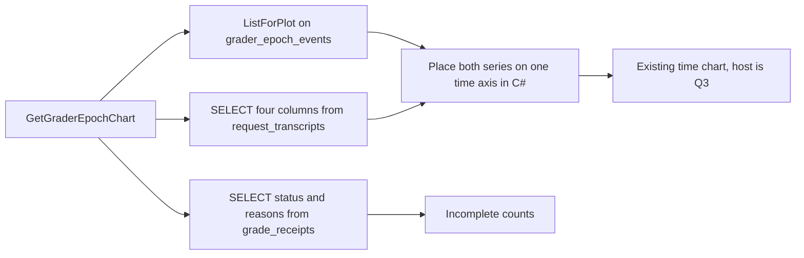

# Plan: #304 phase 9 — grader epoch marks on existing charts

**Status:** Draft. Q1 and Q2 are answered (David, 2026-10-26). Do not start the implementation pull request until David answers Q3. This pull request is docs only. It does not change source, tests, project files, or workflows.

**Goal:** Show each local-grader takeover, each teacher retake, and each teacher, BGE, or feature-schema change as a point-in-time mark on charts that already exist, including a token-efficiency series. Count `Incomplete` receipts by reason. The marks do not say they caused a line to move. Unknown cost stays blank. There is no new grader-epoch chart.

**Architecture:** Phase 8 already appends `grader_epoch_events` in the router-memory database. Token counts and cost already sit on `request_transcripts` in the transcript database. Those are two files. Phase 9 reads each list on its own and places both on one time axis in C#. It does not join them in SQL. The ratio is computed once, on the router, so the page cannot invent a second formula. Which existing chart's pulsing dots are reused is Q3. Until that answer, do not add a chart kind and do not pick a host chart.

**Tech stack:** C# / .NET 10. Charts already render through Apache ECharts (`EChart.razor` plus `wwwroot/js/echarts-interop.js`). BGE stays the frozen ONNX session (`OnnxEmbeddingClient`). No Python. No second embedder. No fine-tune. No new NuGet package.

**Issue:** [#304](https://github.com/davidpizon/TotallyHot-ArcRouter/issues/304). **Parent plan:** [`issue-304-grade-non-coding-responses.md`](issue-304-grade-non-coding-responses.md) §3.8, §4 phase 9. **Phase 7:** [`issue-304-phase-7-grader-epoch.md`](issue-304-phase-7-grader-epoch.md), implemented in [#346](https://github.com/davidpizon/TotallyHot-ArcRouter/pull/346). **Phase 8:** [`issue-304-phase-8-grader-takeover.md`](issue-304-phase-8-grader-takeover.md), implemented in [#348](https://github.com/davidpizon/TotallyHot-ArcRouter/pull/348). **ADR:** [Amendment 4](../adr/0027-grade-non-coding-responses-on-a-bootstrap-recipe-and-keep-them-out-of-code-tallies.md#amendment-4-2026-10-26-phase-9-marks-existing-charts) records Q1 and Q2. Q3 stays in this plan.

Checked against `main` at `5b00300b` (the #348 merge) with CodeGraph (`codegraph_explore` after `codegraph init`) and Serena (`find_symbol` on the router project).

## Global constraints

- C# / .NET 10 only. BGE-large stays frozen ONNX. Do not fine-tune it, do not load another embedder, and do not call Python.
- `TreatWarningsAsErrors` stays on. New public members get XML docs that describe the behavior this phase ships.
- Serilog only. Every message template is a static string literal. No question text, no response text, and no vector contents in a log or on the chart.
- Unknown cost is null. A null token count stays null. Neither is stored as 0, and neither is drawn as 0. A reported zero stays zero.
- A `LocalScore` is never a training label. This phase does not fit, score, or take over.
- Old receipts and old transcripts are not rewritten.
- Each new test stays under 5 seconds. Recorded fixtures only. No live provider and no BGE download.
- `QualityOptions.ScorerVersion` stays `3.0`. No historical rescan is added.
- Do not add a method to `ManagementFacade`. Do not register `grader_epoch_events` with `ScoreTableRetentionService`.

## Decisions

### Q1. Tokens per dollar. Approved by David on 2026-10-26.

The line is tokens per dollar. For one bucket, add `input_tokens + output_tokens` and add `cost` over the rows that have both token counts and a cost greater than 0. Divide the token sum by the cost sum. The unit label is `tok/$`.

A row is left out of both sums when `input_tokens` is null, or `output_tokens` is null, or `cost` is null, or `cost` is 0. Leaving it out is not the same as adding 0. A bucket with no usable row is a gap in the line, not a point at 0. A row whose token counts are both 0 and whose cost is greater than 0 stays in the sums. That 0 is a reported zero, not a stand-in for unknown.

The columns are `request_transcripts.created_at_utc`, `input_tokens`, `output_tokens`, and `cost`. The grade (`score`) is not one of them. There is no judge-cost column.

### Q2. No new grader-epoch chart. David, 2026-10-26.

David's words: "The epochs should be represented in the existing charts. Epochs represent single points in time. There was a chart that displayed pulsating dots. Could that be repurposed for the epochs? Different types of epochs would be different colors. More information about each epoch would be available as a tooltip when the user mouses over them or clicks them."

What that decides:

- Do not add a separate grader-epoch chart, and do not add a Report Card row titled `Grader epoch`.
- An epoch is one instant. It is a marker on a chart that already has a time axis, including the token-efficiency series. It is not its own plot.
- Each epoch type has its own color and a legend. Hover and click both open the same detail. Click also works from the keyboard and from a touch.
- The detail comes from `grader_epoch_events`: time in a clearly labeled zone, type, kind, cause, artifact ids, and spot-check stats. No question text and no answer text.
- The marks do not claim they moved the line. Unknown cost stays blank.
- #292 voter-weight epochs stay out of this phase. Nothing in `src/TotallyHotArcRouter.Gui.Components` draws a voter epoch today. This phase does not add one.

What that does not decide: which pulsing-dot chart to copy. That is Q3. The color legend, which charts receive the marks, how `code` and `non-code` are told apart, and the hover/click tests stay unwritten until David answers Q3.

## Open question

### Q3. Which pulsing-dot chart do we copy?

Two charts in the tree draw pulsing dots. Both sit on the Cost Analytics tab (`CostAnalytics.razor`), one metric at a time. Both are Apache ECharts `effectScatter` series with `rippleEffect` in `src/TotallyHotArcRouter.Gui.Web/wwwroot/js/echarts-interop.js`. Both turn the dot's own tooltip off (`tooltip: { show: false }`). The axis tooltip shows the turn, not a click target. Neither dot is keyboard-focusable today.

| Candidate | What the operator sees | Kind | Function | Dot |
|---|---|---|---|---|
| Tokens | Prompt + completion tokens. A hatched band and an amber pulsing dot when tokens jump by more than 2.5× (`CostChartBuilder.RunawayFactor`). | `RunawayArea` | `optionRunawayArea` | `effectScatter`, `symbolSize` 14, `rippleEffect` scale 4, color `#f59e0b`. The spec calls this a rippling alert. |
| Context Buffer | Percent of the context window used. A dashed red line at 90%. A red pulsing dot when a point is at or over that line. | `ThresholdLine` | `optionThresholdLine` | `effectScatter`, `symbolSize` 16, `rippleEffect` scale 4.5, color `#ef4444`. The function comment calls this the spec's "pulsing" line. `docs/gui/cost-analytics-visualization-spec.md` says the line "begins pulsing" at 90%. `docs/gui/dashboard.md` says "pulsing breaches." |

`docs/gui/cost-analytics-visualization-spec.md` names both in one sentence: rippling `effectScatter` alerts for token runaways and for context breaches. The TTFT chart (`optionZonedLatencyLine`) pins a red spike with `markPoint`. That pin does not ripple. It is not a candidate.

`.pulse-dot` in `docs/gui/MOTION.md` is the live-status dot on a session or a budget. It is CSS. It is not a chart. It is not a candidate.

**Recommendation:** Copy the Context Buffer dots (`optionThresholdLine`). That is the chart the spec and the dashboard call pulsing. Copy the drawing (`effectScatter` plus `rippleEffect`). Do not put grader events on the context-breach points, and do not reuse the breach color `#ef4444` as an epoch color. Epoch colors are a later decision. The Tokens dots are the same kind of animation, and the spec calls those rippling, for a token runaway.

**In one sentence:** Two charts throb with dots; the Context Buffer one is the one we wrote down as pulsing, so copy that dot, and do not drop grader events onto the "context is almost full" spots.

## Scope

Decided, and safe to build after Q3 without another product choice:

- Token efficiency is tokens per dollar, as Q1 states. The math is [Token efficiency](#token-efficiency).
- Epoch rows stay the five types `local_takeover`, `teacher_resumed`, `teacher_changed`, `bge_changed`, and `feature_schema_changed`, for kind `code` and kind `non-code`.
- A count of `Incomplete` receipts in the same window, by `incomplete_reason`, plus the abstention tokens stored in `abstained_graders`. That count is a list, not a chart.
- The docs named under [Docs to update](#docs-to-update), except the chart-host sentences, which wait on Q3.

Not decided until Q3, so this plan does not name them:

- Which existing charts get the epoch marks. David said the existing charts, and the token-efficiency series is one of them. The Report Card charts are not time axes: `LearningReportCardChartBuilder.SpendByModel` and `ScoreDelta` are grouped bars by model, and `GradeMix` is a donut. A point in time cannot sit on those three. The Cost Analytics charts are time axes, and only two of them pulse. Naming the host charts before Q3 would guess.
- The five epoch colors, the legend, and how `code` differs from `non-code` on the dot.
- The hover tooltip, the click tooltip, and the keyboard and touch path. Today's pulsing dots hide their own tooltip.

## Out of scope

- A new grader-epoch chart, a new `buildOption` kind, and a new Report Card row for epochs. Q2 retired the earlier draft of this plan that added those.
- A #292 voter-epoch panel.
- Any change to the fit, the holdout, the reservoir, the agreement gate, takeover, the spot-check draw, or `RollbackToTeacher`.
- A judge-cost column, a new receipt column, or a new transcript column.
- Rewriting stored grades, unified scores, `grader_scores` rows, costs, or token counts.
- Reading `usage_rollup` for this chart. `UsageRollupStore.ApplyIncrement` already adds a null cost as `0m` and a null token count as `0`. That store cannot draw an unknown as a blank.
- `MockData` for this panel. The other three Report Card panels keep the fallback they have.
- Joining the two database files with `ATTACH`, or copying epoch rows into the transcript file.
- Filtering out `is_utility` rows. The parent names `request_transcripts` and does not add that filter. The subtitle says the line is the request's own tokens and cost, not the teacher's bill.
- Tool-count features, #306, BGE changes, and `QualityOptions.SamplingRate`.
- A new window, modal, or dialog. This is a panel on a tab that already exists, so it does not use `DialogShell`.
- Editing the phase 7 or phase 8 plan files. They describe the decisions those pull requests shipped.

## What the screen shows

Held until Q3. Do not add a chart titled `Grader epoch`. Do not draw a token-efficiency line as its own plot until David says which pulsing dots to copy and which existing charts receive the marks.

The incomplete-count list can still land on the Report Card tab, beside the three panels that already exist. Title `Incomplete grades`. Subtitle: `Receipts that did not learn, counted by reason. A zero here means no receipt. It is not an unknown cost.` It uses the same Day / Month / 3-Month / 6-Month / Year filter (`LearningReportCard.razor` `RangeFor`). A slower response for an older filter is dropped the same way the tab already drops a stale reload (`_reloadGeneration`). This list does not use `MockData`. If the RPC fails, the list says `Incomplete grade counts are unavailable.` It does not show zeros in place of a failed read.

## Files

Do not edit `echarts-interop.js` to draw epoch dots until David answers Q3. The reader and RPC rows are the data path. They do not choose a host chart.

| File | Change |
|---|---|
| `src/Protos/admin.proto` | Add `GetGraderEpochChart` on `UsageAdminService`, next to `GetLearningReportCard`. Read-only, same management-token gate. |
| `src/TotallyHotArcRouter/Transcripts/TranscriptTokenCostReader.cs` | New. Reads `request_transcripts` for the four columns. |
| `src/TotallyHotArcRouter/Transcripts/TranscriptTokenCostPoint.cs` | New record: `Id`, `CreatedAtUtc`, `InputTokens`, `OutputTokens`, `Cost`. Token fields are `int?`. Cost is `decimal?`. |
| `src/TotallyHotArcRouter/Judge/IncompleteGradeCountQuery.cs` | New. Counts `Incomplete` receipts in a window. |
| `src/TotallyHotArcRouter/Proxy/Management/GraderEpochEfficiency.cs` | New. The bucket math. This is the only place that divides. |
| `src/TotallyHotArcRouter/Proxy/Management/GraderEpochChartQuery.cs` | New. Calls the three readers and returns one snapshot. |
| `src/TotallyHotArcRouter/Proxy/Management/UsageAdminGrpcService.cs` | Second constructor parameter `GraderEpochChartQuery? epochChart = null`, plus the new RPC method. The default exists so today's `new UsageAdminGrpcService(reporting)` lines in `UsageAdminGrpcServiceTests` still compile. A null query returns unavailable with the message `The grader epoch chart is not available.` That is the same `ManagementErrorType.Unavailable` shape `GetLearningReportCard` uses when both of its stores are null (`The learning report card is not available.`). |
| `src/TotallyHotArcRouter/Proxy/ProxyServerDependencies.cs` | Optional init properties on `ManagementApiDependencies`: `IGraderEpochEventStore? EpochEvents`, `TranscriptDatabase? Transcripts`, `RouterMemoryDatabase? GradeReceipts`. The inner web host has its own container and cannot resolve the outer singletons. This is the same hand-off `UsageRollupStore` already uses. |
| `src/TotallyHotArcRouter/Proxy/ProxyServiceCollectionExtensions.cs` | Set those three properties where `ManagementApi` is built (next to `UsageRollupStore`). `GetRequiredService` for `IGraderEpochEventStore`, `TranscriptDatabase`, and `RouterMemoryDatabase`. |
| `src/TotallyHotArcRouter/Proxy/ProxyServer.cs` | See [Inner-host wiring](#inner-host-wiring). Do not add a `ManagementFacade` method. |
| `src/TotallyHotArcRouter.Gui.Charts/DistributionChart.cs` | No change to `ChartJson`. It drops null properties (`WhenWritingNull`). A missing efficiency must stay absent in JSON, so the chart cannot draw it as 0. |
| `src/TotallyHotArcRouter.Gui.Web/wwwroot/js/echarts-interop.js` | No new `buildOption` kind in this phase. Q3 chooses whether the epoch dots extend `optionThresholdLine`, `optionRunawayArea`, or a shared helper both call. Do not add `GraderEpochTime`. |
| `src/TotallyHotArcRouter.Gui.Admin/UsageQueryClient.cs` | `GetGraderEpochChartAsync`, beside `GetLearningReportCardAsync`. Map a missing `efficiency` field to null, never to 0. |
| `src/TotallyHotArcRouter.Gui.Admin/ProviderAdminModels.cs` | View records for the snapshot, next to `GradeMixRowView`. |
| `src/TotallyHotArcRouter.Gui.Components/Services/UsageStore.cs` | `LoadGraderEpochChartAsync`. Uncached, same reason as `LoadLearningReportCardAsync`: the window is "now minus N" and new rows arrive. |
| `src/TotallyHotArcRouter.Gui.Components/Components/LearningReportCard.razor` | The incomplete-count list only. No epoch chart on this tab. |
| `docs/how-it-learns.md` | Teacher phase and takeover, and the no-rescan sentence. See [Docs](#docs-to-update). |
| `docs/plans/router-evaluator-and-live-pricing.md` | §14 note. |
| `docs/gui/dashboard.md` | Report Card section. |
| `docs/adr/0027-grade-non-coding-responses-on-a-bootstrap-recipe-and-keep-them-out-of-code-tallies.md` | Amendment 4 records Q1 and Q2. It does not pick the pulsing-dot chart. |
| `docs/plans/issue-304-grade-non-coding-responses.md` | Link this file from the phase 9 row. Done in this pull request. |

No change to `src/TotallyHotArcRouter/Judge/IGraderEpochEventStore.cs`. `ListForPlot` already returns every row, oldest first, with the phase 9 `SELECT`. Do not add a time filter to that method. The chart query filters in memory.

No change to `ITranscriptStore` or `IGradeReceiptStore`. Both have many callers. A new method on either would touch every test double. The two new reader types take the database objects the stores already use.

### Inner-host wiring

`UsageAdminGrpcService` is not constructed in `ProxyServer`. `endpoints.MapGrpcService<UsageAdminGrpcService>()` only reflects over the type. The inner Kestrel container constructs the service on the first RPC. That mapping already sits inside `if (managementApi is not null)`, and the constructor's `ManagementReportingService` is the singleton registered in the matching block just above (the block that does `new ManagementReportingService(...)` and `services.AddSingleton(reportingService)`).

In that same block, always construct one `GraderEpochChartQuery` from the three new `ManagementApiDependencies` properties and `services.AddSingleton` it, including when one of those properties is null. The inner container then resolves the chart query because it is registered. A registered query whose database property is null returns unavailable, and the service still activates.

The C# default is for the hand-built tests. It is also what the container uses when the singleton is missing. On `Microsoft.Extensions.DependencyInjection` 10.0.14, both `GetRequiredService` and `ActivatorUtilities.CreateInstance` pass null for an unregistered parameter that has a default. Forgetting `AddSingleton` does not throw on the first RPC. The chart stays unavailable, which is the same symptom as a null database property, and a test that only does `new UsageAdminGrpcService(reporting)` will not catch it. Register the query beside `ManagementReportingService` anyway. That is how the reporting service reaches this gRPC type today.

`ProxyServerTests` that build `ManagementApiDependencies` without the three new properties stay valid. The query is still registered, and its RPC returns unavailable.

## Data queries



The epoch read is the one phase 8 shipped on `SqliteGraderEpochEventStore.ListForPlot`:

```sql
SELECT id, at_utc, kind, epoch_type, cause, artifact_id, previous_artifact_id, window_size, mean_miss,
       previous_teacher_model, teacher_model, previous_prompt_version, prompt_version, rollback_mark_present,
       previous_bge_model, bge_model, previous_feature_schema_version, feature_schema_version
FROM grader_epoch_events
ORDER BY at_utc, id;
```

Keep rows whose parsed `at_utc` is `>= from` and `< to`. `at_utc` is the round-trip `"O"` text `TimeProvider.GetUtcNow` already uses. A row that does not parse is skipped. Log the event id at Warning. Do not plot it at time zero.

The transcript read is new, on `TranscriptTokenCostReader`. Copy the null-preserving reads in `SqliteTranscriptStore.ListSessionsAsync` (cost, input tokens, output tokens around the `IsDBNull` checks). Do not copy that method's query. It is "newest N rows" and it is not a time window.

```sql
SELECT id, created_at_utc, input_tokens, output_tokens, cost
FROM request_transcripts
WHERE created_at_utc >= $from AND created_at_utc < $to
ORDER BY created_at_utc, id;
```

`$from` and `$to` are `DateTimeOffset.ToUniversalTime()` formatted with `"O"`. After the read, parse `created_at_utc` and drop a row outside `[from, to)`. A row that does not parse is skipped. Log the transcript id. Do not plot it. `cost` is `REAL NULL`. Read it only when `IsDBNull` is false. A null stays null. Do not call `GetDouble` on a null, and do not coalesce to 0. The `SELECT` list does not contain `prompt_text` or `response_text`. Capture being off does not hide rows already stored. `ITranscriptStore` methods return empty when capture is disabled. This reader does not. The chart is a history of what was recorded.

The receipt read is new, on `IncompleteGradeCountQuery`, against `RouterMemoryDatabase` (the same file as `grader_epoch_events`):

```sql
SELECT incomplete_reason, abstained_graders
FROM grade_receipts
WHERE grade_status = 'Incomplete'
  AND created_at_utc >= $from AND created_at_utc < $to;
```

`grade_status` is the enum name `Incomplete`. `GradeReceiptRecordObserver` puts `result.GradeStatus` on the `GradeReceiptRecord`. `SqliteGradeReceiptStore.BindRecord` writes `record.GradeStatus.ToString()`, which stores `Incomplete`. `abstained_graders` is the comma-separated `grader:reason` list from `GradeReceiptRecordObserver.FormatAbstainedGraders`. A `Complete` row stores an empty string there, so it is not in this query. Do not select `question_hmac` or any text.

`GraderEpochChartQuery` calls these three and does not open one connection that attaches both files.

### RPC shape

`GetGraderEpochChartRequest`: `from`, `to`, and `width`. `width` is `hour` or `day`. The gRPC method does what `GetLearningReportCard` and `QueryRollup` already do, and nothing more: `ParseTimestamp` on `from` and `to` (a missing field throws `InvalidArgument` with `'{field}' is required.`), and an empty `width` becomes `day` (`string.IsNullOrEmpty(width) ? "day" : width`, copied from `UsageAdminGrpcService.QueryRollup`). `GraderEpochChartQuery` then checks the range. `to <= from` returns `ManagementErrorType.InvalidRequest` with `'to' must be after 'from'.`, copied from `GetLearningReportCardAsync`. Any width other than `hour` or `day` returns `InvalidRequest` with `width must be 'hour' or 'day'.`, copied from `GetUsageRollup`. `UsageAdminGrpcService.Unwrap` maps that `InvalidRequest` to `StatusCode.InvalidArgument`, the same way those two RPCs do. `GetLearningReportCard` has no width field. The new panel chooses the width from the existing filter buttons: `hour` when the button is Day, and `day` for Month, 3-Month, 6-Month, and Year. `from` is inclusive and `to` is exclusive. The buttons already compute that window in `LearningReportCard.razor` (`Day` is `now.AddDays(-1)` through `now`, and the rest follow the same method).

`GraderEpochChartResponse`:

- `points`: `bucket_start_utc`, optional `efficiency` (string), `known_rows`, `skipped_rows`.
- `markers`: the epoch columns above, with the same nullability. `mean_miss` is `optional double`. `window_size` is `optional int32`. `rollback_mark_present` is `optional int32`. `feature_schema_version` and `previous_feature_schema_version` are `optional int32`. A stored `1` is a real schema version. A missing field is null, not 0.
- `incomplete_receipts`: the number of `Incomplete` rows in the window.
- `incomplete_by_reason`: one entry per named reason, count included when it is 0.
- `abstained`: one entry per token that actually occurred.

`efficiency` is an optional string, not a double. Proto3 would otherwise treat a missing number as 0, and the chart would plot that 0. A real zero ratio is the string `0`. A gap omits the field. Money on this RPC family is already a string (`cost_usd` on `UsageRollupBucketRow`). No field on this RPC holds question text or response text.

## Token efficiency

Approved by David on 2026-10-26. This is the formula.

`GraderEpochEfficiency` buckets the transcript points.

- `hour`: bucket start is the UTC hour of `created_at_utc`.
- `day`: bucket start is the UTC midnight of that instant.

A row is **known** when `InputTokens`, `OutputTokens`, and `Cost` all have values and `Cost > 0`. Its token count is `InputTokens + OutputTokens`. That sum may be 0.

A row is **skipped** when any of those is null, or when `Cost` is 0. Skipped rows increment `skipped_rows` for the bucket they would have landed in. They add nothing to either sum. A null is not added as 0. A cost of 0 is not plotted as 0 tokens per dollar, and it is not plotted as a giant number. Dividing by zero is not a point.

The bucket value is `tokenSum / costSum` as `decimal`, only when `known_rows > 0`. Format the string with invariant culture, format `G29`, and no currency symbol, so the string parses back to the same decimal. A bucket with `known_rows == 0` is not a point. It may still be a gap marker on the chart when it sits between two known buckets (see below). `known_rows` and `skipped_rows` are counts. A 0 count is a real count.

Worked example, one hour, four rows:

| Input | Output | Cost | In the ratio? |
|---|---|---|---|
| 100 | 50 | 0.25 | Yes. 150 tokens, 0.25 dollars. |
| null | 10 | 0.10 | No. The null token is not a 0. |
| 10 | 0 | null | No. The null cost is not a 0. |
| 0 | 0 | 0.10 | Yes. A reported zero token count stays in. |

Token sum 150, cost sum 0.35, value `150 / 0.35`. The two skipped rows are `skipped_rows`. They do not become a point at 0.

A fifth row with cost `0` and 100 tokens is skipped. It does not make the value 0, and it does not make the value infinite.

The chart builder does not recompute this. It plots the string the router sent, parsed as a decimal. If the string does not parse, that point is a gap, not 0.

## Chart behavior

Held until Q3. Do not add a `buildOption` kind named `GraderEpochTime`. Do not assign epoch colors, a solid-versus-dashed rule, or a click tooltip in this revision. An earlier draft of this file did that for a new chart. Q2 retired that chart.

These rules already apply to whatever host David picks. They do not choose the host:

- Unknown cost, unknown tokens, and zero cost are gaps. `connectNulls` stays false. `ChartJson` omits null properties (`WhenWritingNull`). The script must not turn a missing value into 0. `Number(null)` is 0, so a gap is an explicit flag, not a missing number read as a number.
- A reported zero token count with a positive cost is a real 0 on the line.
- An epoch mark uses the row's `at_utc`. It is not snapped to a bucket. The mark does not say it moved the line.
- The detail payload is the epoch columns already selected. It never includes question text or answer text.

Hover, click, keyboard, touch, the five colors, the legend, and how `code` differs from `non-code` are named in tests only after Q3. Today's pulsing dots set `tooltip: { show: false }` and are not a click target, so those tests cannot be written against a chart this plan has not chosen.

## Incomplete counts

Eight named reasons, always shown, in the declaration order of `IncompleteReasons`: `queue_full`, `no_text`, `empty`, `no_judge`, `judge_is_answerer`, `disputed`, `deferred_to_loop`, `loop_unlinked`. A reason with no row shows `0`. That 0 is a count of receipts. The query's `grade_status = 'Incomplete'` leaves out `StructureOnly` and `Complete`. `StructureOnly` is a different enum value (`GradeStatus.StructureOnly`) and is not an incomplete reason.

A null or empty `incomplete_reason` is an extra row, `no reason stored`, and only when its count is at least 1. It is not a ninth permanent reason, and it is not shown as 0.

`abstained_graders` is split on commas. Each piece is one token, shown as stored (`judge:judge-join-timeout`). Empty pieces are ignored. A token is listed only when its count is at least 1. Do not invent a zero for a degraded reason that never occurred. The set of reasons is not closed. A piece with no colon is still counted. Do not drop it.

The headline is `incomplete_receipts`, the number of rows, not the sum of the two lists. A row with both a reason and an abstention token would be counted twice in that sum.

These counts are not a series on the time graph.

## Docs to update

Implementation pull request, after Q1 and Q2 are answered.

`docs/how-it-learns.md`

- In Step 4, after the sweep paragraphs, add a short "Teacher phase and takeover" section in the same plain voice. The pinned free teacher grades first. Two local graders, one for code and one for prose, train on the teacher's judge score. Passing the gate in phase 7 writes a shadow score and does not take over. Takeover is later: a confident answer can skip the teacher. A 5% sample and a low-confidence answer still call the teacher. A spot-check window that is too far from the teacher gives the job back to the teacher. Say that a shadow score beside the teacher is not the grade of record.
- Keep the description of `QualityRescanService`. It still runs. It extracts a fenced snippet through `ISignalExtractor`. A prose row with no fence is stamped with a null score and is not sent to the teacher (`RescanOneAsync` stamps null when `Extract` returns null). Add one sentence: issue #304 does not bump `QualityOptions.ScorerVersion` (it stays `3.0`) and does not walk old receipts to grade them again. Already-stored grades are not rewritten when a local grader takes over.
- Do not delete the sentence that says bumping `ScorerVersion` re-marks the cabinet. That is the code sweep. Add that #304 does not do that bump.
- In Honest gaps, add that epoch marks on a time chart do not claim they moved the token line, and that an unknown cost is a blank. Do not call it a grader-epoch chart.

`docs/plans/router-evaluator-and-live-pricing.md` §14, three short bullets:

- The pinned free teacher grades live text. Two local graders, code and non-code, train on the teacher's judge score.
- The grader epoch is a separate job from the #292 voter epoch. It does not change voter weights. The voter epoch does not fit the local grader.
- History is not rescanned for this grade. `ScorerVersion` stays `3.0`.

`docs/gui/dashboard.md`, the Report Card item: the incomplete-count list, and that it does not use `MockData`. Do not describe a new epoch chart. The Cost Analytics sentences that name the pulsing dots stay until Q3 says which one is reused. Do not add a new design-spec file.

`docs/adr/0027` Amendment 4, in this pull request, records the tokens-per-dollar formula and that phase 9 does not add a new chart. It leaves the pulsing-dot choice open.

This pull request records Q1 and Q2 as answered and Q3 as open. It also corrects two sentences that #346 and #348 made false: `GraderEpochOptions` now has `TakeoverEnabled`, `SpotCheckRate`, `SpotCheckWindowSize`, and `SpotCheckRollbackMae`, and the router project references `Microsoft.ML` 5.0.0.

## Tests

New `GraderEpochPhase9Tests` in `src/TotallyHotArcRouter.Tests/Proxy/Management/`, beside `LearningReportCardAggregatorTests`. The RPC mapping test goes in `UsageAdminGrpcServiceTests`. The client mapping test goes in `src/TotallyHotArcRouter.Gui.Admin.Tests/UsageQueryClientTests.cs`. The incomplete-list test goes in `src/TotallyHotArcRouter.Gui.Components.Tests/LearningReportCardTests.cs`. Overlay, color, legend, and tooltip tests (hover, click, keyboard, and touch) are not in this table. They are named after Q3, on the chart David picks. Blank handling is in this table.

Recorded fixtures. Short tables. No `usage_rollup` rows in the efficiency fixture. Each test under 5 seconds.

| Test | Asserts |
|---|---|
| `Efficiency_TokensPerDollar_MatchesTheWorkedExample` | The four-row hour above. The decimal equals `150m / 0.35m`. The wire string parses back to that same decimal. `known_rows` is 2. `skipped_rows` is 2. |
| `Efficiency_NullCost_IsAGap_NotZero` | A window whose only row has a null cost returns no point. The response omits `efficiency`. It does not send `"0"`. |
| `Efficiency_NullToken_IsAGap_NotZero` | A null `input_tokens` or a null `output_tokens` is skipped. The other column is not used alone, and it is not treated as 0. |
| `Efficiency_ZeroCost_IsNotPlotted` | Cost `0` with a non-null token count is skipped. No point at 0 and no point at a huge ratio. The stored cost is left as 0. |
| `Efficiency_ZeroTokens_StaysZero` | Both token counts 0 and cost `0.10` produce the string `0`. |
| `Efficiency_DoesNotReadUsageRollup` | The query type has no `IUsageRollupStore` dependency. A rollup bucket whose cost was zero-filled is not an input. |
| `TokenCostQuery_SelectsFourColumns_NoText` | The command text contains `input_tokens`, `output_tokens`, `cost`, and `created_at_utc`. It does not contain `prompt_text` or `response_text`. A null cost round-trips as null. |
| `Markers_AllFiveTypes_AndBothKinds` | One fixture row per type, for `code` and for `non-code`. The snapshot has ten marks. Order is `at_utc`, then `id`. |
| `Markers_OutsideTheWindow_AreDropped` | An event before `from` or at `to` is absent. An event inside is present. |
| `Markers_NullMeanMiss_StaysNull` | A `teacher_resumed` row with a null `mean_miss` and a null `window_size` comes back with both fields unset. Not 0. |
| `Markers_SchemaVersionOne_IsNotNull` | A `feature_schema_changed` row with `feature_schema_version` 1 returns 1. |
| `Markers_RollbackMarkZero_IsZero` | `rollback_mark_present` 0 stays 0. A null on an authority row stays unset. |
| `IncompleteCount_NamedReasons_IncludeZero` | No `queue_full` rows. That reason is in the list with count 0. The headline is the row count. |
| `IncompleteCount_AbstainedToken_IsSeparate` | One row with reason `no_judge` and `abstained_graders` `judge:judge-join-timeout` counts once in the headline, once under `no_judge`, and once under that token. |
| `IncompleteCount_EmptyReason_OnlyWhenPresent` | A null `incomplete_reason` adds `no reason stored` with its count. The label is absent when every incomplete row has a reason. |
| `ChartQuery_ReadsTheTwoFilesSeparately` | The query calls `ListForPlot` and the transcript reader. It does not execute `ATTACH`. |
| `GetGraderEpochChart_NullQuery_IsUnavailable` | `UsageAdminGrpcService` constructed without the chart query returns unavailable and the message `The grader epoch chart is not available.` It does not return an empty success. | 
| `GetGraderEpochChart_MissingFrom_IsInvalidArgument` | A request with no `from` throws `InvalidArgument` and the detail `'from' is required.` Same helper as `GetLearningReportCard`. |
| `GetGraderEpochChart_GapOmitsEfficiency` | A gap bucket has no `efficiency` field on the wire. A zero ratio has `efficiency` `"0"`. |
| `UsageQueryClient_MissingEfficiency_IsNull` | The view model's efficiency is null. It is not 0. |
| `EfficiencyGap_OmitsValue` | Serialized JSON for a gap point has `"gap":true` and no `"value":0`. A zero ratio has `"value":0` and `"gap":false`. |
| `ReportCard_IncompleteList_DoesNotUseMockData` | When the load returns null, the incomplete list shows `Incomplete grade counts are unavailable.` It does not show `MockData` spend figures as counts. |

`EpochEvent_AppendOnly` and the other phase 8 epoch tests stay green. This phase does not add an update or a delete.

## Rollout

1. David answers Q3. Q1 and Q2 are already answered.
2. The implementation pull request links this file. It builds with no warnings. The tests above pass.
3. Nothing in grading changes when the chart ships. Takeover stays as phase 8 left it. No config flag. An operator does not turn the chart on.
4. No migration. `grader_epoch_events` and `request_transcripts` are already there. A database with no epoch rows shows the empty copy.
5. An older dashboard that does not call `GetGraderEpochChart` keeps working. The new RPC is read-only.

## Risks

- **A null plotted as zero.** `ChartJson` drops null properties. Proto3 drops a missing number into 0. `UsageRollupStore` already stored nulls as 0. The optional string, the `gap` flag, and the ban on the rollup are the three guards. A test covers each.
- **The line connecting across a hole.** Omitting an empty bucket makes ECharts draw a slope across the missing hour. Gap points between known buckets are what break that slope. `connectNulls` stays false.
- **The JS coerce.** `Number(null)` is 0. The host chart checks the gap flag before it reads the value.
- **A reader thinks the mark caused the move.** The mark's detail says it did not. Where that sentence sits on the page waits on Q3, because there is no new chart caption.
- **Conversation text on the admin RPC.** The transcript `SELECT` is four columns. The test fails if `prompt_text` or `response_text` appears.
- **Two database files.** A read cannot be one transaction across them. The chart can show an epoch that was committed a moment after the transcript snapshot. That is a display skew, not a write. The mark's detail refuses a causal claim. The page sentence that says the same thing waits on Q3.
- **The inner web host cannot see outer singletons.** Forgetting the three `ManagementApiDependencies` properties makes the RPC permanently unavailable in the real server while unit tests that pass a database still pass. The wiring section above is the fix. Forgetting `services.AddSingleton` of `GraderEpochChartQuery` has the same symptom, not an activation error: the container supplies the constructor default null. A hand-built `UsageAdminGrpcService` test does not catch a missing registration. Register the query in the same block as `ManagementReportingService`.
- **`ListForPlot` loads every epoch.** The table is append-only and is not purged. Filtering in memory keeps the phase 8 contract. Do not "fix" growth by deleting rows.
- **The code sweep is still on.** A doc that says "history is not rescanned" without naming `QualityRescanService` would be wrong. The doc section above keeps the sweep and says #304 does not send old prose to the teacher.
- **A zero receipt count read as an unknown cost.** The incomplete panel's subtitle says a zero means no receipt.
- **Demo data that looks like a real takeover.** The incomplete list does not use `MockData`. Epoch dots are not drawn from `MockData` either.
- **Copying the breach dots onto the breach series.** Q3 asks to copy the drawing. Putting `grader_epoch_events` on the context-breach points would mark a takeover as "context is almost full."

## Done when

- David has answered Q3, and the implementation pull request links this file. Q1 and Q2 are already answered.
- Epochs are point-in-time marks on the charts David named, using the pulsing-dot drawing he named. There is no new grader-epoch chart. #292 voter epochs are absent. Colors, legend, kind, hover, and click match the answer to Q3.
- A null cost, a null token count, and a zero cost are gaps, not points at 0. A reported zero token count with a positive cost is a real 0 on the line. `usage_rollup` is not an input.
- `Incomplete` receipts in the same window are counted by the eight named reasons, with a real 0 when a reason has no row, and abstention tokens are listed beside that. The headline is the row count.
- `docs/how-it-learns.md` describes the teacher phase and takeover as two steps, and it says #304 does not rescan history and does not bump `ScorerVersion`. §14 of the evaluator plan names the teacher, the local grader, and the separate epoch. Amendment 4 names tokens per dollar and says phase 9 does not add a new chart.
- No stored grade, cost, or token count is rewritten. `ManagementFacade` gains no method. `grader_epoch_events` is still not purged.
- The build is warning-free. New public members have XML docs. Each new test finishes in under 5 seconds.

## Names checked against the tree

Checked with CodeGraph and Serena at `5b00300b`. These exist:

- `IGraderEpochEventStore.ListForPlot` and `SqliteGraderEpochEventStore`, registered in `JudgeServiceCollectionExtensions`. `GraderEpochEventRow` keeps nulls. `Insert` is the only write.
- `IGraderEpochEventStore` constants: `LocalTakeover` `local_takeover`, `TeacherResumed` `teacher_resumed`, `TeacherChanged` `teacher_changed`, `BgeChanged` `bge_changed`, `FeatureSchemaChanged` `feature_schema_changed`.
- `GraderEpochOptions` includes `TakeoverEnabled`, `SpotCheckRate`, `SpotCheckWindowSize`, and `SpotCheckRollbackMae`.
- `UsageAdminService.GetLearningReportCard` in `src/Protos/admin.proto`. `UsageAdminGrpcService` takes `ManagementReportingService` and is constructed by the inner container, not by `ProxyServer`. `MapGrpcService<UsageAdminGrpcService>()` is inside `if (managementApi is not null)`. `ManagementReportingService` is `new`'d and `AddSingleton`'d in the matching block. `ManagementApiDependencies` is filled in `ProxyServiceCollectionExtensions`, which says the inner host cannot resolve outer singletons. `UsageAdminGrpcService.QueryRollup` maps an empty width to `day`. `GetUsageRollup` rejects any other width with `width must be 'hour' or 'day'.` `ParseTimestamp` rejects a missing timestamp. `IncompleteReasons` declaration order is `queue_full`, `no_text`, `empty`, `no_judge`, `judge_is_answerer`, `disputed`, `deferred_to_loop`, `loop_unlinked`.
- `ManagementFacade` is a different type. Reporting was split out of it. This phase does not add a method there.
- `request_transcripts` in `TranscriptDatabase`: `created_at_utc` `TEXT NOT NULL`, `input_tokens` `INTEGER NULL`, `output_tokens` `INTEGER NULL`, `cost` `REAL NULL`, plus `prompt_text` and `response_text`, which this phase does not select.
- `SqliteTranscriptStore.ListSessionsAsync` already reads cost and tokens with `IsDBNull`.
- `UsageRollupStore.ApplyIncrement` sets `cost` to `entry.EstimatedCostUsd ?? 0m` and token counts to 0 when null.
- `grade_receipts.created_at_utc`, `incomplete_reason`, `abstained_graders`. `IncompleteReasons` has the eight strings. `FormatAbstainedGraders` writes `grader:reason` joined by commas, and writes nothing on `Complete`.
- `QualityRescanService.RescanOneAsync` uses `ISignalExtractor.Extract`. A null extract stamps a null score.
- `QualityOptions.ScorerVersion` defaults to `3.0`.
- `LearningReportCard.razor` is the Report Card tab, opened from `Dashboard.razor`. Filters: Day, Month, 3-Month, 6-Month, Year. `ChartJson` uses `WhenWritingNull`. `EChart.razor` renders whatever JSON `echartsInterop.render` is given. `buildOption` switches on `m.kind`.
- `ChartPalette` hashes a name to a color. This chart does not use that for epoch types, because the legend must stay put.
- The router project references `Microsoft.ML` 5.0.0 and `Microsoft.ML.OnnxRuntime` 1.31.0.

Not in the tree, and named by this plan: `TranscriptTokenCostReader`, `IncompleteGradeCountQuery`, `GraderEpochEfficiency`, `GraderEpochChartQuery`, and `GetGraderEpochChart`. `GraderEpochChartBuilder` and the `GraderEpochTime` kind were in an earlier draft. Q2 removed them. Do not add them while Q3 is open.

Pulsing dots that are in the tree: `optionRunawayArea` (`RunawayArea`, Tokens) and `optionThresholdLine` (`ThresholdLine`, Context Buffer), both in `echarts-interop.js`. `optionZonedLatencyLine` uses `markPoint` and does not ripple. `.pulse-dot` is CSS, not a chart.
