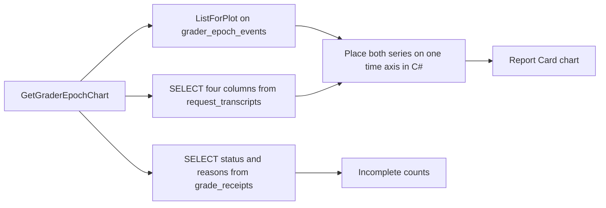

# Plan: #304 phase 9 — grader epoch on the token-efficiency graph

**Status:** Draft. Waiting on David for Q1 and Q2 below. Do not start the implementation pull request until he answers both. This pull request is docs only. It does not change source, tests, project files, or workflows.

**Goal:** Show each local-grader takeover and each teacher retake, and each teacher, BGE, or feature-schema change, as a mark on a time graph of token efficiency, and count `Incomplete` receipts by reason. The marks do not say they caused the line to move. Unknown cost stays blank.

**Architecture:** Phase 8 already appends `grader_epoch_events` in the router-memory database. Token counts and cost already sit on `request_transcripts` in the transcript database. Those are two files. Phase 9 reads each list on its own and places both on one time axis in C#. It does not join them in SQL. The Blazor Report Card tab draws the result. The ratio is computed once, on the router, so the page cannot invent a second formula.

**Tech stack:** C# / .NET 10. The dashboard chart is the existing Apache ECharts host (`EChart.razor` plus `wwwroot/js/echarts-interop.js`). BGE stays the frozen ONNX session (`OnnxEmbeddingClient`). No Python. No second embedder. No fine-tune. No new NuGet package.

**Issue:** [#304](https://github.com/davidpizon/TotallyHot-ArcRouter/issues/304). **Parent plan:** [`issue-304-grade-non-coding-responses.md`](issue-304-grade-non-coding-responses.md) §3.8, §4 phase 9. **Phase 7:** [`issue-304-phase-7-grader-epoch.md`](issue-304-phase-7-grader-epoch.md), implemented in [#346](https://github.com/davidpizon/TotallyHot-ArcRouter/pull/346). **Phase 8:** [`issue-304-phase-8-grader-takeover.md`](issue-304-phase-8-grader-takeover.md), implemented in [#348](https://github.com/davidpizon/TotallyHot-ArcRouter/pull/348). **ADR:** [ADR-0027 Amendment 3](../adr/0027-grade-non-coding-responses-on-a-bootstrap-recipe-and-keep-them-out-of-code-tallies.md#amendment-3-2026-10-26-phase-8-takeover-is-approved) already says phase 9 reads the epoch list and overlays it on `request_transcripts`. This plan does not open a new ADR. After David answers Q1, the implementation pull request adds one sentence to Amendment 3 naming the formula he picked. This pull request does not edit the ADR, because the formula is not decided yet.

Checked against `main` at `5b00300b` (the #348 merge) with CodeGraph (`codegraph_explore` after `codegraph init`) and Serena (`find_symbol` on the router project).

## Global constraints

- C# / .NET 10 only. BGE-large stays frozen ONNX. Do not fine-tune it, do not load another embedder, and do not call Python.
- `TreatWarningsAsErrors` stays on. New public members get XML docs that describe the behavior this phase ships.
- Serilog only. Every message template is a static string literal. No question text, no response text, and no vector contents in a log or on the chart.
- Unknown cost is null. A null token count stays null. Neither is stored as 0, and neither is drawn as 0. A reported zero stays zero.
- A `LocalScore` is never a training label. This phase does not fit, score, or take over.
- Old receipts and old transcripts are not rewritten.
- Each new test stays under 5 seconds. Recorded fixtures only. No live provider and no BGE download.
- `QualityOptions.ScorerVersion` stays `3.0`. No historical rescan is added.
- Do not add a method to `ManagementFacade`. Do not register `grader_epoch_events` with `ScoreTableRetentionService`.

## Open questions for David

These two are product choices. The rest of this file is written so that a "yes" to both recommendations can be implemented without another decision. A "no" changes only the section named in the question.

### Q1. What number is the token-efficiency line?

The parent plan names the columns and does not name the arithmetic. The columns are `request_transcripts.created_at_utc`, `input_tokens`, `output_tokens`, and `cost`. The grade (`score`) is not one of them. There is no judge-cost column. Phase 8 left that out on purpose.

**Recommendation:** Tokens per dollar. For one bucket, add `input_tokens + output_tokens` and add `cost` over the rows that have both token counts and a cost greater than 0. Divide the token sum by the cost sum. The unit label is `tok/$`.

A row is left out of both sums when `input_tokens` is null, or `output_tokens` is null, or `cost` is null, or `cost` is 0. Leaving it out is not the same as adding 0. A bucket with no usable row is a gap in the line, not a point at 0. A row whose token counts are both 0 and whose cost is greater than 0 stays in the sums, so a real zero-token reply can pull the line down. That 0 is a reported zero, not a stand-in for unknown.

**In one sentence:** The line is how many tokens we got for each dollar; if we do not know the dollar amount or the token count, we leave a blank, and we never draw that blank as zero.

If David picks another ratio, replace this section and the tests that lock the number. The queries, the marks, the gaps, and the docs stay.

### Q2. The report card has no voter-epoch panel. Do we build one?

Parent §3.8 says the learning dashboard shows the grader epoch next to the #292 epoch record, labeled so the two cannot be mistaken. The Report Card tab (`LearningReportCard.razor`) has spend, grade mix, and score delta. It has no #292 voter-epoch panel. Nothing in `src/TotallyHotArcRouter.Gui.Components` draws a voter epoch.

**Recommendation:** Do not build the #292 panel in this phase. Add the grader-epoch chart to the Report Card tab. Title it `Grader epoch`. The subtitle is `Not the voter-weight epoch (#292).` Building the voter-epoch panel is #292's work. Phase 9's own row does not ask for it.

**In one sentence:** We add the new grader's timeline and label it so nobody mixes it up with the other training timeline, and we do not build that other timeline here.

If David wants the #292 panel in this phase, stop and add that scope before coding. Do not invent what the voter-epoch panel shows.

## Scope

- One time graph on the Report Card tab. The line is token efficiency over the same Day / Month / 3-Month / 6-Month / Year window the tab already uses (`LearningReportCard.razor` `RangeFor`).
- One mark per `grader_epoch_events` row whose `at_utc` falls in that window. The types are `local_takeover`, `teacher_resumed`, `teacher_changed`, `bge_changed`, and `feature_schema_changed`. Each mark is also split by kind, `code` or `non-code`.
- A caption on the chart that says the marks do not claim to have moved the line.
- A count of `Incomplete` receipts in the same window, by `incomplete_reason`, plus the abstention tokens stored in `abstained_graders`.
- The docs named under [Docs to update](#docs-to-update).

## Out of scope

- A #292 voter-epoch panel, unless Q2 is answered the other way.
- Any change to the fit, the holdout, the reservoir, the agreement gate, takeover, the spot-check draw, or `RollbackToTeacher`.
- A judge-cost column, a new receipt column, or a new transcript column.
- Rewriting stored grades, unified scores, `grader_scores` rows, costs, or token counts.
- Reading `usage_rollup` for this chart. `UsageRollupStore.ApplyIncrement` already adds a null cost as `0m` and a null token count as `0`. That store cannot draw an unknown as a blank.
- `MockData` for this panel. The other three Report Card panels keep the fallback they have.
- Joining the two database files with `ATTACH`, or copying epoch rows into the transcript file.
- Filtering out `is_utility` rows. The parent names `request_transcripts` and does not add that filter. The subtitle says the line is the request's own tokens and cost, not the teacher's bill.
- Tool-count features, #306, BGE changes, and `QualityOptions.SamplingRate`.
- A new window, modal, or dialog. This is a panel on a tab that already exists, so it does not use `DialogShell`.
- Editing the phase 7 or phase 8 plan files. They describe the decisions those pull requests shipped.

## What the screen shows

The Report Card tab keeps its three panels. Under them, one new row:

- Left, the chart. Title `Grader epoch`. Subtitle `Not the voter-weight epoch (#292).` Second line: `Request tokens per dollar. Not the teacher's bill.` The caption under the plot, always visible: `These marks show when a grader started grading on its own, when the teacher took charge again, or when the teacher, the embedding model, or the feature list changed. They do not mean the mark caused the line to move.`
- Right, the incomplete counts. Title `Incomplete grades`. Subtitle: `Receipts that did not learn, counted by reason. A zero here means no receipt. It is not an unknown cost.`

The existing filter buttons drive both. One reload loads the chart and the counts together. A slower response for an older filter is dropped the same way the tab already drops a stale report-card reload (`_reloadGeneration`).

Empty and failure copy, for this panel only:

| What happened | What the panel says |
|---|---|
| The RPC failed, or the query was not registered | `Grader epoch history is unavailable.` No demo marks and no zero line. The other three panels may still fall back to `MockData`. |
| The RPC succeeded, no efficiency points and no marks | `No token-efficiency points and no grader epochs in this range.` |
| Points, no marks | The line draws. The caption stays. The legend says no epochs in this range. |
| Marks, no points | The marks draw on an empty plot. The copy is `No known token cost in this range.` There is no line at 0. |

## Files

| File | Change |
|---|---|
| `src/Protos/admin.proto` | Add `GetGraderEpochChart` on `UsageAdminService`, next to `GetLearningReportCard`. Read-only, same management-token gate. |
| `src/TotallyHotArcRouter/Transcripts/TranscriptTokenCostReader.cs` | New. Reads `request_transcripts` for the four columns. |
| `src/TotallyHotArcRouter/Transcripts/TranscriptTokenCostPoint.cs` | New record: `Id`, `CreatedAtUtc`, `InputTokens`, `OutputTokens`, `Cost`. Token fields are `int?`. Cost is `decimal?`. |
| `src/TotallyHotArcRouter/Judge/IncompleteGradeCountQuery.cs` | New. Counts `Incomplete` receipts in a window. |
| `src/TotallyHotArcRouter/Proxy/Management/GraderEpochEfficiency.cs` | New. The bucket math. This is the only place that divides. |
| `src/TotallyHotArcRouter/Proxy/Management/GraderEpochChartQuery.cs` | New. Calls the three readers and returns one snapshot. |
| `src/TotallyHotArcRouter/Proxy/Management/UsageAdminGrpcService.cs` | Optional constructor parameter `GraderEpochChartQuery? epochChart = null`. New RPC method. Existing `new UsageAdminGrpcService(reporting)` call sites keep compiling. A null query returns the same unavailable status `GetLearningReportCard` returns when both of its stores are null. |
| `src/TotallyHotArcRouter/Proxy/ProxyServerDependencies.cs` | Optional init properties on `ManagementApiDependencies`: `IGraderEpochEventStore? EpochEvents`, `TranscriptDatabase? Transcripts`, `RouterMemoryDatabase? GradeReceipts`. The inner web host has its own container and cannot resolve the outer singletons. This is the same hand-off `UsageRollupStore` already uses. |
| `src/TotallyHotArcRouter/Proxy/ProxyServiceCollectionExtensions.cs` | Set those three properties where `ManagementApi` is built (next to `UsageRollupStore`). `GetRequiredService` for `IGraderEpochEventStore`, `TranscriptDatabase`, and `RouterMemoryDatabase`. |
| `src/TotallyHotArcRouter/Proxy/ProxyServer.cs` | Inside the same `managementApi is not null` block as `new ManagementReportingService(...)` (about line 375), always `services.AddSingleton` a `GraderEpochChartQuery`. When any of the three new properties is null, that query's RPC returns unavailable. The gRPC service still activates. Do not add a `ManagementFacade` method. |
| `src/TotallyHotArcRouter.Gui.Charts/GraderEpochChartBuilder.cs` | New. Colors, dash style, gap flags, caption. Does not divide. |
| `src/TotallyHotArcRouter.Gui.Charts/DistributionChart.cs` | No change to `ChartJson`. It drops null properties (`WhenWritingNull`). The gap flag is a bool, so it survives. |
| `src/TotallyHotArcRouter.Gui.Web/wwwroot/js/echarts-interop.js` | New kind `GraderEpochTime` in `buildOption`. |
| `src/TotallyHotArcRouter.Gui.Components/Components/EChart.razor` | Extend the `ModelJson` summary so it names the new model. The host itself stays the same. |
| `src/TotallyHotArcRouter.Gui.Admin/UsageQueryClient.cs` | `GetGraderEpochChartAsync`, beside `GetLearningReportCardAsync`. Map a missing `efficiency` field to null, never to 0. |
| `src/TotallyHotArcRouter.Gui.Admin/ProviderAdminModels.cs` | View records for the snapshot, next to `GradeMixRowView`. |
| `src/TotallyHotArcRouter.Gui.Components/Services/UsageStore.cs` | `LoadGraderEpochChartAsync`. Uncached, same reason as `LoadLearningReportCardAsync`: the window is "now minus N" and new rows arrive. |
| `src/TotallyHotArcRouter.Gui.Components/Components/LearningReportCard.razor` | The new row. Same filter. No `MockData` on this panel. |
| `docs/how-it-learns.md` | Teacher phase and takeover, and the no-rescan sentence. See [Docs](#docs-to-update). |
| `docs/plans/router-evaluator-and-live-pricing.md` | §14 note. |
| `docs/gui/dashboard.md` | Report Card section. |
| `docs/adr/0027-grade-non-coding-responses-on-a-bootstrap-recipe-and-keep-them-out-of-code-tallies.md` | One sentence on Amendment 3, only after Q1 is answered, naming the formula. |
| `docs/plans/issue-304-grade-non-coding-responses.md` | Link this file from the phase 9 row. Done in this pull request. |

No change to `src/TotallyHotArcRouter/Judge/IGraderEpochEventStore.cs`. `ListForPlot` already returns every row, oldest first, with the phase 9 `SELECT`. Do not add a time filter to that method. The chart query filters in memory.

No change to `ITranscriptStore` or `IGradeReceiptStore`. Both have many callers. A new method on either would touch every test double. The two new reader types take the database objects the stores already use.

## Data queries



The epoch read is the one phase 8 shipped on `SqliteGraderEpochEventStore.ListForPlot`:

```sql
SELECT id, at_utc, kind, epoch_type, cause, artifact_id, previous_artifact_id, window_size, mean_miss,
       previous_teacher_model, teacher_model, previous_prompt_version, prompt_version, rollback_mark_present,
       previous_bge_model, bge_model, previous_feature_schema_version, feature_schema_version
FROM grader_epoch_events
ORDER BY at_utc, id;
```

Keep rows whose parsed `at_utc` is `>= from` and `< to`. `at_utc` is the round-trip `"O"` text `TimeProvider.GetUtcNow` already uses. A row that does not parse is skipped. Log the event id at Warning. Do not plot it at time zero.

The transcript read is new, on `TranscriptTokenCostReader`. Copy the null-preserving reads in `SqliteTranscriptStore.ListSessionsAsync` (cost, input tokens, output tokens around the `IsDBNull` checks). Do not copy that method's query. It is "newest N rows" and it is not a time window.

```sql
SELECT id, created_at_utc, input_tokens, output_tokens, cost
FROM request_transcripts
WHERE created_at_utc >= $from AND created_at_utc < $to
ORDER BY created_at_utc, id;
```

`$from` and `$to` are `DateTimeOffset.ToUniversalTime()` formatted with `"O"`. After the read, parse `created_at_utc` and drop a row outside `[from, to)`. A row that does not parse is skipped. Log the transcript id. Do not plot it. `cost` is `REAL NULL`. Read it only when `IsDBNull` is false. A null stays null. Do not call `GetDouble` on a null, and do not coalesce to 0. The `SELECT` list does not contain `prompt_text` or `response_text`. Capture being off does not hide rows already stored. `ITranscriptStore` methods return empty when capture is disabled. This reader does not. The chart is a history of what was recorded.

The receipt read is new, on `IncompleteGradeCountQuery`, against `RouterMemoryDatabase` (the same file as `grader_epoch_events`):

```sql
SELECT incomplete_reason, abstained_graders
FROM grade_receipts
WHERE grade_status = 'Incomplete'
  AND created_at_utc >= $from AND created_at_utc < $to;
```

`grade_status` is the enum name `Incomplete` (`GradeReceiptRecordObserver` writes `ToString()`). `abstained_graders` is the comma-separated `grader:reason` list from `GradeReceiptRecordObserver.FormatAbstainedGraders`. A `Complete` row stores an empty string there, so it is not in this query. Do not select `question_hmac` or any text.

`GraderEpochChartQuery` calls these three and does not open one connection that attaches both files.

### RPC shape

`GetGraderEpochChartRequest`: `from`, `to`, and `width`. `width` is `hour` or `day`. Empty means `day`. Anything else is `InvalidRequest`, the same style `GetUsageSummary` uses for a bad window. The Report Card sends `hour` when the button is Day, and `day` for Month, 3-Month, 6-Month, and Year. `from` is inclusive and `to` is exclusive, matching `GetLearningReportCard`.

`GraderEpochChartResponse`:

- `points`: `bucket_start_utc`, optional `efficiency` (string), `known_rows`, `skipped_rows`.
- `markers`: the epoch columns above, with the same nullability. `mean_miss` is `optional double`. `window_size` is `optional int32`. `rollback_mark_present` is `optional int32`. `feature_schema_version` and `previous_feature_schema_version` are `optional int32`. A stored `1` is a real schema version. A missing field is null, not 0.
- `incomplete_receipts`: the number of `Incomplete` rows in the window.
- `incomplete_by_reason`: one entry per named reason, count included when it is 0.
- `abstained`: one entry per token that actually occurred.

`efficiency` is an optional string, not a double. Proto3 would otherwise treat a missing number as 0, and the chart would plot that 0. A real zero ratio is the string `0`. A gap omits the field. Money on this RPC family is already a string (`cost_usd` on `UsageRollupBucketRow`). No field on this RPC holds question text or response text.

## Token efficiency

Pending Q1. This section is the recommendation.

`GraderEpochEfficiency` buckets the transcript points.

- `hour`: bucket start is the UTC hour of `created_at_utc`.
- `day`: bucket start is the UTC midnight of that instant.

A row is **known** when `InputTokens`, `OutputTokens`, and `Cost` all have values and `Cost > 0`. Its token count is `InputTokens + OutputTokens`. That sum may be 0.

A row is **skipped** when any of those is null, or when `Cost` is 0. Skipped rows increment `skipped_rows` for the bucket they would have landed in. They add nothing to either sum. A null is not added as 0. A cost of 0 is not plotted as 0 tokens per dollar, and it is not plotted as a giant number. Dividing by zero is not a point.

The bucket value is `tokenSum / costSum` as `decimal`, only when `known_rows > 0`. Format the string with invariant culture, format `G29`, and no currency symbol, so the string parses back to the same decimal. A bucket with `known_rows == 0` is not a point. It may still be a gap marker on the chart when it sits between two known buckets (see below). `known_rows` and `skipped_rows` are counts. A 0 count is a real count.

Worked example, one hour, four rows:

| Input | Output | Cost | In the ratio? |
|---|---|---|---|
| 100 | 50 | 0.25 | Yes. 150 tokens, 0.25 dollars. |
| null | 10 | 0.10 | No. The null token is not a 0. |
| 10 | 0 | null | No. The null cost is not a 0. |
| 0 | 0 | 0.10 | Yes. A reported zero token count stays in. |

Token sum 150, cost sum 0.35, value `150 / 0.35`. The two skipped rows are `skipped_rows`. They do not become a point at 0.

A fifth row with cost `0` and 100 tokens is skipped. It does not make the value 0, and it does not make the value infinite.

The chart builder does not recompute this. It plots the string the router sent, parsed as a decimal. If the string does not parse, that point is a gap, not 0.

## Chart behavior

Kind string: `GraderEpochTime`. `buildOption` in `echarts-interop.js` gains that case. An unknown kind still shows the red "Unknown chart kind" title it shows today.

The line series:

- One point per known bucket, x = bucket start as Unix milliseconds, y = the efficiency decimal.
- `connectNulls: false`.
- The builder is given `width` (`hour` or `day`). Between two known buckets, every missing step is a point with `gap: true`. A step that had only skipped rows is missing from the response, so it becomes a gap too. That is correct: it has no ratio. `ChartJson` omits nulls, so a gap point has no `value` field. The JS checks `p.gap === true` before it reads `value`, and it pushes a JS `null` into the series. That is what breaks the line. `Number(null)` is 0 and `Number(undefined)` is not a gap, so the JS must not coerce a missing value.
- Do not emit empty buckets before the first known point or after the last one.
- A known point whose ratio is 0 has `gap: false` and `value: 0`. That point is drawn.

Marks, one per epoch row in the window, in `id` order:

| `epoch_type` | Color | Meaning on the legend |
|---|---|---|
| `local_takeover` | `#1ed760` | Local grader took over |
| `teacher_resumed` | `#f59e0b` | Teacher took charge again |
| `teacher_changed` | `#38bdf8` | Teacher model or prompt changed |
| `bge_changed` | `#a78bfa` | Embedding model changed |
| `feature_schema_changed` | `#fb7185` | Feature list changed |

Kind changes the line, not the color. `code` is solid. `non-code` is dashed. The legend says `solid = code, dashed = non-code`. Colors are these five fixed values, not `ChartPalette.ColorFor`, so a restart cannot reshuffle them. An `epoch_type` outside the five is still drawn, in `#7c7c7c`, so a future type is not dropped on the floor. It is not given a friendly name.

The mark sits at the event's own `at_utc`, not snapped to the bucket. Two events in the same millisecond both draw. The tooltip lists every event at that x, in `id` order.

Tooltip lines, and nothing else:

- Kind, epoch type, cause, and the UTC time.
- Artifact id. Previous artifact id, or the word `none` when that field is null.
- For cause `spot_check_rollback` or `live_check_pass`: window size, and mean miss. A null mean miss is the word `unknown`, not `0`. A null window size is `unknown`, not `0`.
- For `teacher_changed`: previous and new teacher model, previous and new prompt version. A null side is `unknown`.
- For `bge_changed`: previous and new BGE id.
- For `feature_schema_changed`: previous and new schema version. A stored `1` is shown as `1`. A null is `unknown`, not `0`.
- `rollback_mark_present` only when the field is present. `1` is `rollback mark: yes`. `0` is `rollback mark: no`. That `0` means the file was absent, which is a real answer. A null field omits the line. Do not say `no` for null. Authority rows store null here on purpose.

The caption in the scope section is part of the chart model, not only a tooltip. Hiding it would let a reader think the mark moved the line.

## Incomplete counts

Eight named reasons, always shown, in this order, from `IncompleteReasons`: `queue_full`, `no_text`, `empty`, `no_judge`, `judge_is_answerer`, `deferred_to_loop`, `loop_unlinked`, `disputed`. A reason with no row shows `0`. That 0 is a count of receipts.

A null or empty `incomplete_reason` is an extra row, `no reason stored`, and only when its count is at least 1. It is not a ninth permanent reason, and it is not shown as 0.

`abstained_graders` is split on commas. Each piece is one token, shown as stored (`judge:judge-join-timeout`). Empty pieces are ignored. A token is listed only when its count is at least 1. Do not invent a zero for a degraded reason that never occurred. The set of reasons is not closed. A piece with no colon is still counted. Do not drop it.

The headline is `incomplete_receipts`, the number of rows, not the sum of the two lists. A row with both a reason and an abstention token would be counted twice in that sum.

These counts are not a series on the time graph.

## Docs to update

Implementation pull request, after Q1 and Q2 are answered.

`docs/how-it-learns.md`

- In Step 4, after the sweep paragraphs, add a short "Teacher phase and takeover" section in the same plain voice. The pinned free teacher grades first. Two local graders, one for code and one for prose, train on the teacher's judge score. Passing the gate in phase 7 writes a shadow score and does not take over. Takeover is later: a confident answer can skip the teacher. A 5% sample and a low-confidence answer still call the teacher. A spot-check window that is too far from the teacher gives the job back to the teacher. Say that a shadow score beside the teacher is not the grade of record.
- Keep the description of `QualityRescanService`. It still runs. It extracts a fenced snippet through `ISignalExtractor`. A prose row with no fence is stamped with a null score and is not sent to the teacher (`RescanOneAsync` stamps null when `Extract` returns null). Add one sentence: issue #304 does not bump `QualityOptions.ScorerVersion` (it stays `3.0`) and does not walk old receipts to grade them again. Already-stored grades are not rewritten when a local grader takes over.
- Do not delete the sentence that says bumping `ScorerVersion` re-marks the cabinet. That is the code sweep. Add that #304 does not do that bump.
- In Honest gaps, add that the grader-epoch chart does not claim the marks moved the token line, and that an unknown cost is a blank on that chart.

`docs/plans/router-evaluator-and-live-pricing.md` §14, three short bullets:

- The pinned free teacher grades live text. Two local graders, code and non-code, train on the teacher's judge score.
- The grader epoch is a separate job from the #292 voter epoch. It does not change voter weights. The voter epoch does not fit the local grader.
- History is not rescanned for this grade. `ScorerVersion` stays `3.0`.

`docs/gui/dashboard.md`, the Report Card item: the new panel, the caption, the empty copy, and that this panel does not use `MockData`. Say an unknown cost is a gap. Do not add a new design-spec file.

`docs/adr/0027` Amendment 3: one sentence naming the formula David picked in Q1, the unit, and that a null cost or a null token count is a gap, never a plotted 0. No new ADR. If Q2 is answered "build the #292 panel," that panel is still not an ADR change. It is more of this plan.

This pull request already points the parent plan's phase 9 row at this file and records that Q1 and Q2 are open. It also corrects two sentences that #346 and #348 made false: `GraderEpochOptions` now has `TakeoverEnabled`, `SpotCheckRate`, `SpotCheckWindowSize`, and `SpotCheckRollbackMae`, and the router project references `Microsoft.ML` 5.0.0.

## Tests

New `GraderEpochPhase9Tests` in `src/TotallyHotArcRouter.Tests/Proxy/Management/`, beside `LearningReportCardAggregatorTests`. Chart tests go in `src/TotallyHotArcRouter.Gui.Charts.Tests/GraderEpochChartBuilderTests.cs`. The RPC mapping test goes in `UsageAdminGrpcServiceTests`. The client mapping test goes in `src/TotallyHotArcRouter.Gui.Admin.Tests/UsageQueryClientTests.cs`. The panel test goes in `src/TotallyHotArcRouter.Gui.Components.Tests/LearningReportCardTests.cs`.

Recorded fixtures. Short tables. No `usage_rollup` rows in the efficiency fixture. Each test under 5 seconds.

| Test | Asserts |
|---|---|
| `Efficiency_TokensPerDollar_MatchesTheWorkedExample` | The four-row hour above. The decimal equals `150m / 0.35m`. The wire string parses back to that same decimal. `known_rows` is 2. `skipped_rows` is 2. Pending Q1: if the formula changes, this expected number changes with it. |
| `Efficiency_NullCost_IsAGap_NotZero` | A window whose only row has a null cost returns no point. The response omits `efficiency`. It does not send `"0"`. |
| `Efficiency_NullToken_IsAGap_NotZero` | A null `input_tokens` or a null `output_tokens` is skipped. The other column is not used alone, and it is not treated as 0. |
| `Efficiency_ZeroCost_IsNotPlotted` | Cost `0` with a non-null token count is skipped. No point at 0 and no point at a huge ratio. The stored cost is left as 0. |
| `Efficiency_ZeroTokens_StaysZero` | Both token counts 0 and cost `0.10` produce the string `0`. |
| `Efficiency_DoesNotReadUsageRollup` | The query type has no `IUsageRollupStore` dependency. A rollup bucket whose cost was zero-filled is not an input. |
| `TokenCostQuery_SelectsFourColumns_NoText` | The command text contains `input_tokens`, `output_tokens`, `cost`, and `created_at_utc`. It does not contain `prompt_text` or `response_text`. A null cost round-trips as null. |
| `Markers_AllFiveTypes_AndBothKinds` | One fixture row per type, for `code` and for `non-code`. The snapshot has ten marks. Order is `at_utc`, then `id`. |
| `Markers_OutsideTheWindow_AreDropped` | An event before `from` or at `to` is absent. An event inside is present. |
| `Markers_NullMeanMiss_StaysNull` | A `teacher_resumed` row with a null `mean_miss` and a null `window_size` comes back with both fields unset. Not 0. |
| `Markers_SchemaVersionOne_IsNotNull` | A `feature_schema_changed` row with `feature_schema_version` 1 returns 1. |
| `Markers_RollbackMarkZero_IsZero` | `rollback_mark_present` 0 stays 0. A null on an authority row stays unset. |
| `IncompleteCount_NamedReasons_IncludeZero` | No `queue_full` rows. That reason is in the list with count 0. The headline is the row count. |
| `IncompleteCount_AbstainedToken_IsSeparate` | One row with reason `no_judge` and `abstained_graders` `judge:judge-join-timeout` counts once in the headline, once under `no_judge`, and once under that token. |
| `IncompleteCount_EmptyReason_OnlyWhenPresent` | A null `incomplete_reason` adds `no reason stored` with its count. The label is absent when every incomplete row has a reason. |
| `ChartQuery_ReadsTheTwoFilesSeparately` | The query calls `ListForPlot` and the transcript reader. It does not execute `ATTACH`. |
| `GetGraderEpochChart_NullQuery_IsUnavailable` | `UsageAdminGrpcService` constructed without the chart query returns the unavailable status. It does not return an empty success. |
| `GetGraderEpochChart_GapOmitsEfficiency` | A gap bucket has no `efficiency` field on the wire. A zero ratio has `efficiency` `"0"`. |
| `UsageQueryClient_MissingEfficiency_IsNull` | The view model's efficiency is null. It is not 0. |
| `GraderEpochChart_GapFlag_OmitsValue` | Serialized JSON for a gap point has `"gap":true` and no `"value":0`. A zero ratio has `"value":0` and `"gap":false`. |
| `GraderEpochChart_MarkerColorAndDash` | `local_takeover` is `#1ed760`. `code` is solid. `non-code` is dashed. `teacher_resumed` is `#f59e0b`. |
| `GraderEpochChart_Caption_DeniesCausation` | The model caption contains the sentence that the mark did not cause the line to move. |
| `ReportCard_EpochPanel_DoesNotUseMockData` | When the load returns null, the epoch panel shows the unavailable copy. It does not show `MockData` spend figures as epochs. |

`EpochEvent_AppendOnly` and the other phase 8 epoch tests stay green. This phase does not add an update or a delete.

## Rollout

1. David answers Q1 and Q2.
2. The implementation pull request links this file. It builds with no warnings. The tests above pass.
3. Nothing in grading changes when the chart ships. Takeover stays as phase 8 left it. No config flag. An operator does not turn the chart on.
4. No migration. `grader_epoch_events` and `request_transcripts` are already there. A database with no epoch rows shows the empty copy.
5. An older dashboard that does not call `GetGraderEpochChart` keeps working. The new RPC is read-only.

## Risks

- **A null plotted as zero.** `ChartJson` drops null properties. Proto3 drops a missing number into 0. `UsageRollupStore` already stored nulls as 0. The optional string, the `gap` flag, and the ban on the rollup are the three guards. A test covers each.
- **The line connecting across a hole.** Omitting an empty bucket makes ECharts draw a slope across the missing hour. Gap points between known buckets are what break that slope. `connectNulls` stays false.
- **The JS coerce.** `Number(null)` is 0. The new kind checks `gap` first.
- **A reader thinks the mark caused the move.** The caption is on the chart model and on the page, not only in a tooltip.
- **Conversation text on the admin RPC.** The transcript `SELECT` is four columns. The test fails if `prompt_text` or `response_text` appears.
- **Two database files.** A read cannot be one transaction across them. The chart can show an epoch that was committed a moment after the transcript snapshot. That is a display skew, not a write. The caption already refuses a causal claim.
- **The inner web host cannot see outer singletons.** Forgetting the three `ManagementApiDependencies` properties makes the RPC permanently unavailable in the real server while unit tests pass. The wiring rows above are the fix. `ProxyServerTests` that build `ManagementApiDependencies` without the new properties stay valid: the RPC is unavailable there.
- **`ListForPlot` loads every epoch.** The table is append-only and is not purged. Filtering in memory keeps the phase 8 contract. Do not "fix" growth by deleting rows.
- **The code sweep is still on.** A doc that says "history is not rescanned" without naming `QualityRescanService` would be wrong. The doc section above keeps the sweep and says #304 does not send old prose to the teacher.
- **A zero receipt count read as an unknown cost.** The incomplete panel's subtitle says a zero means no receipt.
- **Demo data that looks like a real takeover.** This panel does not use `MockData`.

## Done when

- David has answered Q1 and Q2, and the implementation pull request links this file.
- The Report Card shows one token-efficiency line and one mark per epoch row in the window, for all five types and both kinds. The caption says the mark did not cause the line to move. The title says this is the grader epoch, not the #292 voter epoch.
- A null cost, a null token count, and a zero cost are gaps, not points at 0, unless Q1 changes the zero-cost rule. A reported zero token count with a positive cost is a real 0 on the line. `usage_rollup` is not an input.
- `Incomplete` receipts in the same window are counted by the eight named reasons, with a real 0 when a reason has no row, and abstention tokens are listed beside that. The headline is the row count.
- `docs/how-it-learns.md` describes the teacher phase and takeover as two steps, and it says #304 does not rescan history and does not bump `ScorerVersion`. §14 of the evaluator plan names the teacher, the local grader, and the separate epoch. Amendment 3 names the formula David picked.
- No stored grade, cost, or token count is rewritten. `ManagementFacade` gains no method. `grader_epoch_events` is still not purged.
- The build is warning-free. New public members have XML docs. Each new test finishes in under 5 seconds.

## Names checked against the tree

Checked with CodeGraph and Serena at `5b00300b`. These exist:

- `IGraderEpochEventStore.ListForPlot` and `SqliteGraderEpochEventStore`, registered in `JudgeServiceCollectionExtensions`. `GraderEpochEventRow` keeps nulls. `Insert` is the only write.
- `IGraderEpochEventStore` constants: `LocalTakeover` `local_takeover`, `TeacherResumed` `teacher_resumed`, `TeacherChanged` `teacher_changed`, `BgeChanged` `bge_changed`, `FeatureSchemaChanged` `feature_schema_changed`.
- `GraderEpochOptions` includes `TakeoverEnabled`, `SpotCheckRate`, `SpotCheckWindowSize`, and `SpotCheckRollbackMae`.
- `UsageAdminService.GetLearningReportCard` in `src/Protos/admin.proto`. `UsageAdminGrpcService` takes `ManagementReportingService`. `ManagementReportingService` is built in `ProxyServer` from `ManagementApiDependencies`. That record is filled in `ProxyServiceCollectionExtensions`, which says the inner host cannot resolve outer singletons.
- `ManagementFacade` is a different type. Reporting was split out of it. This phase does not add a method there.
- `request_transcripts` in `TranscriptDatabase`: `created_at_utc` `TEXT NOT NULL`, `input_tokens` `INTEGER NULL`, `output_tokens` `INTEGER NULL`, `cost` `REAL NULL`, plus `prompt_text` and `response_text`, which this phase does not select.
- `SqliteTranscriptStore.ListSessionsAsync` already reads cost and tokens with `IsDBNull`.
- `UsageRollupStore.ApplyIncrement` sets `cost` to `entry.EstimatedCostUsd ?? 0m` and token counts to 0 when null.
- `grade_receipts.created_at_utc`, `incomplete_reason`, `abstained_graders`. `IncompleteReasons` has the eight strings. `FormatAbstainedGraders` writes `grader:reason` joined by commas, and writes nothing on `Complete`.
- `QualityRescanService.RescanOneAsync` uses `ISignalExtractor.Extract`. A null extract stamps a null score.
- `QualityOptions.ScorerVersion` defaults to `3.0`.
- `LearningReportCard.razor` is the Report Card tab, opened from `Dashboard.razor`. Filters: Day, Month, 3-Month, 6-Month, Year. `ChartJson` uses `WhenWritingNull`. `EChart.razor` renders whatever JSON `echartsInterop.render` is given. `buildOption` switches on `m.kind`.
- `ChartPalette` hashes a name to a color. This chart does not use that for epoch types, because the legend must stay put.
- The router project references `Microsoft.ML` 5.0.0 and `Microsoft.ML.OnnxRuntime` 1.31.0.

Not in the tree, and named by this plan: `TranscriptTokenCostReader`, `IncompleteGradeCountQuery`, `GraderEpochEfficiency`, `GraderEpochChartQuery`, `GraderEpochChartBuilder`, the `GraderEpochTime` chart kind, and `GetGraderEpochChart`.
