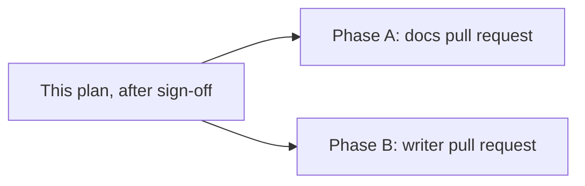
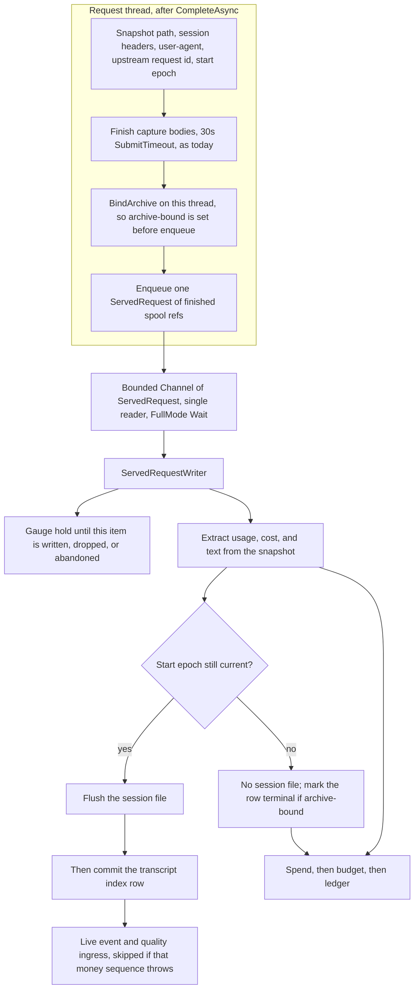

# Plan: Reconcile docs with code (26-item review) (#315)

**Status:** Awaiting David's approval. This pull request adds the plan only. Phase A and Phase B do not start until David signs off, by a comment on [#315](https://github.com/davidpizon/TotallyHot-ArcRouter/issues/315) or on the pull request that adds this file. The issue being open is not approval.
**Issue:** [#315](https://github.com/davidpizon/TotallyHot-ArcRouter/issues/315) — "Reconcile docs with code (26-item review)".
**Standing rule:** [Approved plan before coding](../router/standing-rules.md#approved-plan-before-coding). Each implementation pull request links this plan.
**Audit base:** `main` at `d3452c4a` (2026-10-20). Line numbers below are from that commit. Re-read the cited symbol before editing. A shifted line is not a reason to change the decision.
**Decisions:** David, items #1–#26, recorded in §3 and §4. This plan does not re-decide any item.
**ADR:** Phase A changes no contract. Phase B implements accepted [ADR-0018](../adr/0018-persist-request-telemetry-off-the-request-path-via-a-bounded-channel.md) and the write path already specified by accepted [ADR-0019](../adr/0019-store-conversation-text-in-encrypted-per-session-files.md). It does not open a new ADR. It does not change `ManagementFacade`'s public method set, and it does not register that type's internal collaborators as their own services.

This plan pull request **closes nothing**.

## 1. Split

Two pull requests, both after sign-off, both linking this file. They do not depend on each other. Do not put the writer in the docs pull request.

| Phase | Items | What lands |
|---|---|---|
| **A. Docs only** | #1–#3, #5–#26 | The edits in §3. Includes #20's G3 check and #23's retarget-or-close. No product code, no proto, no test, no `appsettings.json`. |
| **B. One code build** | #4 | The bounded `Channel<ServedRequest>` writer in §4. Its own pull request. |

Phase A may be one pull request. The edits share one rule: the doc changes, the code does not.

## 2. Rules for every edit

- C# / .NET only where Phase B writes code. No Python, no shell script that rewrites docs.
- No secrets, tokens, certificate passwords, or connection strings in any file this work touches.
- Diagrams in markdown stay Mermaid.
- A closed plan or an accepted ADR is amended in place. Add a dated note that names #315. Do not delete the history of what the text used to require. Do change the sentence a reader would follow, so the current rule is the one on the page.
- Serilog message templates stay static string literals.
- Do not merge either pull request from the agent that writes it.

**Phase A verification, for every item.** Re-read the code citation in that item. Then search the edited doc for the retired sentence and confirm it is gone. Build nothing for Phase A. The docs-only pull request does not need `dotnet build`.

**Phase B verification** is §4.5. Before editing, list production callers of `ProxyMiddleware`, `RequestTelemetryPublisher.PublishAsync`, and `SessionCaptureWriter`.

## 3. Phase A — docs only

Item #4 is not in this section. It is the writer in §4.

### 3.1 Explicit circuit-open models are blocked (#1)

**Decision.** Fix `README.md` to match the code and ADR-0005. An explicit, still-enabled model whose circuit is already open is not substituted.

**File.** `README.md`, Routing section (the paragraph at lines 117–121).

**Change.** Keep: "A request naming a real, servable model … is always served exactly that model; the router never substitutes a model the client explicitly named."

Replace the next sentence. An unrecognized name and an administratively stopped model still fall back to the same routing decision as `auto`. An explicit model whose circuit is already open does not: the router returns 503 with reason `CircuitOpen` and does not enter the candidate loop. A circuit that opens during the request can still fail over.

**Verify.** `RoutingCandidateBuilder` sets `ExplicitCircuitTripBlockMessage` when the substitution reason is still `None` and the target or provider circuit is open, and it does not swap in another model. `ProxyMiddleware` returns that block (503, `CircuitOpen`) before the candidate loop. `RequestInterceptor.ResolveAgenticRouteAsync` still runs for an unresolved or stopped name.

### 3.2 An unknown model name is a routing decision (#2)

**Decision.** Fix `src/README.md` to match `README.md` and `RequestInterceptor`. A 400 is only the empty-`model` case and the nothing-eligible case.

**File.** `src/README.md`, the `ModelList` sentence (around lines 59–60) and the unconfigured-name sentence (around lines 231–232).

**Change.** Replace both of these:

- "Only models listed in `ModelList` are routable; anything else gets a `400` response."
- "An unconfigured model name returns a `400` with an `invalid_request_error` body instead of being forwarded."

With: outside forced single-model mode, an unresolved or administratively disabled name is a routing decision (`RequestInterceptor.ResolveAgenticRouteAsync`, reasons `UnresolvedName` or `ModelStopped`) and is served when a candidate exists. The proxy returns 400 `invalid_request_error` only when `model` is missing, or when that fallback also finds nothing (`ProxyMiddleware.WriteModelNotFoundResponseAsync`).

**Verify.** `RequestInterceptor` around the empty-`model` check and the unresolved/disabled branch. `WriteModelNotFoundResponseAsync` is the 400. A name that resolves to a candidate is not a 400.

### 3.3 Live grading does not cover every response (#3)

**Decision.** Fix the README citation now. Issue #304 updates it later if prose grading ships. Do not change the scorer.

**File.** `README.md`, the G-Eval paragraph (around lines 322–327).

**Change.** Replace "Arc Router grades every response with two independent graders, and one of them (`GEvalJudgeClient`) follows this recipe directly."

With: Arc Router grades fenced code blocks. `QualityIngress` does not enqueue a turn that sampling drops, or whose `ISignalExtractor.Extract` returns null. `CodeBlockSignalExtractor` returns null when the response has no fenced code block. The G-Eval judge joins only when it is enabled and a free backbone resolves (`JudgeAvailability`). Static syntax and analysis can score a block with no judge. The sentence that every response is graded, including prose, is open issue #304, not current behavior.

**Amendment (2026-10-27, #315).** The paragraph above is the edit that was correct at `d3452c4a`. After #304 phases 0–9 it is not the current rule. The current README text is [§3.1 of the docs follow-up](issue-315-phase-b-docs-follow-up.md#31-readme-still-says-prose-is-not-graded--original-item-3). §4 of this plan (the `Channel<ServedRequest>` writer) is unchanged.

Keep the G-Eval recipe citation for the judge that does run.

**Verify.** `QualityIngress` returns without enqueue on a dropped sample or a null extract. `CodeBlockSignalExtractor` returns null with no fence. `JudgeAvailability` gates the judge. No edit under `src/TotallyHotArcRouter.Quality/`.

### 3.4 Metadata-only session list (#5)

**Decision.** Update ADR-0023 and the closed plans for #179, #185, #184, and #165 so metadata-only is the rule. Do not put prompt text back on `ListPersistedSessions`.

**Files.**

- `docs/adr/0023-send-display-previews-under-a-byte-budget-on-the-persisted-session-list.md`
- `docs/adr/README.md` (the 0023 row, if it still describes option A as the contract)
- `docs/plans/issue-179-persisted-sessions-list-size.md` §4.1
- `docs/plans/issue-185-passkey-content-gate.md` §1 F2–F3 and §3.2
- `docs/plans/issue-184-transcript-data-protection.md` F10
- `docs/plans/issue-165-export-import-history.md`, "What is stored today"

**Change.**

- ADR-0023 already says option E (metadata only) is the end state once encrypted session files exist. Those files exist. Change the Decision Outcome so the chosen option is E, not A. Delete the claim that the current contract reads each row's full text from SQLite and cuts it into fields 6 and 7. Keep option A in the considered options, labeled as the interim that ADR-0019 replaced. State the rule: `ListPersistedSessions` returns lengths and metadata. It does not set `PromptText`, `ResponseText`, or the truncation flags. Previews are `GetTurnTexts`. `StreamEvents` is grant-filtered.
- Each closed plan gets a dated amendment note naming #315. Then correct the sentences a reader would follow:
  - #179 §4.1: fields 6–7 are not 2,000-character previews on the list.
  - #185: the list does not map stored text, and a content grant does not restore preview text on `ListPersistedSessions`. `StreamEvents` is not "every event unchanged"; `ApplyContentGate` filters it.
  - #184 F10: `ListPersistedSessions` does not return `prompt_text` / `response_text`. Annotate F10 as the pre-ADR-0019 finding, the same way §3.21 annotates F9.
  - #165: full bodies are the encrypted per-session files. The SQLite text columns are not the live store.

**Verify.** `TelemetryGrpcService.ToContract` sets lengths and metadata and does not set `PromptText`, `ResponseText`, or truncation flags. `telemetry.proto` documents the list as metadata-only and points previews at `GetTurnTexts`. `SqliteTranscriptStore.ListSessionsAsync` selects `prompt_text_length` / `response_text_length`, not the text columns. Search the edited files for a current-tense claim that the list returns prompt or response text. That claim is gone.

### 3.5 ADR-0025 is accepted and not in the tree (#6)

**Decision.** Do not delete the ADR. Do not build the RPC here. #176 phase 2 builds it. Until then the index says accepted and not yet in the tree.

**Files.**

- `docs/adr/0025-serve-persisted-turn-details-and-a-session-aggregate-on-a-metadata-only-rpc.md` (status note under the existing accepted line)
- `docs/adr/README.md` row 0025

**Change.** Keep status `accepted`. Add one sentence: `GetSessionTurnDetails`, `GetSessionTurnDetailsRequest`, `GetSessionTurnDetailsResponse`, and `SessionTurnDetail` are not in `src/Protos/telemetry.proto` yet; [#176](https://github.com/davidpizon/TotallyHot-ArcRouter/issues/176) phase 2 builds them. The index row says the same. Amendment 1 (the tool-call flag) stays accepted and stays a transcript-row fact, not a claim that a wire message of that name exists.

**Verify.** Search `src/` and `src/Protos/telemetry.proto` for `GetSessionTurnDetails` and `SessionTurnDetail`. No matches. `request_transcripts.has_tool_calls` is written by the transcript store. No pull request in Phase A adds the RPC.

### 3.6 Secret-store and data-directory ACLs (#7)

**Decision.** Mark ADR-0015 superseded by ADR-0024. Accept ADR-0024. Fix the price-catalog sentence. Do not add a writing-account ACE or a `Users` read ACE.

**Files.**

- `docs/adr/0015-machine-scoped-protection-for-the-shared-secret-store.md` status line
- `docs/adr/0024-protect-the-machine-shared-data-directory-and-make-deletion-final.md` status line
- `docs/adr/README.md` rows 0015 and 0024
- `docs/router/model-price-catalog.md` D5 table (the SQLite-file row, around line 253)

**Change.**

- ADR-0015's status line is `accepted` today. Change it to `superseded by ADR-0024`. Leave the old "writing account" sentence in the decision history, and add a note that the code no longer grants that ACE. Do not edit `SecureFile` to put it back.
- ADR-0024's status line is `proposed` today. Change it to `accepted`. The code already enforces it, and #184 is closed. `packaging-and-distribution.md` §3.1 already treats the DACL as current; point the status note at that section.
- Index rows match those two statuses.
- D5: the SQLite file is not "readable by local `Users`." The production directory policy is `SYSTEM` and `Administrators` only on Windows, and owner-only `0700` for Unix state directories.

**Verify.** `SecureFile.WriteMachineShared` grants `LocalSystem` and `BuiltinAdministrators` only. `WindowsDataDirectorySecurity` is `SYSTEM` and `Administrators` only. `DataDirectoryBootstrap` uses `0700` on Unix. No code diff in Phase A.

### 3.7 Management token lives in the secret store (#8)

**Decision.** Rewrite `secrets-at-rest.md` §6. Drop `management-token.txt` from the packaging inventory of live files. §1 is already right; keep it.

**Files.**

- `docs/router/secrets-at-rest.md` §6 (around lines 161–167). Do not rewrite §1.
- `docs/router/packaging-and-distribution.md` §3.1 (the data-directory file list, around line 72)

**Change.** §6 currently says the management token is deliberately not covered and `management-token.txt` stays. Replace that section: the token lives in `ProtectedSecretStore` (`secrets.dat`). A legacy `management-token.txt` is imported once by `ManagementAccessToken.GetOrCreate` and then not used. Delete `management-token.txt` from the list of files the data directory holds as live state. `secrets.dat` stays.

**Verify.** `docs/router/mcp-endpoint.md` already matches this. `ManagementAccessToken` names `management-token.txt` only as the legacy import. After the edit, packaging §3.1 does not list that file beside the databases.

### 3.8 Telemetry transport and the cost ledger (#9)

**Decision.** Rewrite `telemetry.md`'s "Transport: gRPC" section from `ProxyServer` and `telemetry.proto`. Mark the cost ledger shipped. The later GUI paragraph that names `https://localhost:47104` is already the current default; the transport section must agree with it.

**File.** `docs/router/telemetry.md`.

**Change.** Replace the transport section's current-behavior claims. The section banner can keep the note that SignalR is gone. The following sentences do not survive:

- A second Kestrel listener on `ProxyServer.DefaultGrpcPort` 5002, beside proxy port 5001.
- `TelemetryGrpcService.StreamEvents` is the sole RPC on `TelemetryService`.
- A dedicated `telemetry-cert.pfx` bound only to that gRPC port is the current TLS story. (`LegacyStorageMigration` still knows the old file name; that is not the listener.)

Write what the code does:

- LLM forwarding is HTTPS on `ProxyListenerOptions.Port` (default 47101).
- Telemetry and admin gRPC are mapped on the web listener, `UseHttps`, `WebInterfaceOptions.Port` (default 47104). `TelemetryChannelFactory.DefaultServerAddress` is `https://localhost:47104`. There is no `DefaultGrpcPort`.
- `TelemetryService` RPCs at this commit: `StreamEvents`, `ListPersistedSessions`, `GetTurnTexts`. That is the whole of `TelemetryService`. It is not the whole listener.
- The same web listener also maps the other services in `src/Protos/telemetry.proto`: `PriceSourceAdminService`, `BenchmarkDataAdminService`, `LlmRouterModelAdminService`, `RoutingModeAdminService`, `RoutingGateAdminService`, `ManagementTokenAdminService`, `PasskeyAdminService`, `RouterSettingsAdminService`, `ClusterModelAdminService`, `RouterModelAdminService` (implemented by `LogRegModelAdminGrpcService`), `RegretHarnessAdminService`, `JudgeCalibrationAdminService`, `UpdateAdminService`, `CostReconciliationAdminService`, `ConversationAdminService`.
- It also maps `src/Protos/admin.proto`: `ProviderAdminService` and `UsageAdminService` (`ProxyServer` maps `ProviderAdminGrpcService` and `UsageAdminGrpcService`). The telemetry.proto list is not the full set.
- Re-read every `service` line in both proto files and every `MapGrpcService` call in `ProxyServer` and `ProxyServerDependencies`, and write that list. Do not leave "sole RPC".
- TLS is the router listener's HTTPS, not a private h2c port.

Also mark the ledger shipped, in the same file:

- The paragraph that says a per-request usage ledger still does not exist (around lines 291–296). It does: `UsageLedger` is on the request path, and `CostReconciliationAdminService` exposes `GetCostReconciliationStatus` and `RunCostReconciliationNow`.
- The "Proposed features" sentence (around lines 416–418) that lists `agent-cost-tracking.md`'s SQLite ledger as proposed. The GUI-only-talks-to-the-proxy principle stays. The ledger is not proposed.

The audit's "telemetry.proto line 417" does not contain that sentence at `d3452c4a` (that line is a sync-progress comment). Re-grep the proto for a proposed-ledger claim and fix it only if the search hits. Do not invent one.

**Verify.** Search `src/` for `DefaultGrpcPort`. No symbol. `ProxyServer` maps `TelemetryGrpcService` on the web listener inside `UseHttps`. The rewritten section names 47104 and more than `StreamEvents`. The two ledger sentences no longer say the ledger is absent or proposed.

### 3.9 Security-hardening threat model (#10)

**Decision.** Rewrite §1.1 and the port-5001 claim from the current listeners. Do not leave the table as the current posture with stale file:line citations. The document's "per-finding status is unverified" banner can stay; it does not license a wrong listener table.

**File.** `docs/router/security-hardening-plan.md`, the listener table (around lines 34–40) and the `http://127.0.0.1:5001/v1/chat/completions` claim (around line 344).

**Change.** Replace the table's current-posture rows:

| Listener | What to write |
|---|---|
| LLM proxy | HTTPS on 47101 (`ProxyListenerOptions`). Not plain HTTP on 5001. REST `/admin/*` is not registered on it. |
| MCP | HTTPS on 47103 (`McpOptions.Port`, `appsettings.json` `Mcp:Port`). Not 5003. |
| Web and management gRPC | HTTPS on 47104. Dashboard and gRPC share that port. Admin operations are gRPC (`ProviderAdminGrpcService.RefreshFromEndpoint`, `ListProviders`, `SetSecret`, and the other mapped admin services). There is no `ProviderAdminEndpoints` or `UsageAdminEndpoints` type. |

Replace the 5001 completions URL with `https://127.0.0.1:47101/v1/chat/completions`. Drop file:line citations that point at removed types. Cite `ProxyServer`, `ProxyListenerOptions`, `WebInterfaceOptions`, and `McpOptions`.

**Verify.** Search `src/` for `ProviderAdminEndpoints` and `UsageAdminEndpoints`. No types. `ProxyServer` calls `UseHttps` for the proxy listener. No REST `/admin` route registration. MCP default port is 47103.

### 3.10 Delete the stale "verified today" section (#11)

**Decision.** Delete §2.1 of `docs/router/orchestrator-live-path-plan.md`. The status banner at the top of that file (M1–M4 shipped) stays. It is the text that matches the code.

**File.** `docs/router/orchestrator-live-path-plan.md` §2.1 (around lines 94–108), titled "Verified in the code today."

**Change.** Delete the section. Do not replace it with a shorter version of the same claims. Those claims are false: `CompositeRoutingPolicy` does override the signals overload and forwards non-utility traffic into `OrchestratorRoutingPolicy`; telemetry's requested model is the client string captured before substitution (`RequestInterceptor`, then `ProxyMiddleware` publishes `requestedModelName`), not `candidates[0]`.

**Verify.** The heading "Verified in the code today" is gone. The M1–M4 banner remains. `CompositeRoutingPolicy` still overrides the signals overload.

### 3.11 Utility routing and the price catalog (#12)

**Decision.** Update the B2 and B3a blockquotes. The file's "Phase I shipped" status line is already right. Leave the statement that cost is absent on the normal orchestrator path; that is open issue #291 and `docs/how-it-learns.md`.

**File.** `docs/router/utility-model-routing.md`, B2 (around lines 206–208), B3a (around line 267), and the test notes that say `http://127.0.0.1:5001/v1` (around lines 467–468). Also line 13 if it repeats the same claim.

**Change.**

- Replace "IsUtility … is not yet consumed by any routing decision." `CompositeRoutingPolicy` dispatches `context.IsUtility` to `UtilityRoutingPolicy`.
- Replace "The cost term requires `IModelPriceCatalog` — designed but not implemented." The catalog is registered (`ProxyServiceCollectionExtensions`) and `GetFreshPrice` is the live path `model-price-catalog.md` describes.
- Replace `http://127.0.0.1:5001/v1` with `https://127.0.0.1:47101/v1`.

**Verify.** The two blockquotes match the two code facts. A search of this file for "not yet consumed" and "not implemented" on those two claims finds nothing. The normal-path cost gap is still described, and #291 is still named or still clearly out of scope.

### 3.12 Unified API translation is registered (#13)

**Decision.** Replace §1.1 and the §4.1 "interface only, not yet consumed" bullet. The status banner (lines 3–4) is already right.

**File.** `docs/router/unified-api-translation.md` §1.1 (around lines 27–41) and §4.1 item 3 (around line 123).

**Change.** Delete "There is no request/response payload translation for any provider today", "Unified API Translation is genuinely unbuilt end-to-end", and "Added `IPayloadTranslator` … as an interface only, not yet consumed by anything."

Replace with the current registration: `ProxyServiceCollectionExtensions` registers `GeminiPayloadTranslator`, `AnthropicPayloadTranslator`, and the three Bedrock translators. Gemini and Bedrock always translate. Anthropic translates when `ShouldTranslate` says so. Ollama and OpenAI-compatible providers pass through.

**Verify.** The registration block lists those translators and states that Gemini and Bedrock always translate. The three deleted sentences are gone. The status banner is unchanged.

### 3.13 Price and cost "Why" sections (#14)

**Decision.** Rewrite the "Why" sections in the two docs so they match their banners and the code. Drop "proposed" for `model-price-catalog.md`. The schema SQL in `agent-cost-tracking.md` §2 is explicitly historical; leave it labeled that way.

**Files.**

- `docs/router/pricing-seed-removal.md` (banner at lines 3–6 is "Implemented"; body around lines 21–26 still says the fetching subsystem does not exist)
- `docs/router/agent-cost-tracking.md` (banner at lines 3–9 says the ledger and reconciliation are implemented; body around lines 29–40 says there is no price data and nothing is persisted)
- Any remaining "proposed" label on `model-price-catalog.md` in those two files and in `docs/README.md` if one is still there. `docs/README.md` line 97 already says phases 1–4 are implemented; do not regress it.

**Change.** Point the body at the banner. The price catalog, `IModelPriceCatalog` / `PriceCatalogRepository.GetFreshPrice`, `UsageLedger`, and `CostReconciliationService` exist. `appsettings.json` has no `Pricing` seed section. `model-price-catalog.md` is not proposed.

**Verify.** Search both files for "does not exist", "no SQLite dependency", "There is no price data", and "Nothing is persisted" used in the present tense about this tree. Those sentences are gone or explicitly historical. `src/TotallyHotArcRouter/PriceCatalog/` is still the implementation. No code edit.

### 3.14 Adaptive routing defaults on (#15)

**Decision.** Keep `EnableAdaptiveRouting = true`. Update the two docs to that default and that property name.

**Files.**

- `docs/router/orchestrator-ensemble.md` (around lines 73–75)
- `docs/router/self-organizing-classification-plan.md` (around lines 709–718, under a shipped phase)

**Change.** Replace `AdaptiveRoutingEnabled` with `RoutingOptions.EnableAdaptiveRouting`. Replace default off / `false` with default `true`. A fresh install captures transcripts and can score `cluster_best` without an extra opt-in. The System Settings toggle defaults to On. Do not change the initializer in `RoutingOptions.cs`.

**Verify.** `RoutingOptions.EnableAdaptiveRouting` is initialized to `true`. Both docs use that name and that default. Search both files for `AdaptiveRoutingEnabled`. No remaining current-tense use.

### 3.15 Serilog is not `WriteTo` in appsettings, and logs are not in `C:\Logs\ArcRouter` (#16)

**Decision.** Rewrite the guide's status banner and path, the `docs/README.md` logging row, and the `AGENTS.md` logging example. Keep EventLog labeled proposed.

**Files.**

- `docs/router/serilog-logging-guide.md` (status banner, lines 5–9, and the path at lines 23–25; the later "target configuration" sections that repeat `C:\Logs\ArcRouter` and a `WriteTo` File-plus-EventLog example)
- `docs/README.md` line 116
- `AGENTS.md`, the Logging section's `appsettings.json` example. `CLAUDE.md` and `.github/copilot-instructions.md` are symlinks to `AGENTS.md`. Edit `AGENTS.md` only.

**Change.**

- `Program.cs` strips `Serilog:WriteTo` on purpose, so conversation-body events cannot escape `bodies-*.log`. `appsettings.json` has MinimumLevel and Enrich, and a comment that `WriteTo` entries are ignored. Do not document a `"WriteTo"` array as the way the file sink is configured.
- The process then attaches Console, a rolling File sink (`arcrouter-.log`, 30 files), the telemetry Console-tab sink, and the body sink. There is no EventLog sink. Keep every EventLog section labeled proposed.
- The directory is `AppDataPaths.ResolveLogsDirectory()`: `LOGS_DIRECTORY` when set, otherwise `<machine-shared-data>/logs`. Delete `C:\Logs\ArcRouter\arcrouter-.log` as the current path.
- `docs/README.md` row: not "Partially implemented — Console sink only." State that Console, the rolling file, the Console-tab sink, and the body sink are attached in code, and that EventLog is proposed.
- `AGENTS.md`: replace the example that tells agents to configure `Serilog.WriteTo` File plus `Serilog.Sinks.EventLog` in `appsettings.json` with the behavior above. Keep the rule that the message template is a static string literal, and keep the list of what to log (routing decisions, proxy interceptions, memory updates, errors).

**Verify.** `Program.cs` strips `WriteTo` and attaches the four sinks. `AppDataPaths.ResolveLogsDirectory` matches the path sentence. Search the three docs for `C:\Logs\ArcRouter` and for an instruction to add `Serilog.Sinks.EventLog` to the live `WriteTo` list. Both are gone. EventLog is still described as proposed.

### 3.16 Model Distribution is live data (#17)

**Decision.** Update `dashboard.md` §3 and the opening sentence of `docs/gui/backlog.md` item 1. The later bullets in that backlog item already say the rollup path is live; make the opening agree.

**Files.**

- `docs/gui/dashboard.md` §3 (around lines 215–219) and the Cost Analytics known-gap list (around lines 410–412)
- `docs/gui/backlog.md` item 1 opening (around lines 21–23)

**Change.**

- The time-range filter calls `UsageStore.LoadRollupAsync`. Charts are not fed from `MockData.TokenBuckets` / `MockData.ModelShares` on the live path. `MockData` is the empty-corpus fallback. The component comment says the filter drives a real rollup call; the doc should say the same.
- Remove the "$0–$160 savings scale" known gap. No `$160` axis pin remains in `CostAnalytics.razor` or `CostChartBuilder`.
- Replace "everything else still reads `MockData`" in the backlog item's opening so it does not contradict the later live-rollup bullets.

**Verify.** `ModelDistribution.razor` calls `UsageStore.LoadRollupAsync` from the filter handler. Search `CostAnalytics.razor` and `CostChartBuilder` for `$160`. No hit. The known-gap sentence is gone.

### 3.17 ADR index statuses that already match the tree (#18)

**Decision.** Mark ADR-0002, ADR-0004, ADR-0005, and ADR-0016 accepted, in the ADR status line and in `docs/adr/README.md`. Fix ADR-0004's "no implementation has landed yet" sentence. ADR-0024 is §3.6, not this item. ADR-0017 stays `proposed`. Do not edit ADR-0017.

**Files and the code fact each status must match.**

| ADR | Change | Verify against |
|---|---|---|
| 0002 | `proposed` → `accepted` | `model_context_windows` in `ToolCallCapabilityRepository` |
| 0004 | `proposed` → `accepted`, and replace More Information's "no implementation has landed yet" | `OutOfCreditsClassifier`; `ProxyMiddleware` records `ProviderInteractionKind.OutOfCredits` and fails over when the router chose the model |
| 0005 | `proposed` → `accepted` | §3.1. Explicit selections are not silently substituted on a circuit that is already open |
| 0016 | `proposed` → `accepted` | No `AuthHeaderName` symbol under `src/`. Credentials are header rows (`appsettings.json` `Headers`) |

**Verify.** The four status lines and the four index rows say `accepted`. ADR-0017's status line and index row still say `proposed`. Search `src/` for `AuthHeaderName`. No symbol. ADR-0004 no longer says nothing has landed.

### 3.18 Management docs still name REST `/admin` (#19)

**Decision.** Say gRPC `RefreshFromEndpoint`, `ListProviders`, and `SetSecret`. Drop port 5001. Keep the licensing rule that prices are not republished on the OpenAI-shaped surface.

**Files.**

- `docs/gui/provider-management.md` (around lines 71–72): `RefreshFromEndpointAsync` does not "return 200 OK." It is a gRPC call on `ProviderAdminGrpcService`.
- `docs/gui/secret-field.md` (around lines 99–101): replace "the REST `/admin/providers` API". Reads go through gRPC `ListProviders`. MCP `list_providers` still goes through `ManagementFacade`; that clause stays if the code still does.
- `docs/gui/backlog.md` resolved bullets (around lines 67–71 and 174–178): replace `/admin/providers/{key}/budget`, `ProviderAdminEndpointsTests`, `PUT /admin/secrets/{name}`, and `GET /admin/providers` with the gRPC methods (`SetBudget` on the provider admin service, `SetSecret`, `ListProviders`). There is no `ProviderAdminEndpointsTests` project.
- `docs/gui/governance-model-cards.md` (around lines 300 and 348): delete "on :5001". Keep the licensing rule.

`docs/gui/backlog.md` lines 7–10 already warn that REST wording is dated. This item updates the bodies that warning points at. Do not delete the warning until the bodies no longer use REST.

**Verify.** Search these four files for `` `/admin/ ``, `200 OK`, and `:5001`. No current-tense hit. `ProviderAdminGrpcService` exposes `RefreshFromEndpoint`, `ListProviders`, and `SetSecret`. The licensing sentence is still present.

### 3.19 G-Eval header, table, and G3 check (#20)

**Decision.** Mark G2 shipped in the header and in the phase table. Verify G3 against the code, then state that one result in the header, the phase table, and `docs/README.md` (the G-Eval row, around line 80).

**Files.**

- `docs/router/geval-shadow-scoring-plan.md` header (around lines 12–14) and phase map (around lines 182–184)
- `docs/README.md` G-Eval row

**G2, not conditional.** The header says "G2 proposed … G3 shipped." The phase table already says G2 "Shipped" (around line 183) and G3 "Proposed." Change the header so it says G2 shipped. Leave the table's G2 cell as Shipped. Do not rewrite it into a second, different wording. G2 is shipped: `QualityScorer` folds `result.JudgeScore` into the weighted total, and judge calibration is a Governance surface (`JudgeCalibrationAdmin`) plus the CLI/report path.

**G3 verification, before any G3 sentence is rewritten.** Read these symbols and record which ones exist:

1. `QualityScorer` folds `result.JudgeScore` into the weighted total (the three-axis blend).
2. `TranscriptScoreObserver` and `EmbeddingMemoryScoreObserver` set `is_judge_scored` from `JudgeScore.HasValue`.
3. `RoutingOptions.JudgeScoredRowPolicy` / `JudgeScoredRowWeight` are applied through `RoutingOptions.ResolveJudgeRowWeight` by `MemoryKnnVoter`, `EmbeddingLogRegTrainingService`, and `ClusterTrainingService`. `ClusterLedger.Build` calls `JudgeRowWeighting.ResolveWeight`. Those are two methods. Both must be present.

   > **Note, 2026-10-22 (issue #326).** #326 renamed those symbols to `UnjudgedRowPolicy`,
   > `UnjudgedRowWeight`, `ResolveRowWeight`, and `UnjudgedRowWeighting.ResolveWeight`. This checklist
   > item records what existed at `d3452c4a`; it is not an audit of the new names.
4. The Phase G3 section of the same plan says the original "non-executable dimensions only" scope was superseded because execution was removed.

At `d3452c4a` all four are present, and the Phase G3 body already says the blend, the provenance flag, and the learning policy shipped. Re-read them anyway. Then pick exactly one of these writings, and use it in the header, the G3 table row, and the `docs/README.md` row:

- **All four present.** G2 shipped. G3's original non-executable-only carve-out was superseded. What shipped is the blend, `is_judge_scored` when a judge grade reached the blend, and the judge-row learning policy. `docs/README.md`'s "G1–G3 shipped" stays only if the same sentence says that, not the original carve-out.
- **Any symbol missing.** Do not mark G3 shipped. Header, table, and `docs/README.md` all say G3 is not in the tree, and name the missing symbol. Do not leave the header on "shipped" while the table says "Proposed."

Do not change `QualityScorer` in Phase A.

**Verify.** The three texts agree. A reader cannot find G2 called proposed in the header, or G3 called both shipped and proposed.

### 3.20 Motion tokens that are already in the stylesheet (#21)

**Decision.** Change the status of `--dur-slow` and `--dur-exit` to shipping. `--dur-entrance` stays "token only."

**File.** `docs/gui/MOTION.md` (the token table, around lines 103–104).

**Change.** `--dur-slow` (`300ms`) and `--dur-exit` (`120ms`) are not "Proposed." They are shipping. Leave the `--dur-entrance` row as token only: the variable is defined and is not used for a full-screen entrance.

**Verify.** `src/TotallyHotArcRouter.Gui.Web/wwwroot/css/app.css` defines both variables. `.overlay-panel` uses `--dur-slow`. `.ls-disclosure` uses `--dur-exit`. The MOTION table says shipping for those two and token-only for `--dur-entrance`.

### 3.21 The #184 plan's log level (#22)

**Decision.** Annotate F9 as the pre-fix finding. The default was changed on purpose. Do not rewrite F9 as if the file had never said Debug.

**File.** `docs/plans/issue-184-transcript-data-protection.md` F9 (around line 57).

**Change.** Add a note on F9: this was the finding before the fix. Shipped `appsettings.json` now sets Serilog `MinimumLevel.Default` to `Information`, not `Debug`.

**Verify.** `src/TotallyHotArcRouter/appsettings.json` has `"Default": "Information"`. F9 is labeled pre-fix. The rest of the plan is not rewritten.

### 3.22 Code-smell D3, retarget or close (#23)

**Decision.** Retarget D3 if the 47100-series duplication still exists. Otherwise close it. The audit's evidence lines are already gone; do not leave them as the reason the item is open.

**File.** `docs/router/code-smell-refactoring-plan.md`, D3 (around lines 907–912).

**Check, in this order, at implementation time.**

1. Confirm the retired evidence is gone: no `http://localhost:5001` under `src/**/*.cs`, `TelemetryChannelFactory.DefaultServerAddress` is not `https://localhost:5002`, and `ProxyServer` does not take `port = 5001` / `grpcPort = DefaultGrpcPort`. `ProviderAdminStore` has no endpoint constant. `ProviderTemplates` does not hardcode the router port (at this commit it also has no `http://localhost:11434/v1` at the cited line; do not cite a provider template URL as a router-port duplicate unless a re-read finds one).
2. Then look for a remaining split between GUI constants and router defaults. At `d3452c4a` these still duplicate each other, and the GUI projects do not reference the router:
   - `TotallyHot.ArcRouter.Gui.Services.OpenAiCompatibleDropIn.BaseUrl` (`https://localhost:47101/v1`) and `DashboardUrl` (`https://localhost:47104`), against `ProxyListenerOptions.Port` (47101) and `WebInterfaceOptions.Port` (47104). The router test `OpenAiCompatibleDropInTests.Gui_drop_in_constants_stay_in_lockstep_with_the_router` already greps the GUI source for the router's formatted strings.
   - `TelemetryChannelFactory.DefaultServerAddress` (`https://localhost:47104`), which that grep does not cover, against `WebInterfaceOptions.Port`.
   - `McpServer`'s constructor default `port = 47103`, `McpOptions.Port`, and `appsettings.json` `Mcp:Port`. Three literals, one value.
   - `PlainHttpListenerOptions.Port` (47105) is a different opt-in listener. It is not part of this split unless a re-read finds a GUI constant that copies it. Do not retarget D3 at 47105 just because the number is in the 47100s.

**If any of those splits remain.** Retarget D3. Replace the 5000-series citations with the symbols that still differ. The fix stays the one D3 already allows: a shared constant, or a written decision to keep the split because the GUI must not reference the router. Where a lockstep test already exists, documenting that test is enough. Where it does not (`TelemetryChannelFactory.DefaultServerAddress`, and the `McpServer` default if it is still a second literal), adding the same kind of lockstep test is Phase B-sized only if the retarget chooses code. **Phase A only retargets the text.** A new shared constant or a new test is a follow-up on D3, not part of the docs pull request, and not part of §4. Do not add a project reference from a GUI assembly to the router.

**If a later commit has removed every split** (one constant, or a lockstep test for each remaining literal), close D3. Say in the item which check failed to find a split, and delete it from the open Phase 5C list. Do not leave a closed item looking actionable.

**Verify.** D3 no longer cites `ProviderAdminStore.cs:21`, `https://localhost:5002`, or `ProxyServer`'s old constructor defaults. The item either names the current symbols or is closed with the check that found nothing.

### 3.23 Stale ports inside current ADRs (#24)

**Decision.** Replace the port numbers. The decisions (one web port, one CA, REST `/admin` deleted) already match the code.

**Files.**

- `docs/adr/0011-router-served-blazor-webassembly-gui-over-grpc-web.md` (around line 72): `WebInterface` `Port` default `5004` becomes `47104` (`WebInterfaceOptions.Port`).
- `docs/adr/0013-name-constrained-local-ca-for-router-tls.md` (around lines 73–74): "MCP (5003), the web GUI (5004), and the LLM proxy (5001)" becomes MCP `47103`, web `47104`, proxy `47101` (`McpOptions` / `appsettings.json` `Mcp:Port`, `WebInterfaceOptions`, `ProxyListenerOptions`).

**Verify.** The three new numbers match those initializers. The ADR status lines stay `accepted`. No other decision sentence in those two files is rewritten.

### 3.24 Router index omits the health survey (#25)

**Decision.** Add the survey to the `docs/README.md` router index. The table's "exhaustive" claim then stays true. Do not drop the word "exhaustive" instead.

**File.** `docs/README.md`, the router index (the sentence around lines 51–53, and a new row). Put the row next to `code-smell-refactoring-plan.md`, because the survey is the source of the HS items.

**Change.** Add `docs/router/codebase-health-survey-2026-09-28.md`. Status text: point-in-time survey, 2026-09-28, with its own implementation-status table. It is not a living spec, and it is not a stub. Do not re-litigate its findings in the index. HS-02 step 2 is ADR-0018; Phase B of this plan is that step. Phase A does not mark HS-02 done.

**Verify.** The new row resolves. Every other living file directly under `docs/router/` is still either in the index or is a historical stub whose first paragraph points at `docs/archive/`. The historical stubs stay indexed via the archive rows. This item does not add them again.

### 3.25 Small name and inventory drifts (#26)

**Decision.** Fix the names in place. No behavior change.

**Files and the exact change.**

| File | Change | Verify |
|---|---|---|
| `docs/router/agent-resilience-strategies.md` (around lines 11–13) | Replace `TryAgenticallyRouteUnresolvedModel` with `RequestInterceptor.ResolveAgenticRouteAsync`. Ranking is `RoutingCandidateBuilder.RankEligibleModels`. | Both methods exist. The old name is gone from this file. |
| `docs/gui/DESIGN.md` §5.5 | `.z-50` is not "all four modals." Nine components use `DialogShell`: `SettingsModal`, `ProviderEditDialog`, `RemoveProviderDialog`, `UnlockSecretFieldDialog`, `UnlockContentDialog`, `ExportDialog`, `AddPasskeyDialog`, `ApprovalRequestsDialog`, `RegenerateManagementTokenDialog`. Re-grep `DialogShell` and write the list the grep returns. | The count matches the grep. |
| `docs/gui/DESIGN.md` §7 | The `style=` exception list is incomplete. `SettingsModal.razor` has `style="overflow-wrap:anywhere"`. Re-grep `style=` under `src/TotallyHotArcRouter.Gui.Components` and add every hit the list omits. | Every `style=` in that project is either on the list or deleted. Phase A does not delete them. |
| `docs/research/zhou-2606.22902-deviation-audit.md` (around line 9) | The paper's system is ACRouter, which is what `docs/research/paper-notes.md` says. Delete the claim that `paper-notes.md` calls it TotallyHotArcRouter. | `paper-notes.md` says ACRouter. The audit doc quotes that. |
| `docs/research/harness-routing-constraints-evidence.md` (around line 178) | `RoutingCandidateBuilder.GetEligibleRoutes` exists; the cited line (226 in the doc, 274 at audit time) has moved. Cite the method, and the line only after re-reading it. | The method is `GetEligibleRoutes`. The line number matches the current declaration. |
| `docs/gui/dashboard.md` Price Sources (around lines 249–250) | Up/down rank controls do not write `priority_score`. `PriceSourcesAdmin.razor` reorders by drag (`grip-vertical`), which is what `DESIGN.md` §5.3 describes. | The razor file uses the grip, not up/down controls, for reorder. |

### 3.26 Left alone on purpose

These were in the audit as non-findings. Do not edit them in Phase A.

- `docs/router/system-proxy-architecture.md` and `docs/router/proxy-coexistence.md` use port 5001. Both are proposed and not implemented. No OS-proxy registration exists under `src/`.
- ADR-0017 stays proposed.
- Open issues #176, #291, #304, and the other open issues listed in the audit. Their plans are not "closed plan" amendments.
- Archive stubs, except where §3.8–§3.15 already name a living doc that points at one.
- Paper notes under `docs/research/papers/`. They describe external papers.

## 4. Phase B — bounded `Channel<ServedRequest>` writer (#4)

**Decision.** Build the background writer now, so the running path matches ADR-0018 and ADR-0019's write path. Do not supersede ADR-0018. Inline persistence after `CompleteAsync` is not the decision.

**Own pull request.** After this plan is approved. Not in the Phase A pull request. The code pull request links this plan and says it implements #315 item 4 / ADR-0018. It may close #315 only if Phase A has already merged; otherwise it says which phase it contains and does not use a closing keyword that would close the issue early. Prefer leaving #315 open until both phases have merged, and closing it from the later of the two pull requests.

**What is wrong today.** `ProxyMiddleware` calls `Response.CompleteAsync` (ADR-0018 step 1, done), then the same request awaits `RequestTelemetryPublisher.PublishAsync` (`ProxyMiddleware` around line 769, `BedrockInvocationHandler` around line 286). Inside one try, `PublishAsync` runs `RecordSpendAndBudgetAsync` (spend, then budget, then the ledger), then `PersistTranscriptAsync`, then `PublishTelemetryEventAsync`. A throw skips the rest of that try and comes back as `PublishedTurn.TelemetryFailure`. `capture.SubmitAsync` is the next call in the same outer try at both sites, so a telemetry failure that was caught inside `PublishAsync` still stores the session, and a throw from `PublishAsync` itself skips `SubmitAsync`. Spend, budget, ledger, and the transcript insert already use `CancellationToken.None`. The live event does not: `PublishTelemetryEventAsync` takes the `cancellationToken` argument, and both call sites pass `context.RequestAborted`.

There is no `ServedRequest` type under `src/`. `SessionCaptureWriter` is a second queue. Its class comment says it is "shaped like ADR-0018's writer so the two can be merged later." ADR-0019's "writes go through ADR-0018's background writer" is the same gap. The Bedrock call is not the middleware call with a different route: `telemetryShapeProvider` is the literal `"openai"`, and `nativeResponseBytes` is a positional `null`. The `ServedRequest` built there must keep both.

`RateLimitHeaderCapture` (`src/TotallyHotArcRouter/Telemetry/RateLimitHeaderCapture.cs`) is the older single-consumer loop the ADR cites. On a full channel `TryWrite` returns false and that capture is dropped. Do not copy that. ADR-0018 says a full channel waits and never drops a spend row.

### 4.1 Shape

The diagram is one consumer's sequence, not parallel tasks. Spend, budget, and the ledger run on that same reader. A failure there does not undo a session file or an index row already written.

One hosted service, one channel, one consumer. `SessionCaptureWriter`'s channel goes away. Its epoch check, spool disposal, drop callback, and `SessionStore.AppendTurn` move behind this writer. `SessionCaptureOptions.QueueCapacity` (default 256) and `ShutdownDrainTimeout` (default 10 seconds) are the bounds. Do not add a second capacity. Pump bounds (`PumpMaxQueuedBytes`, `MinFreeDiskBytes`) stay on `SessionCaptureOptions`. Update the XML docs on the queue properties so they describe telemetry rows and session turns.

Follow `SessionCaptureWriter`'s service shape, not `BackgroundService`. On .NET 10 a `BackgroundService` that is stopped immediately after start never runs `ExecuteAsync`, which would leave the queue undrained. Start the consumer from `StartAsync` with `Task.Run`, and read until the channel is completed.

A separate `ServedRequestWriterOptions` with the same defaults is acceptable only if it replaces `QueueCapacity` and `ShutdownDrainTimeout` rather than sitting beside them. Two capacities that can disagree are not.

`ServedRequest` is the record ADR-0018 names. It replaces the long `PublishAsync` argument list at both call sites (the C2 clump at this call, not the rest of C2). It holds:

- the route, the client-requested model name, fallback and resolution facts, the telemetry shape provider (`"openai"` when a translator ran, and the literal `"openai"` on the Bedrock path), token and cost inputs the publisher already receives, the rewritten body, the captured response bytes, the native response bytes (null on the Bedrock path), streaming flag, timings, status code, and the archive binding;
- the capture start epoch (`TurnCapture`'s `_startEpoch`, the same value `SessionCaptureItem.Epoch` carries today);
- snapshots taken on the request thread, and no `HttpContext`: request path, the headers `ISessionIdResolver` reads, header names used only for the existing log line, `User-Agent`, and the upstream request-id header values the ledger already reads;
- the capture handoff after finish: spool references, not a second copy of the body bytes (ADR-0019), and not the in-progress `CaptureBody` tasks. The existing 4 MiB telemetry capture cap is unchanged.

`HttpContext` and `HttpResponseMessage` are not fields. Kestrel can reuse the context after the middleware returns. The record does not carry `HttpContext.RequestAborted`.

**Cancellation, on purpose.** Spend, budget, the ledger, and the transcript insert already use `CancellationToken.None`. The live event does not: it observes `RequestAborted`. Once the event is written on the background writer, that token is the wrong signal. A streaming client aborts it as the response finishes, which is before or as the writer runs, so passing it through would drop the dashboard event for a request that completed. The live event uses `CancellationToken.None` too. That is a behavior change. The request-abort test covers both `RecordAsync` and `ITelemetryPublisher.PublishAsync`.

**Spool finish stays on the request thread.** `TurnCapture.SubmitAsync` finishes `_requestCompletion`, `_response`, and `_providerResponse` under `SubmitTimeout` (30 seconds) before it enqueues, and it sets `_submitted` only after that finish. At enqueue time the writer receives finished spool refs (`SessionCaptureItem`), which is what `SessionCaptureWriter` already consumes. Do not move `FinishAsync` onto the single reader. A 30 second stall there would block every later spend row. The request thread still waits for that finish, as it does today, and it does not wait for SQLite. That is the ADR-0018 cut: the synchronous commits leave the request. The pump wait does not move onto the writer to chase a stricter reading of "released as soon as the response is complete."

**Ownership.** `ProxyMiddleware` is `using var capture = _turnCapture?.Begin(context)`. `Dispose` releases bodies unless `_submitted` is set. The request thread finishes the bodies, calls `BindArchive` (so `_archiveBound` is set on the request thread, before any writer drop), sets `_submitted`, then enqueues. `Dispose` after that is a no-op. The writer disposes the finished spools after the append, and on every drop path. `BedrockInvocationHandler` uses the same capture object. `BindArchive` does not run again on the writer thread. The one-shot drop notification (`_dropNotified`, and `NotifyTurnDropped`'s `_archiveBound` check) must be safe when the writer thread is the caller: use `Interlocked` for the one-shot, and do not notify when the archive was never bound. That matches today's callback, which already no-ops unless `_archiveBound`.

**What the request thread still does.** `CompleteAsync`, the existing response-body log excerpt, the snapshot, spool finish, `BindArchive`, enqueue. Enqueue replaces both the `PublishAsync` await and the `SubmitAsync` await, inside the same try. A throw from the snapshot or the enqueue is caught by that try, logged, and does not fail the completed response. Enqueue is `TryWrite`, and on a full channel a Warning with a static template and then `WriteAsync` (wait). The client's response is already complete, so the wait holds a pipeline thread and not the client. That wait is the ADR's back-pressure. The producer never drops a spend row because the queue is full.

**Gauge.** `InvokeAsync`'s `InFlightRequestGauge.Track()` still covers routing and streaming, and it ends when the method returns after enqueue. The writer takes its own `Track()` hold in enqueue, before enqueue returns, and releases it in a `finally` when the item is written, dropped, or abandoned. Background jobs that pause on a non-zero gauge stay paused while queued work exists. Use `Track()`, which ignores a double dispose, so the count cannot go negative.

**Order for a turn whose capture epoch is still current.** Two deliberate changes from today, and one coupling that stays.

Today, on the request thread, one try does spend, then budget, then ledger, then the transcript insert, then the live event. The session file is queued after that try returns. A spend exception skips the insert and the live event, and does not skip the session file.

The writer does this instead:

1. Extract usage, cost, and text. No SQLite yet. Bodies are already finished on the request thread.
2. Re-check the start epoch. When it is still current, append and flush the session file (`SessionStore.AppendTurn`), then commit the transcript index row with the same archive turn id. File then index is ADR-0019. Today the index is inserted before the file is queued. A turn exists only once the index row commits.
3. If the index insert throws after the flush: log it, do not append again, and run the drop callback only when the archive was bound. The uncommitted file tail is the case startup recovery already handles (truncate each session file to its last committed record, delete a spool with no index row). Do not add a new recovery pass in this pull request.
4. Spend, then budget (only when usage was extracted), then the ledger, in that order, each still best-effort. **Coupling change, on purpose:** a failure in this sequence does not skip the session file and does not skip the index insert. Today a spend exception skips the insert. Skipping the insert after a flush would orphan the file. The consumer continues.
5. The live event and `IQualityIngress.TryIngest` stay in the money sequence's success path: a throw from spend, budget, or the ledger skips them, which is today's try. They run on the writer, so a dashboard listener lags by the queue, the same lag ADR-0018 accepts for budget enforcement. Do not publish the event back on the request thread to hide that lag. They use `CancellationToken.None`, which is the cancellation change above.

**Clear / stale epoch.** Checked on the request thread before finish, as `SubmitAsync` does today, and re-checked by the writer before append, as `SessionCaptureWriter` does today. `ServedRequest` carries the start epoch so the writer can do that second check. When the epoch is stale: do not append the session file; still record spend, budget, and ledger; still insert the transcript row; then mark it terminal through the drop callback only if the archive was bound. A Clear must not resurrect the wiped conversation, and it must not drop the spend for a request that was already served.

**One writer implies per-session serialization.** ADR-0019 asks for writes to any one session to be serialized. A single reader gives that. Removing `SessionCaptureWriter`'s channel is what keeps a second consumer from appending the same session.

**Logging.** Static templates. At least:

- full queue, Warning: `"The served-request queue is full; waiting for the writer."`
- shutdown abandon, Warning: `"Served-request shutdown timed out with {Abandoned} rows unwritten."`
- a write failure, the existing static templates, logged and swallowed so one bad item cannot stop the consumer.

**Shutdown.** `StopAsync` completes the channel, drains until `ShutdownDrainTimeout`, then sets the abandon flag, logs the count, and does not throw out of the host stop. Items already queued are written until the deadline. Items abandoned are counted. This is the ADR's loss window at shutdown, which is accepted and must be logged. A crash between `CompleteAsync` and the drain loses queued rows. That is the ADR's crash loss window. Do not add a synchronous flush to close it.

**Registration.** `SessionsServiceCollectionExtensions` registers this hosted service once and stops registering `SessionCaptureWriter` as its own hosted service. `ManagementFacade` is untouched.

**Call sites.** `ProxyMiddleware` after `CompleteAsync` (around line 769) and `BedrockInvocationHandler` (around line 286). At both, the `PublishAsync` await and the `capture.SubmitAsync` await are one enqueue. The Bedrock record keeps `telemetryShapeProvider: "openai"` and a null native body. `RequestTelemetryPublisher.PublishAsync`'s side effects become an internal method that takes `ServedRequest`. Keep `ResolveSubstitutionReason` where it is: the response header still needs it before the writer runs.

**Docs that ride with the code pull request, and only there.**

- `docs/router/codebase-health-survey-2026-09-28.md` HS-02 row: step 2 is built, not "not yet built", once the writer is in.
- One sentence on C2 in `docs/router/code-smell-refactoring-plan.md`: this call site is now one `ServedRequest`. Do not refactor the rest of C2.
- ADR-0018 "More Information" may gain a line that the writer landed and name the type. Do not change the decision.

**Not in this pull request.** A new ADR. A proto change. A GUI change. Quality scoring. Putting `HttpContext` on the record. Copying `RateLimitHeaderCapture`'s drop-on-full. A second channel that "also" writes session files. Widening `ManagementFacade`.

### 4.2 Tests

xUnit, in the existing router test project. Fakes and `TaskCompletionSource`, not sleeps. Every test under 5 seconds. XML docs on new types and methods. Nullable reference types. No new warning.

The tests that must exist:

| Test | Asserts |
|---|---|
| Enqueue returns before the writes | A fake ledger blocks inside `RecordAsync`. Enqueue has returned and `RecordAsync` has not been entered. `WaitForIdleAsync` then completes and the row exists. |
| Full channel waits and does not drop | Capacity 1. The writer is blocked on the first item. The second enqueue logs the full-queue Warning and completes only after the first write finishes. Both spend rows exist. |
| Order | Three items. Index inserts happen in enqueue order. |
| Shutdown drain, then abandon | Drain timeout shorter than a blocked write. The Warning names the abandoned count. `StopAsync` does not throw. |
| Gauge | After the request-scope `Track()` is disposed, `InFlightRequestGauge.Count` stays above zero until the writer finishes the item, then returns to the prior value. |
| Commit order | For a current-epoch turn, the session-file append is recorded before the transcript insert. |
| Index insert fails after the flush | The failure is logged, there is no second append, and the drop callback runs only when the archive was bound. No new startup-recovery code. |
| Spend failure does not skip the file or the index | A throw from `RecordAsync` still leaves the session append and the transcript insert done. The live event is skipped. |
| Stale epoch | No session-file append. Spend is still recorded. The transcript row is still inserted. The drop callback runs only when the archive was bound. The record carries the start epoch. |
| Request abort | A cancelled request token does not skip `RecordAsync` or `ITelemetryPublisher.PublishAsync`. Both use `CancellationToken.None`. |
| Ownership | Finish runs before enqueue. After enqueue, `TurnCapture.Dispose` does not release the spools. The writer releases them after the append. `BindArchive` has already run on the request thread. |
| No `HttpContext` on `ServedRequest` | The record can be built from the snapshot types alone. |

Update existing tests that assert a transcript, spend, or ledger row as soon as `InvokeAsync` returns. They await the writer's `WaitForIdleAsync` (ADR-0018's neutral consequence). Known suites: `RequestTelemetryPublisherTests`, `ProxyMiddlewareCaptureRecoveryTests`, and the session-capture writer tests. Move the session-capture queue tests onto this writer; do not leave a second channel under test as if it were still the production path.

`PublishAsync` behavior that is not the threading change stays covered: usage extraction, the nothing-to-publish path, telemetry failure carried on `PublishedTurn` so capture still stores the turn.

### 4.3 Acceptance

- ADR-0018's six guarantees hold: one writer and enqueue order; crash loss window accepted and not papered over; budget lag bounded by queue depth times write latency; full channel waits and logs Warning and does not drop; shutdown drains until the deadline and logs the abandoned count; the gauge stays non-zero while queued work exists.
- ADR-0019's write path holds for a stored turn: the queue carries spool references; the session file is flushed before the transcript index row; one writer serializes writes to a session.
- Both call sites enqueue and return without awaiting SQLite. The request thread may still wait for the existing 30 second spool finish, and it does not wait for the commits.
- `SessionCaptureWriter` is not registered as a second consumer.
- `ManagementFacade`'s public methods are unchanged.
- Static Serilog templates on every new log.
- Warning-free build (`TreatWarningsAsErrors`), including the new XML docs.
- Affected suites green. On the Ubuntu .NET 10 SDK, `dotnet test` can report "Zero tests ran"; run the built test host directly, as `AGENTS.md` describes. Full suite green, line coverage at least 80% on the non-GUI assemblies this change builds. No test over 5 seconds.
- Golden-path smoke from the health survey's HS-02 validation: streaming, buffered, Bedrock, `GET /v1/models`, `/api/tags`, `/api/show`. Measure last `data:` frame to EOF before and after, on one streaming request, and put both numbers in the pull request. The client-visible wait is not the SQLite write.
- Linux CI does not build `src/TotallyHotArcRouter.slnx` or the Windows tray. Build the projects `.github/workflows/dotnet-ci.yml` builds.

## 5. Out of scope

- Implementing `GetSessionTurnDetails` (#176), grading prose (#304), or adding cost to the normal orchestrator path (#291).
- Accepting ADR-0017.
- Putting prompt or response text back on `ListPersistedSessions`.
- Adding a writing-account ACE or a `Users` read ACE.
- Port numbers in the two proposed, unbuilt proxy-architecture docs (§3.26).
- A Python tool, a secret in a file, or merging either pull request from the agent that opens it.

## 6. Sign-off

David's comment on #315 or on the plan pull request is the sign-off. Until that comment exists, no Phase A edit and no Phase B code is in scope for an implementation pull request.
