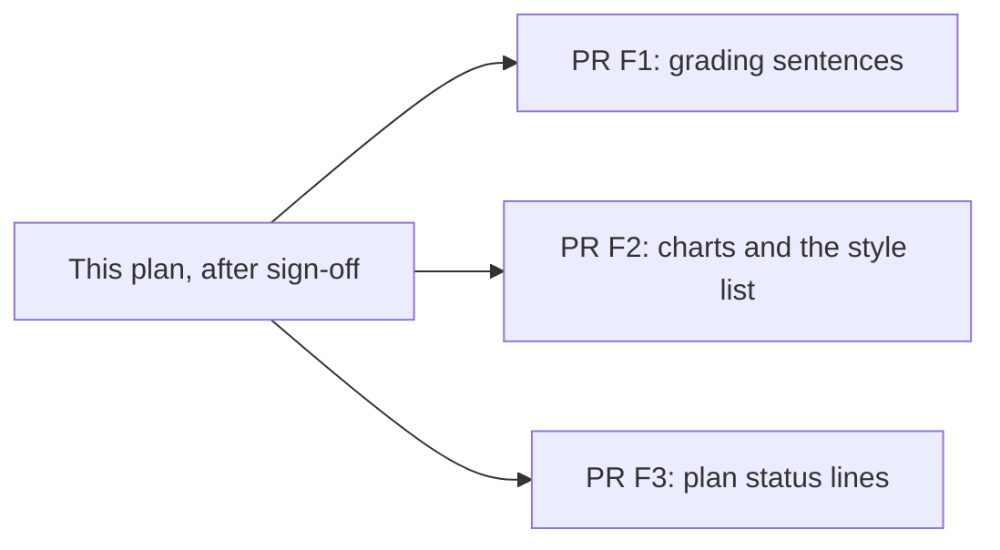

# Plan: #315 docs follow-up after the grader epochs

> **For agentic workers:** Do not start these edits until David signs off on this file, by a comment on [#315](https://github.com/davidpizon/TotallyHot-ArcRouter/issues/315) or on the pull request that adds this file. The issue being open is not approval. Steps use checkbox (`- [ ]`) syntax. This file changes markdown only.

**Status:** Awaiting David's approval. This pull request adds the plan only. It does not edit the docs it lists.
**Issue:** [#315](https://github.com/davidpizon/TotallyHot-ArcRouter/issues/315) — "Reconcile docs with code (26-item review)".
**Standing rule:** [Approved plan before coding](../router/standing-rules.md#approved-plan-before-coding). Each implementation pull request links this file.
**Tree this plan was read against:** `origin/main` at `37dfd1d0` (merge of [#351](https://github.com/davidpizon/TotallyHot-ArcRouter/pull/351), 2026-10-27). Re-read the cited symbol before editing. A shifted line is not a reason to change the decision.
**Engines:** CodeGraph (`npx @colbymchenry/codegraph init -y`, 1,381 files, 25,813 nodes) and Serena (`find_symbol` / `get_symbols_overview`, session `8356b620`, C# language server). Both returned source. Serena was not skipped. The index was built on `eb909749` (after [#353](https://github.com/davidpizon/TotallyHot-ArcRouter/pull/353), before #351). `QualityIngress`, `QualityRescanService`, `QualityScorer`, `LocalGradeTakeover`, and `GraderEpochOptions` did not change in #351, so those line numbers are the tree at `37dfd1d0`. The #351 chart files were read on this branch after `git fetch` of `37dfd1d0`. CodeGraph's two explore calls did not include those new files.

This pull request **closes nothing**. It does not cancel Phase B. Phase B is the writer in the approved plan. This file is the docs follow-up. It is not Phase B.

## 0. Where this follow-up sits

Phase A and Phase B are written down. They are not an inference. David settled the name of this file on 2026-10-27 (question 1).

| What | Where | What it is |
|---|---|---|
| Phase A | [#317](https://github.com/davidpizon/TotallyHot-ArcRouter/pull/317) and the leftovers in [#318](https://github.com/davidpizon/TotallyHot-ArcRouter/pull/318), both merged 2026-10-21 | Docs for original items #1–#3 and #5–#26. The plan is [`issue-315-docs-code-reconciliation.md`](issue-315-docs-code-reconciliation.md), merged in [#316](https://github.com/davidpizon/TotallyHot-ArcRouter/pull/316). |
| Phase B | Same plan, §4, and the issue body. Confirmed by David on 2026-10-27, on [#356](https://github.com/davidpizon/TotallyHot-ArcRouter/pull/356). | One **code** change: item #4, the bounded `Channel<ServedRequest>` writer (ADR-0018 and ADR-0019). Not a docs pass. Not started. |
| This file | Not in the issue or its comments | The **docs follow-up**. The sentences Phase A wrote, and the living docs beside them, that later merges made false. Not Phase B. |

Later merges this file accounts for:

| Merge | What landed that can make a doc false |
|---|---|
| [#334](https://github.com/davidpizon/TotallyHot-ArcRouter/pull/334) through [#348](https://github.com/davidpizon/TotallyHot-ArcRouter/pull/348) | #304 phases 0–8. Live ingress enqueues unfenced text. Takeover defaults on. |
| [#347](https://github.com/davidpizon/TotallyHot-ArcRouter/pull/347) | Phase 8 plan and ADR-0027 Amendment 3. Docs only. |
| [#349](https://github.com/davidpizon/TotallyHot-ArcRouter/pull/349) | Phase 9 plan. The file still says "Draft" and "implementation waits". |
| [#351](https://github.com/davidpizon/TotallyHot-ArcRouter/pull/351) | Epoch marks, token-efficiency pill, incomplete-grade card. It updated `dashboard.md`, `how-it-learns.md`, and the evaluator plan, and left other sentences on seven pills. |
| [#353](https://github.com/davidpizon/TotallyHot-ArcRouter/pull/353) | #350 test change. The plan file still says implementation has not started. |

**Question 1 is settled** (David, 2026-10-27, on #356). Phase B stays the writer in §4 of the approved plan. This file is the docs follow-up. Implementers do not delete §4. They do not build the writer from this file. The branch and this filename still contain `phase-b`. That string is history. It is not the name of this plan.

## 1. Split

Three pull requests, F1, F2, and F3. Those ids are slices of this follow-up. They are not Phase B. They do not depend on each other. Each is docs only. None of them contains the writer. None of them contains the word-answer routing change. That change is code. It is §9. It needs its own plan and David's go on that plan.

| PR | Items | Files |
|---|---|---|
| **F1. What gets graded** | §3.1–§3.7, §3.12 | `README.md`, `docs/how-it-learns.md`, `docs/router/quality-verifier-architecture.md`, `docs/research/subagent-and-helper-routing-evidence.md`, `docs/adr/0022-route-harness-subagent-and-helper-traffic-by-kind.md`, `docs/adr/0027-grade-non-coding-responses-on-a-bootstrap-recipe-and-keep-them-out-of-code-tallies.md`, `docs/plans/issue-293-graders-judge-against-the-question.md`, `docs/plans/issue-163-subagent-aware-routing.md`, `docs/plans/issue-304-grade-non-coding-responses.md`, `docs/plans/issue-315-docs-code-reconciliation.md`, `docs/plans/issue-304-phase-8-grader-takeover.md` |
| **F2. The eighth pill** | §3.8–§3.10, §3.13 | `docs/gui/dashboard.md`, `docs/gui/cost-analytics-visualization-spec.md`, `docs/gui/DESIGN.md`, `docs/plans/issue-304-phase-9-epoch-time-graph.md` |
| **F3. The test plan's status** | §3.11 | `docs/plans/issue-350-flaky-grader-epoch-phase7-tests.md` |

## 2. Rules for every edit

- Markdown only. No `.cs`, `.csproj`, `.razor`, `.js`, `.proto`, test, workflow, or `appsettings.json` edit. The three `style=` bugs in §6 stay bugs.
- No secrets, tokens, certificate passwords, or connection strings.
- Diagrams stay Mermaid.
- A closed plan or an accepted ADR is amended in place. Add a dated note that names #315. Do not delete the history of what the text used to require. Do change the sentence a reader would follow, so the current rule is the one on the page.
- The code is the source of truth. Do not "fix" a doc by describing behavior the code does not have. Do not describe a code bug as an allowed exception.
- Do not merge the plan pull request or any implementation pull request from the agent that opens it.
- There is no doc-test project in this repo (no project, workflow, or script that checks markdown links or quotes). Verification is the search in each item. Do not add a doc-test project in these pull requests.

**Verification, for every item.** Re-read the symbol named in that item. Then search the edited file for the retired sentence and confirm a reader cannot mistake it for the current rule. A dated "this used to say" note may keep the old words. Build nothing. These pull requests do not need `dotnet build`.

## 3. Items

### 3.1 README still says prose is not graded (§ original item #3)

**Why this is open again.** Phase A wrote the sentence the audit asked for, and it told #304 to update the README when prose grading shipped. Phases 0–9 have shipped. The README was not one of the files #351 edited.

**File.** `README.md`, the paragraph that starts "**The quality-scoring judge**" (lines 326–335).

**What the doc claims now.** Arc Router grades fenced code blocks. `QualityIngress` does not enqueue a turn whose `ISignalExtractor.Extract` returns null. `CodeBlockSignalExtractor` returns null when there is no fence. Grading every response, including prose, is open issue #304, not current behavior.

**What the code does.**

- `CodeBlockSignalExtractor.Extract` still returns null when `FencedCodeBlockParser.Parse` finds no block (`CodeBlockSignalExtractor.cs`, the `blocks.Count == 0` return).
- `QualityIngress.TryIngest` does **not** stop on that null. The call is `Extract(...) ?? CreateBootstrapRequest(...)`. `CreateBootstrapRequest` builds a `QualityRequest` with empty `Code`, `CodeLanguage.Unknown`, empty `Dimension`, and `RecipeId: GradingRecipes.Bootstrap`, then `TryEnqueue` runs.
- The ingress still returns without a grade when quality scoring is disabled, when sampling drops the turn, or when it stores a terminal incomplete instead of enqueueing: tool call and no text (`IncompleteReasons.DeferredToLoop`), empty text (`NoText` or `Empty`), text whose newest request turn is tool results (`LoopUnlinked`). A full queue logs and stores `QueueFull`. Those are receipts with `GradeStatus.Incomplete`. They are not a score that learns.
- `QualityRescanService.RescanOneAsync` is the other path. A null extract still calls `MarkQualityRescannedAsync` with a null score and returns. The sweep does not call `CreateBootstrapRequest`.
- `GraderEpochOptions.TakeoverEnabled` defaults to `true`. `LocalGradeTakeover.ApplyAsync` sets `AllowLocalGradeOfRecord` and skips the teacher when the artifact matches, takeover is on, the row is not low-confidence, the 5% draw missed, and `rollback.json` is absent. `QualityScorer.Score` uses `LocalScore` on the judge axis only while `AllowLocalGradeOfRecord` is still true.
- A low-confidence row sets `AllowLocalGradeOfRecord` false and calls the teacher. The emergency switch does the same for every row.
- A spot-check draw calls the teacher and leaves `AllowLocalGradeOfRecord` true on the way in. `QualityScoreAggregator.CollapseLocalGrade` then forces that flag off when `JudgeScore` is set, so a teacher score that arrived is the judge axis. `GraderEpochPhase8Tests.SpotCheck_TeacherMiss_KeepsLocalScore` is the miss: no `JudgeScore`, and `LocalScore` stays the grade of record. A low-confidence miss does not keep it, because the flag was already false.
- Not every response is graded. Sampling, the terminal reasons above, and a disabled judge are still real.

**Correction.** Replace that paragraph with:

> **The quality-scoring judge** is an implementation of G-Eval, by Liu et al. A fenced block is graded on the code recipe (`CodeBlockSignalExtractor.Extract` returns it, `GradingRecipes.Code`). Unfenced text is not dropped on the live path. `QualityIngress.TryIngest` builds a bootstrap request (`CreateBootstrapRequest`, empty dimension, `GradingRecipes.Bootstrap`) when `Extract` returns null, and enqueues that request. The ingress still skips a turn when quality scoring is disabled or when sampling drops it. It stores a terminal `Incomplete` receipt, and does not enqueue a score, for a tool call with no text (`deferred_to_loop`), empty text (`no_text` or `empty`), a text reply whose newest request turn is tool results (`loop_unlinked`), or a full queue (`queue_full`). The background sweep is a different path: `QualityRescanService.RescanOneAsync` still stamps a null score when `Extract` returns null and does not build a bootstrap request. The G-Eval judge (`GEvalJudgeClient`) joins only when the result has a correlation id, the judge is enabled, and a free backbone resolves (`JudgeAvailability`). Static syntax and analysis can score a block with no judge. When a kind has a matching accepted grader-epoch artifact, `GraderEpochOptions.TakeoverEnabled` (default true) lets a confident row that the 5% draw did not pick skip that judge. `JudgeScore` stays empty on that row, and `QualityScorer.Score` uses `LocalScore` on the judge axis. A 5% sample and a low-confidence row still call the teacher. If that call returns a score, `QualityScoreAggregator.CollapseLocalGrade` turns `AllowLocalGradeOfRecord` off and the scorer uses `JudgeScore`. A spot-check whose teacher call fails keeps `LocalScore`. A low-confidence miss does not. Issue #304 is this behavior. It is not a promise that every response receives a score.

Keep the G-Eval citation that follows the paragraph. Do not edit `IQualityIngress.cs`. The type summary still says the ingress "extracts a runnable snippet, and enqueues it", and the `TryIngest` summary still says it "samples, extracts, and enqueues a snippet". Those two comments are §6. This pull request does not change them. The parameter docs on `QualityIngestContext` already name the terminal reasons. Leave those.

**Verify.** Re-read `QualityIngress.TryIngest`, `CreateBootstrapRequest`, `QualityRescanService.RescanOneAsync`, `LocalGradeTakeover.ApplyAsync` from the `TakeoverEnabled` check, and `QualityScorer.Score`. Search `README.md` for `open issue` next to #304 and for `does not enqueue a turn`. Both are gone. The new paragraph names `CreateBootstrapRequest` and the sweep's null stamp.

### 3.2 how-it-learns: takeover "is later", and a full queue "is never graded"

**File.** `docs/how-it-learns.md`.

**What the doc claims now.**

- Lines 128–131: a response dropped because the queue was full "is never graded *at all*", and the queue "drops work rather than deferring it".
- Lines 133–136: the sweep stamps a prose row that has no fence with a null score and does not send it to the teacher. This sentence is **true**. Do not delete it.
- Lines 150–156, "Teacher phase and takeover": passing the gate writes a shadow score that "is not the grade of record. Takeover is later."

**What the code does.** A full queue is `QualityIngress` `SubmitTerminal(..., IncompleteReasons.QueueFull)`. That writes an `Incomplete` receipt. It does not enqueue a score, and it does not learn. `TryEnqueue` does not retry, so the live queue still does not defer. Takeover is in the tree (`#348`). `TakeoverEnabled` defaults to true. The kind names are `code` and `non-code` (`GraderEpochKinds`), not a prose keyword. `LocalGradeTakeover.ApplyAsync` is the skip. In `Decide`, `TakeoverEnabled` false forces the teacher and sets `AllowLocalGradeOfRecord` false on every row, including a drawn one. A `rollback.json` marker forces the teacher and clears that flag unless the row was drawn. `ShadowLocalScoreObserver` is a different type. `QualityScoreAggregator.WriteAsync` calls `ObserveAsync` for a finalized grade, including a takeover skip. `Apply` returns without a new write when `LocalScore` is already that artifact's id. It also returns when `TryReadAccepted` finds no artifact, or when the artifact does not match the current teacher, prompt version, and BGE id. The beside-the-teacher stamp happens only in the remaining case, and it does not change who the grade of record is. The rollback bar is mean absolute difference, `RankCorrelation.MeanAbsoluteDifference`, against `SpotCheckRollbackMae` (default 0.10), on a full window of `SpotCheckWindowSize` (default 50). Equal to 0.10 does not roll back.

**Correction.**

Replace the queue-full clause so it says: a full queue stores a terminal `Incomplete` receipt with reason `queue_full` and does not enqueue a score. That receipt does not learn. The queue still does not defer the work. Keep the point that a rule change does not rewrite old traffic unless `Quality:ScorerVersion` is bumped, and that #304 does not bump it (`QualityOptions.ScorerVersion` defaults to `3.0`).

Leave the sweep paragraph (lines 133–140) as it is, including the null stamp and the "does not bump ScorerVersion" sentence. Those match `RescanOneAsync`.

Replace the "Teacher phase and takeover" section with:

> The pinned free teacher grades first until a kind has a matching accepted artifact. Two local graders, one for code recipes and one for non-code recipes (kind folders `code` and `non-code`), train on the teacher's judge score. `GraderEpochOptions.TakeoverEnabled` defaults to true. When that kind has a matching accepted artifact, the feature schema matches, and no `rollback.json` is present, a confident answer that the 5% draw did not pick skips the teacher. `LocalGradeTakeover.ApplyAsync` sets `LocalScore` as the grade of record and leaves `JudgeScore` empty. `ShadowLocalScoreObserver` does not skip the teacher. `ObserveAsync` still runs when the grade is finalized, including on that skip. `Apply` then returns without a new write, because `LocalScore` is already that artifact's score. `Apply` also returns without writing when `TryReadAccepted` finds no artifact, or when that artifact does not match the current teacher, prompt version, and BGE id. The stamp beside a teacher score is the other case: the teacher graded the row, a matching artifact exists, and `LocalScore` was not already that artifact. That stamp does not change who the grade of record is. `TakeoverEnabled` set to false, and a `rollback.json` marker, are why `LocalGradeTakeover` still calls the teacher. They are not a path where the shadow observer stamps a score with no artifact. Turning `TakeoverEnabled` off clears the local-grade flag on every row, including a drawn one. A `rollback.json` marker clears that flag unless the row was the 5% draw. A 5% sample and a low-confidence answer still call the teacher. A teacher score that comes back wins: `QualityScoreAggregator.CollapseLocalGrade` turns `AllowLocalGradeOfRecord` off when `JudgeScore` is set. A spot-check whose teacher call fails keeps `LocalScore`. A low-confidence miss does not. A window of at least 50 spot-check rows whose mean absolute difference from the teacher is greater than `SpotCheckRollbackMae` (default 0.10) gives that kind back to the teacher. A difference equal to 0.10 does not.

**Verify.** Search this file for `Takeover is later`. It is gone. Search for `never graded *at all*`. It is gone. The sweep sentence about a null stamp on an unfenced row is still present. The new takeover section names `ShadowLocalScoreObserver.Apply` as a stamp beside a teacher score, and it does not say the observer runs when no artifact exists. Re-read `ShadowLocalScoreObserver.Apply`, `LocalGradeTakeover.Decide`, `RescanOneAsync`, and `GraderEpochOptions.TakeoverEnabled`.

### 3.3 The subagent evidence doc still says only fences are graded

**File.** `docs/research/subagent-and-helper-routing-evidence.md` §4, the two bullets that start "Only responses with a fenced code block are graded" (around lines 107–114). The section header says "From the code, not from docs."

**What the doc claims now.** `Extract` returns nothing with no fence, and `QualityIngress.TryIngest` then drops it. Helper output is effectively never graded, so a helper quality floor never fires. Subagent turns are mostly tool calls and are rarely graded.

**What the code does.** `TryIngest` does not drop a null extract (§3.1). A helper reply that is unfenced text is a bootstrap request and can be graded. A tool call with no text is `deferred_to_loop` and does not learn. A text reply that follows tool results is `loop_unlinked` and does not learn. A quality floor still protects only a turn that received a score.

**Correction.** Replace the first two bullets of §4 with the text below. Do not change §1–§3 (vendor behavior) or the utility-rule bullets that follow in the same section. Those numbers were not re-checked as false.

> - **Fenced blocks and unfenced text are graded on different recipes.** `CodeBlockSignalExtractor.Extract` returns nothing when a response has no fenced code block. On the live path, `QualityIngress.TryIngest` does not drop that null. It calls `CreateBootstrapRequest` (empty code, `GradingRecipes.Bootstrap`) and enqueues that request. A fenced block stays on `GradingRecipes.Code`.
> - **A score is still not guaranteed, so a floor still protects only a scored turn.** A tool call with no text is stored as `Incomplete` with reason `deferred_to_loop` and does not learn. A text reply whose newest request turn is tool results is `loop_unlinked` and does not learn. Helper output that is only a tool call still writes nothing into router memory. Helper output that is unfenced text can be graded. Subagent turns that are only tool calls are not graded. A quality floor reads scores that exist. It does not fire for a turn with no score.

**Verify.** Search this file for `TryIngest` then drops. That sentence is gone. The new bullets name `CreateBootstrapRequest`, `deferred_to_loop`, and `loop_unlinked`. The utility-rule numbers `ε₁ = 1.0` and `ε₂ = −0.1` are still in the file.

### 3.4 ADR-0022's "what the router can measure" driver

**File.** `docs/adr/0022-route-harness-subagent-and-helper-traffic-by-kind.md`. Two places. Status stays `accepted`. Do not change the decision outcome (route by kind).

**What the doc claims now.** Only fenced responses are graded. Helpers are never graded, and subagent turns rarely are. A quality floor protects only where grades exist.

**What the code does.** Same as §3.3 for grading. The route in the tree today is still route by kind. A helper reaches the utility rule only when the client delegated the model choice (§9). A helper that names its own model is not moved. Grading a word answer does not, by itself, change that route. David decided on 2026-10-27 that the route for word answers should change. That change is §9. It is not this docs pull request, and this pull request does not open the ADR for it.

**Correction.** Under the three bullets in Decision Drivers ("Respect what the router can measure", lines 44–47), add this note. Do not delete the three bullets. They stay as the measurement in the accepted text (decided 2026-10-02, merged in #186 on 2026-10-03).

> **Amendment (2026-10-27, #315).** The three bullets above are the measurement in the accepted text (decided 2026-10-02, merged in #186 on 2026-10-03). They are not the live path. `QualityIngress.TryIngest` now calls `CreateBootstrapRequest` when `Extract` returns null, so unfenced text can be graded on `GradingRecipes.Bootstrap`. A tool-only turn (`deferred_to_loop`) and a text reply after tool results (`loop_unlinked`) are `Incomplete` and do not learn. A quality floor still protects only a turn that received a score. The route in the tree today is still route by kind. A later code plan (§9 of the #315 docs follow-up) changes how word answers are routed. This note does not make that change.

After the context sentence "It also showed that this router cannot grade most of this traffic." (line 25), add: "That sentence is the same 2026-10-02 measurement. The live path is the amendment under Decision Drivers." Do not rewrite the rest of the context.

After option 3's bullet "Helpers are never graded, so \"no helper floor\" and \"0.3\" behave the same" (around line 146), add one sentence and do not otherwise rewrite that option:

> That sentence is the measurement in the accepted text. Today's measurement is the amendment under Decision Drivers. It is not a reason to reopen option 3.

**Verify.** The status line still says `accepted`. The Decision Drivers note names `CreateBootstrapRequest`. Option 3 still contains the words "Helpers are never graded", and the next sentence points at the amendment. Search the decision-outcome section for a new routing rule. There is none. The note may say a later code plan will change word-answer routing. It must not itself state a new route.

### 3.5 ADR-0027 still says the drop is "today" and takeover is "a later phase"

**File.** `docs/adr/0027-grade-non-coding-responses-on-a-bootstrap-recipe-and-keep-them-out-of-code-tallies.md`.

**What the doc claims now.**

- Context, lines 13–14: "Today `CodeBlockSignalExtractor.Extract` returns null, `QualityIngress.TryIngest` enqueues nothing."
- Decision outcome point 3, lines 75–76: "This implementation ships the teacher path; takeover is a later phase of the same plan, not a second ADR."
- Amendment 3 records the procedure and does not say the code landed. Amendment 4 records the chart decision the same way. The procedures match the code. The missing fact is that they have landed.

**What the code does.** Phase 0 landed the bootstrap enqueue (`#334`). Phase 8 landed takeover (`#348`). Phase 9 landed the marks and the token-efficiency pill (`#351`). `RescanOneAsync` still stamps null. Amendment 2's explanation that phase 7 does not take over is still the right reading of phase 7. It is not a statement that phase 8 is unbuilt.

**Correction.**

- In the context paragraph, replace "Today" with "On 2026-10-23, before phase 0". Add one sentence: after [#334](https://github.com/davidpizon/TotallyHot-ArcRouter/pull/334), a null extract calls `CreateBootstrapRequest` and is enqueued. `RescanOneAsync` still stamps a null score.
- Under decision point 3, add a dated note: phase 8 landed in #348 and phase 9 landed in #351. "Later phase" means later than phase 7. That later phase is in the tree. Amendment 3 is the procedure that shipped. It is not a second ADR, and it is not still waiting. Do not delete Amendment 2.
- Do not rewrite Amendment 3 or Amendment 4's procedure lists. They were checked against `LocalGradeTakeover`, `GraderEpochOptions`, and `GraderEpochEfficiency.TryKnown` and they match. A line-number citation inside Amendment 3 ("lines 98–102", "lines 100–117") is a plan-time citation. Do not treat a shifted line as a wrong decision. If a citation is re-checked and the method is gone, name the method and drop the dead line number. Do not hunt line numbers that still resolve.

**Verify.** Search the context for `enqueues nothing` used as the current tree. It is labeled as the pre-phase-0 tree. The new note names #348 and #351. The status line stays `accepted`.

### 3.6 Closed plans that still tell a reader the drop is live

Three files. Each gets a dated amendment. Do not rewrite the rest of the plan.

| File | Sentence a reader would follow | Correction |
|---|---|---|
| `docs/plans/issue-293-graders-judge-against-the-question.md` finding 5 (around line 204) | "Responses with no code block are never graded" and "`TryIngest` then enqueues nothing". | Add: **Amendment (2026-10-27, #315).** That was the finding on 2026-10-14. The live path now calls `CreateBootstrapRequest` when `Extract` returns null. `QualityRescanService.RescanOneAsync` still stamps a null score. #293 stays the code-reply contract. |
| `docs/plans/issue-163-subagent-aware-routing.md` "Why the design changed" point 2 (lines 31–33) | "Only responses with a fenced code block are graded" and "Helper output is never graded". | Add the same amendment. Point at §3.3 of this file for the tool-only exceptions. Do not change the approved route. |
| `docs/plans/issue-304-grade-non-coding-responses.md` | The status paragraph says the phase 9 file "is a draft" whose open questions are Q1 and Q2. The summary's first bullet says a reply with no fence "is dropped before any grader runs". §1 (line 25) says "The prose drop below is still the live path" at `88ef8bc2`. | Status: phases 0–8 landed as the paragraph already says for the earlier phases; phase 9 landed in #351; Q1, Q2, Q3, and the unit switch were answered before that merge; the phase 9 file is not a draft waiting on a decision. Summary bullet: replace the drop sentence with the live `CreateBootstrapRequest` fact, and say §1 is the pre-phase-0 record. §1 banner: replace "still the live path" with "this section is the tree at `88ef8bc2`, before phase 0. It is not the live path." Leave the old diagram in place under that banner. Do not redraw it. |

**Also in the phase 8 plan, one status sentence.** `docs/plans/issue-304-phase-8-grader-takeover.md` line 5 says "This pull request does not add that code" and "a type name or file path marked proposed is not in the tree yet." That described the plan pull request. Add one sentence at the top of the status: implemented in #348. The procedure in the file is what shipped. Do not rewrite P1–P9.

**Verify.** Search the three plan files and the phase 8 status for a current-tense "enqueues nothing", "is a draft", or "does not add that code" that is not inside a dated "this used to say" note. Those bare claims are gone. The #304 §1 diagram is still in the file.

### 3.7 The approved #315 plan's item #3 text

**File.** `docs/plans/issue-315-docs-code-reconciliation.md` §3.3 (the paragraph that begins "With: Arc Router grades fenced code blocks").

**What the doc claims now.** It is the instruction Phase A followed. Read as a current rule, it still says a null extract is not enqueued and that prose grading is not current behavior.

**Correction.** Do not rewrite §3.3 as if the 2026-10-20 audit had said something else. Add a dated note under it: the paragraph is the edit that was correct at `d3452c4a`. After #304 phases 0–9 it is not the current rule. The current README text is §3.1 of this file. §4 of the approved plan (the writer) is unchanged.

**Verify.** §4 still describes `Channel<ServedRequest>`. The new note names this file. The old paragraph is still visible and labeled as the audit-time instruction.

### 3.8 Cost Analytics docs still say seven charts, and one bullet sends the eighth pill through the wrong builder

**Files.** `docs/gui/dashboard.md`. #351 already added the eighth pill, the epoch strip, and the incomplete-grade card. Those new paragraphs match the code and stay. The sentences below do not.

**What the doc claims now.**

- Line 52: "the seven bespoke Cost Analytics charts".
- Lines 172 and 192: the bespoke charts are "one point per turn", and "the chart models are built by `CostChartBuilder.Build`".
- Lines 198–199: "Every other metric merges rollup-backed history with live conversation turns." "Every other" means every metric except Routing ROI, which now includes Token efficiency.
- Line 388: `MockData.BuildMetricHistory` populates "all seven metrics". This one is **true** for `MockData`. Token efficiency never uses it (`CostAnalytics.BuildEfficiency`, and `_isDemoCorpus` is set only inside `BuildCorpus`, which the token-efficiency branch does not call). Do not change "seven" to "eight" in that sentence.

**What the code does.**

- `CostMetric` has eight values. The eighth is `TokenEfficiency`. `CostAnalytics.BuildEfficiency` builds `CostChartKind.TokenEfficiencyLine` from `GraderEpochChartView.Points`. It does not call `CostChartBuilder.Build`.
- `GraderEpochEfficiency.Bucket` / `TryKnown`: a row counts only when both token counts and the cost are present, the cost is greater than 0, and the token sum is greater than 0. A null, a zero, and a negative are skipped in both views. The page does not divide.
- `LoadEpochAsync` does not read the session dropdown. The comment on that method says the chart is account-wide.
- `ShowLegend` is `_metric == CostMetric.TokenEfficiency || !_isDemoCorpus`. `ShowEpochChrome` also requires `_epoch is not null`. The legend can show on a non-demo pill when the epoch read failed. The strip, the keyboard list, and the detail region cannot. The doc's sentence that all four "stay off a pill that is showing demo data" is true and stays. Add the split so a later edit does not force them onto one flag.
- Epoch colors are `EpochMarkerPalette` (fixed hex, including "Feature list changed" for `feature_schema_changed`). They are not `ChartPalette`. `ChartPalette` still colors model series on the first seven pills.
- `UsageAdminService.GetGraderEpochChart` is a new RPC on a service `telemetry.md` already names. `telemetry.md`'s service list was re-read against every `service` line in `src/Protos/telemetry.proto` and `src/Protos/admin.proto` and every `MapGrpcService` call. No service was added. Do not add a service to that list. Do not give `GetGraderEpochChart` its own section in `telemetry.md` in this pull request. The chart's user-facing description belongs in `dashboard.md`.

**Correction.**

- Line 52: seven per-turn charts plus the token-efficiency line.
- The "one point per turn" parenthetical applies to the first seven pills. Token efficiency is buckets (`GraderEpochEfficiency`), not one point per turn.
- `CostChartBuilder.Build` builds the first seven. `CostAnalytics.BuildEfficiency` builds the eighth from the epoch chart, not from a turn corpus.
- Replace "Every other metric merges rollup-backed history…" so Routing ROI stays on its own corpus, the next six pills merge rollups and live turns, and Token efficiency does neither. It reads `GetGraderEpochChart`.
- After the epoch paragraph, one sentence: the legend uses `ShowLegend`. The strip, keyboard list, and detail use `ShowEpochChrome`, which also needs a successful epoch read.
- Line 388: keep "seven". Add that token efficiency is not in `MockData` and does not show `· demo data`.

**Verify.** Search `dashboard.md` for `seven bespoke`. It is gone. Search for `Every other metric merges`. It is gone. The MockData sentence still says seven and also says token efficiency is not in that corpus. Re-read `CostAnalytics.BuildEfficiency`, `ShowLegend`, `ShowEpochChrome`, and `GraderEpochEfficiency.TryKnown`.

### 3.9 The cost-analytics spec's status still says seven

**File.** `docs/gui/cost-analytics-visualization-spec.md`, the status banner (lines 3–7).

**What the doc claims now.** "The seven bespoke per-metric charts below are live" and "the per-metric chart models are built by" `CostChartBuilder`.

**What the code does.** The seven sections below are still the seven per-turn charts, and `CostChartBuilder` still builds those. The eighth pill is not specified in those sections.

**Correction.** Replace the opening of the status banner (the "Status: Implemented" sentences through the `CostChartBuilder` clause) with the paragraph below. Leave the four implementation notes (layout, time axis, data, animations), and add one clause to the time-axis note: "one point per turn" is the seven per-turn pills. Token efficiency is buckets from `GraderEpochEfficiency`, not one point per turn. Do not rewrite the seven chart sections. Do not add an eighth section that duplicates `dashboard.md`.

> **Status: Implemented.** The seven per-metric sections below are the seven per-turn charts. They are live in `Components/CostAnalytics.razor`, rendered with **Apache ECharts** (vendored under `wwwroot/lib/echarts`, driven by `wwwroot/js/echarts-interop.js`) via the reusable `<EChart>` host. `TotallyHot.ArcRouter.Gui.Charts.CostChartBuilder` builds those seven. The tab also has an eighth pill, Token efficiency. That pill is specified in [`dashboard.md`](dashboard.md). `GraderEpochEfficiency` and `CostAnalytics.BuildEfficiency` build it from `GetGraderEpochChart`. `CostChartBuilder.Build` does not. The whole dashboard moved off ApexCharts to ECharts in the same change that landed the seven (Model Distribution too). A few implementation notes on how the seven were realized:

**Verify.** The banner no longer says the seven charts are the whole tab. It names `BuildEfficiency`. The seven section headings are still in the file. The time-axis note says the eighth pill is buckets.

### 3.10 DESIGN.md's `style=` inventory is missing one legal color and hiding three bugs

**File.** `docs/gui/DESIGN.md` §7, the paragraph that starts "Every remaining `style=` attribute" (around lines 827–837).

**What the doc claims now.** Every remaining `style=` in `TotallyHotArcRouter.Gui.Components/Components` is one of the listed exceptions. The list names `CostAnalytics.razor` `background:@m.Color` and does not name `background:@entry.Color`.

**What the code does.** `git grep style=` on `src/TotallyHotArcRouter.Gui.Components/Components` at `37dfd1d0` also finds:

| Location | Attribute | Class |
|---|---|---|
| `CostAnalytics.razor` line 124 | `style="background:@entry.Color"` | Data-driven color. Same exception as `background:@m.Color`. `entry.Color` is `EpochMarkerPalette`. |
| `CostAnalytics.razor` line 147 | `style="max-height:180px;overflow:auto"` | Static layout. Not a sanctioned exception. |
| `CostAnalytics.razor` line 150 | `style="min-height:44px"` | Static layout. Not a sanctioned exception. |
| `LearningReportCard.razor` line 86 | `style="min-width:16rem;max-width:22rem"` | Static layout. Not a sanctioned exception. |

The design rule in the same section is that static layout is a CSS class, not a `style=` attribute. These three are code bugs. §6 says so. David settled this on 2026-10-27 (question 3, [#356](https://github.com/davidpizon/TotallyHot-ArcRouter/pull/356)): log them as bugs, and do not loosen `DESIGN.md` §7 or add them to the allowed list. This pull request does not edit the `.razor` files. The bugs are [#357](https://github.com/davidpizon/TotallyHot-ArcRouter/issues/357). This plan does not fix them.

**Correction.** Add `background:@entry.Color` to the data-driven color list. Replace "Every remaining `style=` attribute … is one of the sanctioned exceptions" with: every `style=` except the three static attributes above is one of the sanctioned exceptions, and those three violate §7. Name the file and the attribute. Point at §6 of this plan and at [#357](https://github.com/davidpizon/TotallyHot-ArcRouter/issues/357). Do not delete the attributes in this pull request. Do not add `max-height:180px`, `min-height:44px`, or `min-width:16rem;max-width:22rem` to the allowed list.

**Verify.** Re-run `git grep -n 'style=' -- 'src/TotallyHotArcRouter.Gui.Components/Components/*.razor'`. Every hit is either on the sanctioned list or named as one of the three bugs. Search `DESIGN.md` for a sentence that calls `max-height:180px` an allowed exception. It is not there.

### 3.11 The #350 plan still says the tests have not changed

**File.** `docs/plans/issue-350-flaky-grader-epoch-phase7-tests.md`, the status paragraph (line 11).

**What the doc claims now.** "Waiting for David's approval. This pull request is docs only. … Implementation waits for David's explicit sign-off."

**What the code does.** [#353](https://github.com/davidpizon/TotallyHot-ArcRouter/pull/353) merged the test change. At `37dfd1d0`, `SqliteConnection.ClearAllPools()` remains in exactly two places, which is decision 5 of that plan: `TestTempDirectorySweeper.Dispose` and `RouterMemoryDatabase.AdoptLegacyInstallDirectoryCopy`. `GraderEpochPhase7Tests.AssertTickDidNotThrow` fails the test when a log line contains `threw unexpectedly`. That is Task 2. The diagnosis in the plan body was not re-litigated. The status line is the sentence that is wrong.

**Correction.** Replace the status paragraph with the text below. Do not rewrite the hypothesis, the task list, or the "questions for David" inside that file. Do not edit a test.

> **Status:** Implemented in [#353](https://github.com/davidpizon/TotallyHot-ArcRouter/pull/353). The body below is the record of the decision that shipped. "Waiting for David's approval" and "Implementation waits" described this file when it was the plan pull request. They are not the tree.

**Verify.** The status names #353. Search the status paragraph for `Implementation waits`. It is gone, or it sits in a sentence that says it described the plan pull request. `rg "ClearAllPools" src` still shows the two call sites the plan said to leave, and no others.

### 3.12 The architecture note still says a full queue is never graded

**File.** `docs/router/quality-verifier-architecture.md` §3.3, the Backfill bullet (around lines 202–203) and the Throttle bullet (around lines 207–208).

**What the doc claims now.** A response dropped because `QueueCapacity` was full "is never graded". The live queue "drops rather than defers".

**What the code does.** `QualityIngress.TryIngest` still fails `TryEnqueue` closed. It then calls `SubmitTerminal(..., IncompleteReasons.QueueFull)`. That is an `Incomplete` receipt, not a score, and the queue does not retry. "Drops rather than defers" is still true of the live queue. "Never graded" is too strong. `TranscriptOptions.EnableQualityRescan` defaults to false, so with the default the saved row is not graded later. When the switch is on, `SqliteTranscriptStore.LoadPendingQualityRescanAsync` selects saved transcripts whose `scorer_version` is not the current version, including a row the live path never scored. `QualityRescanService.RescanOneAsync` then scores that row when `Extract` returns a fence, and still stamps null when `Extract` returns null. The null-stamp paragraph later in the same section (around line 219) matches `RescanOneAsync`. Do not change it.

**Correction.** Replace the Backfill bullet with:

> **Backfill.** A response the live queue could not take is not scored on that path. `QualityIngress.TryIngest` stores an `Incomplete` receipt with reason `queue_full` and does not enqueue a grade. `TryEnqueue` does not retry. With `TranscriptOptions.EnableQualityRescan` left at its default (`false`), that saved transcript is not graded later either. When the switch is on, `LoadPendingQualityRescanAsync` can select the row, and `QualityRescanService.RescanOneAsync` scores it when `Extract` returns a fence.

Leave the Throttle bullet's "drops rather than defers". Add one clause: the drop now also stores the `queue_full` receipt, and it still does not put the work back on the queue.

**Verify.** Search this file for `is never graded`. It is gone. The Throttle bullet still says the live queue drops rather than defers. The null-stamp paragraph is still present. Re-read `TryIngest`'s `QueueFull` branch and `LoadPendingQualityRescanAsync`.

### 3.13 The phase 9 plan still says implementation is waiting

**File.** `docs/plans/issue-304-phase-9-epoch-time-graph.md`, the status line (line 3). This is why the file is on PR F2. §3.6 amends the parent #304 plan. It does not edit this file.

**What the doc claims now.** "**Status:** Draft. … Implementation waits until David signs off this plan."

**What the code does.** [#351](https://github.com/davidpizon/TotallyHot-ArcRouter/pull/351) shipped the marks and the token-efficiency pill. `CostAnalytics.BuildEfficiency` builds `CostChartKind.TokenEfficiencyLine`. `UsageAdminGrpcService.GetGraderEpochChart` is the read. The procedure in the rest of this file was the procedure that shipped. This pull request does not re-check every line of that procedure. The status line is the sentence that is false.

**Correction.** Replace line 3 with:

> **Status:** Implemented in [#351](https://github.com/davidpizon/TotallyHot-ArcRouter/pull/351) (2026-10-27). Q1, Q2, Q3, and the unit switch were answered on 2026-10-26. "Draft" and "Implementation waits until David signs off" described this file when it was the plan pull request. They are not the tree. The procedure below is the record of what shipped.

Do not rewrite the goal, the constraints, or the task list.

**Verify.** The status names #351. Search the status line for a bare `Draft`. It is gone. `BuildEfficiency` is still the method a reader is pointed at by §3.8.

## 4. Out of scope

- Phase B, item #4, the `Channel<ServedRequest>` writer. It stays §4 of [`issue-315-docs-code-reconciliation.md`](issue-315-docs-code-reconciliation.md). This follow-up does not build it and does not rename it.
- Editing `.cs`, `.razor`, `.js`, `.proto`, tests, or workflows. §6 records the code bugs and does not fix them.
- Marking G3 shipped. `docs/router/geval-shadow-scoring-plan.md`, `docs/README.md`, and `src/PLAN.md` say G3 is not in the tree because the old non-executable carve-out is not what shipped, and they already say the embedding-memory flag matches `JudgeScore.HasValue` after #319. #304 is a different recipe. Do not collapse those two sentences into "G3 shipped".
- Rewriting `telemetry.md`'s service list. It matches the `service` lines and the `MapGrpcService` calls. `GetGraderEpochChart` is an RPC on `UsageAdminService`, which is already named.
- `docs/plans/router-evaluator-and-live-pricing.md` §14. #351 added the three bullets the phase 9 plan required (teacher, separate epoch, `ScorerVersion` stays `3.0`). They match the code. Do not edit them.
- Port numbers, ACLs, Serilog `WriteTo`, `management-token.txt`, adaptive-routing default, metadata-only session lists, and the other Phase A items whose sentences were not touched by #304, #319, #326, #350, or #351. A full second pass over those is not this plan. If an edit in F1–F3 happens to sit next to one and the sentence is still true, leave it.
- Accepting ADR-0017, or building `GetSessionTurnDetails`.
- The word-answer routing change. David settled the direction on 2026-10-27 (question 2). The code is §9. It is not an edit in F1–F3.

## 5. Checked and left alone

| Check | Result |
|---|---|
| `README.md` routing paragraph (original item #1) | Still says an explicit circuit-open model returns 503 `CircuitOpen` and is not substituted. Not part of #304. Left alone. |
| `src/README.md` unknown-model sentences (item #2) | Still say 400 is the empty-model and nothing-eligible cases. Left alone. |
| Proto `service` lines vs `MapGrpcService` vs `telemetry.md` | The same set of services. No new service in #351. |
| `DialogShell` components | Still the nine names in `DESIGN.md` §5.5. #351 did not add a dialog. |
| `docs/how-it-learns.md` sweep paragraph | Matches `RescanOneAsync`. Kept. |
| `docs/gui/dashboard.md` epoch strip, unit switch, incomplete-grade card | Match `CostAnalytics`, `EpochMarkerPalette`, `EpochMarkerText.NoCause`, and `LearningReportCard`. Kept. |
| G3 header | Still "not in the tree", with the #319 flag called out. Left alone (§4). |

## 6. Code bugs this plan will not paper over

These are real code defects against a written rule. The docs pull requests name them. They do not add an exception that makes the defect look intended. A later code pull request, with its own plan if the standing rule requires one, can move the styles into classes or fix the comment.

1. **Static `style=` attributes** from #351, listed in §3.10. David settled this on 2026-10-27 (question 3): log them as bugs. Do not loosen `DESIGN.md` §7, and do not add them to the sanctioned list. The three are `CostAnalytics.razor` line 147 `style="max-height:180px;overflow:auto"`, `CostAnalytics.razor` line 150 `style="min-height:44px"`, and `LearningReportCard.razor` line 86 `style="min-width:16rem;max-width:22rem"`. Tracked as [#357](https://github.com/davidpizon/TotallyHot-ArcRouter/issues/357). This plan does not edit the `.razor` files and does not fix that issue.
2. **`IQualityIngress` summaries** (`src/TotallyHotArcRouter.Quality/Ingress/IQualityIngress.cs`). The type summary says the ingress "extracts a runnable snippet, and enqueues it". The `TryIngest` summary says it "samples, extracts, and enqueues a snippet". The live path also enqueues a bootstrap request with empty code, and it stores terminal incomplete receipts. Those two summaries describe the pre-#304 path. The parameter docs on `QualityIngestContext` already name `deferred_to_loop`, `no_text`, `empty`, and `loop_unlinked`. Fixing the two summaries is a source edit. Not in F1–F3.

## 7. Questions only David can answer

Questions 1, 2, and 3 are settled. Questions 4, 5, and 6 are open choices inside the code follow-up (§9). They do not block F1–F3. For an open question, the recommended answer is what the later plan does if David says nothing is wrong with it.

1. **Settled (David, 2026-10-27, on [#356](https://github.com/davidpizon/TotallyHot-ArcRouter/pull/356)).** What should this stack of doc fixes be called? **David's answer:** keep the background writer, the `Channel<ServedRequest>` item in §4 of the approved plan, as Phase B. Call this plan a docs follow-up, not Phase B. The slices of this follow-up are F1, F2, and F3, so they are not read as Phase B. The branch and the filename still contain `phase-b`. That string is not the name of this plan.

2. **Settled (David, 2026-10-27, on [#356](https://github.com/davidpizon/TotallyHot-ArcRouter/pull/356)).** Helpers can be graded now when they answer in words. Should routing change? **David's answer:** fix the doc sentences, and change how word (non-coding) answers are routed now that they can be graded. The sentences stay in F1 (§3.3 and §3.4). The routing change is code. It is §9. It does not go in F1, F2, or F3.

3. **Settled (David, 2026-10-27, on [#356](https://github.com/davidpizon/TotallyHot-ArcRouter/pull/356)).** Three pictures use a `style=` the design rules do not allow. Should the docs allow them? **David's answer:** log the three static attributes as bugs, and do not loosen `DESIGN.md` §7 or add them to the allowed list. They are `CostAnalytics.razor` line 147 (`max-height:180px;overflow:auto`), `CostAnalytics.razor` line 150 (`min-height:44px`), and `LearningReportCard.razor` line 86 (`min-width:16rem;max-width:22rem`). F2 records them in §3.10 and §6 and links [#357](https://github.com/davidpizon/TotallyHot-ArcRouter/issues/357). It does not edit the `.razor` files and does not fix that issue.

4. **Which requests should read the new word grades?** The classifier has no "this is prose" switch. `KeywordDimensionInferrer.Infer` returns `code_generation` when no keyword matches. A harness helper is not on the utility leg unless the client delegated the model (`IsRouterChoiceModelName` or `IsCopilotUtilityAlias`).
   **Recommended answer.** Only those delegated helpers, plus a request `InferIsUtility` already marks utility. Leave a helper that names its own model, light subagents, and the orchestrator path on the routes they have today.

5. **Should a delegated helper stay on the cheap rule, or move to the learned path?** Delegated means `IsRouterChoiceModelName` or `SubagentSignalDetector.IsCopilotUtilityAlias`, the same gate as question 4.
   **Recommended answer.** Stay on `UtilityRoutingPolicy`. Add a floor that reads the separate non-code tally. No non-code score yet means the floor does not fire. Do not send helpers down the exploring path.

6. **Word grades already sit in the neighbor list the learned path reads. Should a code request ignore those neighbors?**
   **Recommended answer.** Yes. Tag the neighbor with the recipe and skip a bootstrap neighbor when the route is not a word route. That keeps a word grade from steering a code pick.

## 8. Sign-off

David's comment on #315 or on this pull request, approving this follow-up, is the sign-off for the edits in §3. The comments on 2026-10-27 settle questions 1, 2, and 3. They are not that sign-off. They are not the go for the code plan in §9. Questions 4, 5, and 6 are still open. Until a comment approves this follow-up, no edit in §3 is in scope for an implementation pull request. Sign-off of this file is not sign-off to build Phase B, and it is not sign-off to change routing, and it is not a fix for the three `style=` bugs.

## 9. Code follow-up: route word answers

David's answer on question 2 (2026-10-27, [#356](https://github.com/davidpizon/TotallyHot-ArcRouter/pull/356)): fix the doc sentences, and change how word (non-coding) answers are routed now that they can be graded.

F1 still fixes the sentences. F2 and F3 are unchanged. This section does not edit code, does not file an issue, and does not open a pull request. The routing change is a separate code follow-up. It needs its own plan at `docs/plans/issue-<N>-route-word-answers.md`, where `<N>` is the issue David opens for it, and it needs David's go on that plan before any code. This file does not pick `<N>`.

Checked with CodeGraph (`codegraph_explore` on `CompositeRoutingPolicy`, `UtilityRoutingPolicy`, `RouterMemoryScoreObserver`, and `EmbeddingMemoryScoreObserver`) and Serena (`find_symbol` with bodies, session `de845485`, C# language server). Both returned source. Serena was not skipped.

**What routing does with a word answer today.** The route is chosen before the answer exists. `RequestInterceptor` applies a harness helper or light-subagent class only when the client delegated the model: `IsRouterChoiceModelName` or `SubagentSignalDetector.IsCopilotUtilityAlias`. Otherwise `subagentRoute` is `SubagentRouteClass.Normal`, and `IsUtility` stays whatever `HeuristicRequestClassifier.InferIsUtility` already decided. A helper that names its own model, including the auto-mode classifier, is not sent to the cheap path. When the class does apply, `Helper` sets `IsUtility` true and `LightSubagent` sets it false and supplies `NearBestValueFloor`. A helper does not get that floor.

`InferIsUtility` is also true when `max_tokens` (or `max_completion_tokens`) is in `(0, 64]`, or when the prompt is 1 to 200 characters and contains a title, summary, or commit-message phrase. `CompositeRoutingPolicy.SelectModelAsync` calls `UtilityRoutingPolicy.SelectModelAsync` only when `RoutingContext.IsUtility` is true. Otherwise it tries the near-best floor, then `OrchestratorRoutingPolicy` when `EnableOrchestratorPolicy` is true, and `AgentRouterPolicy` when it is false. The utility leg is the one that calls `RouterMemory.GetAverageScore`. The dimension on that call is `RouterDimension.ToLiveKey` of what `KeywordDimensionInferrer.Infer` returned (the default is `code_generation`, so the key looks like `live:code_generation`). A prompt with no keyword match is still `code_generation`. Neither the orchestrator leg nor the general leg reads a separate word-answer tally.

The grade for a word answer does not move that tally. `QualityIngress.CreateBootstrapRequest` builds `GradingRecipes.Bootstrap` with an empty dimension. `RouterMemoryScoreObserver.ObserveAsync` writes `RouterMemory.AddScoreAsync` only when the grade is `Complete` and `GradingRecipes.IsCodeRecipe` is true. A bootstrap grade fails that check, so the next delegated helper is still ranked on the code tally. `EmbeddingMemoryScoreObserver.ObserveAsync` stores a complete bootstrap grade in the neighbor list only when a pending task embedding is waiting for that correlation id. When that write happens and no cost was cached, the stored cost is null.

**What should change.** Give those word routes a score of their own, kept out of the code tallies (ADR-0027). A complete bootstrap grade is written under a fixed live key, `RouterDimension.ToLiveKey` of a non-code name (the default prefix makes that `live:non-code`), not under `live:code_generation` and not under the empty dimension on the bootstrap request. The readers are the same requests that reach the utility leg today: a helper whose route class applied because the client delegated the model, and a request `InferIsUtility` already marks utility. When the new key has no score yet, that request stays on the utility rule it uses today. A missing word score is not a zero. A helper that names its own model stays off the cheap path. Light subagents and the orchestrator path stay on the code tallies until David says otherwise (questions 4 and 5).

**Risks the code plan must keep.**

- BGE stays the frozen ONNX session (`OnnxEmbeddingClient`). Do not fine-tune it, do not load a second embedder, and do not call Python.
- Unknown cost stays null. `UtilityRoutingPolicy.ResolveCost` returns null when the catalog has no fresh price, and `SelectModelAsync` leaves that candidate out of the price ranking. It does not treat a missing price as free. A known free model is cost 0 because `IsFree` is true. That 0 is a known price. Do not store 0 for a missing price, in the tally or in embedding memory.
- Do not copy `Quality ?? 0` onto a missing word grade. That `?? 0` is only the utility formula's stand-in when a priced candidate has no dimension average. A model that has never been graded on words must not look like a model that scored 0 on words.
- Do not pour bootstrap grades into the code tallies. `RouterMemoryScoreObserver` skipping them is the rule ADR-0027 already set.

**Choices only David can make.** Questions 4, 5, and 6. Each has a recommended answer. A different answer is written into the code plan before that plan is implemented. F1–F3 do not wait on them.
