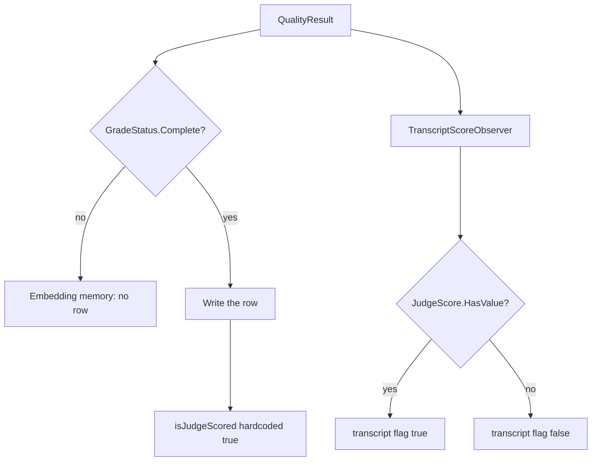

# Plan: Stamp embedding-memory rows from the judge score (#319)

**Status:** Awaiting David's approval. This pull request adds the plan only. No code changes until David signs off, by a comment on [#319](https://github.com/davidpizon/TotallyHot-ArcRouter/issues/319) or on this pull request. The issue being open is not approval.
**Issue:** [#319](https://github.com/davidpizon/TotallyHot-ArcRouter/issues/319) — `EmbeddingMemoryScoreObserver` stamps every `Complete` grade as judge-scored.
**Standing rule:** [Approved plan before coding](../router/standing-rules.md#approved-plan-before-coding). The implementation pull request links this file.
**Precedes:** [#304](https://github.com/davidpizon/TotallyHot-ArcRouter/issues/304). Do not start #304's learning writes until this flag is fixed. #304's plan is not edited here.
**Found in:** [#315](https://github.com/davidpizon/TotallyHot-ArcRouter/issues/315) item #20 (G3). The docs correction is [#318](https://github.com/davidpizon/TotallyHot-ArcRouter/pull/318), merged. That pull request did not change the stamp.
**Audit base:** `main` at `770d02a1` (2026-10-21), which is the #318 merge. Re-read `EmbeddingMemoryScoreObserver.ObserveAsync` before editing. A shifted line is not a reason to change the decision.

This plan pull request **closes nothing**.

## 1. Observed cost

[ADR-0008 Amendment 1](../adr/0008-codegraph-serena-dual-engine-code-smell-pipeline.md#amendment-1-2026-09-02-stop-rules) asks for an observed cost, not a name. This is not a smell cleanup.

The cost is the bug. `EmbeddingMemoryScoreObserver` writes `isJudgeScored: true` for every `GradeStatus.Complete` row, including a row whose `JudgeScore` has no value. `TranscriptScoreObserver` passes `result.JudgeScore.HasValue` for the same fact. `JudgeRowPolicy.Exclude` and `DownWeight` then treat a non-judge grade as judge-verified. The default policy is `Include`, so the weight is the same today. The stored flag is already wrong, and #304 will make a `Complete` grade with no judge score a normal write (prose is judge-only; after takeover a local grader can fill an axis that is not `JudgeScore`). Learning from that population as if the judge had answered is the failure #293 and [ADR-0026](../adr/0026-grade-a-response-only-against-its-question-and-learn-only-from-complete-grades.md) exist to stop.

## 2. What the code does now



Verified on `770d02a1`:

- `EmbeddingMemoryScoreObserver.ObserveAsync` returns before the write when `GradeStatus` is not `Complete`. The write then passes `isJudgeScored: true`. It does not read `JudgeScore`.
- `GradeStatusCalculator.Calculate` returns `Complete` only when every positive-weight axis scored. Shipped weights in `appsettings.json` set `Judge` to 0.60 on all nine dimensions, so a `Complete` grade from that calculator has a `JudgeScore` today. A dimension whose judge weight is 0, or a caller that sets `GradeStatus.Complete` without going through the calculator, does not. The observer does not check.
- `TranscriptScoreObserver` passes `result.JudgeScore.HasValue`. `EmbeddingBackfillService` copies `transcript.IsJudgeScored` onto the memory row it creates, and links that row. The live observer does not.
- `grade_receipts.prompt_version` is set only when `JudgeScore.HasValue` (`GradeReceiptRecordObserver`). Receipts are an audit table. `memory_entries` has no `correlation_id`, so a stored memory row cannot be joined to a receipt or to `grader_scores`.
- The #293 purge runs once. `RouterMemoryDatabase.MigrateIssue293LiveLearningPurge` returns immediately when `schema_meta` already holds `issue-293-live-learning-purge`. It deleted every `memory_entries` row, the `live:` tallies, `grader_scores`, and `judge_shadow_scores`. It did not delete `grade_receipts`, transcripts, or benchmark rows. It must not be reset or run again.
- `JudgeRowPolicy`'s summary says every `Complete` live row is judge-scored by construction. That sentence is the #293 plan §2.5 choice. This plan reverses the flag, not the learning gate.

## 3. The code change

One assignment, in `EmbeddingMemoryScoreObserver.ObserveAsync`:

```csharp
isJudgeScored: result.JudgeScore.HasValue
```

in place of `isJudgeScored: true`.

That is the whole behavior change.

- A `Complete` grade with a judge score still writes a row with the flag true.
- A `Complete` grade with no judge score still writes a row. The learning gate stays `GradeStatus.Complete`. The flag is false.
- `StructureOnly` and `Incomplete` still write nothing.
- `TranscriptScoreObserver` is not edited. The two observers then use the same boolean.
- Do not change `GradeStatusCalculator`, the weights, `JudgeRowPolicy`'s default (`Include`), or the cost written on a pending-cost cache miss. That miss stores 0 today. Unknown cost is null, and that miss is #304 / #290, not this bug.

Comments that describe the old stamp, updated in the same change so they match the assignment:

- The class summary and the inline comment on `EmbeddingMemoryScoreObserver`.
- `MemoryEntry.IsJudgeScored` and `EmbeddingMemory.AddEntryAsync`'s `isJudgeScored` parameter, which currently say the observer does not consult `HasValue`.
- `JudgeRowPolicy`'s summary, which says every `Complete` live row is judge-scored by construction. After this change that is no longer true. The default stays `Include`.

C# / .NET only. No Python. No new service. No change to `ManagementFacade`. Serilog templates stay static string literals. The hot path is one boolean read on a grade that is already off the request thread. No new allocation.

## 4. Rows already stored

`memory_entries` cannot be re-derived from `grade_receipts`. There is no shared key. `prompt_version` being null means "no judge score" only on a receipt you can find, and retention may already have deleted the receipt. Matching a memory row to a receipt by model, score, and time would invent a provenance. Accuracy wins over a faster cleanup. An unknown flag stays as stored. It is not rewritten to a guess, and it is not turned into null: the column is a non-null bool.

| Option | What it does | Recommendation |
|---|---|---|
| Leave the rows | New writes use `HasValue`. Rows already stored keep the flag they have. | **Yes.** |
| Re-derive | Set `memory_entries.is_judge_scored` from a receipt or a `grader_scores` judge row. | No. No join key. A fuzzy match would write a fact we do not have. Backfill rows already copied the transcript flag, which `TranscriptScoreObserver` set correctly, and only those rows are linked. |
| Purge | Delete live memory again, the way #293 did. | No. The #293 purge already ran, once, under `issue-293-live-learning-purge`. Resetting that marker would delete rows that really did have a judge score, which is the common case under the shipped 0.60 judge weight. A second purge needs its own marker and David's say-so. It is not the default. |

Do not add `correlation_id` to `memory_entries` in this change. That would be a new column so a later repair can join. It does not fix the rows already written, and it is not required to make new stamps correct.

## 5. Tests

In `EmbeddingMemoryScoreObserverTests`:

- New test: `GradeStatus.Complete`, no `JudgeScore`, pending embedding present. The row is written. `IsJudgeScored` is false. Score, cost, and the exploratory fields stay as they are today.
- Existing `ObserveAsync_JudgeScoreContributed_StampsIsJudgeScoredTrue` stays: a judge score still stamps true.
- Existing incomplete-grade test stays: no row.

`TranscriptScoreObserver` is the regression, and it already has both sides:

- `ObserveAsync_ResultWithCorrelationId_BackfillsClampedScore` asserts the flag is false when `JudgeScore` is absent.
- `ObserveAsync_JudgeScoreContributed_BackfillsIsJudgeScoredTrue` asserts true when it is present.

Do not change those tests. They are the parity check: the same `QualityResult` produces the same flag in both observers. Run `TotallyHotArcRouter.Tests`. The build stays warning-free (`TreatWarningsAsErrors`, XML docs on the touched members).

## 6. Docs the implementation updates

After the assignment is true, these sentences are updated so they describe the shipped flag. This plan pull request does not edit them.

- `docs/router/geval-shadow-scoring-plan.md`: the header and the "What actually shipped, and what is still owed" bullets. G3's provenance flag on the embedding-memory path is then the `HasValue` rule. Do not mark the rest of G3 (non-executable-only scope, the old blend story) as if this flag completed it. Say the flag now matches `TranscriptScoreObserver`, and name #319.
- `docs/README.md`, the G-Eval row (around line 80): the same sentence, so it does not keep saying the observer skips `HasValue`.
- `src/PLAN.md`, the G1–G3 row: it carries that same sentence today. Update it with the other two so the three places #315 kept together do not split again.
- The observer comment, as in §3.

Closed plans and accepted ADRs are amended in place, with a dated note that names #319. Do not delete the history. The note belongs in the implementation, and only if David accepts decision 2 below.

## 7. Open decisions for David

Each one has a recommendation. The implementation does not start until these are answered, including an answer of "use the recommendation."

1. **Is `JudgeScore.HasValue` the definition of the flag?** Recommendation: yes. Same boolean `TranscriptScoreObserver` already uses. A later local grader that writes `JudgeScore` will count as judge-scored. Telling that grader apart from G-Eval is #304's storage choice, not a second rule in this observer.
2. **Amend ADR-0026 and the #293 plan §2.5 sentence that every new live row is judge-scored by construction?** Recommendation: yes, a dated note in the implementation. Do not change the `Complete`-only learning gate, the purge, or the receipt design.
3. **What happens to rows already stored?** Recommendation: leave them (§4). Do not re-derive, and do not purge.
4. **Does #304 wait for this fix?** Recommendation: yes. #304 may keep being planned. Its learning writes should not merge until this flag is in the tree, so a prose or local-grader `Complete` row is not stored as judge-verified when no judge score exists.

## 8. Out of scope

- The #304 design, its ADR, and its weights.
- Re-running or editing `MigrateIssue293LiveLearningPurge`.
- `grade_receipts` columns, retention, or question HMAC.
- Recording cost 0 when the pending cost cache misses.
- Changing `JudgeRowPolicy` away from `Include`.
