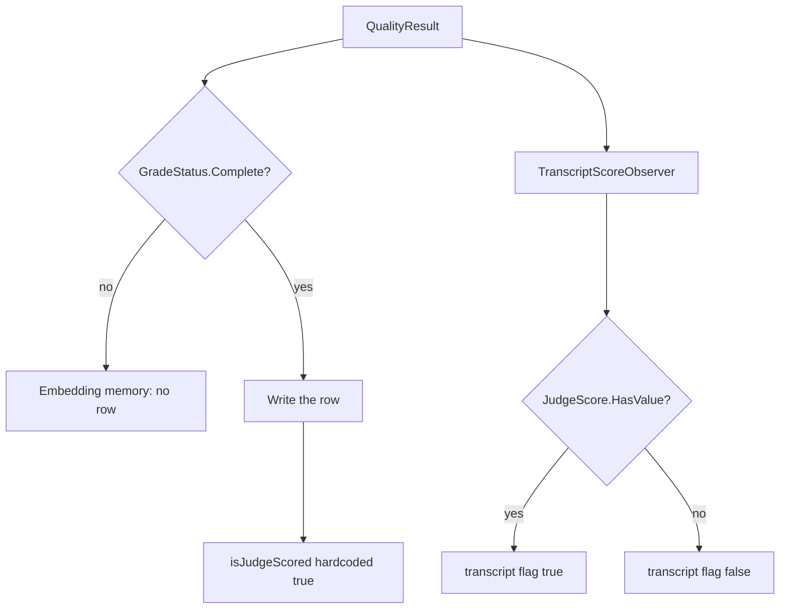

# Plan: Stamp embedding-memory rows from the judge score (#319)

**Status:** Implemented. [#327](https://github.com/davidpizon/TotallyHot-ArcRouter/pull/327) merged the stamp (`isJudgeScored: result.JudgeScore.HasValue`), the one-time purge (`issue-319-untrusted-judge-provenance-purge`), the comment rewrites in §6, and the dated notes on ADR-0026 and the #293 plan §2.5. Decisions recorded 2026-10-21 (§7). Plan text landed via [#320](https://github.com/davidpizon/TotallyHot-ArcRouter/pull/320), [#321](https://github.com/davidpizon/TotallyHot-ArcRouter/pull/321), and [#325](https://github.com/davidpizon/TotallyHot-ArcRouter/pull/325). CodeGraph + Serena (2026-10-22) re-checked `EmbeddingMemoryScoreObserver.ObserveAsync` and `MigrateIssue319UntrustedJudgeProvenancePurge` on `main` at `547439de`; both match this plan. No further code change is owed here. **2026-10-22 (issue #326):** #326 replaces the comments §6 quotes. Those quoted blocks stay: they were the correct text for the code #319 shipped.
**Issue:** [#319](https://github.com/davidpizon/TotallyHot-ArcRouter/issues/319) — `EmbeddingMemoryScoreObserver` stamps every `Complete` grade as judge-scored.
**Standing rule:** [Approved plan before coding](../router/standing-rules.md#approved-plan-before-coding). The implementation pull request linked this file (#327).
**Precedes:** [#304](https://github.com/davidpizon/TotallyHot-ArcRouter/issues/304). #304's learning writes may proceed; this fix is in the tree. #304's plan is not edited here.
**Found in:** [#315](https://github.com/davidpizon/TotallyHot-ArcRouter/issues/315) item #20 (G3). The docs correction is [#318](https://github.com/davidpizon/TotallyHot-ArcRouter/pull/318), merged. That pull request did not change the stamp.
**Audit base:** Implementation landed on `main` at `547439de` (#327). The plan was written against `770d02a1` (#318).

This closeout pull request closes [#319](https://github.com/davidpizon/TotallyHot-ArcRouter/issues/319).

## 1. Observed cost

[ADR-0008 Amendment 1](../adr/0008-codegraph-serena-dual-engine-code-smell-pipeline.md#amendment-1-2026-09-02-stop-rules) asks for an observed cost, not a name. This is not a smell cleanup.

The cost is the bug. `EmbeddingMemoryScoreObserver` writes `isJudgeScored: true` for every `GradeStatus.Complete` row, including a row whose `JudgeScore` has no value. `TranscriptScoreObserver` passes `result.JudgeScore.HasValue` for the same fact. `JudgeRowPolicy.Exclude` and `DownWeight` then treat a non-judge grade as judge-verified. The default policy is `Include`, so the weight is the same today. Under the shipped weights a `Complete` grade from `GradeStatusCalculator` has a `JudgeScore`, so the hardcoded true has matched `HasValue` for those rows. The flag on the row still does not record that. A dimension whose judge weight is 0, or any `Complete` result that did not come from the calculator, stores true with no judge score, and the row does not say which case it was. #304 will make a `Complete` grade with no judge score a normal write (prose is judge-only; after takeover a local grader can fill an axis that is not `JudgeScore`). Learning from that population as if the judge had answered is the failure #293 and [ADR-0026](../adr/0026-grade-a-response-only-against-its-question-and-learn-only-from-complete-grades.md) exist to stop.

## 2. What the code does now



Verified on `770d02a1`:

- `EmbeddingMemoryScoreObserver.ObserveAsync` returns before the write when `GradeStatus` is not `Complete`. The write then passes `isJudgeScored: true`. It does not read `JudgeScore`. That observer is the only caller of `EmbeddingMemory.AddEntryAsync`.
- `GradeStatusCalculator.Calculate` returns `Complete` only when every positive-weight axis scored. Shipped weights in `appsettings.json` set `Judge` to 0.60 on all nine dimensions, so a `Complete` grade from that calculator has a `JudgeScore` today. A dimension whose judge weight is 0, or a caller that sets `GradeStatus.Complete` without going through the calculator, does not. The observer does not check.
- `TranscriptScoreObserver` passes `result.JudgeScore.HasValue`. `EmbeddingBackfillService` copies `transcript.IsJudgeScored` onto the memory row it creates, then sets `request_transcripts.memory_entry_id`. The live observer does not link the transcript. A stored `is_judge_scored = 0` cannot have come from the live observer. A stored `1` can have come from the live observer or from a backfill of a transcript the judge did score. This database has no column that says which.
- `grade_receipts.prompt_version` is set only when `JudgeScore.HasValue` (`GradeReceiptRecordObserver`). Receipts are an audit table. `memory_entries` has no `correlation_id`, so a stored memory row cannot be joined to a receipt or to `grader_scores`.
- The #293 purge runs once. `RouterMemoryDatabase.MigrateIssue293LiveLearningPurge` returns immediately when `schema_meta` already holds `issue-293-live-learning-purge`. It deleted every `memory_entries` row, the `live:` tallies, `grader_scores`, and `judge_shadow_scores`. It did not delete `grade_receipts`, transcripts, or benchmark `dimension_scores`. That marker is not reset and that method is not edited.
- `dimension_scores` has no `is_judge_scored` column. `RouterMemoryScoreObserver` adds a `Complete` score under the `live:` prefix and does not store a judge flag.
- `JudgeRowPolicy`'s summary says every `Complete` live row is judge-scored by construction. That sentence is the #293 plan §2.5 choice. This plan reverses the flag, not the learning gate.

## 3. The code change

One assignment, in `EmbeddingMemoryScoreObserver.ObserveAsync`:

```csharp
isJudgeScored: result.JudgeScore.HasValue
```

in place of `isJudgeScored: true`.

- A `Complete` grade with a judge score still writes a row with the flag true.
- A `Complete` grade with no judge score still writes a row. The learning gate stays `GradeStatus.Complete`. The flag is false. **Decided 2026-10-21:** judge-scored means `JudgeScore.HasValue`.
- `StructureOnly` and `Incomplete` still write nothing.
- `TranscriptScoreObserver` is not edited. The two observers then use the same boolean.
- Do not change `GradeStatusCalculator`, the weights, `JudgeRowPolicy`'s default (`Include`), or the cost written on a pending-cost cache miss. That miss stores 0 today. Unknown cost is null, and that miss is #304 / #290, not this bug.

The other behavior change is the one-time purge in §4. It runs from `RouterMemoryDatabase.EnsureCreated`, after `MigrateIssue293LiveLearningPurge` returns, and only when its own marker is absent. On a database that does not yet have `issue-293-live-learning-purge`, that method still runs first and deletes every `memory_entries` row, including `is_judge_scored = 0`. This purge does not change that. The keep-list in §4.2 is what this purge itself leaves when the #293 marker is already present.

Comments that describe the old stamp, updated in the same change so they match the assignment:

- The class summary and the inline comment on `EmbeddingMemoryScoreObserver`.
- `MemoryEntry.IsJudgeScored` and `EmbeddingMemory.AddEntryAsync`'s `isJudgeScored` parameter, which currently say the observer does not consult `HasValue`.
- `JudgeRowPolicy`'s summary, which says every `Complete` live row is judge-scored by construction. After this change that is no longer true. The default stays `Include`. The 2026-10-22 note in §6 names `RoutingOptions.JudgeScoredRowPolicy`, `JudgeRowPolicy.DownWeight`, and `JudgeRowPolicy.Include`, which repeat that claim, and gives the replacement wording. Rewrite those three to that wording in the same change.

C# / .NET only. No Python. No new service. No change to `ManagementFacade`. Serilog templates stay static string literals. The hot path is one boolean read on a grade that is already off the request thread. No new allocation. The purge is startup migration, not the request path.

## 4. Rows already stored

**Decided 2026-10-21:** do not leave the rows, and do not re-derive them. Purge the live learning rows whose `isJudgeScored` provenance cannot be trusted, and start fresh. A fuzzy match on model, score, and time would invent a provenance. `grade_receipts` stays the audit record it already is. It is not a repair source.

The #293 purge is a different migration. Do not clear `issue-293-live-learning-purge`, do not change `MigrateIssue293LiveLearningPurge`, and do not delete the tables that purge deleted. This purge has its own marker, `issue-319-untrusted-judge-provenance-purge`, in `schema_meta` inside `router_embedding_memory.db`. If the key is present, the method returns without deleting and without opening `transcripts.db`. The value is the UTC timestamp of the run, the same shape as the #293 marker (`DateTimeOffset.UtcNow` formatted with `"O"`). The marker is written only after the memory delete and the transcript-link clear in §4.3 have both succeeded. The router logs one static Serilog line with the deleted-row count and the cleared-link count. If a write-ahead log is busy, log the same kind of static warning `MigrateIssue293LiveLearningPurge` already logs, and do not fail startup.

Finality matches the #293 purge and [ADR-0024](../adr/0024-protect-the-machine-shared-data-directory-and-make-deletion-final.md): after the delete, truncate the write-ahead log the way `MigrateIssue293LiveLearningPurge` does, then `VACUUM`. The migration is not reversible. Take a copy of `router_embedding_memory.db` and of `transcripts.db` first if you want one.

### 4.1 What is deleted

In `router_embedding_memory.db` only:

| Rows | Why |
|---|---|
| Every `memory_entries` row with `is_judge_scored = 1` | This is the only value the live observer writes, and this database cannot show whether that `1` was `JudgeScore.HasValue` or the hardcoded true. Under shipped weights (`Judge` 0.60) a calculator `Complete` always has a `JudgeScore`, so those live rows matched `HasValue`. A `1` may also be a backfill of a transcript the judge really did score, which copies the trusted flag. `memory_entries` has no `correlation_id`, and the transcript link lives in the other database, so the two cannot be separated. Both are deleted. That is the cost of starting fresh instead of re-deriving. |

No other table is deleted from. The one column update, on the other file, is §4.3.

### 4.2 What is kept

| Rows | Why |
|---|---|
| `memory_entries` where `is_judge_scored = 0` | The live observer has never stored 0. After the #293 purge, a 0 is a backfill copy of a transcript `TranscriptScoreObserver` marked not judge-scored (`EmbeddingBackfillService` copies `transcript.IsJudgeScored`), or a row that omitted the column and took `DEFAULT 0`. That flag can be trusted, so these rows stay. `EnsureCreated_OnCopiedLegacyDatabase_PurgesLiveLearningOnce` does not guard this. Its post-marker insert happens after the first `EnsureCreated`, which will already have written the #319 marker, so that row survives even a `DELETE FROM memory_entries`. The new test in §5 is the guard. |
| `dimension_scores`, including every `live:` tally and every benchmark key such as `code_generation` | No `is_judge_scored` column. The aggregate is a `Complete` score, not a judge-provenance flag. #293 deleted `live:` tallies because the scoring rule changed. This fix does not. |
| `grader_scores` and `judge_shadow_scores` | Audit and shadow rows. A judge row here is not the flag kNN and the trainers read. Deleting them would not repair `memory_entries`. |
| `grade_receipts`, including `prompt_version` | Unchanged, per decision 2. `prompt_version` is null when no judge score existed. Retention is unchanged. |
| `schema_meta` key `issue-293-live-learning-purge` | Left as stored. The new key is separate. |
| `router_settings` and any other table in this file | Not the flag. |
| `request_transcripts`, except the `memory_entry_id` values §4.3 clears | The transcript flag is the trusted `HasValue` stamp. `is_judge_scored`, `score`, prompt text, response text, and every column other than the cleared links stay. A link to a kept `is_judge_scored = 0` row stays. The live observer never set `memory_entry_id`, so transcripts it never linked stay eligible for `LoadUnembeddedScoredAsync`. Embedding backfill defaults off. This plan does not change `EmbeddingBackfillService`. |
| Trained cluster and logreg artifacts | Not the rows. The next training pass reads whatever `memory_entries` remains. This purge does not delete model files. |

Do not add `correlation_id` to `memory_entries` in this change.

### 4.3 Links in the transcript file

**Decided 2026-10-21.** The purge also clears `request_transcripts.memory_entry_id` values that point at `memory_entries` rows this purge deletes. Set those values to NULL. Every other column on `request_transcripts` stays, including `is_judge_scored`, `score`, and the prompt and response text.

The two tables are not in the same file.

| Table | File | How the path is resolved |
|---|---|---|
| `memory_entries`, and the marker in `schema_meta` | `router_embedding_memory.db` | `RoutingOptions.EmbeddingMemoryDatabasePath`. A relative path is combined with `AppDataPaths.ResolveMachineSharedDirectory()`. |
| `request_transcripts` | `transcripts.db` | `StorageOptions.TranscriptDatabasePath`, default `%PROGRAMDATA%\transcripts.db`, resolved by `StorageOptions.ResolveTranscriptDatabasePath()`. |

There is no shared transaction. Do not `ATTACH` one file to the other. Use the one marker already named in §4, `issue-319-untrusted-judge-provenance-purge`, stored in `router_embedding_memory.db`. Do not add a companion marker on `transcripts.db`. That file has no copy of the deleted ids, so a second marker there could not tell which links this purge owned.

Write the marker only after both steps have succeeded. If the key is already present, return without opening `transcripts.db` and without deleting. Order:

1. Read the `id` values of `memory_entries` where `is_judge_scored = 1`. Keep that list. Do not delete yet. If the list is empty, skip the transcript update. An empty `IN` list is not valid SQL. Still write the marker after the delete of zero rows, so the next startup returns at the marker. Bind a non-empty list in chunks that fit SQLite's variable limit. A chunk that commits is safe to run again.
2. On `transcripts.db`: if the file does not exist, skip this step and do not create the file. If it exists, run `UPDATE request_transcripts SET memory_entry_id = NULL WHERE memory_entry_id IN (those ids)`. That statement is the step that must succeed. Then truncate that file's write-ahead log the way `TranscriptDatabase.RunStartupMaintenance` does. A busy log logs one static warning. The update is already committed, so a busy log does not fail the purge and does not block the delete.
3. If the update in step 2 throws, stop. Do not delete the memory rows and do not write the marker. Log one static warning. The next startup still has the ids and retries both steps. A missing file is not a failure.
4. Delete the `is_judge_scored = 1` rows, write the marker, then truncate and `VACUUM` `router_embedding_memory.db` as §4 already says.

A link is cleared only when its `memory_entry_id` is in the id list from step 1. These stay: a link to a kept `is_judge_scored = 0` row, a `memory_entry_id` that is already NULL, and an id that was already dangling before this purge. The #293 purge removed rows whose ids are no longer in `memory_entries`, so those ids are not in the list. Doing the update before the delete is what makes a crash safe. After the rows are gone, the transcript file cannot tell a link this purge removed from a link that was already dangling. A retry that still sees the rows runs the same update, which sets NULL again and changes nothing else, then deletes and writes the marker.

`PersistedSessionAggregator` sets `IsUsedForTraining` when any turn's `MemoryEntryId` is not null. Clearing these links is what keeps that label from saying a deleted row was used for training. A session that still links a kept `0` stays labeled.

`LoadUnembeddedScoredAsync` selects `memory_entry_id IS NULL`, so a cleared link is eligible for embedding backfill again. Backfill defaults off (`TranscriptOptions.EnableEmbeddingBackfill` is false, and `appsettings.json` does not set it). If it is on, `EmbeddingBackfillService` may later insert a new memory row and copy `transcript.IsJudgeScored`. That insert is the existing service. This migration does not rebuild the deleted row, and it does not change backfill.

Every production construction passes the transcript path from `StorageOptions.ResolveTranscriptDatabasePath()`. There are two. The DI singleton is `services.AddSingleton<RouterMemoryDatabase>()`. The private instance is the one the `RouterSettingsStore` factory in `RouterServiceCollectionExtensions` builds with `RoutingOptions` only today. That private instance runs `EnsureCreated` first, from `RouterSettingsStore`'s constructor, so it is the one that writes the marker. In that factory, read the path from `sp.GetRequiredService<IOptions<StorageOptions>>()`. `StorageOptions` binds from `IConfiguration` only (`PriceCatalogServiceCollectionExtensions`), so this does not create a cycle with `RoutingOptions`. The new test passes the path of the transcript copy and does not open the machine-default transcript file. A missing transcript path is allowed only for the `RoutingOptions`-only constructor the existing #293 tests use. In that case, skip the update, do not throw, and still delete and write the marker. Do not use that missing-path branch in production. A production run that deleted the rows and wrote the marker without the path could never clear the links, because the ids would already be gone.

## 5. Tests

In `EmbeddingMemoryScoreObserverTests`:

- New test: `GradeStatus.Complete`, no `JudgeScore`, pending embedding present. The row is written. `IsJudgeScored` is false. Score, cost, and the exploratory fields stay as they are today.
- Existing `ObserveAsync_JudgeScoreContributed_StampsIsJudgeScoredTrue` stays: a judge score still stamps true.
- Existing incomplete-grade test stays: no row.

`TranscriptScoreObserver` is the regression, and it already has both sides:

- `ObserveAsync_ResultWithCorrelationId_BackfillsClampedScore` asserts the flag is false when `JudgeScore` is absent.
- `ObserveAsync_JudgeScoreContributed_BackfillsIsJudgeScoredTrue` asserts true when it is present.

Do not change those tests. They are the parity check: the same `QualityResult` produces the same flag in both observers.

Purge test, same shape as `GradeReceiptStoreTests.EnsureCreated_OnCopiedLegacyDatabase_PurgesLiveLearningOnce`. Build the seed with raw SQL on a file that already has the current `memory_entries` columns, including `is_judge_scored`. Insert `schema_meta` key `issue-293-live-learning-purge` and no `issue-319-untrusted-judge-provenance-purge` key. Copy that file, and open only the copy through `RouterMemoryDatabase.EnsureCreated`. Before opening the copy, assert the source has no #319 key.

Do not create the seed by calling `EnsureCreated` after this migration exists. That call writes the #319 marker, the copy then skips the purge, and the delete assertion fails. A file that lacks the `is_judge_scored` column is also the wrong seed: `MigrateIsJudgeScoredColumn` adds it with `DEFAULT 0` before this purge runs, so a row meant to be `1` is stored as `0` and is kept. Without the #293 marker, `MigrateIssue293LiveLearningPurge` deletes the `0` row first, and the keep assertion tests #293 rather than this purge.

Do not edit the existing #293 tests. `EnsureCreated_OnCopiedLegacyDatabase_PurgesLiveLearningOnce` inserts its post-marker row after the first `EnsureCreated`, which will already have written the #319 marker, so that row survives because of the marker, not because of this predicate. Do not cite that test as proof the predicate keeps `0`s.

- The memory copy loses every `memory_entries` row with `is_judge_scored = 1`.
- The memory copy keeps a `memory_entries` row with `is_judge_scored = 0`.
- The memory copy keeps a `grade_receipts` row, a `grader_scores` row, a `judge_shadow_scores` row, a `live:` `dimension_scores` row, and a benchmark `dimension_scores` row.
- The memory copy keeps the existing `issue-293-live-learning-purge` value and gains `issue-319-untrusted-judge-provenance-purge`.
- The memory source file is unchanged.
- A row inserted into the memory copy after the marker, with `is_judge_scored = 1`, is still there after a second `EnsureCreated`. The marker value does not change.

The same test uses a copied `transcripts.db`. Point the purge's transcript path at that copy. Build it with raw SQL. Seed four `request_transcripts` rows:

- `memory_entry_id` equal to the id of an `is_judge_scored = 1` memory row. After `EnsureCreated` that column is NULL. `is_judge_scored`, `score`, and every other column on that row are unchanged.
- `memory_entry_id` equal to the id of an `is_judge_scored = 0` memory row. After `EnsureCreated` that value is unchanged.
- `memory_entry_id` already NULL. It stays NULL.
- `memory_entry_id` set to an id that matches no row in the memory copy (already dangling, and not an id this purge deletes). It stays unchanged.

The transcript source file is unchanged. After the marker, insert a new `is_judge_scored = 1` memory row and a transcript row whose `memory_entry_id` is that new id. A second `EnsureCreated` leaves that new link set.

In a separate test, copy the same memory seed again: the #293 key present, no #319 key, one `is_judge_scored = 1` row, and one `is_judge_scored = 0` row. Point the transcript path at a file that does not exist. After `EnsureCreated`, the `1` row is gone, the `0` row stays, the #319 key is present, and the transcript path still does not exist.

Run `TotallyHotArcRouter.Tests`. The build stays warning-free (`TreatWarningsAsErrors`, XML docs on the touched members). The purge test stays under the 5-second cap.

## 6. Docs the implementation updates

After the assignment and the purge are true, these sentences are updated so they describe the shipped flag. This plan pull request does not edit them.

- `docs/router/geval-shadow-scoring-plan.md`: the header and the "What actually shipped, and what is still owed" bullets. G3's provenance flag on the embedding-memory path is then the `HasValue` rule. Do not mark the rest of G3 (non-executable-only scope, the old blend story) as if this flag completed it. Say the flag now matches `TranscriptScoreObserver`, and name #319.
- `docs/README.md`, the G-Eval row (around line 80): the same sentence, so it does not keep saying the observer skips `HasValue`.
- `src/PLAN.md`, the G1–G3 row: it carries that same sentence today. Update it with the other two so the three places #315 kept together do not split again.
- The observer comment, as in §3.
- [ADR-0026](../adr/0026-grade-a-response-only-against-its-question-and-learn-only-from-complete-grades.md) and `docs/plans/issue-293-graders-judge-against-the-question.md` §2.5. **Decided 2026-10-21:** add a dated correction note in the implementation. Do not delete the old text. Do not change the `Complete`-only learning gate, the #293 purge, or `grade_receipts`.
  - The sentence "every new live row is judge-scored by construction" is §2.5 of the #293 plan (`MemoryEntry.IsJudgeScored` is true for every new live row). The note says that sentence described the stamp this plan removes, and that the flag is now `JudgeScore.HasValue`.
  - ADR-0026 does not contain that sentence. Its decision is the `Complete`-only gate, `JudgeRowPolicy` default `Include`, and the one-time #293 purge (decision point 6). The note, dated 2026-10-21, says a `Complete` grade no longer means the embedding-memory row is judge-scored, names #319, and records the second purge in §4. It does not reopen decision point 6.
- **2026-10-22.** `RoutingOptions.JudgeScoredRowPolicy` and `JudgeRowPolicy.DownWeight` still say every `Complete` live row is judge-scored. `JudgeRowPolicy.Include` says the same thing in other words ("only question-aware complete grades survive the learning gate"). After the assignment in §3 (`isJudgeScored: result.JudgeScore.HasValue`), a `Complete` grade with no `JudgeScore` is still written, and the row is stored with `is_judge_scored = 0`. `AGENTS.md` treats a stale XML doc as a missing doc, so the implementation rewrites all three to the wording below. This plan pull request leaves the C# files unchanged. The default stays `Include`.

  `JudgeRowWeighting.ResolveWeight` (`src/TotallyHotArcRouter/Models/JudgeRowWeighting.cs` line 28) returns `1.0` when `isJudgeScored` is false. The policy switch on lines 30-35 does not run for that row. That return is how every value of `RoutingOptions.JudgeScoredRowPolicy` treats an `is_judge_scored = 0` row, and how `JudgeRowPolicy.DownWeight` treats one: the row stays, at multiplier `1.0`. Consumers apply the return as-is:

  - `MemoryKnnVoter.VoteAsync` (`src/TotallyHotArcRouter/Router/Orchestrator/MemoryKnnVoter.cs` lines 59-63) takes that weight and multiplies neighbor similarity by it. The row stays in the average at its full similarity.
  - `EmbeddingMemory.FindNearest` (`src/TotallyHotArcRouter/Router/EmbeddingMemory.cs` lines 292-294) applies the judge policy by dropping a neighbor only when `ResolveWeight` returns null. Length, embedding-model, and similarity checks still apply (lines 286-290 and 298). This row passes the judge-policy check.
  - `ClusterLedger.Build` (`src/TotallyHotArcRouter/Router/Orchestrator/ClusterLedger.cs` lines 74-81) skips a row on the judge policy only when the weight is null, then adds `score * weight` and increments `ObservationCount`. Dimension and assignment-threshold checks still apply (lines 69 and 72). This row contributes its score at `1.0` and counts as an observation. Any non-null weight is counted, including a judge-scored row that `DownWeight` scaled (line 81).
  - `EmbeddingLogRegTrainingService` (`src/TotallyHotArcRouter/Router/Orchestrator/EmbeddingLogRegTrainingService.cs` lines 150-161) skips a row on the judge policy only when the weight is null, and otherwise stores `LogRegLiveSampleWeight * 1.0`. Dimension and embedding-model skips still apply (lines 125-136 and 138-148). `ClusterTrainingService` (`src/TotallyHotArcRouter/Router/Orchestrator/ClusterTrainingService.cs` lines 156-164) does the same with `ClusterLiveSampleWeight * 1.0`. Its dimension and embedding-model skips are lines 133-144 and 146-154.
  - `MemoryKnnVoterTests.VoteAsync_DownWeightPolicy_PullsTheWeightedAverageTowardTheNonJudgeScoredNeighbor` (`src/TotallyHotArcRouter.Tests/Router/Orchestrator/MemoryKnnVoterTests.cs` lines 150-174) stores a non-judge `0.9` beside a judge-scored `0.3`. `Include` averages them to `0.6` (the `0` row at weight 1). `DownWeight` at `0.5` yields `(0.9 * 1 + 0.3 * 0.5) / 1.5 = 0.7`. `Exclude` drops the judge-scored neighbor and leaves `0.9` (the assertion is line 174). `ClusterLedgerTests.Build_DownWeightPolicy_WeightsTheMeanButNotTheObservationCount` (`src/TotallyHotArcRouter.Tests/Router/Orchestrator/ClusterLedgerTests.cs` lines 123-126) records the same split on the ledger: the non-judge entry is the `* 1` term, and `ObservationCount` stays 2.

  `JudgeRowPolicy.DownWeight`'s own arm is `JudgeRowWeighting.cs` line 34 (`judgeRowWeight <= 0 ? null : judgeRowWeight`). Line 34 runs only when `isJudgeScored` is true. An `is_judge_scored = 0` row has already returned `1.0` at line 28.

  Replace the summary on `RoutingOptions.JudgeScoredRowPolicy` (`src/TotallyHotArcRouter/Models/RoutingOptions.cs` lines 393-400). The current text says that, after issue #293, only `Complete` grades enter live memory "and every surviving row is judge-scored question-aware evidence". A surviving `Complete` row with no `JudgeScore` is not that evidence. Every value of the property leaves it at multiplier `1.0`, because line 28 returns before `Include`, `Exclude`, or `DownWeight` is applied. The replacement, at the member's existing four-space indent:

  ```csharp
      /// <summary>
      /// Gets how <see cref="Router.Orchestrator.MemoryKnnVoter"/>, the <c>logreg</c>/cluster trainers, and
      /// <see cref="Router.Orchestrator.ClusterLedger"/> treat a <see cref="Router.MemoryEntry"/> whose score
      /// came from the G-Eval judge (<see cref="Router.MemoryEntry.IsJudgeScored"/>) rather than from
      /// execution or heuristic signals alone. Defaults to <see cref="Models.JudgeRowPolicy.Include"/> after
      /// issue #293: only <see cref="TotallyHot.ArcRouter.Quality.GradeStatus.Complete"/> grades enter live
      /// memory (ADR-0026). After issue #319 a surviving row is judge-scored only when <c>JudgeScore</c> has a
      /// value. A row with <c>is_judge_scored = 0</c> keeps multiplier <c>1.0</c> under every value of this
      /// property. <see cref="Models.JudgeRowWeighting.ResolveWeight"/> returns <c>1.0</c> for that row before
      /// <see cref="Models.JudgeRowPolicy.Include"/>, <see cref="Models.JudgeRowPolicy.Exclude"/>, or
      /// <see cref="Models.JudgeRowPolicy.DownWeight"/> is applied, so none of those values removes it from
      /// retrieval, from the weighted mean, or from training.
      /// </summary>
  ```

  Replace the summary on `JudgeRowPolicy.DownWeight` (`src/TotallyHotArcRouter/Models/JudgeRowPolicy.cs` lines 22-26). The current text says the knob is no longer the default "once live memory admits only complete judge-grounded grades." A `Complete` grade with no `JudgeScore` is admitted, and it is not judge-grounded. `DownWeight` leaves that row at multiplier `1.0` (line 28). Line 34 scales a judge-scored row when `judgeRowWeight` is positive and drops it when `judgeRowWeight` is 0 or less (`judgeRowWeight <= 0 ? null : judgeRowWeight`). On the ledger the `0` row stays in the weighted mean at full strength. `ClusterLedger.Build` line 81 counts every row the policy keeps, scaled or not, as one observation, so this row is counted too. The replacement, at the member's existing four-space indent:

  ```csharp
      /// <summary>
      /// A judge-scored row's contribution is scaled by <see cref="RoutingOptions.JudgeScoredRowWeight"/>
      /// when that weight is positive, and dropped when it is 0 or less. Kept as an operator knob, and no
      /// longer the default after issue #293. A row with <c>is_judge_scored = 0</c> keeps multiplier
      /// <c>1.0</c>. <see cref="JudgeRowWeighting.ResolveWeight"/> returns that weight before this policy is
      /// consulted. A <see cref="TotallyHot.ArcRouter.Quality.GradeStatus.Complete"/> grade with no
      /// <c>JudgeScore</c> (issue #319) stays at full strength in the weighted mean.
      /// <see cref="Router.Orchestrator.ClusterLedger"/> counts every row this policy keeps, scaled or not,
      /// as one observation.
      /// </summary>
  ```

  Replace the summary on `JudgeRowPolicy.Include` (`src/TotallyHotArcRouter/Models/JudgeRowPolicy.cs` lines 13-16). The current text says it is the default "because only question-aware complete grades survive the learning gate." The learning gate stays `Complete`. A `Complete` grade with no `JudgeScore` also survives, and it is not question-aware. Under `Include`, line 28 returns `1.0` for that row and line 32 returns `1.0` for a judge-scored row, so the two contribute at the same strength. The replacement, at the member's existing four-space indent:

  ```csharp
      /// <summary>
      /// A judge-scored row is treated exactly like any other row. The default after issue #293 (ADR-0026).
      /// A row with <c>is_judge_scored = 0</c> keeps multiplier <c>1.0</c>.
      /// <see cref="JudgeRowWeighting.ResolveWeight"/> returns that weight before this policy is consulted,
      /// and this value also returns <c>1.0</c> for a judge-scored row, so a
      /// <see cref="TotallyHot.ArcRouter.Quality.GradeStatus.Complete"/> grade with no <c>JudgeScore</c>
      /// (issue #319) contributes at the same full strength.
      /// </summary>
  ```

## 7. Decisions (David, 2026-10-21)

These were the open questions. They are decided. The recommendations are kept so the record shows where decision 3 differs.

1. **Judge-scored means `JudgeScore.HasValue`.** Decided: yes. Same boolean `TranscriptScoreObserver` already uses. A later local grader that writes `JudgeScore` counts as judge-scored. Telling that grader apart from G-Eval is #304's storage choice, not a second rule in this observer.
2. **Amend ADR-0026 and the #293 plan §2.5 sentence.** Decided: yes, a dated note in the implementation, as §6 specifies. The learning gate, the #293 purge, and `grade_receipts` stay as they are. The §2.5 sentence stays in place with the note beside it. ADR-0026's note sits on the decision; it does not rewrite decision point 6.
3. **Rows already stored.** The recommendation was to leave them. Decided: do not leave them. Purge the live learning rows whose `isJudgeScored` provenance cannot be trusted, and start fresh, as §4 specifies. The migration does not rebuild rows and does not re-run the #293 purge. An install that already has embedding backfill on can later insert new rows for transcripts the live observer never linked, and for transcripts whose link §4.3 cleared. Those inserts copy the trusted transcript flag. They are the existing backfill service, not this migration repairing the deleted rows.
4. **#304.** Decided: #304's learning writes wait for this fix. #304 planning may proceed now.
5. **Dangling transcript links.** Added the same day. Decided: the purge sets `request_transcripts.memory_entry_id` to NULL where it points at a `memory_entries` row this purge deletes, as §4.3 specifies. Every other column on `request_transcripts` stays. The label `PersistedSessionAggregator` derives from that column then stays honest.

## 8. Out of scope

- The #304 design, its ADR, and its weights.
- Editing `MigrateIssue293LiveLearningPurge` or resetting `issue-293-live-learning-purge`.
- `grade_receipts` columns, retention, or question HMAC.
- Recording cost 0 when the pending cost cache misses.
- Changing `JudgeRowPolicy` away from `Include`.
- Rebuilding deleted memory rows from transcripts, and any change to `EmbeddingBackfillService`, `EnableEmbeddingBackfill`, or `TranscriptScoreObserver`.
