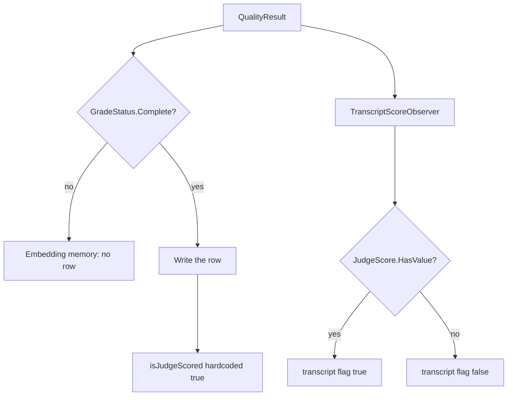

# Plan: Stamp embedding-memory rows from the judge score (#319)

**Status:** Decisions recorded 2026-10-21. David answered the four questions in §7. [#320](https://github.com/davidpizon/TotallyHot-ArcRouter/pull/320) merged the previous text of this file, which still listed those questions as open. This revision records the answers. It is still the plan only. The implementation is a later pull request that links this file. It does not start here.
**Issue:** [#319](https://github.com/davidpizon/TotallyHot-ArcRouter/issues/319) — `EmbeddingMemoryScoreObserver` stamps every `Complete` grade as judge-scored.
**Standing rule:** [Approved plan before coding](../router/standing-rules.md#approved-plan-before-coding). The implementation pull request links this file.
**Precedes:** [#304](https://github.com/davidpizon/TotallyHot-ArcRouter/issues/304). #304 planning may proceed now. #304's learning writes wait until this fix is in the tree. #304's plan is not edited here.
**Found in:** [#315](https://github.com/davidpizon/TotallyHot-ArcRouter/issues/315) item #20 (G3). The docs correction is [#318](https://github.com/davidpizon/TotallyHot-ArcRouter/pull/318), merged. That pull request did not change the stamp.
**Audit base:** `main` at `770d02a1` (2026-10-21), which is the #318 merge. Re-read `EmbeddingMemoryScoreObserver.ObserveAsync` and `MigrateIssue293LiveLearningPurge` before editing. A shifted line is not a reason to change the decision.

This plan pull request **closes nothing**.

## 1. Observed cost

[ADR-0008 Amendment 1](../adr/0008-codegraph-serena-dual-engine-code-smell-pipeline.md#amendment-1-2026-09-02-stop-rules) asks for an observed cost, not a name. This is not a smell cleanup.

The cost is the bug. `EmbeddingMemoryScoreObserver` writes `isJudgeScored: true` for every `GradeStatus.Complete` row, including a row whose `JudgeScore` has no value. `TranscriptScoreObserver` passes `result.JudgeScore.HasValue` for the same fact. `JudgeRowPolicy.Exclude` and `DownWeight` then treat a non-judge grade as judge-verified. The default policy is `Include`, so the weight is the same today. Under the shipped weights a `Complete` grade from `GradeStatusCalculator` has a `JudgeScore`, so the hardcoded true has matched `HasValue` for those rows. The flag on the row still does not record that. A dimension whose judge weight is 0, or any `Complete` result that did not come from the calculator, stores true with no judge score, and the row does not say which case it was. #304 will make a `Complete` grade with no judge score a normal write (prose is judge-only; after takeover a local grader can fill an axis that is not `JudgeScore`). Learning from that population as if the judge had answered is the failure #293 and [ADR-0026](../adr/0026-grade-a-response-only-against-its-question-and-learn-only-from-complete-grades.md) exist to stop.

## 2. What the code does now



Verified on `770d02a1`:

- `EmbeddingMemoryScoreObserver.ObserveAsync` returns before the write when `GradeStatus` is not `Complete`. The write then passes `isJudgeScored: true`. It does not read `JudgeScore`. That observer is the only caller of `EmbeddingMemory.AddEntryAsync`.
- `GradeStatusCalculator.Calculate` returns `Complete` only when every positive-weight axis scored. Shipped weights in `appsettings.json` set `Judge` to 0.60 on all nine dimensions, so a `Complete` grade from that calculator has a `JudgeScore` today. A dimension whose judge weight is 0, or a caller that sets `GradeStatus.Complete` without going through the calculator, does not. The observer does not check.
- `TranscriptScoreObserver` passes `result.JudgeScore.HasValue`. `EmbeddingBackfillService` copies `transcript.IsJudgeScored` onto the memory row it creates, then sets `request_transcripts.memory_entry_id`. The live observer does not link the transcript. A stored `is_judge_scored = 0` cannot have come from the live observer. A stored `1` can have come from the live observer or from a backfill of a transcript the judge did score. This database has no column that says which.
- `grade_receipts.prompt_version` is set only when `JudgeScore.HasValue` (`GradeReceiptRecordObserver`). Receipts are an audit table. `memory_entries` has no `correlation_id`, so a stored memory row cannot be joined to a receipt or to `grader_scores`.
- The #293 purge runs once. `RouterMemoryDatabase.MigrateIssue293LiveLearningPurge` returns immediately when `schema_meta` already holds `issue-293-live-learning-purge`. It deleted every `memory_entries` row, the `live:` tallies, `grader_scores`, and `judge_shadow_scores`. It did not delete `grade_receipts`, transcripts, or benchmark `dimension_scores`. That marker is not reset and that method is not edited.
- `dimension_scores` has no `is_judge_scored` column. `RouterMemoryScoreObserver` adds a `Complete` score under the `live:` prefix and does not store a judge flag.
- `JudgeRowPolicy`'s summary says every `Complete` live row is judge-scored by construction. That sentence is the #293 plan §2.5 choice. This plan reverses the flag, not the learning gate.

## 3. The code change

One assignment, in `EmbeddingMemoryScoreObserver.ObserveAsync`:

```csharp
isJudgeScored: result.JudgeScore.HasValue
```

in place of `isJudgeScored: true`.

- A `Complete` grade with a judge score still writes a row with the flag true.
- A `Complete` grade with no judge score still writes a row. The learning gate stays `GradeStatus.Complete`. The flag is false. **Decided 2026-10-21:** judge-scored means `JudgeScore.HasValue`.
- `StructureOnly` and `Incomplete` still write nothing.
- `TranscriptScoreObserver` is not edited. The two observers then use the same boolean.
- Do not change `GradeStatusCalculator`, the weights, `JudgeRowPolicy`'s default (`Include`), or the cost written on a pending-cost cache miss. That miss stores 0 today. Unknown cost is null, and that miss is #304 / #290, not this bug.

The other behavior change is the one-time purge in §4. It runs from `RouterMemoryDatabase.EnsureCreated`, after `MigrateIssue293LiveLearningPurge` returns, and only when its own marker is absent. On a database that does not yet have `issue-293-live-learning-purge`, that method still runs first and deletes every `memory_entries` row, including `is_judge_scored = 0`. This purge does not change that. The keep-list in §4.2 is what this purge itself leaves when the #293 marker is already present.

Comments that describe the old stamp, updated in the same change so they match the assignment:

- The class summary and the inline comment on `EmbeddingMemoryScoreObserver`.
- `MemoryEntry.IsJudgeScored` and `EmbeddingMemory.AddEntryAsync`'s `isJudgeScored` parameter, which currently say the observer does not consult `HasValue`.
- `JudgeRowPolicy`'s summary, which says every `Complete` live row is judge-scored by construction. After this change that is no longer true. The default stays `Include`.

C# / .NET only. No Python. No new service. No change to `ManagementFacade`. Serilog templates stay static string literals. The hot path is one boolean read on a grade that is already off the request thread. No new allocation. The purge is startup migration, not the request path.

## 4. Rows already stored

**Decided 2026-10-21:** do not leave the rows, and do not re-derive them. Purge the live learning rows whose `isJudgeScored` provenance cannot be trusted, and start fresh. A fuzzy match on model, score, and time would invent a provenance. `grade_receipts` stays the audit record it already is. It is not a repair source.

The #293 purge is a different migration. Do not clear `issue-293-live-learning-purge`, do not change `MigrateIssue293LiveLearningPurge`, and do not delete the tables that purge deleted. This purge has its own marker, `issue-319-untrusted-judge-provenance-purge`, in the same `schema_meta` table. If the key is present, the method returns without deleting. The value is the UTC timestamp of the run, the same shape as the #293 marker (`DateTimeOffset.UtcNow` formatted with `"O"`). The router logs one static Serilog line with the deleted count. If the write-ahead log is busy, log the same kind of static warning `MigrateIssue293LiveLearningPurge` already logs, and do not fail startup.

Finality matches the #293 purge and [ADR-0024](../adr/0024-protect-the-machine-shared-data-directory-and-make-deletion-final.md): after the delete, truncate the write-ahead log the way `MigrateIssue293LiveLearningPurge` does, then `VACUUM`. The migration is not reversible. Take a copy of `router_embedding_memory.db` first if you want one.

### 4.1 What is deleted

In `router_embedding_memory.db` only:

| Rows | Why |
|---|---|
| Every `memory_entries` row with `is_judge_scored = 1` | This is the only value the live observer writes, and this database cannot show whether that `1` was `JudgeScore.HasValue` or the hardcoded true. Under shipped weights (`Judge` 0.60) a calculator `Complete` always has a `JudgeScore`, so those live rows matched `HasValue`. A `1` may also be a backfill of a transcript the judge really did score, which copies the trusted flag. `memory_entries` has no `correlation_id`, and the transcript link lives in the other database, so the two cannot be separated. Both are deleted. That is the cost of starting fresh instead of re-deriving. |

No other table is deleted from.

### 4.2 What is kept

| Rows | Why |
|---|---|
| `memory_entries` where `is_judge_scored = 0` | The live observer has never stored 0. After the #293 purge, a 0 is a backfill copy of a transcript `TranscriptScoreObserver` marked not judge-scored (`EmbeddingBackfillService` copies `transcript.IsJudgeScored`), or a row that omitted the column and took `DEFAULT 0`. That flag can be trusted, so these rows stay. `EnsureCreated_OnCopiedLegacyDatabase_PurgesLiveLearningOnce` does not guard this. Its post-marker insert happens after the first `EnsureCreated`, which will already have written the #319 marker, so that row survives even a `DELETE FROM memory_entries`. The new test in §5 is the guard. |
| `dimension_scores`, including every `live:` tally and every benchmark key such as `code_generation` | No `is_judge_scored` column. The aggregate is a `Complete` score, not a judge-provenance flag. #293 deleted `live:` tallies because the scoring rule changed. This fix does not. |
| `grader_scores` and `judge_shadow_scores` | Audit and shadow rows. A judge row here is not the flag kNN and the trainers read. Deleting them would not repair `memory_entries`. |
| `grade_receipts`, including `prompt_version` | Unchanged, per decision 2. `prompt_version` is null when no judge score existed. Retention is unchanged. |
| `schema_meta` key `issue-293-live-learning-purge` | Left as stored. The new key is separate. |
| `router_settings` and any other table in this file | Not the flag. |
| `request_transcripts`, including `is_judge_scored` and `memory_entry_id` | The transcript flag is the trusted `HasValue` stamp. It is a different database. Do not null `memory_entry_id`. Nulling a link that is already set would make `EmbeddingBackfillService` recreate that row, which is a re-derive this migration does not do. A `memory_entry_id` that pointed at a deleted `1` is left dangling. Readers that load `memory_entries` never see that id. The next backfill pass skips a transcript whose link is still set. Checks that only test `memory_entry_id IS NOT NULL` (`SqliteTaxonomyComparisonStore.LoadPendingComparisonsAsync`, and `PersistedSessionAggregator`, which sets `IsUsedForTraining` when any turn's `MemoryEntryId` is not null) still see the transcript. They do not join `memory_entries`, so a missing row does not throw. The dashboard can keep saying a turn was used for training after its memory row is gone. The #293 purge left the same kind of dangling link. Do not null the column to clear that label. The live observer never set `memory_entry_id`, so the transcripts behind the deleted live rows stay eligible for `LoadUnembeddedScoredAsync` (`memory_entry_id IS NULL AND score IS NOT NULL`, plus an archive turn and a non-empty prompt). Embedding backfill defaults off (`TranscriptOptions.EnableEmbeddingBackfill` is false, and `appsettings.json` does not set it). If it is on, `EmbeddingBackfillService` will insert a new memory row for those transcripts after this purge, with `IsJudgeScored` copied from the transcript. That is the service's existing job, not this migration rebuilding rows. This plan does not enable backfill and does not scan transcripts. `TranscriptScoreObserver` writes `score` for every grade status, and the backfill does not filter on `GradeStatus`, so a non-`Complete` transcript can become a memory row the same way it can today. Do not change that here. |
| Trained cluster and logreg artifacts | Not the rows. The next training pass reads whatever `memory_entries` remains. This purge does not delete model files. |

Do not add `correlation_id` to `memory_entries` in this change.

## 5. Tests

In `EmbeddingMemoryScoreObserverTests`:

- New test: `GradeStatus.Complete`, no `JudgeScore`, pending embedding present. The row is written. `IsJudgeScored` is false. Score, cost, and the exploratory fields stay as they are today.
- Existing `ObserveAsync_JudgeScoreContributed_StampsIsJudgeScoredTrue` stays: a judge score still stamps true.
- Existing incomplete-grade test stays: no row.

`TranscriptScoreObserver` is the regression, and it already has both sides:

- `ObserveAsync_ResultWithCorrelationId_BackfillsClampedScore` asserts the flag is false when `JudgeScore` is absent.
- `ObserveAsync_JudgeScoreContributed_BackfillsIsJudgeScoredTrue` asserts true when it is present.

Do not change those tests. They are the parity check: the same `QualityResult` produces the same flag in both observers.

Purge test, same shape as `GradeReceiptStoreTests.EnsureCreated_OnCopiedLegacyDatabase_PurgesLiveLearningOnce`. Build the seed with raw SQL on a file that already has the current `memory_entries` columns, including `is_judge_scored`. Insert `schema_meta` key `issue-293-live-learning-purge` and no `issue-319-untrusted-judge-provenance-purge` key. Copy that file, and open only the copy through `RouterMemoryDatabase.EnsureCreated`. Before opening the copy, assert the source has no #319 key.

Do not create the seed by calling `EnsureCreated` after this migration exists. That call writes the #319 marker, the copy then skips the purge, and the delete assertion fails. A file that lacks the `is_judge_scored` column is also the wrong seed: `MigrateIsJudgeScoredColumn` adds it with `DEFAULT 0` before this purge runs, so a row meant to be `1` is stored as `0` and is kept. Without the #293 marker, `MigrateIssue293LiveLearningPurge` deletes the `0` row first, and the keep assertion tests #293 rather than this purge.

Do not edit the existing #293 tests. `EnsureCreated_OnCopiedLegacyDatabase_PurgesLiveLearningOnce` inserts its post-marker row after the first `EnsureCreated`, which will already have written the #319 marker, so that row survives because of the marker, not because of this predicate. Do not cite that test as proof the predicate keeps `0`s.

- The copy loses every `memory_entries` row with `is_judge_scored = 1`.
- The copy keeps a `memory_entries` row with `is_judge_scored = 0`.
- The copy keeps a `grade_receipts` row, a `grader_scores` row, a `judge_shadow_scores` row, a `live:` `dimension_scores` row, and a benchmark `dimension_scores` row.
- The copy keeps the existing `issue-293-live-learning-purge` value and gains `issue-319-untrusted-judge-provenance-purge`.
- The source file is unchanged.
- A row inserted into the copy after the marker, with `is_judge_scored = 1`, is still there after a second `EnsureCreated`. The marker value does not change.

Run `TotallyHotArcRouter.Tests`. The build stays warning-free (`TreatWarningsAsErrors`, XML docs on the touched members). The purge test stays under the 5-second cap.

## 6. Docs the implementation updates

After the assignment and the purge are true, these sentences are updated so they describe the shipped flag. This plan pull request does not edit them.

- `docs/router/geval-shadow-scoring-plan.md`: the header and the "What actually shipped, and what is still owed" bullets. G3's provenance flag on the embedding-memory path is then the `HasValue` rule. Do not mark the rest of G3 (non-executable-only scope, the old blend story) as if this flag completed it. Say the flag now matches `TranscriptScoreObserver`, and name #319.
- `docs/README.md`, the G-Eval row (around line 80): the same sentence, so it does not keep saying the observer skips `HasValue`.
- `src/PLAN.md`, the G1–G3 row: it carries that same sentence today. Update it with the other two so the three places #315 kept together do not split again.
- The observer comment, as in §3.
- [ADR-0026](../adr/0026-grade-a-response-only-against-its-question-and-learn-only-from-complete-grades.md) and `docs/plans/issue-293-graders-judge-against-the-question.md` §2.5. **Decided 2026-10-21:** add a dated correction note in the implementation. Do not delete the old text. Do not change the `Complete`-only learning gate, the #293 purge, or `grade_receipts`.
  - The sentence "every new live row is judge-scored by construction" is §2.5 of the #293 plan (`MemoryEntry.IsJudgeScored` is true for every new live row). The note says that sentence described the stamp this plan removes, and that the flag is now `JudgeScore.HasValue`.
  - ADR-0026 does not contain that sentence. Its decision is the `Complete`-only gate, `JudgeRowPolicy` default `Include`, and the one-time #293 purge (decision point 6). The note, dated 2026-10-21, says a `Complete` grade no longer means the embedding-memory row is judge-scored, names #319, and records the second purge in §4. It does not reopen decision point 6.

## 7. Decisions (David, 2026-10-21)

These were the open questions. They are decided. The recommendations are kept so the record shows where decision 3 differs.

1. **Judge-scored means `JudgeScore.HasValue`.** Decided: yes. Same boolean `TranscriptScoreObserver` already uses. A later local grader that writes `JudgeScore` counts as judge-scored. Telling that grader apart from G-Eval is #304's storage choice, not a second rule in this observer.
2. **Amend ADR-0026 and the #293 plan §2.5 sentence.** Decided: yes, a dated note in the implementation, as §6 specifies. The learning gate, the #293 purge, and `grade_receipts` stay as they are. The §2.5 sentence stays in place with the note beside it. ADR-0026's note sits on the decision; it does not rewrite decision point 6.
3. **Rows already stored.** The recommendation was to leave them. Decided: do not leave them. Purge the live learning rows whose `isJudgeScored` provenance cannot be trusted, and start fresh, as §4 specifies. The migration does not rebuild rows and does not re-run the #293 purge. An install that already has embedding backfill on can later insert new rows for transcripts the live observer never linked. Those inserts copy the trusted transcript flag. They are the existing backfill service, described in §4.2, not this migration repairing the deleted rows.
4. **#304.** Decided: #304's learning writes wait for this fix. #304 planning may proceed now.

## 8. Out of scope

- The #304 design, its ADR, and its weights.
- Editing `MigrateIssue293LiveLearningPurge` or resetting `issue-293-live-learning-purge`.
- `grade_receipts` columns, retention, or question HMAC.
- Recording cost 0 when the pending cost cache misses.
- Changing `JudgeRowPolicy` away from `Include`.
- Rebuilding deleted memory rows from transcripts, and any change to `EmbeddingBackfillService`, `EnableEmbeddingBackfill`, or `TranscriptScoreObserver`.
