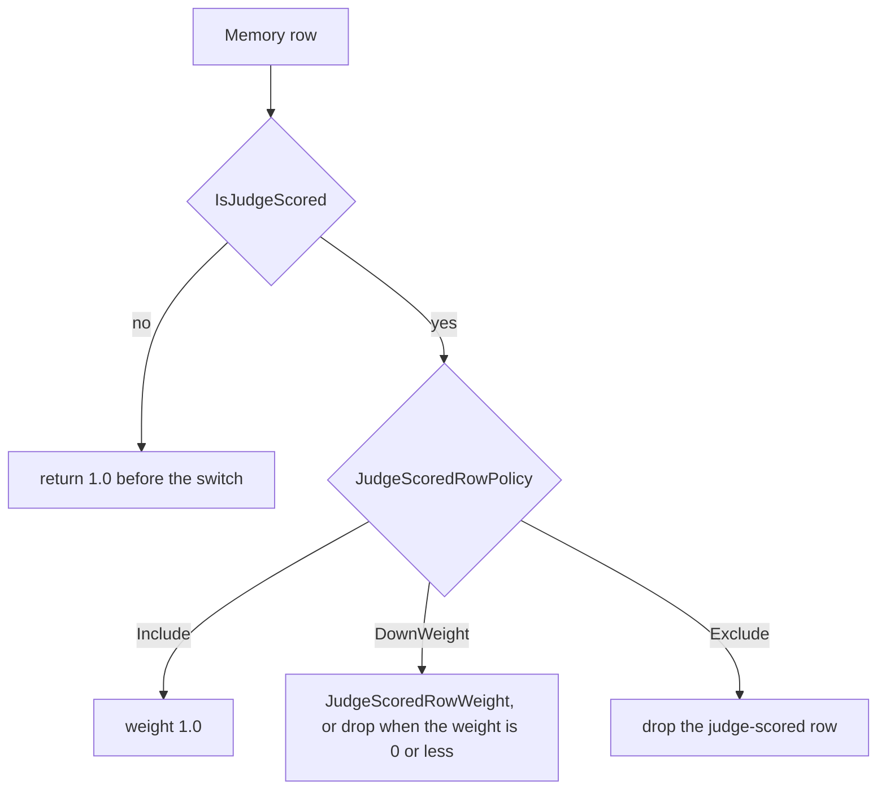
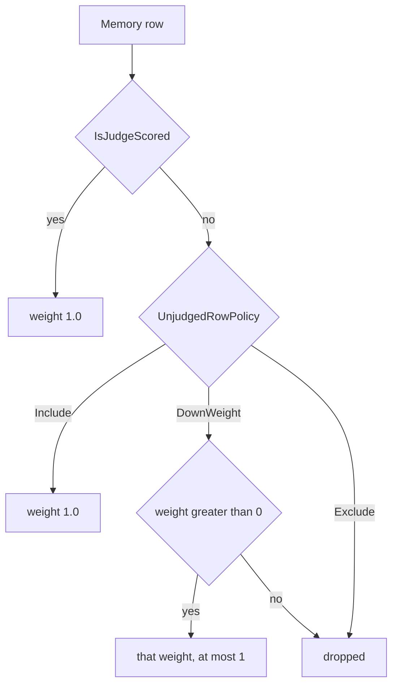

# Plan: Unjudged grades never outweigh judge-scored grades (#326)

**Status:** Implementation. Signed off by David on 2026-10-22 (chat). David's 2026-10-22 answers on the three review items are recorded as decided (§3.1, §6, §10). The plan and ADR-0026 Amendment 1 landed in [#329](https://github.com/davidpizon/TotallyHot-ArcRouter/pull/329).
**Issue:** [#326](https://github.com/davidpizon/TotallyHot-ArcRouter/issues/326). Part of #326. This plan does not close it.
**Standing rule:** [Approved plan before coding](../router/standing-rules.md#approved-plan-before-coding). The implementation pull request links this file.
**Audit base:** `8ca7a35f` (`main`, merge of #328). Line numbers below are that commit.
**Engines:** CodeGraph MCP (`user-codegraph`, `codegraph_explore`) and Serena MCP (`plugin-serena-serena`, `find_symbol` / `find_referencing_symbols`) were not available in this session. A tool search for those namespaces returned no matches. Serena skipped. This is not a dual-engine catalog. Every symbol, line, and caller below was read from source at `8ca7a35f`.

## 1. Observed cost

[ADR-0008 Amendment 1](../adr/0008-codegraph-serena-dual-engine-code-smell-pipeline.md#amendment-1-2026-09-02-stop-rules) asks for an observed cost. This is not a smell cleanup, and it is not added to [`docs/router/code-smell-refactoring-plan.md`](../router/code-smell-refactoring-plan.md).

**Classification: Major.** The cost is that unverified evidence outweighs verified evidence whenever `JudgeScoredRowPolicy` is not `Include`. `JudgeRowWeighting.ResolveWeight` (`src/TotallyHotArcRouter/Models/JudgeRowWeighting.cs` line 28) returns `1.0` for a row with `isJudgeScored` false, and the switch on lines 30-35 never runs for that row. `DownWeight` and `Exclude` then scale or drop the judge-scored row only. [ADR-0026](../adr/0026-grade-a-response-only-against-its-question-and-learn-only-from-complete-grades.md) option B already named the inversion: "question-aware rows count less." Decision point 6 changed the default to `Include`, which hides it. It did not remove it.

The cost is latent on the shipped default. It is live as soon as a stored row has `is_judge_scored = 0` and the operator sets `DownWeight` or `Exclude`. [#304](https://github.com/davidpizon/TotallyHot-ArcRouter/issues/304) is the planned writer of new `Complete` grades outside the nine code dimensions. Which of those grades leave `JudgeScore` empty is #304's question (§10). It does not block this change. The #319 plan's sentence is the one this cost follows: a `Complete` grade with no `JudgeScore` is stored, and learning from it at full strength while judged rows are discounted is the failure.

The matrix in ADR-0008 uses file size and coupling as the usual evidence for Major. This item is Major because of the learning inversion, which is the observed cost the issue records. It is not a size finding.

## 2. What the code does now



`ResolveWeight` (`JudgeRowWeighting.cs` lines 26-36):

```csharp
if (!isJudgeScored) return 1.0;

return policy switch
{
    JudgeRowPolicy.Include => 1.0,
    JudgeRowPolicy.Exclude => null,
    JudgeRowPolicy.DownWeight => judgeRowWeight <= 0 ? null : judgeRowWeight,
    _ => throw new ArgumentException($"Unknown JudgeRowPolicy: {policy}", nameof(policy))
};
```

`null` means drop. A non-null return is the multiplier. Under every policy, an unjudged row is `1.0` and a judged row is `1.0`, a number in `(0, 1]`, or absent. `DownWeight` at `0.5` therefore makes the unjudged row count twice the judged row. `Exclude` keeps the unjudged row and removes the judged one.

`RoutingOptions.ResolveJudgeRowWeight` (lines 424-428) forwards `JudgeScoredRowPolicy` (line 406, default `Include`) and `JudgeScoredRowWeight` (line 415, default `0.5`, `[Range(0d, 1d)]`). `EnsureValid` (lines 482-487) throws `OptionsValidationException` when the policy is `DownWeight` and the weight is `<= 0`. The message is `JudgeScoredRowWeight must be positive when JudgeScoredRowPolicy is DownWeight.` Callers that construct `new RoutingOptions` in tests never call `EnsureValid`. The resolver's `<= 0 ? null` arm is what those callers hit. Both layers stay.

Shipped `appsettings.json` does not set either key. `router_settings` does not store them. `RouterSettingsStore` writes `EnableAdaptiveRouting`, `EmbeddingMemoryCapacity`, and the judge, transcript, and portfolio flags. No GUI control sets them.

After [#319](https://github.com/davidpizon/TotallyHot-ArcRouter/issues/319), `EmbeddingMemoryScoreObserver` stamps `IsJudgeScored` from `JudgeScore.HasValue`. The nine shipped dimension weights (`appsettings.json` lines 246-254) set `Judge` to `0.60`. `GradeStatusCalculator` returns `Complete` only when every positive-weight axis scored, so a new live row from that calculator is judge-scored. The #319 purge kept `memory_entries` rows with `is_judge_scored = 0` (a backfill copy, or the column default). Those kept rows are the stored unjudged rows today. Under the default `Include` they weigh the same as a judged row. Under `DownWeight` or `Exclude` they already outweigh judged rows.

## 3. Decision

**Decided 2026-10-22, Option C.** Flip the axis. Recorded in [ADR-0026 Amendment 1](../adr/0026-grade-a-response-only-against-its-question-and-learn-only-from-complete-grades.md#amendment-1-2026-10-22-the-row-policy-applies-to-unjudged-rows) in this pull request. The amendment does not reopen decision point 6 or the 2026-10-21 correction.



- A judge-scored row always has weight `1.0`. The switch does not run for it. `IsJudgeScored` stays the #319 stamp (`JudgeScore.HasValue`).
- `Include`: unjudged weight `1.0`. Same as today, and the same as the judged weight. The default stays `Include`, so a deployment that does not set the key does not change.
- `DownWeight`: unjudged weight is the configured weight when it is `> 0` and `<= 1`. Weight `<= 0` drops the row (`null`).
- `Exclude`: unjudged weight is `null`. The router learns from judge-scored rows only.
- The invariant is by construction for every value the options pipeline accepts. The judged weight is the constant `1.0`. The unjudged weight is `1.0`, a configured value in `(0, 1]`, or absent. Absent is not a greater weight. The upper bound is `[Range(0d, 1d)]`, enforced by `ValidateDataAnnotations` on the existing `AddOptions<RoutingOptions>()` chain (`RouterServiceCollectionExtensions.cs` line 54). The resolver does not add a second upper-bound check. A direct caller that passes `1.5` is outside that contract, as it is today.
- The cap suggested on the issue (leave the policy on judged rows, and limit the unjudged weight to whatever the judged row got) is the option Amendment 1 does not take. `Exclude` would stay inverted under a cap that only clamps `DownWeight`.

`Include`, `DownWeight`, and `Exclude` stay the enum member names. They still say what happens to the rows the policy governs. Those rows are the unjudged ones.

### 3.1 Names

**Decided 2026-10-22.** The two property names were decided with Option C. David confirmed the type, method, and parameter renames the same day.

| Current | New |
|---|---|
| `RoutingOptions.JudgeScoredRowPolicy` | `UnjudgedRowPolicy` |
| `RoutingOptions.JudgeScoredRowWeight` | `UnjudgedRowWeight` |

The type and method names still say the policy acts on judge-scored rows. Keeping them next to `UnjudgedRowPolicy` would leave the inverted name in every signature.

| Current | New | Why this name |
|---|---|---|
| enum `JudgeRowPolicy` | `UnjudgedRowPolicy` | The property and the enum then share a name (`public UnjudgedRowPolicy UnjudgedRowPolicy`). That is legal, and `options.UnjudgedRowPolicy` versus `UnjudgedRowPolicy.Exclude` stays readable. A property `UnjudgedRowPolicy` of type `JudgeRowPolicy` says the opposite of what the type does. |
| `JudgeRowWeighting` | `UnjudgedRowWeighting` | It is the one rule. The file moves with the class. |
| `ResolveWeight` | `ResolveWeight` | The method resolves any row. Rename the weight parameter from `judgeRowWeight` to `unjudgedRowWeight`. `isJudgeScored` stays: it is still the row flag. `policy` stays. |
| `RoutingOptions.ResolveJudgeRowWeight` | `ResolveRowWeight` | It returns the weight of a judged row and of an unjudged row. `ResolveUnjudgedRowWeight` would be wrong on the judged branch, which always returns `1.0`. |
| `ClusterLedger.Build` parameters `judgeRowPolicy`, `judgeRowWeight` | `unjudgedRowPolicy`, `unjudgedRowWeight` | Callers pass the options properties. Default remains `Include` and `1.0`, which is still both populations at `1.0`. |
| `EmbeddingMemory.FindNearest` parameters `judgeRowPolicy`, `judgeRowWeight` | `unjudgedRowPolicy`, `unjudgedRowWeight` | A null policy still means "do not filter" (lines 291-293). The weight is still ignored unless a policy is passed. |
| local `skippedForJudgePolicy` in both trainers | `skippedForUnjudgedPolicy` | The counter counts dropped unjudged rows. |

The two trainer log templates currently say the excluded rows are judge-scored (`EmbeddingLogRegTrainingService.cs` lines 175-176, `ClusterTrainingService.cs` lines 179-180). After the flip that sentence is false. Replace the text and keep a static string literal:

- `"Excluded {SkippedCount} unjudged memory entry/entries from logreg training per the configured unjudged-row policy."`
- `"Excluded {SkippedCount} unjudged memory entry/entries from cluster training per the configured unjudged-row policy."`

## 4. Resolver, validation, and the old key

`UnjudgedRowWeighting.ResolveWeight`:

```csharp
if (isJudgeScored) return 1.0;

return policy switch
{
    UnjudgedRowPolicy.Include => 1.0,
    UnjudgedRowPolicy.Exclude => null,
    UnjudgedRowPolicy.DownWeight => unjudgedRowWeight <= 0 ? null : unjudgedRowWeight,
    _ => throw new ArgumentException($"Unknown UnjudgedRowPolicy: {policy}", nameof(policy))
};
```

The judged return stays before the switch, so a new enum member cannot scale a judged row by falling through. The `_` arm still throws for an unjudged row.

`[Range(0d, 1d)]` stays on `UnjudgedRowWeight`. `EnsureValid` keeps the positivity check and renames the message:

`UnjudgedRowWeight must be positive when UnjudgedRowPolicy is DownWeight.`

`Include` with weight `0` stays valid. The weight is ignored under `Include` and `Exclude`. Do not extend the positivity check to those two values. Do not add a second `<= 1` check in `EnsureValid`. `ValidateDataAnnotations` already enforces the range (the comment on `RouterServiceCollectionExtensions.cs` lines 47-50 says the two checks are complementary).

**The old key fails startup. It is not bound and not inverted.**

The configuration binder ignores an unknown key. After the rename, `Routing:JudgeScoredRowPolicy` and `Routing:JudgeScoredRowWeight` would disappear, and the new properties would take `Include` and `0.5`. An operator who had set `Exclude` would silently get `Include`. `EnsureValid` cannot see the old key: `Bind` has already dropped it.

The check reads `IConfiguration` in the `Configure<IConfiguration>` delegate that already binds `RoutingOptions` (`RouterServiceCollectionExtensions.cs` lines 51-60), before `Bind`. `RoutingOptions.SectionName` is `"Routing"` (line 14). If that section has a child named `JudgeScoredRowPolicy` or `JudgeScoredRowWeight`, compared case-insensitively, throw `OptionsValidationException` and do not bind. A key set to an empty string still counts as present. Both keys present means both failures in the one exception. The new key being present as well does not waive the old key.

Messages, so the test can assert them:

- `Routing:JudgeScoredRowPolicy is not a setting. Set Routing:UnjudgedRowPolicy. The policy applies to rows that are not judge-scored. Judge-scored rows always have weight 1. Copying the old value onto the new key does not keep the old behavior.`
- `Routing:JudgeScoredRowWeight is not a setting. Set Routing:UnjudgedRowWeight.`

`ValidateOnStart` (line 60) builds options at host start, so a throw from that delegate fails startup. The same configuration key is what an environment variable `Routing__JudgeScoredRowPolicy` and a command-line `--Routing:JudgeScoredRowPolicy` become. No `router_settings` migration: the table has never stored this policy. Do not add the new key to `appsettings.json`. The shipped file does not set the old one, and the coded default remains `Include`.

Extract the existing `AddOptions<RoutingOptions>()` chain (lines 51-60) into an internal method, `AddRoutingOptions`, that `AddRouterCore` calls. The test calls that method. `TotallyHotArcRouter.csproj` already has `InternalsVisibleTo` for `TotallyHotArcRouter.Tests`. Do not boot `AddRouterCore` in the test. It registers the database and the voters, and the assertion only needs the options chain.

## 5. Production consumers

Each of these reads the resolver. There is no second copy of the switch. Grep of `src` for `ResolveWeight`, `ResolveJudgeRowWeight`, `JudgeScoredRowPolicy`, and `JudgeScoredRowWeight` found no other production caller.

| Consumer | Where | What it does with the return | After the flip |
|---|---|---|---|
| `UnjudgedRowWeighting.ResolveWeight` | `JudgeRowWeighting.cs` lines 26-36, renamed | The rule. | Judged rows return `1.0` first. The switch applies to unjudged rows. |
| `RoutingOptions.ResolveRowWeight` | `RoutingOptions.cs` lines 424-428, renamed from `ResolveJudgeRowWeight` | Forwards the two properties. | Same forward, new names. |
| `EmbeddingMemory.FindNearest` | `EmbeddingMemory.cs` lines 261-293 | Drops a neighbor when the resolver returns null (lines 291-293), before the similarity threshold and before `MaxNeighborCount` (line 313). Does not scale. A null policy still skips the check. | Drops unjudged neighbors under `Exclude` and under `DownWeight` with weight `<= 0`. A judged neighbor is never dropped here. The dropped row still does not consume a neighbor slot. |
| `MemoryKnnVoter.VoteAsync` | `MemoryKnnVoter.cs` lines 44-46 and 59-66 | Passes the policy into `FindNearest`, then calls the resolver again and multiplies similarity by the weight (line 63). The null continue on line 61 stays: `FindNearest` drops, and this call scales. Removing the second call would make `DownWeight` stop scaling in the voter while the ledger still scaled. | Judged neighbor: similarity times `1.0`. Unjudged `DownWeight`: similarity times the configured weight. Unjudged `Exclude`: already absent from `neighbors`. |
| `EmbeddingLogRegTrainingService` | lines 150-161, log lines 172-176 | Null increments `skippedForJudgePolicy` and skips. Otherwise the sample weight is `LogRegLiveSampleWeight *` the resolved weight. | Judged rows keep `LogRegLiveSampleWeight` (times `1.0`). Unjudged `DownWeight` scales that product. Unjudged `Exclude` skips. The log text in §3.1. |
| `ClusterTrainingService` | lines 156-164, log lines 176-180 | Same shape, with `ClusterLiveSampleWeight`. | Same split. The log text in §3.1. |
| `ClusterLedger.Build` | `ClusterLedger.cs` lines 74-81 | Null skips. Otherwise adds `score * weight` and the weight, and increments `ObservationCount` (line 81) for every kept row, including a down-weighted one. | An unjudged `Exclude` row is absent from the mean, the weight total, and the count. A down-weighted unjudged row moves the mean and still counts as one observation. A judged row always contributes at `1.0` and counts. |
| `TaxonomyComparisonService` | `GetClusteringInputsAsync` lines 414-417, and `Compare` lines 473-475 | Builds the ledger with the two properties, then leave-one-out uses `ResolveJudgeRowWeight(...) ?? 1.0`. | The build follows `ClusterLedger.Build`. Leave-one-out for a dropped row is the decided fix in §6. |

`ClusterBestVoter.GetModelAsync` (`ClusterBestVoter.cs` lines 198-201) passes the two properties into `ClusterLedger.Build`. It does not call the resolver again. Vote time reads the ledger `Build` already weighted. Rename the arguments. Do not add a second weighting.

`FindNearest`'s production caller is `MemoryKnnVoter`. The embedding-memory tests call `FindNearest` without a policy, so they stay on the null-policy path.

The watermark comments stay true and only need the renamed cref. `ClusterRetrainHostedService` (line 134) and `LogRegRetrainHostedService` (line 120) compare `TotalLiveMemoryEntryCount` with the raw store count, because `MemoryEntryCount` omits rows the policy excluded. After the flip the omitted rows are unjudged. The comparison still needs the raw count, for the same reason the Copilot note on PR #93 recorded. Do not change that field.

`MemoryKnnVoter` runs during a vote. The change is which branch returns `1.0`. No new allocation, no new log on that path. `RequestInterceptor`, `ManagementFacade`, and `ProxyMiddleware` are not edited. No golden-path proxy smoke is added for this change. The voter, ledger, and trainer tests are the gate.

## 6. Leave-one-out when a row was dropped

**Decided 2026-10-22.** In scope for #326. A dropped row uses the cell mean as-is, and the four assertions below land in the implementation.

`TaxonomyComparisonService.Compare` (`TaxonomyComparisonService.cs` lines 473-475):

```csharp
var observedWeight = _routingOptions.ResolveJudgeRowWeight(entry.IsJudgeScored) ?? 1.0;
clusterPredicted = ClusterLedger.PredictLeaveOneOut(cell: cell, observedScore: observedScore,
    observedScoreWeight: observedWeight);
```

`ClusterLedger.Build` does not add a row whose weight is null (lines 76-77). `PredictLeaveOneOut` (lines 146-157) then subtracts `observedScore * observedScoreWeight` from `MeanScore * WeightTotal` and subtracts `observedScoreWeight` from `WeightTotal`. The `?? 1.0` supplies a weight that was never added.

Today null is a dropped judge-scored row (`Exclude`, or `DownWeight` at `<= 0`). After the flip, null is a dropped unjudged row. The bug moves with the null.

One kept judged row at `0.4`, and the unjudged row under comparison dropped: `WeightTotal` is `1.0`. Subtracting `1.0` makes `remainingWeight` `0`, and `PredictLeaveOneOut` returns null. The comparison reports no cluster prediction. The cell mean, `0.4`, is already the prediction with this row removed, because the row was never in the cell.

Two kept judged rows at `0.4` and `0.8` (`WeightTotal` `2`, mean `0.6`), and a dropped unjudged `0.9`: remaining weight `1`, remaining sum `1.2 - 0.9 = 0.3`, prediction `0.3`. The cell mean is `0.6`. The subtraction invented the `0.3`.

**Fix.** When the resolver returns null, do not call `PredictLeaveOneOut`. Use the cell mean as-is: `cell?.MeanScore`. A missing cell stays null. Do not substitute `0`. When the resolver returns a weight, call `PredictLeaveOneOut` with that weight, as today. A judged row always passes `1.0`, which is what `Build` added. A lone judged row still has no held-out prediction (`remainingWeight` `0`). Two judged rows still subtract `1.0`.

**Test.** `TaxonomyComparisonServiceTests`. `Sample` (lines 704-714) has no judge flag, and `BuildHarnessAsync` (lines 577-586) builds `MemoryEntry` without `IsJudgeScored`, so every current fixture row is unjudged. Add an optional `IsJudgeScored` on `Sample`, default false, and pass it through. Existing samples stay unjudged under default `Include`, which still weights them at `1.0`. The `RoutingOptions` at line 674 today sets only `ClusterAssignmentThreshold`.

One new test, policy `Exclude`, same cluster and model:

- A judged row at `0.4` and the unjudged transcript under comparison. `ClusterPredictedScore` is `0.4`, the cell mean. It is not null.
- Two judged rows at `0.4` and `0.8`, plus the dropped unjudged transcript. `ClusterPredictedScore` is `0.6`. The bug's `0.3` fails this assertion.
- The unjudged row is the only row in the cell. `ClusterPredictedScore` is null.
- A judged transcript that shares its cell with another judged row still leave-one-outs to the other row's score. The fix does not skip leave-one-out for a row the ledger contains.

No existing taxonomy test asserts a judge weight, so none of them flip. This test is additive.

## 7. Tests whose expectations flip

Default `Include` is unchanged: both populations weight `1.0`. Tests that do not set the policy do not flip. The `Include` assertion inside the voter test below stays `0.6`. `EmbeddingMemoryTests` calls `FindNearest` without a policy. Those assertions stay.

Confidence below is the weighted average. The values sit inside the clamp at `MemoryKnnVoter.cs` line 86, so the clamp does not change the expected number.

### 7.1 `MemoryKnnVoterTests`

`VoteAsync_DownWeightPolicy_PullsTheWeightedAverageTowardTheNonJudgeScoredNeighbor` (lines 145-175). Neighbors are an exact match, so similarity is `1`. Unjudged score `0.9`, judged score `0.3`.

| Policy | Today | After the flip |
|---|---|---|
| `Include` | `(0.9 + 0.3) / 2 = 0.6` | `0.6` |
| `DownWeight` at `0.5` | `(0.9 * 1 + 0.3 * 0.5) / 1.5 = 0.7` | `(0.9 * 0.5 + 0.3 * 1) / 1.5 = 0.5` |
| `Exclude` | `0.9` (judged neighbor dropped) | `0.3` (unjudged neighbor dropped) |

Rename the test. The name states the old direction. The average moves toward the judge-scored neighbor.

`VoteAsync_JudgeScoredNeighbor_ExcludePolicy_IsIgnored` (lines 125-142). A lone judge-scored neighbor at `0.9` under `Exclude` abstains today. After the flip that neighbor has weight `1.0`, so the vote is `model-a` at confidence `0.9`. Rewrite the test: a lone judged neighbor still votes; a lone unjudged neighbor abstains.

### 7.2 `ClusterLedgerTests`

`Build_ExcludePolicy_DropsJudgeScoredEntriesFromMeanAndObservationCount` (lines 96-109). Entries are unjudged `0.9` and judged `0.1`. Today the mean is `0.9` and `ObservationCount` is `1`. After the flip the mean is `0.1` and the count is `1`. Rename the test.

`Build_DownWeightPolicy_WeightsTheMeanButNotTheObservationCount` (lines 112-127). Unjudged `0.9`, judged `0.3`, weight `0.5`. The mean changes from `0.7` to `0.5`. `ObservationCount` stays `2`, because both weights are non-null. A down-weighted unjudged row is still one observation. The comment on lines 123-124 states the old direction. Replace it. Do not change the count assertion.

`ClusterModelScore`'s summary (`ClusterLedger.cs` lines 198-202) says `ObservationCount` counts raw entries regardless of policy. `Build`'s own return text (lines 44-46) and the `Exclude` test say the opposite: a dropped row is not counted. When rewriting that summary, say the count is rows the policy kept, including a down-weighted row. Do not keep the false sentence.

### 7.3 Training services

Both tests are named `RetrainAsync_ExcludePolicy_JudgeScoredEntriesAreNotCounted`. Neither asserts the log text. Both assert `MemoryEntryCount` and the raw watermark `TotalLiveMemoryEntryCount`.

`EmbeddingLogRegTrainingServiceTests` (lines 155-198). The seed is 30 unjudged rows (15 per model) plus 2 judged rows. Minimum rows is 20. Today `MemoryEntryCount` is 30, the outcome is `Trained`, and the artifact's raw watermark is 32. After the flip, `Exclude` keeps the 2 judged rows and drops the 30. Two rows is below the minimum, so the outcome is `Declined` and no artifact is written. Changing the expected count to 2 fails the `Trained` assertion and then fails reading the file.

Reseed so the rows the policy keeps are the ones that meet the minimum: 30 judge-scored rows and 2 unjudged rows. `MemoryEntryCount` stays 30. The raw watermark stays 32. The outcome stays `Trained`. The test still guards the PR #93 watermark: `TotalLiveMemoryEntryCount` is the store total, not the filtered count. Rename the test so it says the unjudged rows are the ones left out.

`ClusterTrainingServiceTests` (lines 137-174). The seed is 100 unjudged rows plus 20 judged rows. Minimum is 100. Today the count is 100 and the raw watermark is 120. After the flip, 20 kept rows is below the minimum and the outcome is `Declined`. Reseed to 100 judge-scored rows plus 20 unjudged rows. Count stays 100, raw watermark stays 120, outcome stays `Trained`. Same rename, same watermark guard.

## 8. New tests

`dotnet test` reports zero tests on this SDK. Run the built `TotallyHotArcRouter.Tests` host, the same way the other plans do. The build stays warning-free (`TreatWarningsAsErrors`, XML docs on the touched public members). No new warning suppression.

**Invariant.** A new `UnjudgedRowWeightingTests`. There is no `JudgeRowWeighting` test file today. Loop `Enum.GetValues<UnjudgedRowPolicy>()` and the weights `0`, `0.5`, and `1`. For every pair:

- The judged return is `1.0`, never null, including when the weight is `0.5` and the policy is `Exclude` or `DownWeight`.
- `Include`: unjudged return is `1.0` for every weight in the set, including `0`.
- `DownWeight`: unjudged return is the weight when the weight is `0.5` or `1`, and null when the weight is `0`.
- `Exclude`: unjudged return is null for every weight in the set.
- When both returns are non-null, the unjudged value is less than or equal to the judged value.

An enum member the loop does not know fails the test, so a new value cannot ship without an invariant line. One more call goes through `RoutingOptions.ResolveRowWeight` with `DownWeight` at `0.5`, so the wrapper cannot drift from the static method.

**Old key.** `RoutingOptionsTests`, beside `SubagentBias_BindsFromConfiguration` (lines 164-180). Register an in-memory configuration and call `AddRoutingOptions` from §4. Resolving `IOptions<RoutingOptions>.Value` throws `OptionsValidationException`.

- `Routing:JudgeScoredRowPolicy` = `Exclude`. The message contains `UnjudgedRowPolicy` and the sentence that copying the old value does not keep the old behavior. The options object is not returned.
- `Routing:JudgeScoredRowWeight` = `0.25`, no policy key. The message contains `UnjudgedRowWeight`.
- `Routing:judgescoredrowpolicy` = `Include` (different case). Same failure. The configuration API is case-insensitive, and a case-sensitive check would miss an environment variable.
- Both old keys, and also `Routing:UnjudgedRowPolicy` = `DownWeight`. Still fails. The new key does not win.
- `Routing:UnjudgedRowPolicy` = `DownWeight` and `Routing:UnjudgedRowWeight` = `0.5`, with neither old key. Binds. `EnsureValid` does not throw. The weight is `0.5` and the policy is `DownWeight`.

`Get<RoutingOptions>()` alone is the wrong assertion. It ignores the unknown key and returns `Include`, which is the silent bind this test exists to reject.

**Positivity.** Same file. There is no test of the current check. `DownWeight` with weight `0` throws, and the message contains `UnjudgedRowWeight`. `DownWeight` with `0.5` does not throw. `Include` with weight `0` does not throw.

**`FindNearest`.** `EmbeddingMemoryTests` does not pass a policy today. One test: under `Exclude`, an unjudged neighbor is absent and a judged neighbor is present, and the absent row does not consume `MaxNeighborCount`. Under a null policy, the unjudged neighbor is still returned.

**Leave-one-out.** The test in §6.

## 9. Docs

### 9.1 This pull request

- This file.
- [ADR-0026](../adr/0026-grade-a-response-only-against-its-question-and-learn-only-from-complete-grades.md) Amendment 1. The decision text lives there. It is not copied into this plan.
- [`docs/adr/README.md`](../adr/README.md). The index row for 0026 said `proposed`. The ADR file has said `accepted` since 2026-10-14. The row now says accepted and links Amendment 1. That status word was already wrong; this edit is the row being touched for the amendment.
- [`docs/plans/issue-304-grade-non-coding-responses.md`](issue-304-grade-non-coding-responses.md) §12. The question David deferred. It is an open question on that plan.

This pull request does not edit the other docs in §9.2. The implementation does, after the code matches them.

### 9.2 Docs that mention the old names

Markdown search for `JudgeScoredRowPolicy`, `JudgeScoredRowWeight`, and `ResolveJudgeRowWeight` found only these files. `JudgeRowPolicy` and `JudgeRowWeighting` appear in the same files and in ADR-0026.

| Doc | What it says | Implementation edit |
|---|---|---|
| `docs/router/geval-shadow-scoring-plan.md` lines 457-470 | The shipped policy scales or drops judge-scored neighbors, in `MemoryKnnVoter`, both trainers, and `ClusterLedger.Build`. | Rewrite that bullet to the flipped rule and the new names. `0.5` remains a starting-point guess, now as the unjudged-row weight's default. |
| Same file, line 377 | Calibration thresholds are guesses "in the `JudgeScoredRowWeight = 0.5` tradition." | Update the identifier to `UnjudgedRowWeight`. The calibration section's meaning stays: the thresholds are guesses. |
| Same file, line 475 | "New live rows stamp `IsJudgeScored = true`." | This sentence does not use the policy names. It is already false after #319. Lines 449-456 of the same section were updated and this sentence was not. Correct it in the same edit. A `Complete` grade is judge-scored only when `JudgeScore` has a value. Leaving it beside the rewritten policy bullet keeps a false sentence in the section being edited. |
| `docs/plans/issue-293-graders-judge-against-the-question.md` line 131, and the `JudgeRowPolicy` sentences at lines 16, 155, and 173 | The #293 decision: default moves to `Include`, and `JudgeScoredRowWeight` stays a knob. | Dated note beside line 131. #326 flips which rows that knob applies to. Do not rewrite the 2026-10-14 decision. |
| `docs/plans/issue-315-docs-code-reconciliation.md` line 354 | The reconciliation checklist names `JudgeScoredRowPolicy`, `JudgeScoredRowWeight`, `ResolveJudgeRowWeight`, and `JudgeRowWeighting.ResolveWeight` as the symbols that existed at `d3452c4a`. | Dated note that #326 renamed them. Do not change the checklist item as if that audit had checked the new names. |
| `docs/plans/issue-319-judge-scored-provenance.md` | §6 quotes the comments #319 installed. Those comments describe line 28 returning `1.0` for an unjudged row, and they name `JudgeScoredRowPolicy`. | Dated note in the status header: #326 replaces those comments. Do not edit the quoted replacement blocks. They were the correct text for the code #319 shipped. |

### 9.3 XML docs the implementation rewrites

A stale summary is a missing summary under `AGENTS.md`. Rewrite these so they describe the flipped rule. `<see cref>` updates that follow a rename are part of the same edit.

- `JudgeRowPolicy.cs` (the whole enum summary, and `Include`, `Exclude`, `DownWeight`). `DownWeight` currently says a judge-scored row is scaled and an unjudged row stays at `1.0` (lines 27-36). `Include` says the same about the unjudged row (lines 14-21).
- `JudgeRowWeighting.cs` lines 12-24. The returns text says null is `Exclude` on a judge-scored row, and a row that is not judge-scored is always `1.0`.
- `RoutingOptions.cs` lines 393-427, and the `EnsureValid` message at line 487.
- `MemoryKnnVoter.cs` lines 11-13 and the constructor parameter at line 24. The summary says the policy applies when the neighbor is judge-scored.
- `EmbeddingMemory.FindNearest` lines 253-259. The parameter text says `Exclude` skips judge-scored rows.
- `ClusterLedger.Build` parameter docs, lines 30-39, and `ClusterModelScore` lines 198-206 (the count sentence in §7.2).
- `MemoryEntry.IsJudgeScored` lines 34-43. It says consumers weight, exclude, or discount judge-influenced rows. After the flip they do that to unjudged rows, and a judged row contributes at `1.0`.
- `JudgeCalibrationOptions.cs` line 13. The cross-reference is `RoutingOptions.JudgeScoredRowWeight`. Point it at `UnjudgedRowWeight`. The sentence stays "the default `0.5` shipped as a guess."
- `ClusterModelArtifact.cs` lines 47-51 and 62-68, and `EmbeddingLogRegModelArtifact.cs` lines 38-42 and 53-59. The watermark sentences stay. Update the type name in the cref.
- The two hosted-service comments in §5, same cref update.
- The two trainer log templates in §3.1.

## 10. #304, and which rows exist today

New live writes under the shipped weights are judge-scored, for the reason in §2. Kept `is_judge_scored = 0` rows from the #319 purge are the stored exception. Under `Include` they do not outweigh a judged row. Under `DownWeight` or `Exclude` they do, today, before #304 writes anything.

#304's bootstrap recipe for unfenced text is judge weight `1.0`, syntax `0`, analysis `0` (`docs/plans/issue-304-grade-non-coding-responses.md` lines 109-114). A `Complete` grade on that recipe has a judge score, so the #319 stamp is true. Those rows are not the unjudged population. The phrase "prose dimensions with Judge=0" does not match that table. Syntax and analysis start at `0` on a non-code recipe (line 118). The judge axis does not.

The unjudged `Complete` rows #319 named are a grade whose `JudgeScore` has no value: a recipe whose judge weight is `0` (not shipped, and not #304's bootstrap), or a writer that sets `GradeStatus.Complete` without going through the calculator. #304's takeover (`§3.2` of that plan) says the local score fills the judge axis. If that implementation sets `JudgeScore`, the row is judge-scored. If it fills the unified score and leaves `JudgeScore` empty, the row is unjudged, and this policy is what keeps it from outweighing a judged row.

**Deferred 2026-10-22.** Which of those writes #304 will make is an open question for #304's planning, recorded in [that plan §12](issue-304-grade-non-coding-responses.md#12-open-question-2026-10-22-from-326). It does not block #326. This plan does not choose the answer.

## 11. Out of scope

- The `Complete`-only learning gate, the #319 stamp, the #293 purge, and the #319 purge.
- Dimension weights, `GradeStatusCalculator`, and any #304 type.
- Changing the default from `Include`.
- A `router_settings` key, a GUI control, or an `appsettings.json` entry for the new properties.
- Copying an old `Exclude` or `DownWeight` value onto the new key. Startup fails instead.
- A second upper-bound check inside the resolver.
- `RequestInterceptor`, `ManagementFacade`, `ProxyMiddleware`, and a new proxy golden-path smoke.
- Renaming the enum members `Include`, `DownWeight`, and `Exclude`.

## 12. Implementation gate

C# / .NET only. Nullable reference types stay on. Serilog templates stay static string literals, including the two rewritten trainer lines. XML docs on every renamed public member, accurate to the flipped rule. `TreatWarningsAsErrors`. Run `TotallyHotArcRouter.Tests`. The new tests are ordinary unit tests, under the 5-second cap.

The implementation pull request links this file and says Part of #326.

## 13. Open questions

None. The leave-one-out fix and the renames were decided on 2026-10-22 (§6, §3.1). Which #304 grades leave `JudgeScore` empty is #304's question, not this plan's (§10).
