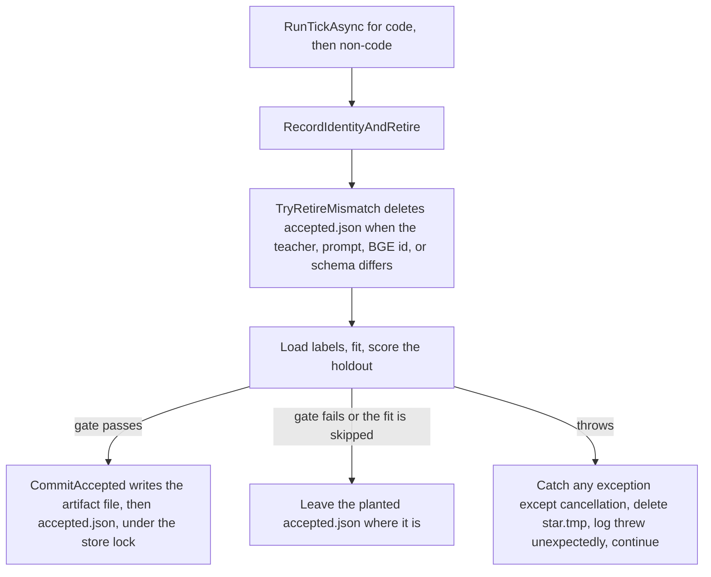

# Plan: #350 flaky grader-epoch phase 7 tests

> **For agentic workers:** REQUIRED SUB-SKILL: Use superpowers:subagent-driven-development (recommended) or superpowers:executing-plans to implement this plan task-by-task. Steps use checkbox (`- [ ]`) syntax for tracking.

**Goal:** Stop `GraderEpochPhase7Tests` from failing a CI run when the commit under test did not change the grader.

**Architecture:** Each failing assert is a tick that did not commit the artifact the fixture expects. The tick already catches every exception, logs one line, and continues, so a database error becomes a null pointer instead of a stack trace. The artifact files for one test live in their own temp directory and are written under a lock. The leading mechanism, stated as a hypothesis in the body, is the process-wide SQLite pool clear that other tests still call while this class is running.

**Tech Stack:** C# / .NET 10, xUnit v3 4.0.2 (`-parallelMode collections` is the default), Microsoft.Data.Sqlite (pooling on by default), Microsoft.ML 5.0.0 SDCA.

**Status:** Waiting for David's approval. This pull request is docs only. It does not change source, tests, project files, or workflows. Implementation waits for David's explicit sign-off on this file, per [standing rules](../router/standing-rules.md).

**Issue:** [#350](https://github.com/davidpizon/TotallyHot-ArcRouter/issues/350).

**Tree this plan was read against:** `b10aaa83` (`main` after the #349 merge).

**Engines:** CodeGraph (`npx @colbymchenry/codegraph init -y` in this pass; 1,381 files, then `codegraph_explore` on the fit, the store, the feature encoder, and the vector key) and Serena (`find_symbol` with bodies, session against `/workspace`, C# language server). Both tools returned source. Serena was not skipped.

## Global Constraints

- C# / .NET only. The implementation pull request edits tests and, if a comment on a production method has to change, that comment. It does not edit a workflow.
- `TreatWarningsAsErrors` stays on. A new or updated `///` summary matches the method after the edit.
- The implementation pull request links this file and stays a draft until the proof runs below are green.
- Do not push to `main`.

## Observed cost

ADR-0008 Amendment 1. Three red **.NET CI / Build and test** jobs on 2026-10-26 and 2026-10-27, on commits whose diff does not change the save/read of a grader artifact. Each one needed a person to open the log, and the suite was re-triggered by a later commit.

| Commit | What the commit changed | .NET CI | What went green afterwards |
|---|---|---|---|
| [`ea9e1cf`](https://github.com/davidpizon/TotallyHot-ArcRouter/commit/ea9e1cfe5d7948bc5ee7b2fd08fe14c16995c005) on PR #347 | Docs only | [run 40383464797](https://github.com/davidpizon/TotallyHot-ArcRouter/actions/runs/40383464797) failed, attempt 1 | The next docs commit [`768f3be`](https://github.com/davidpizon/TotallyHot-ArcRouter/commit/768f3be3) passed .NET CI. Merge [`33747881`](https://github.com/davidpizon/TotallyHot-ArcRouter/commit/33747881) passed on `main`. |
| [`fef7d56`](https://github.com/davidpizon/TotallyHot-ArcRouter/commit/fef7d56bb6987a84d28ab24ec5e972d988535e4f) on PR #348 | Qodana cleanup. The phase 7 test diff is the `Events` property's type (`SqliteGraderEpochEventStore` to `IGraderEpochEventStore`). The label-query diff is the spot-check parameter `nameof(GradeStatus.Complete)`. | [run 40413139980](https://github.com/davidpizon/TotallyHot-ArcRouter/actions/runs/40413139980) failed, attempt 1. There is no attempt 2. | Merge [`5b00300`](https://github.com/davidpizon/TotallyHot-ArcRouter/commit/5b00300b) passed .NET CI on `main` with that same test code. |
| [`534795a`](https://github.com/davidpizon/TotallyHot-ArcRouter/commit/534795ac1b4d27f11f93b917f5ca8d29a0860a2d) on PR #349 | Docs only | [run 40434836783](https://github.com/davidpizon/TotallyHot-ArcRouter/actions/runs/40434836783) job [121960925996](https://github.com/davidpizon/TotallyHot-ArcRouter/actions/runs/40434836783/job/121960925996) failed, attempt 1 | Empty commit [`84d73cab`](https://github.com/davidpizon/TotallyHot-ArcRouter/commit/84d73cab) (`ci: re-run checks (flaky GraderEpochPhase7Tests, see #350)`, no file changes) passed .NET CI on the same branch. |

[`d69ba9cb`](https://github.com/davidpizon/TotallyHot-ArcRouter/commit/d69ba9cb) on PR #348 also failed .NET CI, on `ResponseVectorPhase3Tests.TwoSealsOfTheSameVector_Differ_AndACopiedBlobFailsAuthentication` (`Assert.NotEqual` of two sealed blobs). That failure is a different test. It is not evidence for this plan.

## What the three logs show

Pulled from the failed-job logs in this pass. One failed test each time. The same assert shape: after `Tick()`, the accepted code artifact is missing, or it is still the planted artifact.

| Run | Test | Assert | Meaning |
|---|---|---|---|
| `ea9e1cf` | `Retirement_TeacherModelPromptBgeOrFeatureSchema_RetiresArtifact` | `Assert.NotNull` inside `AssertRetire` at line 975. The caller frame is line 676, the prompt-version `AssertRetire`. The teacher-model call above it had returned. Current tree: `Assert.NotNull` is line 979. | That prompt-version case clears `accepted.json`. The tick did not commit a replacement. The read returned null. |
| `fef7d56` | `Bootstrap_NotRun_WhenNoComparableLiveArtifact` | The job says `Assert.NotNull() Failure: Value is null` and the stack names line 225. At that commit line 225 is `var accepted = world.Store.TryReadAccepted(...)` and line 226 is `Assert.NotNull(accepted)`. Async frames often land on the line before the assert. The accepted value was null. Current tree: the assert is line 226. | The planted artifact's teacher model is `retired-teacher`, so the tick retires it, then should accept a new first artifact. The read returned null. |
| `534795a` | `Bootstrap_ReplacesOnlyWhenLowerBoundGreaterThanZero` | `Assert.Equal` at line 246. Expected `58adf9a8d4b64d61b8452dfa14411a04`, actual null. Current tree: line 246 is still `Assert.Equal(bad, accepted.PreviousArtifactId)`, and line 245 is `Assert.NotNull(accepted)`. | The pointer read succeeded. `PreviousArtifactId` is null. `AcceptLayout` stores a null previous id unless the caller passes one. The planted artifact was still the accepted one: the tick did not commit a replacement. A torn `accepted.json` would have failed `Assert.NotNull` on line 245 with "Value is null", and the log would say that. This log says the strings differ. |

`World.Create` puts every world in `Path.GetTempPath()/grader-epoch-{guid}` with its own `router.db`, `secrets.dat`, and `epoch/` directory (`GraderEpochPhase7Tests` `World.Create`). The class has no `[Collection]`. xUnit's default `-parallelMode collections` runs the methods of one class one at a time, and runs other classes beside it. There is no `xunit.runner.json` and no assembly `CollectionBehavior` in this repo.

## What is proven about the tick



Proven from the current source:

- `RunTickAsync` awaits `RunKindAsync`. The save is not fired off on another task. `CommitAccepted` and `TryReadAccepted` take the store's `_gate` lock. `ReplaceAtomically` writes `accepted.json.tmp` and `File.Move`s it over `accepted.json`.
- `AcceptLayout` commits a planted artifact whose `PreviousArtifactId` is null unless the caller passes one. The three fixtures do not pass one.
- `RecordIdentityAndRetire` runs before the fit. A teacher, prompt, BGE, or schema mismatch deletes `accepted.json` and leaves the old file on disk. The retirement test and `Bootstrap_NotRun` are that case. `Bootstrap_Replaces` plants a matching artifact (`weightOnResponse0: 0`, default teacher, prompt, and BGE), so the pointer should still be there when the fit starts.
- `RunTickAsync` catches `Exception` other than `OperationCanceledException`, deletes `*.tmp`, logs `Grader epoch fit for kind {Kind} threw unexpectedly; continuing.`, and moves on to the next kind. The test method does not see the exception. After a retirement, the pointer stays deleted. On the replace fixture, the planted artifact stays, and its previous id stays null. Both are the asserts in the table.
- `CaptureLog` stores `formatter(state, exception)`. The Microsoft.Extensions.Logging formatter appends the exception text, so a swallowed exception is already in `ServiceLog.Lines` when `Tick` returns. The three job logs show only the pointer assert (`Value is null`, or the two strings). They do not show `ServiceLog`, because nothing in the test prints that list. Task 2 puts the list into the assert message.

## What was measured and did not fail the gate

`GraderEpochTrainer.Fit` builds `new MLContext(seed: options.RandomSeed)` and calls `Trainers.Sdca(lossFunction: new SquaredLoss(), maximumNumberOfIterations: 100)`. `RandomSeed` defaults to `20261025`. The call leaves `NumberOfThreads` null. Microsoft.ML 5.0.0's XML doc for `SdcaTrainerBase.OptionsBase.NumberOfThreads` says the degree of lock-free parallelism "Defaults to automatic depending on data sparseness. Determinism is not guaranteed."

A throwaway probe (not in the repo) fit the `SeedLinear` training rows this fixture uses: 18 rows, features `response_has_code`, `response_vector[0]`, `response_vector[1]`, label equal to `response_vector[0]`. Holdout is the newest 6 rows. The planted "bad" model is weight 0 and bias 0. Gate bars are the real defaults, MAE at most 0.10 and Spearman at least 0.60, then bootstrap low greater than 0.

| Fit | Result |
|---|---|
| Production overload, 200 fits at once, this machine has 4 processors (the same count as a GitHub-hosted `ubuntu` runner) | 0 fits failed the gate. MAE stayed inside 0.008 to 0.055. Weights were not identical from fit to fit. |
| `NumberOfThreads = 1`, shuffle on, 100 iterations, 25 fits | 25 fits, one weight vector, MAE 0.509 every time. Bootstrap low about -0.28. The gate fails every time. |
| `NumberOfThreads` 2, 3, 4, or 8 | 0 gate failures in 25 fits each. Weights still vary. |

Setting `NumberOfThreads = 1` makes this fixture deterministic and makes the gate fail on every run. That is the wrong fix. The varying weights from the default thread count stayed far from the bars in this sample, so they do not explain an assert that fails and then passes on the next run.

Local reproduction of the three tests, same SDK, 4 processors:

- `TotallyHotArcRouter.Tests -class TotallyHot.ArcRouter.Tests.Judge.GraderEpochPhase7Tests`: 40 runs, 39 tests each, 0 failures.
- The whole `TotallyHotArcRouter.Tests` host, default collection parallelism, 4,129 tests: 12 runs, 0 failures.

Twelve full runs can miss a race that showed up three times across a day of CI. The local runs bound how often it happens here. They do not clear the CI logs.

## Hypothesis

Another test in the same process calls `SqliteConnection.ClearAllPools()` while `GraderEpochPhase7Tests` is inside `RunKindAsync`. The pool is process-wide. `SqliteHardening.Open` uses `Data Source={path}` and leaves pooling at the driver default. `TempDatabase.Dispose` already documents the result: the clear "can tear down a pooled native sqlite3 handle out from under a completely different test's in-flight query, surfacing as a spurious ObjectDisposedException". `RunTickAsync` catches that exception. The test then fails on the pointer.

This is a hypothesis about which exception fired in those three jobs. The jobs did not print it. It is the mechanism that fits all three asserts, the private temp directory, the synchronous locked save, and the suite's own comment. A shared epoch folder, a shared clock, and a fire-and-forget save were checked and are absent: `StepClock` and the `SeedLinear` timestamps are per world, and `Tick` awaits `RunTickAsync`.

The Unix secret-store key ring is one directory for every `ProtectedSecretStore` (`AppDataPaths` `keys/`), and the mutex name is a hash of that store's file path, so two tests do not lock each other's key ring. `LoadMapUnix` lets `CryptographicException` escape. `World.Create` calls `GetOrCreate` before the tick, and the holder caches the key, so a decrypt failure there would fail the test with that exception. The three logs are assertion failures. The key ring is not the cause of these three jobs.

## Decisions

| # | Decision |
|---|---|
| 1 | The fix belongs in the test suite. `CommitAccepted`, `TryReadAccepted`, `ReplaceAtomically`, and the artifact directory stay as they are. The save/read path has a lock, a temp file, and a move, and each test has its own directory. |
| 2 | The production catch in `RunTickAsync` stays. One kind throwing must not kill the hosted service. The catch is what hides the other test's pool clear, so the tests have to fail when that log line is present. |
| 3 | Do not set SDCA `NumberOfThreads` to 1. On this fixture that makes the gate fail every time. A deterministic trainer is a different change and needs its own plan. |
| 4 | A `[Collection]` on `GraderEpochPhase7Tests`, including `DisableParallelization = true`, does not stop this. A collection only stops its own tests from running beside each other. The pool clear is in other classes, which still run at the same time. |
| 5 | Mid-run `SqliteConnection.ClearAllPools()` goes away. The replacement is `SqliteConnection.ClearPool(connection)` on a connection to the database that test owns, copied from `TempDatabase.Dispose`. Two call sites stay: `TestTempDirectorySweeper.Dispose` (the assembly fixture runs it after the last test; its own comment says a mid-run clear is unsafe) and `RouterMemoryDatabase.AdoptLegacyInstallDirectoryCopy` (it runs only when the database path is the machine-shared default and a legacy file is being adopted; grader worlds use a private path and return before that call). |

## Out of scope

- Rewriting `GraderEpochTrainer` or pinning SDCA threads.
- Giving `ProtectedSecretStore` a per-file key ring.
- Serializing the whole test assembly.
- The sealed-blob assert on `d69ba9cb`.
- Editing `accepted.json` locking. A future failure that still happens after this fix, with the new assert printing an exception, is a new issue.

## Files

- Modify: every test file in the call-site list in Task 1.
- Modify: `src/TotallyHotArcRouter.Tests/Judge/GraderEpochPhase7Tests.cs` (`World.Tick`, one helper).
- Modify: `src/TotallyHotArcRouter.Tests/Judge/GraderEpochPhase8Tests.cs` (`Restart` and the three direct `RunTickAsync` calls).
- Leave: `src/TotallyHotArcRouter/Judge/GraderEpochArtifactStore.cs`, `src/TotallyHotArcRouter/Judge/GraderEpochTrainer.cs`, `src/TotallyHotArcRouter/Hosting/GraderEpochHostedService.cs` (the catch stays; update its `///` only if the words become wrong, and they stay true).
- Leave: `src/TotallyHotArcRouter.Tests/TestTempDirectorySweeper.cs` and the `ClearAllPools` call in `RouterMemoryDatabase.AdoptLegacyInstallDirectoryCopy`.

## Tasks

### Task 1: Stop mid-run process-wide pool clears

**Files:** the call sites below. `TempDatabase.Dispose` is the pattern to copy, in `src/TotallyHotArcRouter.Tests/PriceCatalog/TempDatabase.cs`.

**Interfaces:**

- Consumes: `SqliteConnection.ClearPool(SqliteConnection)`.
- Produces: no production API change. After this task, a search for `ClearAllPools` under `src` lists two executable calls: `TestTempDirectorySweeper.Dispose` and `RouterMemoryDatabase.AdoptLegacyInstallDirectoryCopy`. Comments that mention the name may stay.

- [ ] **Step 1: Replace each mid-run clear**

Open a connection to the database that test created, then clear that pool only. Guard on the file existing. Swallow `SqliteException` the way `TempDatabase` does. Update the `///` on the method you edit when it still says the method clears every pool.

```csharp
if (File.Exists(databasePath))
{
    try
    {
        using var connection = new Microsoft.Data.Sqlite.SqliteConnection($"Data Source={databasePath}");
        connection.Open();
        Microsoft.Data.Sqlite.SqliteConnection.ClearPool(connection);
    }
    catch (Microsoft.Data.Sqlite.SqliteException)
    {
        // Best-effort cleanup. A database already going away is not a test failure.
    }
}
```

Use the test's existing open method when it has one (`Database.OpenConnection()`, `_database.OpenConnection()`), so the connection string stays the one the test used.

Call sites to change:

| File | Line on `b10aaa83` | When it runs |
|---|---|---|
| `src/TotallyHotArcRouter.Tests/Sessions/SessionTestStore.cs` | 72 | `Dispose`, while other classes are still running |
| `src/TotallyHotArcRouter.Tests/Sessions/SessionStoreTests.cs` | 44 and 525 | `Dispose`, and mid-test before the shred |
| `src/TotallyHotArcRouter.Tests/Sessions/SessionCaptureWriterTests.cs` | 45 | `Dispose` |
| `src/TotallyHotArcRouter.Tests/Sessions/SessionBodySpoolTests.cs` | 41 | `Dispose` |
| `src/TotallyHotArcRouter.Tests/Sessions/SessionRetentionTests.cs` | 45 | `Dispose` |
| `src/TotallyHotArcRouter.Tests/Sessions/Import/TranscriptImportSinkTests.cs` | 29 | `Dispose` |
| `src/TotallyHotArcRouter.Tests/Transcripts/SqliteTranscriptStoreTests.cs` | 903, 1080, 1082 | mid-test, before a byte scan of the db file. 1080 and 1082 bracket `CreateDatabase().EnsureCreated()` so the scan sees a checkpointed file. Clear that database's pool after the calls that opened it. |
| `src/TotallyHotArcRouter.Tests/Router/MemoryEntryEmbeddingModelTests.cs` | 134 | `Dispose` |
| `src/TotallyHotArcRouter.Tests/Router/RouterSettingsAdminGrpcServiceTests.cs` | 398 | `DiscardSessionStorage` |
| `src/TotallyHotArcRouter.Tests/Proxy/ProxyMiddlewareSessionCaptureTests.cs` | 88 | `Dispose` |
| `src/TotallyHotArcRouter.Tests/PriceCatalog/LegacyStorageMigrationTests.cs` | 84 | `finally`, before `Directory.Delete` |

- [ ] **Step 2: Confirm the two remaining calls**

Run:

```bash
rg -n "ClearAllPools" src
```

Expected executable calls (a line that invokes the method) only in `TestTempDirectorySweeper.Dispose` and `RouterMemoryDatabase.AdoptLegacyInstallDirectoryCopy`. Comment lines that name the method, including the note in `SessionStoreTests` around the file scan, may remain. A hit that is a call, outside those two methods, means this step is not done.

- [ ] **Step 3: Build the test project**

```bash
dotnet build src/TotallyHotArcRouter.Tests/TotallyHotArcRouter.Tests.csproj -c Release --nologo
```

Expected: 0 warnings, 0 errors.

### Task 2: Make a swallowed tick fail with the exception text

**Files:**

- Modify: `src/TotallyHotArcRouter.Tests/Judge/GraderEpochPhase7Tests.cs`
- Modify: `src/TotallyHotArcRouter.Tests/Judge/GraderEpochPhase8Tests.cs` (`Restart` around line 762, and the `RunTickAsync` calls at lines 314, 381, and 392)

**Interfaces:**

- Consumes: `CaptureLog.Lines`, the message `threw unexpectedly`.
- Produces: `GraderEpochPhase7Tests.AssertTickDidNotThrow(IReadOnlyList<string> lines)`.

- [ ] **Step 1: Add the helper and call it from `World.Tick`**

`World.Tick` is the only phase 7 path into the hosted service. The three historical failures all go through it.

```csharp
/// <summary>
/// Fails the test when the tick caught an exception and kept going.
/// The formatted line includes the exception, so the CI log shows the type and message.
/// </summary>
internal static void AssertTickDidNotThrow(IReadOnlyList<string> lines)
{
    var thrown = lines.Where(line => line.Contains("threw unexpectedly", StringComparison.Ordinal)).ToArray();
    Assert.True(thrown.Length == 0, string.Join(Environment.NewLine, thrown));
}

public async Task Tick()
{
    await Service.RunTickAsync(CancellationToken.None);
    AssertTickDidNotThrow(ServiceLog.Lines);
}
```

Keep the existing `///` on `Tick` accurate: it drives one tick and fails when that tick logged a swallowed exception.

- [ ] **Step 2: Point phase 8 `Restart` at the world's log**

`Restart` currently constructs `new GraderEpochPhase7Tests.CaptureLog()`, so a swallowed exception on a restarted service is discarded. Pass `world.ServiceLog.For<GraderEpochHostedService>()` instead. After each of the three `await Restart(world).RunTickAsync(...)` calls, call `GraderEpochPhase7Tests.AssertTickDidNotThrow(world.ServiceLog.Lines)`.

- [ ] **Step 3: Run the class once**

```bash
src/TotallyHotArcRouter.Tests/bin/Release/net10.0/TotallyHotArcRouter.Tests \
  -class TotallyHot.ArcRouter.Tests.Judge.GraderEpochPhase7Tests \
  -class TotallyHot.ArcRouter.Tests.Judge.GraderEpochPhase8Tests
```

`dotnet test` on this SDK can report "Zero tests ran". Use the built host, as `AGENTS.md` says. Expected: 0 failed. Rebuild Release first if Task 1's build is stale.

### Task 3: Prove the suite holds

**Files:** none. This task is the gate for the implementation pull request.

- [ ] **Step 1: Run the two grader classes 50 times**

```bash
host=src/TotallyHotArcRouter.Tests/bin/Release/net10.0/TotallyHotArcRouter.Tests
fail=0
for i in $(seq 1 50); do
  "$host" -class TotallyHot.ArcRouter.Tests.Judge.GraderEpochPhase7Tests \
          -class TotallyHot.ArcRouter.Tests.Judge.GraderEpochPhase8Tests \
    || fail=$((fail+1))
done
echo "failures=$fail"
```

Expected: `failures=0`.

- [ ] **Step 2: Run the whole test assembly 30 times**

Same host, no `-class` filter, default parallelism (collections). Expected: 30 runs, 0 failed tests. A swallowed tick now fails with the exception text in the assert message. If that happens, stop. The exception text is the next bug, and this plan's pool-clear change did not cover it. Paste the assert message into the implementation pull request and do not keep rerunning until it goes green.

- [ ] **Step 3: One forced-parallel pass**

```bash
src/TotallyHotArcRouter.Tests/bin/Release/net10.0/TotallyHotArcRouter.Tests -parallelMode all
```

Expected: 0 failed. `-parallelMode all` runs test methods in one class at the same time. The grader worlds use distinct directories, so they should still pass. This is one run, on top of the 30, to catch a mistake that only shows up when the class's own methods overlap.

- [ ] **Step 4: Commit**

One commit for the pool-clear edits, one commit for the tick assert. Messages in the repo's style, for example `test: clear only this test's SQLite pool` and `test: fail when a grader tick swallows an exception`.

## Questions for David

None. The choices in the decisions table were made from the code and the CI logs. The one that is easy to reject is decision 5's file list: the implementation touches session, transcript, proxy, and price-catalog tests because those are the files that clear every pool. A change that only edits `GraderEpochPhase7Tests` leaves the clear in place.
