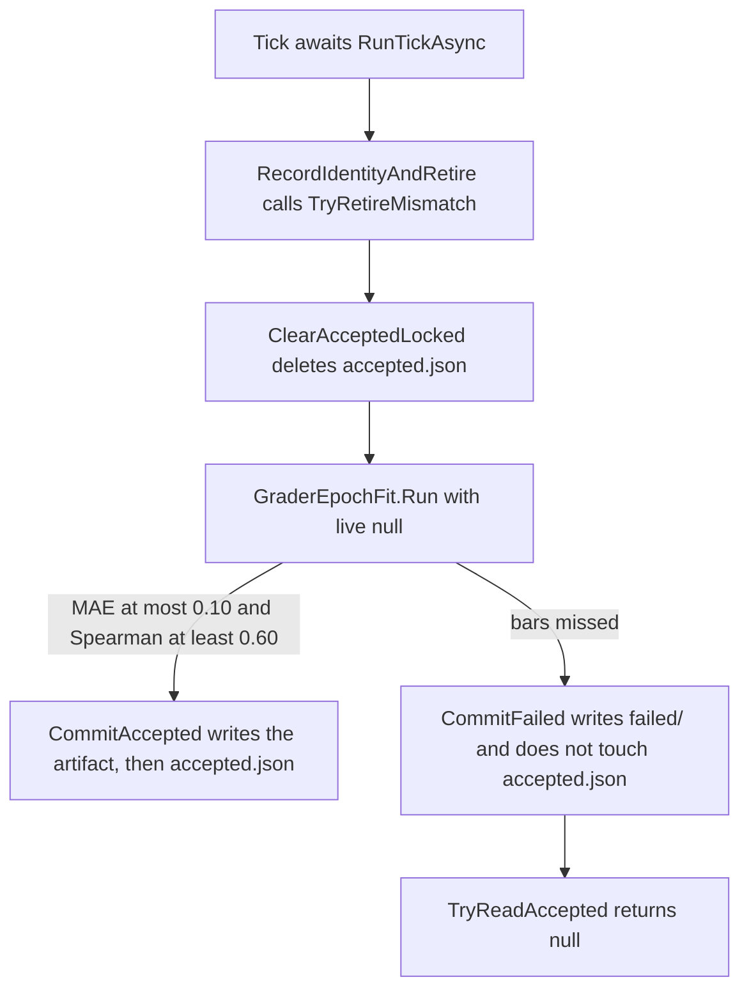

# Plan: #358 retirement test loses the artifact when one SDCA draw misses the gate

> **For agentic workers:** REQUIRED SUB-SKILL: Use superpowers:subagent-driven-development (recommended) or superpowers:executing-plans to implement this plan task-by-task. Steps use checkbox (`- [ ]`) syntax for tracking.

**Goal:** Stop `Retirement_TeacherModelPromptBgeOrFeatureSchema_RetiresArtifact` from failing CI when one SDCA draw misses the holdout bars after retirement has already deleted the accepted pointer. Approval covers both tasks: the test retry (Task 1) and the gate-failed log sentence (Task 2). Task 2 is a one-sentence production log change plus the assertions and the phase 7 plan row that quote it.

**Architecture:** The tick retires a mismatched artifact before it fits. A fit that misses the gate files the candidate under `failed/` and does not write `accepted.json`. The pointer stays absent, `TryReadAccepted` returns null, and no exception is logged. The trainer's draw is not deterministic, and on this fixture about one draw in 1,800 misses the MAE bar. The test ticks once. The fix ticks again, a few times, only when the logs say the code kind missed the gate. A skip or an unreadable pointer still fails on the first tick.

**Tech Stack:** C# / .NET 10, xUnit v3 4.0.2, Microsoft.ML 5.0.0 SDCA (`NumberOfThreads` left unset, shuffle default true).

**Status:** Waiting for David's approval. This pull request is docs only. It does not change source, tests, project files, or workflows. Implementation waits for David's explicit sign-off on this file, per [standing rules](../router/standing-rules.md).

**Issue:** [#358](https://github.com/davidpizon/TotallyHot-ArcRouter/issues/358).

**Tree this plan was read against:** `37dfd1d0` (`main`). The failing job built `13ba74025e37397280765f9d9000e5f97dc42cc1`. `git diff 13ba74025e37397280765f9d9000e5f97dc42cc1 HEAD` is empty for `GraderEpochHostedService.cs`, `GraderEpochFit.cs`, `GraderEpochTrainer.cs`, `GraderEpochArtifactStore.cs`, and `GraderEpochPhase7Tests.cs`.

**Engines:** CodeGraph (`npx @colbymchenry/codegraph init -y` in this pass; 1,390 files, 26,046 nodes, 75,501 edges, then `codegraph_explore` on the tick, the retire, and the commit). Serena (`find_symbol` with bodies, session against `/workspace`, C# language server) read `AssertRetire`, `RunKindAsync`, `RecordIdentityAndRetire`, `GraderEpochFit.Run`, `TryReadAccepted`, `CommitFailed`, `GraderEpochTrainer.Fit`, and `SeedLinear`. Both tools returned source. Serena was not skipped. This is not a smell to file. The observed cost is the CI flake below, and the fix for that cost is the test retry in Task 1. ADR-0008 Amendment 1 leaves a production refactor of the tick unscheduled.

## Global Constraints

- C# / .NET only. BGE stays frozen. Unknown cost is null, never 0.
- `TreatWarningsAsErrors` stays on. A changed `///` summary matches the method after the edit. A stale sentence is a wrong sentence.
- The implementation pull request links this file and stays a draft until the proof runs below are green.
- Do not push to `main`. Do not edit a workflow.
- A new unit test stays under the 5-second bound. The 18,000-fit probe stays out of the suite.

## Observed cost

ADR-0008 Amendment 1. One red **Build and test** job on a docs-only pull request, after [#353](https://github.com/davidpizon/TotallyHot-ArcRouter/pull/353) had already landed the [#350](https://github.com/davidpizon/TotallyHot-ArcRouter/issues/350) pool-clear fix.

| Commit | What the commit changed | .NET CI |
|---|---|---|
| [`13ba740`](https://github.com/davidpizon/TotallyHot-ArcRouter/commit/13ba74025e37397280765f9d9000e5f97dc42cc1) on PR #356 | One markdown file | [run 40598152298](https://github.com/davidpizon/TotallyHot-ArcRouter/actions/runs/40598152298) job [122519756805](https://github.com/davidpizon/TotallyHot-ArcRouter/actions/runs/40598152298/job/122519756805) failed, attempt 1. Image `ubuntu-24.04`. 4,150 tests: 4,108 succeeded, 41 skipped, 1 failed. |

The job log contains the string `threw unexpectedly` zero times. [#353](https://github.com/davidpizon/TotallyHot-ArcRouter/pull/353) makes `World.Tick` fail the test when that line is present, before `Assert.NotNull`. This failure is the null assert, so the tick returned and the swallowed-exception path did not run.

## What the stack names

```
Assert.NotNull() Failure: Value is null
  at GraderEpochPhase7Tests.AssertRetire(...) in GraderEpochPhase7Tests.cs:979
  at GraderEpochPhase7Tests.Retirement_TeacherModelPromptBgeOrFeatureSchema_RetiresArtifact() in GraderEpochPhase7Tests.cs:682
```

The test reported 593 ms. Line 979 is `Assert.NotNull(accepted)` after `TryReadAccepted(GraderEpochKinds.Code)`. Line 682 is the fourth await in the test method:

```681:682:src/TotallyHotArcRouter.Tests/Judge/GraderEpochPhase7Tests.cs
        await AssertRetire(field: "BGE model id", mutate: world => world.RetargetBge("bge-next"));
        await AssertRetire(field: "feature schema", mutate: _ => { }, schemaVersion: 2);
```

The teacher-model await (line 671), the prompt-version await (line 676), and the BGE await (line 681) had returned. The feature-schema call is the one whose `AssertRetire` saw a null pointer. [#350](https://github.com/davidpizon/TotallyHot-ArcRouter/issues/350)'s earlier failure of this same method was the prompt-version await, at the old line 676. Same assert shape, different case. The feature-schema case passes `schemaVersion: 2` and a mutate that does not touch the database.

## What is proven about this tick



Proven from the current source, which matches the job's commit on these files:

- `AssertRetire` builds a private world (`Path.GetTempPath()/grader-epoch-{guid}`), seeds 24 linear rows, plants an artifact, mutates, awaits `Tick`, then reads. `World.Tick` awaits `RunTickAsync` and then `AssertTickDidNotThrow`. The null assert is after that. The read is not racing the tick.
- `RunKindAsync` calls `RecordIdentityAndRetire` at line 135, before `var live = _store.TryReadAccepted(kind)` at line 188. `TryRetireMismatch` deletes `accepted.json` when `FeatureSchemaVersion` differs (`ClearAcceptedLocked`, line 428). Schema version 2 differs from `GraderEpochArtifact.SchemaVersion` (1). The planted file stays on disk for the later `File.Exists` assert. The pointer is gone.
- With `live` null, `GraderEpochFit.Run` sets `passed` from MAE and Spearman only (lines 126–128). The bootstrap block is inside `if (passed && live is not null)` and does not run. `MaxHoldoutMae` is 0.10 and `MinSpearman` is 0.60. `PreviousArtifactId` on a pass is null, which is what `Assert.Null(accepted.PreviousArtifactId)` locks in.
- A pass calls `CommitAccepted`, which writes the artifact file and then replaces `accepted.json`. A miss calls `CommitFailed`, whose summary says `accepted.json` is not created or replaced. Phase 7 decision C says the same thing: a failed gate does not write the pointer. After a retirement, "not replaced" means the pointer stays deleted.
- `RunTickAsync` logs `threw unexpectedly` only from its catch. `CommitFailed` does not throw on a gate miss. `World.Tick` would have failed the test on that log line. The job has no such line.
- The three earlier `AssertRetire` calls in this same method use `World.Small()` (`MinimumLabels` 24, `HoldoutSize` 6, `MinimumTrainingRows` 12) and `SeedLinear(count: 24, holdout: 6)`, and each one got past `Assert.NotNull`. Those thresholds were met. `schemaVersion` is stored on the artifact file. `LoadForKindAsync` does not read it. A skip for too few labels would happen on every run of this case, and the case usually passes. The job's fourth case is the intermittent one.
- `TryReadAccepted` can also return null when the pointer file is present but unreadable, and it logs that on the store logger (`StoreLog`), not on `ServiceLog`. Nothing in the test prints either list. The job log therefore cannot show "gate failed" or "could not be read". That is the missing line. Task 1 puts both lists into the assert message. The unreadable branch is the one this plan does not claim to have reproduced. `CommitAccepted` writes the artifact, then replaces `accepted.json` by a temp file and a move, under the store lock, and the world's directory is private. No other writer runs after `Tick` returns. A gate miss is the branch that matches the code and the measurement below.

## What was measured this pass

`GraderEpochTrainer.Fit` (lines 48–50) calls `Trainers.Sdca(lossFunction: new SquaredLoss(), maximumNumberOfIterations: 100)` and does not pass `NumberOfThreads`. Microsoft.ML 5.0.0's XML doc for `SdcaTrainerBase.OptionsBase.NumberOfThreads` says the degree of lock-free parallelism "Defaults to automatic depending on data sparseness. Determinism is not guaranteed." Shuffle defaults to true. `MLContext` is constructed with `seed: options.RandomSeed` (default `20261025`). The seed does not make this overload deterministic.

A throwaway probe (not in the repo, not run as a test) repeated that `Sdca` call on the matrix this fixture encodes. `SeedLinear` sets the label equal to `response_vector[0]`, with values 0.2, 0.5, 0.8 cycling by row, `response_vector[1] = 0.15 + 0.5 * response_vector[0]`, and `response_has_code` on even rows. Question, analysis, syntax, and length are absent, so `GraderEpochFeatures.Names` / `Encode` drop those slots. The vector is `response_has_code`, `response_vector[0]`, `response_vector[1]`. Training rows are the oldest 18. Holdout is the newest 6. Predictions are clamped to `[0, 1]`, matching `GraderEpochFeatures.Score`. A miss is MAE above 0.10 or Spearman below 0.60 or a non-finite score. The probe does not call `GraderEpochFit.Run` and does not open SQLite. The non-deterministic step in the production fit is this trainer call.

This machine has 4 processors. Three sequential samples, default thread count:

| Fits | Gate misses | MAE of the misses |
|---|---|---|
| 2,000 | 1 | 0.207 |
| 8,000 | 6 | 0.113, 0.136, 0.139, 0.139, 0.139, 0.156 |
| 8,000 | 3 | 0.110, 0.120, 0.122 at fit indexes 1456, 4890, and 4968 |

10 misses in 18,000 fits. The bulk of the MAE values sit between 0.00 and 0.02. The misses are a separate draw, not a pile-up against the bar: one 8,000-fit sample had a single weight vector (`-0.0532, 0.3468, 0.2032`) three times at MAE 0.139, and the indexed sample's three misses are hundreds of fits apart. A later fit is an independent draw. No miss was non-finite. `NumberOfThreads = 1` is a different outcome: 20 of 20 fits, one weight vector, MAE 0.508941 every time. That vector did not appear in the 18,000 default-thread fits. [#350](docs/plans/issue-350-flaky-grader-epoch-phase7-tests.md) measured 0 misses in 200 default-thread fits and MAE from 0.008 to 0.055, and the same always-fail result at one thread. Two hundred fits sit inside the bulk. They do not show this tail.

Every recorded miss had MAE above 0.10. The Spearman bar was not what separated those fits from the rest. The retirement method fits four worlds, so its chance of a miss is on the order of 4/1,800, about one run in 450. `Bootstrap_NotRun` adds one more fit. One red job on a docs pull request is in that range. The feature-schema case was the fourth draw of four. The stack landing there is what a rare miss looks like.

## Decisions

| # | Decision |
|---|---|
| 1 | The flake fix is in the test. `RunKindAsync` still fits once per tick. Phase 7 already retries on the timer (`CheckIntervalMinutes` defaults to 5). No production incident is recorded. A same-tick production refit is a product change and is out of this issue. |
| 2 | `AssertRetire` and `Bootstrap_NotRun_WhenNoComparableLiveArtifact` both retire, then require a new pointer from one tick. Both call the helper in Task 1. `Bootstrap_ReplacesOnlyWhenLowerBoundGreaterThanZero` keeps its single tick. A miss there leaves the planted pointer in place and fails a different assert. It has not failed since #353. See the question at the end. |
| 3 | The helper retries only when a service line contains `gate failed for kind code` (the kind constant, not the literal in new code). It does not retry when a service line contains `skipped code:`, or when a store line for kind `code` contains `unreadable` or `could not be read`. The non-code kind logs `skipped non-code:` on this fixture because it has no labels. That line must not block the retry. `skipped non-code:` does not contain `skipped code:`. |
| 4 | Four attempts, counting the first tick. `World.Tick` still runs `AssertTickDidNotThrow` on every attempt, so a swallowed exception still fails immediately. |
| 5 | Do not set SDCA `NumberOfThreads` to 1. On this fixture that misses the gate on every fit. The measured tail already happens with the default thread count. A pinned thread count that removes the tail is a different plan, the one #350 deferred. |
| 6 | The gate-failed log sentence changes. It currently ends with "The accepted artifact was left unchanged." After `TryRetireMismatch` the pointer is already gone, so that sentence is false on the path this job hit. The replacement is "No new accepted artifact was written." That is true when a live artifact stays and when the pointer was already deleted. The bars, `CommitFailed`, and the accept path stay as they are. |

## Risks

- A retry hides a fixture that has started missing the gate on most draws. Four attempts still fail when every draw misses, which is what `NumberOfThreads = 1` does on this matrix. `GateFail_BelowBar` and `Holdout_ZeroVariance` stay on one tick, so a fixture that is supposed to miss keeps missing.
- The non-code skip line is easy to get wrong. `skipped non-code:` must not be treated as `skipped code:`. The theory's second case is that pair of lines. A helper that retries on any skip, or that refuses to retry when any skip is present, fails that case.
- The job log still does not contain the service lines from the red run. Task 1's assert message is how the next red run shows them. If that message says the pointer could not be read, the helper is required to fail, and the unreadable read becomes the next plan.
- One hundred green runs will usually contain no miss. They do not prove a retry happened. The theory is the proof of the branch.

## Out of scope

- A production loop inside `RunKindAsync`.
- Pinning SDCA threads, or making the trainer deterministic.
- `Bootstrap_ReplacesOnlyWhenLowerBoundGreaterThanZero`, unless David answers the question below by asking for it.
- [#354](https://github.com/davidpizon/TotallyHot-ArcRouter/issues/354) and [#355](https://github.com/davidpizon/TotallyHot-ArcRouter/issues/355). A key-directory failure throws from `World.Create` or is caught and logged as `threw unexpectedly`. This job did neither.
- Editing `accepted.json` locking. The write is already under the store lock, artifact file first, pointer last.
- Serializing the test assembly.

## Files

- Modify: `src/TotallyHotArcRouter.Tests/Judge/GraderEpochPhase7Tests.cs` (`AssertRetire`, `Bootstrap_NotRun_WhenNoComparableLiveArtifact`, three `left unchanged` assertions, two new helpers, one theory).
- Modify: `src/TotallyHotArcRouter/Hosting/GraderEpochHostedService.cs` (one log template, line 240).
- Modify: `docs/plans/issue-304-phase-7-grader-epoch.md` (the gate-failed row in the log table, so the sentence matches the template).
- Leave: `GraderEpochTrainer.cs`, `GraderEpochFit.cs`, `GraderEpochArtifactStore.cs`.

## Tasks

### Task 1: Retick when the code kind missed the gate

**Files:**

- Modify: `src/TotallyHotArcRouter.Tests/Judge/GraderEpochPhase7Tests.cs`

**Interfaces:**

- Consumes: `World.Tick`, `World.ServiceLog`, `World.StoreLog`, `World.Store.TryReadAccepted`, `GraderEpochKinds.Code`.
- Produces: `ShouldRetick(IReadOnlyList<string> serviceLines, IReadOnlyList<string> storeLines)` and `RequireCodeArtifact(World world, string whenMissing)`.

- [ ] **Step 1: Add the failing theory**

`ShouldRetick` does not exist yet. This theory is the contract. `Assert.Equal` fails until Step 3 adds the method.

```csharp
[Theory]
[InlineData("Grader epoch gate failed for kind code. Holdout MAE 0.14.", "", true)]
[InlineData("Grader epoch gate failed for kind code.\nGrader epoch skipped non-code: eligible labels 0 are below the minimum 24.", "", true)]
[InlineData("Grader epoch skipped code: eligible labels 23 are below the minimum 24.", "", false)]
[InlineData("Grader epoch gate failed for kind non-code.", "", false)]
[InlineData("", "Grader epoch accepted artifact for kind code could not be read.", false)]
[InlineData("", "Grader epoch accepted pointer for kind code is unreadable; treating it as no artifact.", false)]
[InlineData("", "", false)]
public void ShouldRetick_OnlyAfterACodeGateMiss(string service, string store, bool expected)
{
    var serviceLines = service.Length == 0 ? [] : service.Split('\n');
    var storeLines = store.Length == 0 ? [] : store.Split('\n');
    Assert.Equal(expected, ShouldRetick(serviceLines, storeLines));
}
```

- [ ] **Step 2: Run the theory and confirm it fails to compile**

```bash
dotnet build src/TotallyHotArcRouter.Tests/TotallyHotArcRouter.Tests.csproj -c Release --nologo
```

Expected: build failure, `ShouldRetick` is not defined. Do not suppress it.

- [ ] **Step 3: Add the helpers and call them from the two retirement waits**

Place the helpers next to `AssertTickDidNotThrow`. `Assert.Fail` is `[DoesNotReturn]` in xUnit v3 4.0.2, so the method can return `GraderEpochArtifact` without a second return.

```csharp
private const int RetickAttempts = 4;

/// <summary>
/// Ticks until the code kind has an accepted artifact, or the logs say this miss is not a bad draw.
/// Retirement deletes the pointer before the fit. A fit that misses the holdout bars does not write
/// a new pointer, and the trainer's draw is not deterministic. Another tick is another draw.
/// The loop stops when the code kind was skipped or the store could not read the pointer, so those
/// failures still surface on the first tick.
/// </summary>
/// <param name="world">The world whose tick and logs to use.</param>
/// <param name="whenMissing">Text placed above the logs when no artifact appears.</param>
/// <returns>The accepted code artifact.</returns>
private static async Task<GraderEpochArtifact> RequireCodeArtifact(World world, string whenMissing)
{
    for (var attempt = 0; attempt < RetickAttempts; attempt++)
    {
        await world.Tick();
        var accepted = world.Store.TryReadAccepted(GraderEpochKinds.Code);
        if (accepted is not null) return accepted;
        if (!ShouldRetick(world.ServiceLog.Lines, world.StoreLog.Lines)) break;
    }

    Assert.Fail(whenMissing + Environment.NewLine + string.Join(Environment.NewLine,
        world.ServiceLog.Lines.Concat(world.StoreLog.Lines)));
}

/// <summary>
/// True when the code kind missed the holdout bars and the store did not report an unreadable pointer.
/// A skipped code kind, an unreadable code pointer, and a miss on the non-code kind are false.
/// </summary>
/// <param name="serviceLines">Lines from the hosted-service logger.</param>
/// <param name="storeLines">Lines from the artifact-store logger.</param>
/// <returns>True when another tick is the right next step.</returns>
private static bool ShouldRetick(IReadOnlyList<string> serviceLines, IReadOnlyList<string> storeLines)
{
    var kind = GraderEpochKinds.Code;
    if (storeLines.Any(line =>
            line.Contains($"for kind {kind}", StringComparison.Ordinal) &&
            (line.Contains("unreadable", StringComparison.Ordinal) ||
             line.Contains("could not be read", StringComparison.Ordinal))))
        return false;

    if (serviceLines.Any(line => line.Contains($"skipped {kind}:", StringComparison.Ordinal)))
        return false;

    return serviceLines.Any(line =>
        line.Contains($"gate failed for kind {kind}", StringComparison.Ordinal));
}
```

`ServiceLog.Lines` and `StoreLog.Lines` append for the life of the world. Do not clear them between attempts. A `gate failed for kind code` line from an earlier attempt stays, which is why a later attempt may still retry. A `skipped code:` line from any attempt stops the loop.

In `AssertRetire`, delete the `await world.Tick()`, the `TryReadAccepted` line, and `Assert.NotNull(accepted)` together. Leave one assignment:

```csharp
var accepted = await RequireCodeArtifact(world, $"No accepted artifact after retirement of {field}.");
```

Keep the four asserts that follow (`NotEqual`, `Null` previous id, `File.Exists`, the retirement log line). They already describe the contract. A second `var accepted` left behind the helper does not compile.

In `Bootstrap_NotRun_WhenNoComparableLiveArtifact`, delete `await world.Tick()`, the `TryReadAccepted` line, and `Assert.NotNull(accepted)` together. Leave one assignment:

```csharp
var accepted = await RequireCodeArtifact(world, "No accepted artifact after retiring a non-comparable teacher.");
```

Keep the bootstrap-null asserts and the retirement log assert.

- [ ] **Step 4: Build and run the theory**

```bash
dotnet build src/TotallyHotArcRouter.Tests/TotallyHotArcRouter.Tests.csproj -c Release --nologo
src/TotallyHotArcRouter.Tests/bin/Release/net10.0/TotallyHotArcRouter.Tests \
  -method TotallyHot.ArcRouter.Tests.Judge.GraderEpochPhase7Tests.ShouldRetick_OnlyAfterACodeGateMiss
```

`dotnet test` on this SDK can report "Zero tests ran". Use the built host, as `AGENTS.md` says. Expected: build 0 warnings, 0 errors; the theory passes 7 cases.

### Task 2: Make the gate-failed sentence true after a retirement

**Files:**

- Modify: `src/TotallyHotArcRouter/Hosting/GraderEpochHostedService.cs` line 240
- Modify: `src/TotallyHotArcRouter.Tests/Judge/GraderEpochPhase7Tests.cs` lines 50, 213, and 261
- Modify: `docs/plans/issue-304-phase-7-grader-epoch.md` the gate-failed row of the log table

**Interfaces:**

- Consumes: nothing from Task 1. The retry matches `gate failed for kind`, which stays in the template.
- Produces: the log sentence `No new accepted artifact was written.`

- [ ] **Step 1: Replace the last sentence of the template**

The template stays one static string literal. Change only the closing sentence, from `The accepted artifact was left unchanged.` to `No new accepted artifact was written.`

Leave the property names and the `Marker(...)` arguments as they are. `RunKindAsync`'s `///` summary does not quote the old sentence. Do not add one.

- [ ] **Step 2: Update the three assertions and the phase 7 log row**

In `GraderEpochPhase7Tests`, the three `Contains(..., "left unchanged")` checks are `GateFail_BelowBar_DoesNotAcceptOrRewriteGrades`, `Holdout_ZeroVariance_SpearmanNull_GateFails`, and the second half of `Bootstrap_ReplacesOnlyWhenLowerBoundGreaterThanZero`. Change the searched text to `No new accepted artifact was written.` Leave the neighboring `Spearman null` and `bootstrap low` checks in place.

In `docs/plans/issue-304-phase-7-grader-epoch.md`, the gate-failed row says the log records that the accepted artifact was left unchanged. Change that cell so it says the log records that no new accepted artifact was written, including when a retirement already cleared the pointer. Leave the rest of that plan as the record of phase 7.

- [ ] **Step 3: Build**

```bash
dotnet build src/TotallyHotArcRouter.Tests/TotallyHotArcRouter.Tests.csproj -c Release --nologo
```

Expected: 0 warnings, 0 errors.

### Task 3: Prove the two retirement waits and the log sentence

**Files:** none. This task is the gate for the implementation pull request.

- [ ] **Step 1: Run the two methods 100 times**

```bash
host=src/TotallyHotArcRouter.Tests/bin/Release/net10.0/TotallyHotArcRouter.Tests
fail=0
for i in $(seq 1 100); do
  "$host" -method TotallyHot.ArcRouter.Tests.Judge.GraderEpochPhase7Tests.Retirement_TeacherModelPromptBgeOrFeatureSchema_RetiresArtifact \
    || fail=$((fail+1))
  "$host" -method TotallyHot.ArcRouter.Tests.Judge.GraderEpochPhase7Tests.Bootstrap_NotRun_WhenNoComparableLiveArtifact \
    || fail=$((fail+1))
done
echo "failures=$fail"
```

One `-method` per invocation. Two hundred invocations, one hundred of each method.

Expected: `failures=0`. One hundred runs of the retirement method can easily contain zero gate misses (about one run in 450). Green runs show the helpers did not break the contract. They do not by themselves show a retry absorbing a miss. The theory in Task 1 is what locks the branch. If a run fails, stop. Paste the assert message into the implementation pull request. A message that contains `gate failed for kind code` means the four attempts were not enough or `ShouldRetick` returned false, and this plan's bound needs a new measurement before anyone raises it. A message that contains `could not be read` or `unreadable` is the branch this plan did not reproduce. Do not retune the helper to swallow it.

- [ ] **Step 2: Run the three log-sentence tests and the theory once**

```bash
host=src/TotallyHotArcRouter.Tests/bin/Release/net10.0/TotallyHotArcRouter.Tests
"$host" -method TotallyHot.ArcRouter.Tests.Judge.GraderEpochPhase7Tests.ShouldRetick_OnlyAfterACodeGateMiss
"$host" -method TotallyHot.ArcRouter.Tests.Judge.GraderEpochPhase7Tests.GateFail_BelowBar_DoesNotAcceptOrRewriteGrades
"$host" -method TotallyHot.ArcRouter.Tests.Judge.GraderEpochPhase7Tests.Holdout_ZeroVariance_SpearmanNull_GateFails
"$host" -method TotallyHot.ArcRouter.Tests.Judge.GraderEpochPhase7Tests.Bootstrap_ReplacesOnlyWhenLowerBoundGreaterThanZero
```

One `-method` per invocation. Expected: each command exits 0. `GateFail_BelowBar` and `Holdout_ZeroVariance` expect a miss on every run. They must keep failing the gate and must not go through `RequireCodeArtifact`.

- [ ] **Step 3: One full assembly run**

```bash
src/TotallyHotArcRouter.Tests/bin/Release/net10.0/TotallyHotArcRouter.Tests
```

Expected: 0 failed. This is the check that the log-sentence edit did not leave another assertion behind. A failure in another class stops the pull request. Paste it and explain it. Another run comes after that explanation, when the failure is understood.

- [ ] **Step 4: Commit**

One commit for the theory, the helpers, and the two call sites. One commit for the log sentence, the three assertions, and the phase 7 plan row. Messages in the repo's style, for example `test: retick a grader retirement when the gate misses` and `fix: describe a failed grader gate as writing no artifact`.

## Questions for David

`Bootstrap_ReplacesOnlyWhenLowerBoundGreaterThanZero` can hit the same SDCA tail without deleting the pointer. The planted artifact stays, and the test fails because `PreviousArtifactId` is still null. This plan leaves that test on one tick. Recommendation: leave it. A retry there would mean "keep fitting until a new model beats the live one," which is a different contract from "a retired pointer gets a replacement." It has not failed since #353. A later red build on that assert gets its own plan.
