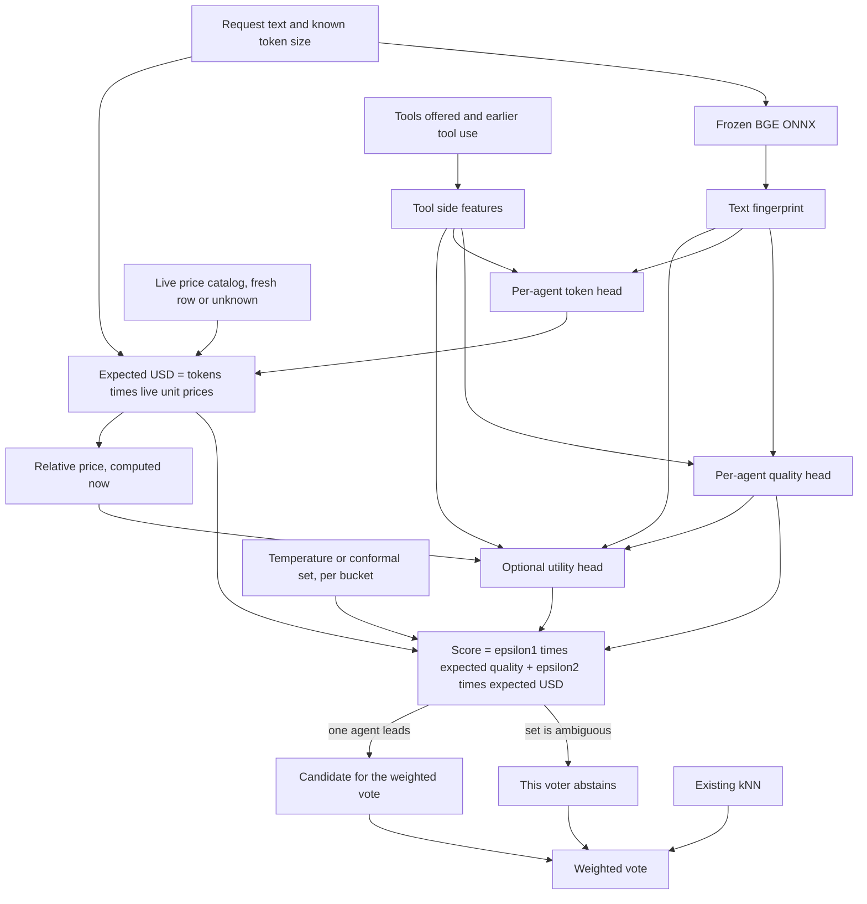

# Plan: Evaluator, dynamic buckets, and live prices

**Status:** Draft, 2026-10-14. Not approved. No coding until David signs off on this file, per the [standing rule](../router/standing-rules.md#approved-plan-before-coding). A comment on this pull request, or on [#290](https://github.com/davidpizon/TotallyHot-ArcRouter/issues/290), [#291](https://github.com/davidpizon/TotallyHot-ArcRouter/issues/291), [#292](https://github.com/davidpizon/TotallyHot-ArcRouter/issues/292), [#293](https://github.com/davidpizon/TotallyHot-ArcRouter/issues/293), or [#294](https://github.com/davidpizon/TotallyHot-ArcRouter/issues/294), is that sign-off.
**Issues:** [#290](https://github.com/davidpizon/TotallyHot-ArcRouter/issues/290) actual cost, [#291](https://github.com/davidpizon/TotallyHot-ArcRouter/issues/291) cost in every normal decision, [#292](https://github.com/davidpizon/TotallyHot-ArcRouter/issues/292) the training epoch, [#293](https://github.com/davidpizon/TotallyHot-ArcRouter/issues/293) grades against the question, [#294](https://github.com/davidpizon/TotallyHot-ArcRouter/issues/294) the meaning fingerprint and dynamic buckets.
**Package review:** [#301](https://github.com/davidpizon/TotallyHot-ArcRouter/issues/301) is the NuGet keep-or-replace note cited in [§21](#21-package-choices). It is not one of the five issues above, and this plan does not implement it.
**Why one file:** David asked for a single plan covering those five issues. This path is that plan. Implementation pull requests link here.
**Research:** [fast-trainable-evaluators.md](../research/fast-trainable-evaluators.md) (abstract shortlist, 2026-10-13), [zhou-2606.22902-deviation-audit.md](../research/zhou-2606.22902-deviation-audit.md), and the paper files indexed in [papers/README.md](../research/papers/README.md).
**Source paper, unchanged:** Zhou et al., Agent-as-a-Router, arXiv:2606.22902. The system in that paper is ACRouter. Reward \(r = \varepsilon_1 s + \varepsilon_2 \kappa\) with \((\varepsilon_1, \varepsilon_2) = (1, -0.1)\) in their evaluation.

This document specifies a design. It does not add code, and it does not report an experiment this repository has not run.

## Goal

Pick the configured agent with the highest expected quality minus a weighted expected cost, for every normal request, not only helper traffic.

The quality and cost predictions are small models over a meaning fingerprint. The fingerprint is a text vector plus a separate block of tool-call signals known before the route is chosen. Signals that exist only after the response are training labels, not inputs. Buckets are a summary of that fingerprint, recomputed each training epoch, and the pre-routing tool block may shape them. The existing kNN voter is the baseline a new voter has to beat. Calibration can abstain. Training during an epoch runs in C# on the router. Python is not part of the epoch.

Live vendor prices enter the decision. The papers this plan cites keep a fixed quality-to-cost weight, and the prices they use are a snapshot. This plan keeps the fixed weight as the default and replaces the snapshot with the catalog this repository already ingests.

## What is already true

These facts constrain the design. They are the current code and docs, not a proposal.

- The orchestrator and agent paths do not read `Epsilon1` or `Epsilon2`. Only `UtilityRoutingPolicy` ranks on \(\varepsilon_1 \cdot\) quality \(+ \varepsilon_2 \cdot\) a blended catalog rate in USD per million tokens. Live regret accounting uses the same algebraic form of \(r\) after the fact. See [how-it-learns.md](../how-it-learns.md).
- Defaults are `Epsilon1 = 1` and `Epsilon2 = -0.1`, matching the paper's evaluation pair. On the utility path the cost term is USD per million tokens. In the paper, \(\kappa\) is monetary cost. Those are different units. A later change has to say which unit \(\varepsilon_2\) multiplies.
- `transcript.Cost` is the telemetry estimate `estimatedCostUsd` (`RequestTelemetryPublisher`). Rows that the taxonomy comparison calls `ActualCostUsd` are that estimate. The estimate is token counts times a catalog price when the catalog row is fresh, `0` for a provider flagged free, and null otherwise ([telemetry.md](../router/telemetry.md#pricing)). Nothing in the request path reads a provider's billing API for the charge.
- The price catalog is live: LiteLLM and OpenRouter, a 24-hour freshness floor (D1 in [model-price-catalog.md](../router/model-price-catalog.md)), an in-memory cache, and no network read on the request path. A missing or stale price is unknown. There is no hand-written price table. D5 forbids serving catalog prices on a public API. D1 currently says a model with no price fetched in the last 24 hours must not be an auto-selected routing target. That rule is about selection, not about an explicit client pick.
- BGE-large-en-v1.5 runs frozen through ONNX (`OnnxEmbeddingClient`). Memory kNN uses cosine similarity, threshold 0.5, k = 10, FIFO capacity 20,000.
- `EmbeddingLogRegTrainer` already fits one ridge linear head per model on that embedding, in C#, by batch gradient descent, with no Python and no ONNX training. It predicts a score. Live rows only contain the score of the model that actually ran, so the head is regression on the chosen model, not a label of which model won.
- `SphericalKMeansTrainer` already clusters unit embeddings in C# and picks \(k\) by a silhouette sweep.
- `LogRegTrainer` (the TF-IDF baseline) can train only on the OOD split. The ID splits publish `task_id`, split, and dimension, and do not publish task text, for all 9,999 ID rows. OOD publishes a prompt, and both ID and OOD rows can carry `cost_usd` and token counts (`input_tokens` / `output_tokens` on ID, `in_tok` / `out_tok` on OOD).
- Voters may abstain. If the embedding model changes, stored vectors are not scored against the new space.
- Graders do not read the question ([#293](https://github.com/davidpizon/TotallyHot-ArcRouter/issues/293)). A grade today is "does this response look well-formed," not "did it answer."
- Voter weights (dim_best 0.9, memory_kNN 0.57, logreg 0.43, llm_router 0.64, cluster_best 0.5) were set by hand.
- [ADR-0025 Amendment 1](../adr/0025-serve-persisted-turn-details-and-a-session-aggregate-on-a-metadata-only-rpc.md) (accepted 2026-10-13) specifies a nullable `has_tool_calls` column on `request_transcripts`. NULL means unknown: rows captured before the column, imported turns, providers with no `ProviderRegistration`, and bodies that could not be parsed. It is never stored as `false` in those cases. The specified detection is a yes/no from `OpenAiResponseTextParser` and `AnthropicResponseTextParser` on the captured response body. It is not a count, not a kind, and not a total for a multi-turn tool loop. The current `Transcripts` code does not yet write the column; the steps that would are in [issue-176 phase 2](issue-176-phase2-persisted-turn-details.md). This plan does not implement that column. It uses the flag as the recording that exists in the design, and [§6.1](#61-tool-call-side-features-294) says what has to be recorded beyond it.

## What the papers do with cost

The shortlist, written from abstracts, says no cited paper takes raw prices as an end-to-end input and that the trade-off weight is fixed. The HTML read on 2026-10-14 supports the second claim and sharpens the first.

| Paper | How cost enters | Weight | Live price |
|---|---|---|---|
| [Li, kNN](../research/papers/2505.12601-knn-beats-learned-routers.md) §3, equation (1) | \(m^\* = \arg\max_m s(x,m) - \lambda\, c(x,m)\). \(c\) may depend on input and output length. | \(\lambda\) is chosen by the user and held fixed. | No ingestion story. |
| [MixLLM](../research/papers/2502.18482-mixllm.md) §3.4, equations (5) and (8) | Predicted cost is prompt length times an input unit price, plus a predicted response length times an output unit price. The length model does not emit dollars. | Willingness to pay \(\lambda\) is fixed inside \(s = \frac{\lambda}{\lambda+1}\hat p - \frac{1}{\lambda+1}\hat c\). | Unit prices are constants in the formula. |
| [IRT-Router](../research/papers/2506.01048-irt-router.md) §3.1 | Performance is predicted from embeddings. Cost is a fixed map of the model's output price into \([0,1]\) (GPT-4o at $10/M maps to 1). | \(\alpha + \beta = 1\), chosen in advance. | The paper says the fixed cost is the simplest form, and that a user could set a self-hosted model to 0. |
| [RouteLLM](../research/papers/2406.18665-routellm.md) | The win model does not see a price. A threshold \(\alpha\) on \(P(\text{strong wins})\) is the cost knob. Dollars are computed afterwards at $24.7/M and $0.24/M. | \(\alpha\) is swept, not learned from a price feed. | Static rates in an appendix. |
| [Hybrid LLM](../research/papers/2404.14618-hybrid-llm.md) | Cost is the fraction of queries sent to the large model. The test-time knob is a threshold on a quality-gap score. | The threshold is chosen on a validation slice. | No vendor price. |
| [RouterBench](../research/papers/2403.12031-routerbench.md) §5.1 | Predictive score is predicted performance minus \(\lambda\) times a cost-per-token approximation. | \(\lambda\) is willingness to pay, swept to draw a curve. | Dataset costs, not a feed. |
| [RouterDC](../research/papers/2409.19886-routerdc.md) appendix I | The main router scores LLMs by correctness and does not see a price. One appendix adds \(c\) into the training score on two RouterBench tasks. | Not a live weight. | Historical cost inside the training score. |
| [GraphRouter](../research/papers/2410.03834-graphrouter.md) | LLM-query edges are initialized with performance and cost concatenated. Cost is computed from token counts and Together API rates when the dataset is built. | Preference between performance and cost is a setting of the experiment. | A training-time snapshot stored on the edge. |
| [FrugalGPT](../research/papers/2305.05176-frugalgpt.md) | A cascade stops when a scorer accepts an answer, subject to a budget. Prices were read in March 2023 and can be input, output, and a per-request fee. | The budget \(b\) is chosen by the user. | A dated snapshot. The scorer sees the answer, so this is not a pre-routing evaluator. |
| Zhou et al., arXiv:2606.22902 | \(r = \varepsilon_1 s + \varepsilon_2 \kappa\). | \((1, -0.1)\) in the evaluation. | Table 6 in the paper is a fixed price table. Matching it is not a goal ([#290](https://github.com/davidpizon/TotallyHot-ArcRouter/issues/290)). |

MixLLM is the closest formula: predict a length, multiply by a unit price outside the learned length model, then apply a fixed weight. GraphRouter is the pattern to avoid for a live catalog: a dollar amount baked into a trained edge goes stale when the vendor changes the rate. This plan uses MixLLM's split, and points the unit price at the catalog row that is fresh at decision time.

[Temperature scaling](../research/papers/1706.04599-temperature-scaling.md) and [conformal prediction](../research/papers/2107.07511-conformal-prediction.md) do not route and do not price. They are the calibration layer. The shortlist's gap still holds for them: there is no conformal paper in this set that is specific to LLM routers.

## Recommended system

Every box that learns is fit during the epoch in [§11](#11-the-training-epoch-292), in C# as [§13](#13-no-python-training-stays-in-c) requires. Phase 3 may fit shadow heads earlier, with no bucket step. BGE stays the frozen ONNX session it is today. The tool block drawn above is only what is known before routing. Counts, kinds, successes, errors, retries, turns, and the cost of the tool loop are labels after the response. They are not inputs, and they are not drawn into the heads at decision time.

The decision quantity for agent \(a\) on fingerprint \(f\) is

\[
u(a) = \varepsilon_1 \, \hat q(a, f) + \varepsilon_2 \, \widehat{\mathrm{USD}}(a, f)
\]

with \(\widehat{\mathrm{USD}}\) computed in [§12.3](#123-expected-cost-is-tokens-times-the-live-price). The agent with the highest \(u(a)\) is this voter's candidate, unless calibration says the set is ambiguous, in which case the voter abstains.

The sections above are the introduction. Numbering starts at 6 so the design sections keep stable citations.

## 6. Meaning fingerprint ([#294](https://github.com/davidpizon/TotallyHot-ArcRouter/issues/294))

The fingerprint is the input the predictors see. It is a text block plus the pre-routing tool block in [§6.1](#61-tool-call-side-features-294). It is not a bucket id and not a taxonomy label. The two blocks stay separate.

**Default contents of the text block.**

- The BGE-large embedding already produced for memory kNN. Same model identity string `EmbeddingLogRegTrainer` stores today. A change of embedding model makes every stored fingerprint unusable, and voters abstain, which is the rule memory kNN already follows.
- Request-known size features that do not depend on a price: an estimate of billable input tokens for the full request (history, system prompt, tools, and the new turn). [ADR-0009](../adr/0009-per-request-counterfactual-token-estimation.md) already says `prompt_text` is only the newest user message and must not be priced as the whole input. The fingerprint stores the estimate and the method that produced it, so a later reader can tell a counted value from a rough one.

**Not in the fingerprint.** A bucket label. The six live dimension names. The paper's nine dimensions. A raw dollar price. An absolute historical price. Anything known only after the response, including `has_tool_calls` and the tool-loop labels in [§6.1](#61-tool-call-side-features-294). Feeding those in would leak the outcome into the route.

**TF-IDF.** The paper's logreg baseline and this repository's `LogRegTrainer` use TF-IDF. That remains a separate voter. It is not merged into the fingerprint. ID task text is unpublished, so a TF-IDF fingerprint cannot be built for those 9,999 rows. Whether TF-IDF features would help on live text is an evaluation question in [§15](#15-phases), not a result this plan claims.

**SetFit.** [Tunstall et al.](../research/papers/2209.11055-setfit.md) fine-tune a sentence transformer contrastively on a few labeled pairs, then fit a classification head. If that is ever turned on here, the pairs come from data-derived groupings: queries that share a best agent under the cost-adjusted reward, or queries that sit in the same current bucket. The pairs are not the paper's nine dimensions and not the repository's six labels. SetFit is off in the default path. Turning it on is [§13.3](#133-setfit-only-through-torchsharp-and-only-if-the-default-path-loses).

**EmbedLLM and ModernBERT.** [EmbedLLM](../research/papers/2410.02223-embedllm.md) is a way to add an agent as a vector when there is no local history. It is a later option for cold start, not part of the fingerprint. [ModernBERT](../research/papers/2412.13663-modernbert.md) would be a second encoder with a long context. It is not loaded. BGE stays the one embedder until a measured failure of long prompts says otherwise.

**Arch-Router.** [Tran et al.](../research/papers/2506.16655-arch-router.md) use a 1.5B model and user-written policies. That is a teacher or a labeling aid if someone later wants one. It is not on the request path.

### 6.1 Tool-call side features ([#294](https://github.com/davidpizon/TotallyHot-ArcRouter/issues/294))

David approved this split on [#294](https://github.com/davidpizon/TotallyHot-ArcRouter/issues/294#issuecomment-6161356279) (2026-10-13), with the rationale in the [following comment](https://github.com/davidpizon/TotallyHot-ArcRouter/issues/294#issuecomment-6161364942). A request that offers tools is a different job from a plain question: it favors agents that handle tools, and it usually costs more because it runs for several turns. That predicts both quality and cost ([#291](https://github.com/davidpizon/TotallyHot-ArcRouter/issues/291)). `has_tool_calls` records what the response did. The router has to decide before that response exists, so the flag is a label, not an input.

**Beside the embedding, not inside it.** The text block stays the BGE vector. Tool signals are a second block with their own scale, their own missingness, and their own schema version. Changing the embedder invalidates the text block and does not invalidate the tool block. Changing the tool schema invalidates the tool block and does not invalidate stored BGE vectors. Mixing the two inside one vector would hide the tool weight and would throw both away together. The predictors see the pair \((f_{\text{text}}, f_{\text{tools}})\). They do not see a bucket id.

**Before routing, the input block.** Only fields on this request.

- Tools offered on this request: that definitions were sent, which definitions (stored as their names on the routing receipt), how many, and a kind histogram. The histogram keys David named are file edit, shell, search, web, and MCP. Two residual keys are part of this proposal: `other` (a name that was read and matched none of the five) and `unknown` (an entry whose name could not be read). `unknown` is not `other`.
- Earlier tool use already in this request's messages: how many prior tool calls and how many prior tool results the parsed conversation contains. The count comes from those messages. It does not come from earlier receipts, so a session the router did not see, or a session that crosses the migration, is still countable when the client sent the history.

A parsed body with no `tools` key, or with an empty one, is a real zero. NULL is only for a body that was not parsed, or a shape the parser does not understand. NULL is not stored as zero and not stored as `false`. That is the same rule as `has_tool_calls`.

Until a classifier is approved, the five kind counts are NULL, not zero. A parsed name counts toward the total and toward `other`. An unreadable name counts toward `unknown`. Zero in the five kind columns would look like a measurement of tools this router has not classified. Those columns join the learned block when a classifier exists, and that is a new tool-schema version. The first learned block is the definition count, the prior-call count, the prior-result count, the unreadable-name count, and the missingness indicator.

Definition bodies and JSON schemas are not appended to the BGE input by this plan. Raw tool names are on the receipt so an audit can see "which ones." They are not one-hot columns against a product's tool list. Whether name identity should become a feature later, once the five kinds are shown to be too coarse, is an open question.

**After the response, labels only.** These train heads. They are not available when \(u(a)\) is computed.

- Whether this response called tools, the number of calls in this response, and, once a classifier exists, the kind breakdown of those calls.
- Across the loop, not on this response alone: successes, errors, and retries; the number of turns; tokens and cost summed across the whole loop, not only the first reply. A success, an error, or a retry is known when a later request carries the tool result, not when the call is first emitted. Tokens are the token head's label. Cost is \(\kappa\) in [§12.2](#122-record-what-the-request-actually-cost-290). The token head still predicts a count, never a dollar.

`tool_error_count` and `tool_success_count` are NULL when any part of the prefix has no error signal. They are not stored as zero, and they are not a partial sum of the parts that happened to carry a signal. OpenAI-shaped tool results have no standard error field, so a prefix that includes that shape stays NULL for both counts until an ADR defines a rule. A retry is a later call to the same tool name after an error result in the same chain. It is not an HTTP retry of the upstream request.

A tool result that came back without an error is an observation. It is not a grade. The quality head does not train on "the tool call succeeded" as a stand-in for "the task was finished." Task-finished stays with [#293](https://github.com/davidpizon/TotallyHot-ArcRouter/issues/293). Until grades include the question, the epoch may store these outcomes and may fit token heads on loop token totals. It may not fit the quality head on them. That matches [§14](#14-grades-293).

**Weight.** The side-feature coefficients are part of the same C# linear head as the text coefficients. They are fit in the epoch ([#292](https://github.com/davidpizon/TotallyHot-ArcRouter/issues/292)), clamped, and stored on the versioned artifact with the mean and scale used to standardize the block. Standardization is required because a raw count and a BGE coordinate are not the same unit; without it the count swamps the text by accident. The receipt stores a missing value as NULL. At fit time and at serve time that column is set to the training-window mean, which is zero after standardization, and the missingness indicator is set to 1. A present value has indicator 0. The indicator has its own coefficient. The initial accepted coefficient on every tool feature, including the indicator, is 0. If a coefficient's held-out interval includes zero, the refit constrains it to the previous accepted value. It is not fit freely and then overwritten. The column stays. Dropping it would churn the schema, and a later epoch could not grow the weight back without a new feature version. Tool-block coefficients are fit on live rows only. Benchmark rows may train the text coefficients. They carry a separate `row_source` indicator, benchmark or live, so the missingness coefficient is not what absorbs the gap between the two. That missingness weight is not reported as a tool effect.

**Buckets.** `SphericalKMeansTrainer` stays on the unit text embedding. Counts are not unit vectors, so they are not concatenated into that sweep. A second candidate step may split a bucket using only the pre-routing tool block. The split is accepted only when held-out cost-adjusted regret improves by enough to clear the bar in [§11](#11-the-training-epoch-292). Tool-heavy and tool-free traffic can therefore land in different buckets, including on similar text. They are not two hard-coded buckets, and post-response labels do not place the next request. After the fact, a bucket version may report how often its rows called tools. That report is a description, not the rule that assigns a new request.

**Benchmarks.** CodeRouterBench and RouterBench rows do not carry tool-loop traces. On those rows the tool block is missing. The eval does not zero-fill, and it does not claim a tool-feature win from either dataset. [§12.8](#128-offline-evaluation-including-price-shifts) still scores text, tokens, and price.

### 6.2 Recording beyond the yes/no flag

`has_tool_calls` answers one question: did this captured response body contain a tool call? A single search and a long edit-and-test loop are the same `true`. The body is not in SQLite, so old rows cannot be backfilled, and a multi-turn loop is more than one response. The proposal below is a further schema. It needs its own ADR before any code, because [ADR-0025 Amendment 1](../adr/0025-serve-persisted-turn-details-and-a-session-aggregate-on-a-metadata-only-rpc.md) decided the boolean only.

David's comment says to replace the yes/no flag with counts and a kind breakdown. This plan keeps the boolean, and that is a deliberate deviation to confirm: the amendment and the [issue-176 label table](issue-176-phase2-persisted-turn-details.md) already depend on it, and once a call count is known the boolean is exactly `count > 0`. The counts are the features and the labels. The boolean is not a model input. When the count is unknown, the boolean stays NULL. Do not derive `false` from a missing count.

The pre-routing block is a new parse of the request before the route. It does not reuse the response parsers named in the issue-176 plan. Post-response fields are written at capture. Both touch the request path, so the implementation re-runs CodeGraph on `ProxyMiddleware` and `RequestInterceptor` callers, keeps Serilog templates static, and runs the golden-path smoke. This file does not make that edit. Phase 2 also waits until issue-176 step 2.1 has landed, so the boolean exists before counts are kept consistent with it.

| When known | Where stored | Proposed fields | Unknown stays |
|---|---|---|---|
| Before routing, from this request | The routing receipt that also stores the fingerprint. Written whether or not transcript capture is on, because the decision needs it. | `tool_definition_count`; names of the offered tools; `prior_tool_call_count` and `prior_tool_result_count` from the parsed messages; `other` and `unknown` counts. The five kind counts once a classifier exists. | NULL when the body was not parsed or the shape is not understood. A parsed body with no `tools` key, or an empty one, is zero. Prior counts are NULL only when the messages were not parsed. |
| After this response | `request_transcripts`, only while capture is on. Absent when capture is off, and training skips the row's post-response labels. | `tool_call_count`; kind counts of calls made, NULL for the five kinds until a classifier exists | NULL. Not a zero. Not a substitute for the loop. |
| Across the tool loop | The routing receipt, on the request that starts the chain. A copy is written to that request's transcript row when capture is on. Capture being off does not drop the receipt. | turn count; `tool_success_count`, `tool_error_count`, `tool_retry_count`; input, output, cache, and reasoning tokens summed over the same-agent prefix; cost summed the same way, with the [#290](https://github.com/davidpizon/TotallyHot-ArcRouter/issues/290) source; the tool-call ids that link the chain | Tokens are NULL when the chain cannot be reconstructed or any part's tokens are unknown. Cost of the prefix is NULL when any included part's cost is null. `tool_success_count` and `tool_error_count` are NULL when any included part has no error signal. A count is never a partial sum. Outcomes are not inferred from a missing field. |

The chain uses the trailing turn, not every tool result still in the history. Clients resend the whole conversation, so an old tool result is still present on a later, unrelated question. A request continues a chain only when its newest turn is tool results for the previous assistant's tool calls and nothing else. That covers an OpenAI `role: tool` message and an Anthropic `user` message whose content is only `tool_result` blocks for that assistant's `tool_use` ids. The router already accepts both shapes. A user message that carries the user's own text starts a new chain, even if older tool results remain above it. Prior-call counts in the side feature still see those older calls. They do not extend the chain.

A loop of one is a request that does not continue a chain and does not itself emit a tool call that a later request answers. Its loop totals equal that request. If the links cannot be reconstructed, the loop fields are NULL. They are not replaced by the first reply's tokens. The tool-call ids are taken from the parsed request and the parsed response and stored on the routing receipt. They do not depend on transcript capture.

The prefix that belongs to agent \(a\) is the start plus the continuations still served by \(a\), and it stops at the first continuation served by someone else. That next request is its own start. Each request is routed on its own today, so a handoff is normal. The previous agent's label does not include the later agent's tokens or cost.

Loop cost uses the weakest source among its parts. The sum is `actual` only when every part is `actual`. It is `computed` when every part is `actual` or `computed`. It is `catalog` when every part is one of those three and at least one is `catalog`. A null part makes the stored prefix sum null. A gap is not filled with a catalog estimate and then labeled `computed`. Per-request receipts keep their own source and their own cost. The prefix sum does not overwrite those rows. When the sum is null, the prefix is unusable for cost-adjusted learning, as [§12.2](#122-record-what-the-request-actually-cost-290) says. The receipt says the remainder was unknown. Per-request costs stay on the receipt for audit.

Classifying a tool name into file edit, shell, search, web, or MCP is not specified by a product list in this plan. The five kinds are the breakdown David asked to record. Until the classifier in [§19](#19-open-questions) is approved, those five counts stay NULL. Where a chain starts when the client does not echo a tool-call id is the other open question there.

## 7. Predictors

Two heads per configured agent. Each is a function of the text fingerprint and the pre-routing tool block in [§6.1](#61-tool-call-side-features-294). Neither head reads post-response tool outcomes at decision time.

- **Quality head.** \(\hat q(a, f)\) in \([0, 1]\). Same shape as `EmbeddingLogRegTrainer`: a ridge linear model, one head per agent, trained on rows where that agent actually ran. Full-feedback rows (CodeRouterBench OOD, where every model has a score, and RouterBench, where the dataset records every model's outcome) may also train the text coefficients. They are marked so a reader can tell benchmark supervision from live supervision. Tool-block coefficients are not fit on those rows ([§6.1](#61-tool-call-side-features-294)).
- **Token heads.** Two targets, both counts, never a dollar amount. The per-request head trains on every request's own observed input, output, cache, and reasoning tokens. It supplies the own-request term in [§12.3](#123-expected-cost-is-tokens-times-the-live-price) for every request, including continuations. The remainder head trains only on starting requests whose same-agent prefix is fully known. Its label is that prefix's token totals minus the starting request's own counts. It is not trained on continuations, and it is not trained on a chain that cannot be reconstructed. A loop of one has a remainder of zero. The starting request's own input is already known and is not a prediction. Input tokens on later turns of the prefix are part of the remainder, because they are not known when the start is routed.

The heads do not take a bucket id. A bucket split or merge does not invalidate them. That is the design David approved on [#294](https://github.com/davidpizon/TotallyHot-ArcRouter/issues/294) (comment on 2026-10-13). The tool-block coefficients are the learned weight of the side features, fit with the heads ([§6.1](#61-tool-call-side-features-294)).

Live training rows are partial: only the agent that served the request has a grade and a token count. Other agents on that request are not labeled. The benchmark rows are the full-feedback source. Exploration, which this repository already logs as a propensity, is what makes a live row usable for off-policy comparison. The epoch must not invent labels for agents that did not run.

A new agent starts with no head. Until it has enough graded calls (the count is an open parameter, defaulting to the same readiness idea as the epoch gate), its quality head abstains. Its token head may use the deployment's prompt-size prior, the same conditioning [ADR-0009](../adr/0009-per-request-counterfactual-token-estimation.md) describes for counterfactual output length, and that prediction is stored as low confidence. Cost can still be computed from that prior times the live price. Quality cannot be invented.

A removed agent leaves the candidate list on the next request. Its head stays in the versioned artifact for history and does not vote.

## 8. kNN is the baseline

[Li](../research/papers/2505.12601-knn-beats-learned-routers.md) reports that a tuned kNN over query embeddings matches or beats learned routers, and attributes that to locality of model performance in the embedding space. This repository already has that voter.

Every new voter in this plan, including the quality head, the token head, the utility head, and any later SetFit model, is accepted only when it beats memory kNN on held-out cost-adjusted regret. Until then it stays in shadow: it scores, it is logged, and it does not change the route. "Beats" means the difference clears the significance bar in [§11](#11-the-training-epoch-292), not a single better point estimate.

kNN itself is scored with the same reward, including cost, so the comparison is not quality-only against a cost-aware challenger. Tuning \(k\), the 0.5 cosine threshold, and neighbor weighting is in scope as a shadow comparison against the current settings. Changing the shipped kNN settings still has to clear the same bar.

[RouterBench](../research/papers/2403.12031-routerbench.md) uses the same idea one level up: the Zero router is the convex hull of the individual models, and a learned router has to beat that hull. This plan keeps kNN as the required baseline because it is the voter this repository already runs. The Zero-router hull is an additional column on the offline report, not a replacement for kNN.

## 9. Calibration and abstention

Fit on a held-out slice each epoch, in C#, after the heads are refit. The slice is not the training rows.

**Temperature scaling** ([Guo et al.](../research/papers/1706.04599-temperature-scaling.md)). Guo et al. divide a shared logit vector by one scalar \(T > 0\) before the softmax. That one shared \(T\) does not change which class wins. A separate \(T\) per agent would be a different model and can change the ranking, so the first fit does not do that. `EmbeddingLogRegTrainer` emits a ridge regression score, not a softmax logit. For that head, the matching step is Platt scaling on the score (slope and offset, fit on the holdout, weights of the head held fixed), which is the family Guo et al. start from. Use it to make a reported probability less overconfident. Do not use it as the ranking rule: the voter still ranks on \(u(a)\). Guo et al. found the single-parameter temperature form enough on most of their datasets, and found vector and matrix scaling no better and sometimes worse. Do not start with matrix scaling. One \(T\), or one Platt calibrator (slope and offset), may be fit per bucket when the bucket has enough held-out rows; inside that bucket it is still one shared calibrator, not one calibrator per agent.

**Conformal sets** ([Angelopoulos and Bates](../research/papers/2107.07511-conformal-prediction.md), split conformal). Calibration scores are computed on the held-out slice. The prediction set is every agent whose score is no worse than the adjusted \(1-\alpha\) quantile. Marginal coverage is at least \(1-\alpha\) when the calibration rows and the next request are exchangeable. That assumption is false across a price change, a new agent, or a shift in traffic. The guarantee is for the window the quantile was fit on. The epoch refits it. The implementation must not describe the set as a guarantee on the next month's traffic.

**Abstention.** If the conformal set contains more than one agent, this voter abstains. That matches the repository's existing abstaining voters, and it is the use the shortlist inferred from the tutorial. A set of size one votes for that agent. A set that is empty abstains and is logged as a calibration failure, not as a low score.

**Per bucket.** After buckets are formed, the quantile and \(T\) are checked inside each bucket that has enough held-out rows. A bucket that just split and is small borrows its parent's \(T\) and quantile, and it abstains more: the borrowed quantile is widened, or \(\alpha\) is treated as smaller, until the bucket's own sample count crosses the readiness line. David specified this on [#292](https://github.com/davidpizon/TotallyHot-ArcRouter/issues/292) (comment on 2026-10-13). The borrowed parameters are labeled with the parent bucket's version so a later audit can see they were not estimated here.

**Cost intervals.** The token head gets a conformal interval too (residual quantile or conformalized quantile regression, both described in the tutorial). Expected USD is the interval times the live unit price, so the dollar width tracks the current price without a refit. If the top agent's worst-case utility overlaps the next agent's best-case utility, the set is treated as ambiguous and the voter abstains. \(\varepsilon_2\) is negative, so the high end of the cost interval is the low end of utility.

## 10. Dynamic buckets ([#294](https://github.com/davidpizon/TotallyHot-ArcRouter/issues/294))

Buckets summarize the fingerprint. They are used for reporting, for attaching a benchmark prior, and for checking calibration. They are not the predictor's input.

Each epoch may split, merge, or redistribute buckets. The proposal is `SphericalKMeansTrainer`'s silhouette sweep over the text embedding, plus a second candidate that may split a bucket on the pre-routing tool block ([§6.1](#61-tool-call-side-features-294)), plus a routing-gain check: the candidate partition replaces the current one only when held-out cost-adjusted regret improves by enough to clear the significance bar. A partition that only looks tidier and does not route better is rejected. That is the churn rule. The tool split is not two fixed buckets named tool and tool-free. Post-response tool labels do not assign the next request to a bucket.

Additional limits, so a rejected idea does not oscillate:

- A new bucket needs a minimum number of fingerprints or it is merged back into its parent.
- At most a configured fraction of fingerprints may change buckets in one epoch.
- Every accepted partition is versioned: id, parent ids, time, fingerprint-model id, tool-feature schema version, whether the tool split was accepted, sample count, silhouette, and the held-out regret before and after. Routing receipts store the bucket version they were scored under.

**Priors.** CodeRouterBench ID rows have no prompt text, so they cannot be embedded. Their dimension label remains a cold-start prior keyed the way `dim_best` is keyed today. OOD rows have prompts and can be embedded. When buckets change, an embedded prior row is reassigned to the nearest current centroid and the assignment is stored on the bucket version. Reassignment of an embedded prior is by cosine on the text embedding, not by matching a dimension string to a bucket name, and not by a tool feature the benchmark row does not have. Live traffic is embedded the same way, then the pre-routing tool split may move it if that split is part of the accepted partition.

**Whose buckets.** One partition per deployment. Per-user partitions are an open question: a single-user install may not have enough graded rows to support them, and a shared install must not let one user's buckets change another's route without a written rule.

The paper's nine dimensions and the repository's six labels stay available as report names. They are not the bucket set.

## 11. The training epoch ([#292](https://github.com/davidpizon/TotallyHot-ArcRouter/issues/292))

The epoch is a hosted job on the router, the same kind of background work as `LogRegRetrainHostedService`. It does not run on the request path. It does not call Python.

**Readiness, before any step.** Skip the epoch, and log the reason, unless all of these hold since the last accepted epoch:

- Enough graded requests overall, and enough per agent that a head would be fit for.
- The confidence interval on each voter's cost-adjusted accuracy is narrow enough that the voters can be told apart. The interval uses the logged propensities so exploratory traffic is not treated as if it had been chosen for certain.
- A held-out slice exists that was not used to fit the current heads.

Time of day may trigger a check. It may not force an epoch. A nightly clock that refits on twenty new rows is churn.

**Order, when the gate passes.** David specified this order on [#292](https://github.com/davidpizon/TotallyHot-ArcRouter/issues/292):

1. Re-form buckets from the fingerprints ([§10](#10-dynamic-buckets-294)).
2. Refit per-agent quality heads and token heads on the accepted buckets' rows. The heads take the text fingerprint and the pre-routing tool block, not the bucket id and not the post-response tool labels. The side-feature coefficients, and the mean and scale used to standardize that block, are part of this fit ([§6.1](#61-tool-call-side-features-294), [#292](https://github.com/davidpizon/TotallyHot-ArcRouter/issues/292)). A coefficient whose held-out interval includes zero is constrained to its previous accepted value during the refit. The column stays. The bucket id is only the calibration group and the report key.
3. Recalibrate. Temperature, then the conformal quantile, per bucket. A new small bucket borrows from its parent ([§9](#9-calibration-and-abstention)).
4. Re-learn voter weights against cost-adjusted reward, using recorded costs ([#290](https://github.com/davidpizon/TotallyHot-ArcRouter/issues/290)) and the logged propensities for the off-policy estimate.

**Accept or keep.** Each step writes a candidate artifact. The candidate replaces the live one only when it beats the live one on the held-out slice by a margin outside the significance band. Otherwise the live artifact stays. A rejected bucket proposal means steps 2–4 run on the previous buckets. A rejected weight vector leaves the hand-set weights, or the last accepted vector, in place.

**Safety.** Clamp each weight to a documented range, including each tool-block coefficient. Clamp the maximum change per epoch. Store the data window, the metrics, the fingerprint-model id, the tool-feature schema version, and the bucket version on the artifact. Keep the previous accepted artifact so an operator can roll back. Log whether the epoch ran, why it skipped, the old and new values, and the measured gain. Surface that record on the dashboard the learning report already uses.

The objective inside the epoch is \(r = \varepsilon_1 s + \varepsilon_2 \kappa\) with \(\kappa\) the recorded cost defined in [§12.2](#122-record-what-the-request-actually-cost-290). It is not a catalog rate per million tokens.

## 12. Live prices in the decision

This section is the part the papers do not specify.

### 12.1 Ingestion and staleness

Keep the catalog in [model-price-catalog.md](../router/model-price-catalog.md). Do not add a second price table. Do not restore a hand-written fallback.

- The request path reads the in-memory cache only. It never waits on LiteLLM or OpenRouter.
- A row older than 24 hours, or absent, is unknown. Unknown is not zero, except for a provider flagged `IsFree`, which is a known zero.
- The decision stores a snapshot on the receipt: source, model key, provider key, the unit rates used (input, output, cache read, cache write), and the time the catalog row was fetched. Later ingests do not rewrite that snapshot. Training and regret read the snapshot, so a price correction tomorrow does not silently change yesterday's reward.
- A failed ingest leaves the last fresh row in place until it ages out. After 24 hours the price is unknown.
- D5 still holds. Predicted costs on the local dashboard are the router's own figures. Catalog rows are not added to a public API.

**Unpriced candidates.** Recommended rule, and it needs an ADR because it changes the routing consequence of D1: if the cost-aware voter cannot price an agent, it drops that agent from its own ranking. If it cannot price any agent, or a feed outage would leave it ranking a leftover cheap subset against models it cannot price, the voter abstains for that request and the other voters run as they do today. An explicit client pick is unchanged. The utility path keeps today's D1 behavior until that ADR says otherwise. The failure this avoids is a catalog outage turning into "always pick whoever still has a number."

### 12.2 Record what the request actually cost ([#290](https://github.com/davidpizon/TotallyHot-ArcRouter/issues/290))

Each receipt gets one cost and a source label.

| Source | When |
|---|---|
| `actual` | The provider reported a charge for this call: a usage or cost field, a billing header, or a generation-cost lookup tied to this request id. |
| `computed` | No reported charge. Cost is the observed token counts, including cache and reasoning tokens the usage block reported, times the snapshotted unit rates. |
| `catalog` | Tokens or a matching snapshot are missing, and the only figure is the catalog estimate already stored as `estimatedCostUsd`. |
| null | None of the three. Reward and regret skip the cost term and say so. They do not substitute zero. |

`actual` wins over `computed`, which wins over `catalog`. The column that today copies `estimatedCostUsd` into `ActualCostUsd` gains the source label. Historical rows with no label stay `catalog` when they came from that estimate, and null when the estimate was null. Do not backfill a guess.

**Which figure is \(\kappa\).** This is the one rule. [§11](#11-the-training-epoch-292), [§12.3](#123-expected-cost-is-tokens-times-the-live-price), §12.7, and the cost ADR all use it. Every consumer uses it: the live decision, per-decision reward, voter-weight learning, and summed regret. A cost is in one of them only if it is in all of them.

- Every request stores its own recorded cost on the routing receipt, for audit. That write does not depend on transcript capture.
- A loop of one has \(\kappa\) equal to that own cost. Expected USD is that request's own tokens times the live price.
- A start of a chain has \(\kappa\) equal to the weakest-source sum of own costs along the same-agent prefix in [§6.2](#62-recording-beyond-the-yesno-flag), when every included part has a cost. Expected USD is that request's own tokens plus the predicted remainder.
- A continuation is scored per candidate, because whether it stays in the prefix depends on which agent is picked. The candidate that has been serving the prefix has no cost term: the live decision applies no cost penalty, and if that candidate is picked the row is `included-in-start`. Reward, voter-weight learning, and regret then omit \(\kappa\). Quality still applies. Its own cost stays on the receipt for audit and is already inside the start's \(\kappa\). It is not added again. Every other candidate is charged \(\widehat{\mathrm{USD}}_{\mathrm{own}}\) for that candidate. Picking one of them ends the prefix, and the reward is that request's own cost. Decision and reward match for the candidate that was picked.
- If any included part's cost is null, or the prefix cannot be reconstructed, the prefix sum is null. The decisions already made are not rewritten. Cost-adjusted reward, voter-weight learning, and regret skip the whole prefix and log that the realized cost did not match the decision-time term. Quality labels on those rows may still train. Per-request costs stay on the receipt. Nothing is given a \(\kappa\) the decision did not use.

The dollar figure is the audit. Token labels are the two targets in [§7](#7-predictors), not this dollar figure.

### 12.3 Expected cost is tokens times the live price

Before the call, every request has an own-request term. \(n_{\mathrm{in}}\) is this request's known input, or a marked estimate. The other own-request counts come from the per-request token head:

\[
\widehat{\mathrm{USD}}_{\mathrm{own}}(a) = n_{\mathrm{in}} p^{\mathrm{in}}_a + \hat n_{\mathrm{out}}(a, f)\, p^{\mathrm{out}}_a + \hat n_{\mathrm{cache}}(a, f)\, p^{\mathrm{cache}}_a + \cdots
\]

A loop of one uses \(\widehat{\mathrm{USD}}_{\mathrm{own}}\).

A continuation, as [§6.2](#62-recording-beyond-the-yesno-flag) defines it, is scored per candidate. The candidate that has been serving the prefix has no cost penalty. The start already carries the predicted remainder. Every other candidate is charged \(\widehat{\mathrm{USD}}_{\mathrm{own}}\) for itself, because picking it ends the prefix and starts a cost that reward will record as that request's own. The per-request head supplies that other-candidate term. It is not consulted for the incumbent.

A start of a chain adds the remainder head's prediction: further input tokens beyond \(n_{\mathrm{in}}\), and further output, cache, and reasoning tokens, each times the live unit price. Those later input tokens are the part a single-request formula leaves out. A loop of one has a zero remainder. A later null in the prefix does not rewrite this decision. [§12.2](#122-record-what-the-request-actually-cost-290) skips that prefix in cost-adjusted learning instead.

\(p\) is the live unit price from the fresh catalog row. Missing rate components are omitted and the omission is stored. A missing row makes \(\widehat{\mathrm{USD}}\) unknown, not zero.

This is MixLLM's equation (5), with \(p\) read from the catalog at decision time instead of a constant in the training run, plus the extra loop terms when the request is the start of a chain.

### 12.4 Price is an input to the decision, and the learned weights do not store a stale dollar

Two different uses:

1. **The penalty.** \(\varepsilon_2 \times \widehat{\mathrm{USD}}\) uses the absolute live dollar amount. A market-wide price increase changes decisions on the next request with no retrain, because \(p\) changed and the heads did not.
2. **A model input.** A small utility head, the same C# linear form as the quality head, may take the fingerprint, the quality head's output, and a **relative** price computed at decision time: \(\log(\widehat{\mathrm{USD}}(a) / \mathrm{median}_b \widehat{\mathrm{USD}}(b))\) over the agents that are priced on this request. It may also take the conformal widths. It does not take an absolute dollar amount as a feature.

The relative feature is recomputed from the receipt's price snapshot when the epoch trains, and recomputed from the current catalog when a request is served. A coefficient therefore cannot memorize "GPT-class output is $10 per million," because that number is not in the feature. When one agent becomes expensive relative to the others, the feature moves and the decision can move. When every price scales by the same factor, the relative feature is unchanged and the penalty term still moves, which is what a global \(\varepsilon_2\) is for.

The utility head is a voter. It ships only after it beats kNN ([§8](#8-knn-is-the-baseline)). Until then the decision is the explicit \(u(a)\) formula, which already multiplies by the live price.

GraphRouter's concatenated cost-on-the-edge is the case this forbids. RouterDC's appendix, which adds \(c\) into the training score, is the same case. Neither is how the heads are trained.

### 12.5 Price changes, new agents, removed agents

- **A rate change** updates the cache on the next successful ingest. The next request uses the new rate. Heads are not refit because of the rate change. Receipts keep the old snapshot.
- **A new agent** is priced as soon as the catalog has a fresh row for its model and provider key. Its quality head abstains until it has graded calls ([§7](#7-predictors)). Routing can still explore it under the existing exploration rate. Cost for that exploration uses the token prior times the live price and is labeled low confidence.
- **A removed agent** is gone from `ListModels` and from the ranking immediately. History stays.
- **An alias or provider change** uses the catalog's existing identity rule (model, provider), not model name alone. A price for the same model on a different provider is a different price.

### 12.6 Uncertainty in cost

Three different uncertainties, stored separately:

- **Token uncertainty.** The conformal interval on the token head. Times the live price, this is dollar uncertainty from the predictor.
- **Price staleness.** The age of the catalog row. Inside 24 hours the row is usable and the age is recorded. The interval does not pretend a 23-hour-old row is as fresh as a row fetched this minute; the age is a label, not a second invented variance, until there is a measured relationship between age and error.
- **Source uncertainty.** `actual` is the provider's charge and is not an interval. `computed` is exact given the tokens and the snapshot. `catalog` and the pre-call \(\widehat{\mathrm{USD}}\) are predictions. Regret uses the recorded cost. The decision uses \(\widehat{\mathrm{USD}}\), because the recorded cost does not exist yet.

Overlapping utility intervals abstain ([§9](#9-calibration-and-abstention)).

### 12.7 \(\varepsilon_2\): fixed, per user, or per budget

Default remains \(\varepsilon_1 = 1\), \(\varepsilon_2 = -0.1\), applied to \(\widehat{\mathrm{USD}}\) from [§12.3](#123-expected-cost-is-tokens-times-the-live-price). On a loop of one that is this request's own expected cost. On a start of a chain it also includes the predicted remainder. On a continuation, the incumbent agent has no cost term and every other candidate is charged its own expected cost. It is not USD per million tokens, and it is not the loop cost pasted onto every later turn. That matches the paper's pair and changes the unit relative to the utility path's USD-per-million rate. The ADR has to state the unit. On a request whose expected cost is a few cents, \(-0.1\) per dollar barely moves a 0–1 quality score. On a request whose expected cost is several dollars, it dominates. That is a property of the unit, and it is why the unit has to be written down before anyone retunes the number.

Recommended for the first implementation:

- \(\varepsilon_2\) is configuration, read live, not a weight the epoch learns.
- An operator may set it per deployment.
- An optional budget schedule may increase \(|\varepsilon_2|\) as `ProviderBudgetStore`'s monthly spend approaches the cap. The schedule is a setting with a documented curve, off unless an operator turns it on. It is not fit from data.
- The epoch does not adapt \(\varepsilon_2\). Learning it is an open question. A learned \(\varepsilon_2\) can chase a price regime and then fight the live penalty. Leave it out until the explicit formula has been measured.

Per-user \(\varepsilon_2\) is the same kind of setting as per-deployment, if the product has a user identity to attach it to. It is not a fingerprint feature.

### 12.8 Offline evaluation, including price shifts

Two datasets.

**CodeRouterBench**, already synced. ID rows have tokens and `cost_usd` and no prompt text, so a fingerprint voter cannot be scored on ID. Report ID regret for the existing voters as today. Score the fingerprint voter on OOD, where prompts exist (176 tasks: small, so report the interval, not a single winner). Recompute cost as token counts times `benchmark_models` rates when tokens are present. A price shift multiplies those rates by a factor and recomputes. If a row has `cost_usd` and no tokens, the shift multiplies `cost_usd` and the row is labeled `scaled-total`, not `tokens-times-rate`.

**RouterBench** ([Hu et al.](../research/papers/2403.12031-routerbench.md)), external, not in this repository's SQLite database. The implementation reads it locally and does not commit the rows. Record the dataset license and the file format before any copy lands in the tree. Any conversion so the C# eval can read it is a developer-machine step. It is not a Python process in the epoch ([§13](#13-no-python-training-stays-in-c)). Predictive evaluation uses the paper's own split style (they used 70/30 and left MT-Bench out of the train split because it is small). Cost shift multiplies the dataset's published per-model rates.

Shifts, all without refitting the heads:

| Shift | What a live-price decision should do |
|---|---|
| Every rate times 2 | Relative features unchanged. The penalty term doubles. Decisions may move toward cheaper agents. A head that had memorized absolute dollars will not track this unless it is refit. |
| One agent's rates times 2 | That agent becomes relatively expensive. Both the penalty and the relative feature move. |
| Two agents' rates swapped | The cheaper one should pick up traffic the oracle would now give it. |

Report, for the fingerprint voter and for kNN, cost-adjusted cumulative regret against the per-task oracle at the shifted prices. The oracle is recomputed at the shifted prices too. Also report the fraction of decisions that change under the single-agent doubling. kNN has to be given the same shifted cost, or the comparison is unfair.

Neither dataset records tool definitions, tool-call kinds, or a tool loop. The tool block is missing on every row. The run uses the missingness indicator from [§6.1](#61-tool-call-side-features-294) and does not fill zeros. A result on these sets is a result about text, tokens, and price. It is not evidence that the tool features help.

[FrugalGPT](../research/papers/2305.05176-frugalgpt.md) and [AutoMix](../research/papers/2310.12963-automix.md) need a model call before they decide. They are escalation references, not pre-routing voters, and they are not in this evaluation as routers to beat.

## 13. No Python: training stays in C#

An epoch must not start a Python process, import a Python module, or shell out to a notebook. The same rule applies to every fit this plan adds: heads, clusters, temperature, conformal quantiles, and voter weights. Reading papers and running an offline benchmark on a developer machine are not the epoch.

### 13.1 Light models, in C#, no ONNX

Quality heads, token heads, the utility head, and k-means stay small.

- Keep the trainers already in the tree: `EmbeddingLogRegTrainer` (ridge linear head per model, batch gradient descent) and `SphericalKMeansTrainer` (spherical k-means, silhouette sweep). They stay for the reasons in [§21](#21-package-choices). New prediction heads, and the Platt and isotonic calibrators, use `Microsoft.ML` 5.0.0, pinned in that section. It is a .NET library. It is not a reason to add Python.
- These models are coefficients. They are not ONNX graphs. Do not export them to ONNX. A new head's Microsoft.ML fit is written as coefficients into the versioned artifact in [§13.4](#134-calibration-and-weights-are-versioned-c-settings), or stored with that artifact's version and rollback metadata. Do not replace `EmbeddingLogRegModelArtifact` or `LogRegModelArtifact` with a Microsoft.ML save.

`LogRegTrainer`'s TF-IDF baseline stays the TF-IDF voter. It is not the fingerprint head.

### 13.2 BGE stays frozen ONNX

`OnnxEmbeddingClient` keeps the frozen BGE session. The trainable layers sit on its output and are the C# heads above. That is the default path. Request-time inference of the embedder does not change.

### 13.3 SetFit only through TorchSharp, and only if the default path loses

Contrastive fine-tuning of the embedder is not the default. It is considered only after the C# heads and the existing kNN have been compared on the metrics in [§18](#18-success-metrics) and the heads have failed to beat kNN.

If that happens, training uses `TorchSharp-cpu` 0.107.0 from C# ([§21](#21-package-choices)). The result is served with TorchSharp, or exported to ONNX and served with the existing ONNX Runtime session if an export of that fine-tune actually loads and matches TorchSharp's outputs on a fixed set of prompts. Until that match is shown, there is no export. A second native runtime beside ONNX Runtime is a cost, and it is why this stays behind the gate. The build does not reference the package until the gate opens.

The training pairs are data-derived ([§6](#6-meaning-fingerprint-294)). There is no fixed label list.

### 13.4 Calibration and weights are versioned C# settings

\(T\), the conformal quantile, the widened quantile for a child bucket, the voter weights, and the tool-block coefficients with their standardization mean and scale are numbers fit in C#. They are stored as a versioned artifact: data window, held-out metric, fingerprint-model id, tool-feature schema version, bucket version, parent version if borrowed, and the previous accepted values for rollback. They are not an ONNX file. The text-embedding version and the tool-feature schema version are separate, so one can change without discarding the other.

### 13.5 ONNX Runtime on-device training is not the path

Checked 2026-10-14.

- The C# API is `TrainingSession` in `Microsoft.ML.OnnxRuntime.Training`. The [API page](https://onnxruntime.ai/docs/api/csharp/api/Microsoft.ML.OnnxRuntime.TrainingSession.html) and the [source on GitHub](https://github.com/microsoft/onnxruntime/blob/main/csharp/src/Microsoft.ML.OnnxRuntime/Training/TrainingSession.shared.cs) say the training graph, the eval graph, the optimizer graph, and the checkpoint are produced by the `onnxruntime-training` Python utility. No C# or other .NET API for generating those artifacts was found.
- NuGet's flat-container index for `Microsoft.ML.OnnxRuntime.Training` lists stable versions through **1.19.2** (published 2024-09-03) and one later prerelease, **1.20.0-dev-20240818-0144-c4ade796d6**. It does not list 1.21 through 1.31.
- This repository references `Microsoft.ML.OnnxRuntime` **1.31.0**. The inference package's index lists 1.31.0 as the newest stable. The training package has not tracked it.

A training session pinned at 1.19.2 next to an inference session at 1.31.0 is the uneven support this plan is not taking on, and the artifact step is Python. On-device ONNX training is out of the epoch unless a future check finds a pure-.NET artifact generator and a training package that matches the inference version this repository ships. That check is an open question with a current answer of no.

## 14. Grades ([#293](https://github.com/davidpizon/TotallyHot-ArcRouter/issues/293))

The quality head learns whatever the grade measures. Today's graders do not read the question, so a live grade is a structural score. Fitting the head on those grades would teach it to prefer tidy answers.

- Benchmark scores (CodeRouterBench, RouterBench) are labels attached to a task. They may train a shadow head before [#293](https://github.com/davidpizon/TotallyHot-ArcRouter/issues/293) lands.
- Live grades do not train the quality head, and do not move voter weights, until grades are computed with the question in the input and stored linked to that question and its fingerprint. Until then the epoch may still fit token heads, which do not depend on the judge, and may still record costs. Tool-loop token totals are in that token-head set. Tool success, error, and retry counts are not a grade. "The task finished" is a grade-shaped label and waits on this issue with the rest of the quality head ([#294](https://github.com/davidpizon/TotallyHot-ArcRouter/issues/294#issuecomment-6161356279)).
- [#293](https://github.com/davidpizon/TotallyHot-ArcRouter/issues/293) has its own requirements (judge criteria, grader weights summing to 1, abstention, privacy). This plan does not redesign the judge. It refuses to treat the current grade as "answered the question."

## 15. Phases

Each phase is shippable on its own and leaves the build warning-free. None of them starts before this plan is approved. Later phases may start their shadow work only after the phase they depend on is in.

| Phase | Issues | What lands | Gate to leave the phase |
|---|---|---|---|
| 0 | all | This plan. | David's approval. |
| 1 | [#290](https://github.com/davidpizon/TotallyHot-ArcRouter/issues/290) | Cost source label and price snapshot on each request receipt. `actual`, then `computed`, then `catalog`, then null. No routing change. Loop totals are not in this phase: they need the tool-result chain, which does not exist until phase 2. | A receipt from a priced call carries a source and the rates used. A call with no usage and no fresh price stores null. Tests cover the three sources. |
| 2 | [#294](https://github.com/davidpizon/TotallyHot-ArcRouter/issues/294), [#290](https://github.com/davidpizon/TotallyHot-ArcRouter/issues/290) | After issue-176 step 2.1 has landed: persist the text fingerprint (BGE vector, model id, input-token estimate) and the pre-routing tool block on the routing receipt, including when transcript capture is off. Persist post-response call counts on `request_transcripts` when capture is on. The five kind counts stay NULL until a classifier is approved. Where the tool-result chain is reconstructable, store loop token and cost totals on the starting request, using phase 1's source labels and the weakest-source rule in [§6.2](#62-recording-beyond-the-yesno-flag). No new model. The boolean stays as ADR-0025 specified; a known count sets it to `count > 0`, and an unknown count does not set it to `false`. | A change of embedding model abstains, as memory kNN does, and does not discard the tool block. A change of tool schema does not discard the BGE vector. Old receipts without a fingerprint or without tool fields are skipped, not zero-filled. A two-request fixture with one null cost part skips that prefix in cost-adjusted learning, records the remainder as unknown, and still stores loop tokens when the tokens are known. A later user message is a new chain even when older tool results are still in the history. The pre-routing parse is covered by the hot-path gate below. |
| 3 | [#291](https://github.com/davidpizon/TotallyHot-ArcRouter/issues/291), [#294](https://github.com/davidpizon/TotallyHot-ArcRouter/issues/294) | Shadow quality and token heads in C#, including the tool-block coefficients. Fit by the same kind of background job as `LogRegRetrainHostedService`: no bucket step and no voter-weight step. They log \(u(a)\) and do not vote. The epoch in phase 7 takes over this fit. | On a held-out slice they either beat kNN under [§8](#8-knn-is-the-baseline) or they stay in shadow. The report shows both, and it shows the decision features are the pre-routing block only. |
| 4 | [#293](https://github.com/davidpizon/TotallyHot-ArcRouter/issues/293) | Grades that see the question, owned by that issue's own plan. | Live grades are allowed to train the quality head only after this phase. Token heads do not wait. |
| 5 | [#292](https://github.com/davidpizon/TotallyHot-ArcRouter/issues/292) | Temperature and conformal calibration in C#, still shadow, on one global group or on clusters `SphericalKMeansTrainer` already produces. No parent borrowing yet. | Coverage on a later slice is reported against the nominal \(1-\alpha\). |
| 6 | [#291](https://github.com/davidpizon/TotallyHot-ArcRouter/issues/291) | The cost-aware voter may join the weighted vote, using live prices. Unpriced behavior follows [§12.1](#121-ingestion-and-staleness). ADR accepted first. | Offline price-shift table in [§12.8](#128-offline-evaluation-including-price-shifts) is produced. The voter is removed from the vote if it does not beat kNN. |
| 7 | [#292](https://github.com/davidpizon/TotallyHot-ArcRouter/issues/292), [#294](https://github.com/davidpizon/TotallyHot-ArcRouter/issues/294) | Dynamic buckets and the epoch, in the order in [§11](#11-the-training-epoch-292), all in C#. The epoch learns the tool-block coefficients. A bucket split on pre-routing tool features is accepted only when regret clears the bar. | A fixture where the gain is inside the noise band does not change weights, tool coefficients, or buckets. A fixture where the gain is outside the band does, and writes a rollback artifact. A fixture that would route on `has_tool_calls` is rejected. |
| 8 | [#294](https://github.com/davidpizon/TotallyHot-ArcRouter/issues/294) | SetFit via TorchSharp, only if phase 3 and phase 6 failed the kNN bar for a reason a frozen BGE cannot fix. | A written result of the comparison. Default is that this phase does not run. |

Phases 1 and 2 write on the request path. Before those edits, re-run CodeGraph on `ProxyMiddleware` and `RequestInterceptor` callers, keep Serilog templates static, and run the golden-path smoke. Phase 2's pre-routing parse is new work on the request. It is not covered by the issue-176 note that response detection reuses parsers that already read the body.

## 16. ADRs required before the code they govern

Do not assign numbers here. Write each ADR when its phase is about to start, from the [template](../adr/adr-template.md).

| ADR | Needed before | What it decides |
|---|---|---|
| Cost in the orchestrator objective | Phase 6 | \(u(a)\), the unit of \(\kappa\) (expected USD from [§12.3](#123-expected-cost-is-tokens-times-the-live-price): this request, plus the predicted remainder of a tool loop when this request starts the chain; recorded loop cost attributed only to the starting request), abstention when a candidate is unpriced, and how that relates to D1. Price rows stay off any public API (D5). |
| Training epoch and the significance bar | Phase 7 | Readiness test, accept/reject rule, clamps, versioning, rollback. |
| Fingerprint and bucket versions | Phase 2 for the vector, phase 7 for buckets | What is in the text block, what is in the pre-routing tool block, the separate versions, what happens when the embedder changes, how a bucket version is stored, and that post-response tool labels are not inputs. The pre-routing fields are this ADR's. The tool-loop ADR does not decide them again. |
| Tool-loop recording beyond `has_tool_calls` | Phase 2 | Post-response counts, outcomes, the tool-result chain, and loop tokens and loop cost in [§6.2](#62-recording-beyond-the-yesno-flag). Phase 1 only labels each request's own cost. Loop cost uses those source labels and the weakest-source rule. ADR-0025 Amendment 1 already decided the boolean. This ADR does not reopen the boolean's NULL rule, and it does not decide the pre-routing feature list. |
| Native training stack | Phase 3 | C# heads. `Microsoft.ML` 5.0.0 for new prediction and calibration heads. Existing trainers stay ([§21](#21-package-choices)). `Meta.Numerics` 4.2.0 for the epoch's significance tests (distributions and tests; the propensity-weighted estimate stays plan code). `TorchSharp-cpu` 0.107.0 only behind the phase 8 gate. Conformal calibration stays hand-rolled. ONNX Runtime training rejected on the evidence in [§13.5](#135-onnx-runtime-on-device-training-is-not-the-path). No Python. |
| Grades include the question | Phase 4 | Owned by [#293](https://github.com/davidpizon/TotallyHot-ArcRouter/issues/293). This plan depends on it and does not replace it. |

[ADR-0009](../adr/0009-per-request-counterfactual-token-estimation.md) stays the rule for counterfactual token estimates. This plan uses that estimate as the low-confidence token prior for a new agent. It does not reopen the tokenizer decision.

## 17. Risks

- **Unit of \(\varepsilon_2\).** Applying \(-0.1\) to USD per request instead of USD per million tokens changes which agent wins. Shipping the formula without the ADR's unit statement would make the utility path and the orchestrator path disagree silently.
- **Partial labels.** Live rows supervise only the agent that ran. Treating them as a full ranking will punish agents that were not tried.
- **ID text is missing.** A fingerprint eval on the 9,999 ID tasks cannot embed the prompts. Reporting an ID win for the fingerprint voter would be a bug.
- **OOD is 176 tasks.** A win there can be noise. The report has to show the interval.
- **Conformal coverage and drift.** A price change, a new agent, or a shift in questions breaks exchangeability. Publishing the nominal \(1-\alpha\) as a promise past the calibration window overclaims the theorem.
- **Parent borrowing.** A child bucket that uses a parent's quantile can look calibrated while its own traffic differs. The artifact has to say the quantile was borrowed, and the child abstains more until it has its own rows.
- **Bucket churn.** A silhouette improvement that does not improve regret will flap labels and make the dashboard lie about trends. The regret bar is what stops that.
- **Stale dollars in a feature.** Adding `cost_usd` as a column on the quality head recreates the GraphRouter edge. Review of the trainer should reject a feature that is an absolute price.
- **Catalog outage.** Interpreting D1 as "drop every unpriced model" during an outage empties the router's choices. The abstain rule in [§12.1](#121-ingestion-and-staleness) is the mitigation, and it is an explicit change to D1's routing consequence.
- **Grades that ignore the question.** Training the quality head on current live grades optimizes the wrong target. Phase 4 blocks that.
- **D5.** A new admin field that echoes a catalog rate onto a public endpoint violates the price-catalog license constraint. Local dashboard figures computed by the router are the allowed surface.
- **TorchSharp.** A second native runtime, and an ONNX export that does not match, is why phase 8 is gated.
- **ORT training package skew.** 1.19.2 training against 1.31.0 inference, plus a Python artifact step, is a standing temptation. [§13.5](#135-onnx-runtime-on-device-training-is-not-the-path) is the refusal.
- **SetFit labels.** Fine-tuning on the six fixed dimension names would freeze the taxonomy [#294](https://github.com/davidpizon/TotallyHot-ArcRouter/issues/294) says must stay dynamic.
- **Tool outcome as an input.** `has_tool_calls`, call counts, kinds of calls made, successes, errors, retries, and loop cost are known after the response. Training or routing on them as if they were known up front leaks the outcome. The feature list on the artifact is the check: it contains the pre-routing block only.
- **Unknown tools stored as zero.** A body that was not parsed, or a shape the parser does not understand, is not "no tools." A parsed body with no `tools` key is no tools, and that zero is real. Zero-filling an unparsed body teaches the head that failed parses were plain questions. NULL and the missingness indicator are the stored values for the unparsed case. The five kind counts stay NULL until a classifier exists. Zero there would look measured.
- **Kind list treated as measured.** File edit, shell, search, web, and MCP are the breakdown David asked to record. They are not a study of this router's tool names. A classifier that hard-codes one product's tool list will mis-file everything else as `other` and then look precise.
- **Boolean versus loop.** ADR-0025's flag is one response body. Summing the first reply and calling it the tool loop undercounts edit-and-test sessions. The chain rule in [§6.2](#62-recording-beyond-the-yesno-flag) is what makes the [#290](https://github.com/davidpizon/TotallyHot-ArcRouter/issues/290) total match the work.
- **Counts inside spherical k-means.** Putting raw tool counts on the unit sphere changes distances for a reason that has nothing to do with meaning. The text sweep stays on the embedding. The tool split is a separate candidate.

## 18. Success metrics

Measured, not assumed. A phase that cannot show the row stays where it is.

| Metric | Pass |
|---|---|
| Cost source | Every new receipt is `actual`, `computed`, `catalog`, or null. A fixture with a provider charge stores `actual` and the charge. A fixture with tokens and a snapshot stores `computed`. |
| Live price, no retrain | On the shift table in [§12.8](#128-offline-evaluation-including-price-shifts), doubling every rate changes the explicit \(u(a)\) ranking in the direction of the recomputed oracle, without refitting heads. |
| Relative versus absolute | A control head trained with absolute USD as a feature is reported beside the token-times-price decision. The control is expected to miss the uniform doubling until it is refit. If it does not, the feature design is wrong and phase 6 stops. |
| Beat kNN | The cost-aware voter has lower cost-adjusted cumulative regret than memory kNN on OOD and on RouterBench, at unshifted prices and under the single-agent doubling, by more than the significance band. Otherwise it stays in shadow. |
| No churn | A replay whose held-out gain is inside the band keeps weights, tool-block coefficients, and buckets. The log says why. |
| Tool inputs versus labels | The artifact's feature list for a decision contains tools offered, kind counts of tools offered, and prior tool calls and results. It does not contain `has_tool_calls`, calls made, successes, errors, retries, loop turns, or loop cost. A fixture that routes on the flag fails review. |
| Unknown tool fields | An unparsed request stores NULL tool fields. A parsed request with no `tools` key, or an empty list, stores a zero count. Prior tool counts come from the parsed messages. None of these are written as `false`. The five kind counts are NULL until a classifier is approved. |
| Loop cost | A fixture whose newest turn is only tool results, OpenAI `role: tool` or an Anthropic user message of only `tool_result` blocks, continues the chain. A user message that contains the user's own text starts a new chain even if old tool results remain above it. Two priced parts served by the same agent store the sum as the start's \(\kappa\) only. The continuation's incumbent has no cost term in the decision, the reward, voter-weight learning, or regret. A different candidate on that continuation is charged its own expected cost, and picking it records that request's own cost. A fixture with one null cost part skips the prefix in cost-adjusted learning, leaves the decisions as made, and says the remainder was unknown. Loop fields are on the routing receipt when transcript capture is off. |
| Calibration | On a slice after the fit, the conformal set's hit rate is reported next to \(1-\alpha\). Child buckets show borrowed parameters. |
| Abstention | When the set has two agents, the receipt shows this voter abstained and names the set. |
| No Python | The epoch process list and the build do not invoke Python. |
| Grades | No live quality-head fit uses grades from before phase 4. |

The kNN comparison uses the same \(\varepsilon\) and the same shifted prices. A quality-only win does not count for [#291](https://github.com/davidpizon/TotallyHot-ArcRouter/issues/291).

## 19. Open questions

These have a recommended default above. David can override them without rewriting the rest of the plan.

1. **Strength of \(\varepsilon_2 = -0.1\) once \(\kappa\) is USD per request.** Keep the number and publish the unit, or pick a different number after the shift table shows how often the cost term changes a decision?
2. **Budget schedule.** Off by default. Is a curve tied to `ProviderBudgetStore` wanted in the first implementation, or later?
3. **Learning \(\varepsilon_2\).** Recommended: no. Is there a case where a deployment should fit it under the epoch's significance bar?
4. **Unpriced agents versus D1.** Recommended: the cost-aware voter abstains rather than deleting models during a feed outage. Confirm or keep D1's current "do not auto-select" rule for this voter too.
5. **Per-user buckets and per-user \(\varepsilon_2\).** Recommended: one partition and one \(\varepsilon_2\) per deployment until a deployment actually has multiple users with enough graded rows.
6. **Minimum graded calls before a new agent's quality head votes.** Needs a number. The readiness gate's per-agent count should be that number.
7. **Nominal conformal \(\alpha\).** Needs a number. 0.1 is the tutorial's example, not a measured choice for this router.
8. **RouterBench license and column names** at the time of implementation. Confirm before copying data. The paper's HTML describes cost-per-token and a willingness-to-pay \(\lambda\); the file format has to be read from the dataset that is current then.
9. **ORT training, again, only if the package story changes.** Re-check NuGet if someone proposes it. The 2026-10-14 result is in [§13.5](#135-onnx-runtime-on-device-training-is-not-the-path).
10. **Whether the utility head (relative price as a feature) is worth a voter** after the explicit formula is measured. It stays shadow until it beats kNN.
11. **How a tool name becomes file edit, shell, search, web, or MCP.** Recommended: no product-specific name list in the first recording. Store the raw name. A parsed name counts as `other`. An entry whose name could not be read counts as `unknown`. The five kind counts stay NULL until a classifier is approved. They are not stored as zero in the meantime.
12. **Where the tool loop starts and ends.** Recommended: the tool-result chain in [§6.2](#62-recording-beyond-the-yesno-flag). If the client does not echo a tool-call id, the loop fields stay NULL rather than guessing a session-wide sum.
13. **Keeping `has_tool_calls`.** David's comment says to replace the yes/no flag. This plan keeps it because ADR-0025 Amendment 1 and the issue-176 label table depend on it, and a known count determines it. Confirm that deviation.

## 20. Sources

- Issues [#290](https://github.com/davidpizon/TotallyHot-ArcRouter/issues/290), [#291](https://github.com/davidpizon/TotallyHot-ArcRouter/issues/291), [#292](https://github.com/davidpizon/TotallyHot-ArcRouter/issues/292), [#293](https://github.com/davidpizon/TotallyHot-ArcRouter/issues/293), [#294](https://github.com/davidpizon/TotallyHot-ArcRouter/issues/294), including David's comments on [#292](https://github.com/davidpizon/TotallyHot-ArcRouter/issues/292#issuecomment-6161157727) and on [#294](https://github.com/davidpizon/TotallyHot-ArcRouter/issues/294#issuecomment-6161020785), [#294](https://github.com/davidpizon/TotallyHot-ArcRouter/issues/294#issuecomment-6161152078), [#294](https://github.com/davidpizon/TotallyHot-ArcRouter/issues/294#issuecomment-6161356279) (tool-call signals), and [#294](https://github.com/davidpizon/TotallyHot-ArcRouter/issues/294#issuecomment-6161364942) (why the split, the side feature, and the richer recording).
- [ADR-0025 Amendment 1](../adr/0025-serve-persisted-turn-details-and-a-session-aggregate-on-a-metadata-only-rpc.md) and [issue-176 phase 2](issue-176-phase2-persisted-turn-details.md) §4.2 and §4.4 for the `has_tool_calls` boolean this plan extends in proposal only.
- [fast-trainable-evaluators.md](../research/fast-trainable-evaluators.md) and [papers/README.md](../research/papers/README.md).
- [how-it-learns.md](../how-it-learns.md), [model-price-catalog.md](../router/model-price-catalog.md), [telemetry.md](../router/telemetry.md#pricing), [ADR-0009](../adr/0009-per-request-counterfactual-token-estimation.md).
- ONNX Runtime training: [TrainingSession](https://onnxruntime.ai/docs/api/csharp/api/Microsoft.ML.OnnxRuntime.TrainingSession.html), [TrainingSession.shared.cs](https://github.com/microsoft/onnxruntime/blob/main/csharp/src/Microsoft.ML.OnnxRuntime/Training/TrainingSession.shared.cs), NuGet index `https://api.nuget.org/v3-flatcontainer/microsoft.ml.onnxruntime.training/index.json` retrieved 2026-10-14.
- Package pins in [§21](#21-package-choices), NuGet registration retrieved 2026-10-14: `Microsoft.ML` 5.0.0 (MIT, published 2025-11-11), `Meta.Numerics` 4.2.0 (MS-PL, published 2025-07-14), `MathNet.Numerics` 5.0.0 (published 2022-04-03, the last stable), `TorchSharp-cpu` 0.107.0 (published 2026-05-07). `Lodestar.Conformal` 0.2.0 was the only conformal-prediction hit and is not adopted.
- [#301](https://github.com/davidpizon/TotallyHot-ArcRouter/issues/301), the NuGet keep-or-replace note. This plan cites it and does not implement it.

## 21. Package choices

Checked against NuGet on 2026-10-14. This is the dependency list for the work in this plan. It adds no package reference. [#301](https://github.com/davidpizon/TotallyHot-ArcRouter/issues/301) is the same review's other item, and it is cited at the end of this section.

Versions below are the stable packages this plan will take when the phase that needs them starts.

- **`Microsoft.ML` 5.0.0** (MIT, published 2025-11-11) for new prediction heads and for calibration heads. Platt scaling is `PlattCalibrator` (slope and offset). Isotonic regression is `IsotonicCalibrator`. Both types are in that package. The first calibration fit is the single shared Platt step in [§9](#9-calibration-and-abstention): slope and offset, not one pair per agent, and not matrix scaling. Isotonic regression is the same package, available when a later comparison asks for it, and it is not the first fit. The package also contains native `LdaNative` binaries for latent Dirichlet allocation. This plan does not train LDA and does not call that library. The existing ridge and logistic trainers stay on their own artifacts; see Kept custom.
- **Conformal calibration is hand-rolled.** Split conformal is a quantile of the calibration scores, about twenty lines, in C#. There is no mature NuGet package for it. The only hit on the 2026-10-14 check was `Lodestar.Conformal` 0.2.0, with 149 downloads. That package is not a dependency this plan takes. The quantile, the widened child-bucket quantile, and the versioned artifact stay as [§13.4](#134-calibration-and-weights-are-versioned-c-settings) describes.
- **`Meta.Numerics` 4.2.0** (MS-PL, published 2025-07-14) for the training epoch's significance tests ([§11](#11-the-training-epoch-292)). The package supplies the distributions and the tests. The propensity-weighted estimate stays plan code, because those tests do not take the logged propensities. `MathNet.Numerics` 5.0.0, published 2022-04-03, is the last stable MathNet release, so MathNet is not taken. The NuGet index lists no stable version after it.
- **`TorchSharp-cpu` 0.107.0** (MIT, published 2026-05-07) only if the gated embedder fine-tune in [§13.3](#133-setfit-only-through-torchsharp-and-only-if-the-default-path-loses) happens. The pin is the CPU package. The build does not reference it until that gate opens.
- **No Python.** An epoch does not start a Python process, import a Python module, or shell out to a notebook ([§13](#13-no-python-training-stays-in-c)). None of the packages above is a Python runtime.

### Kept custom

Each of these stays, with one reason.

| Code | Why it stays |
|---|---|
| `SphericalKMeansTrainer` | ML.NET `KMeansTrainer` scores squared Euclidean distance and does not sweep \(k\) by silhouette. |
| `CircuitBreaker` | It is per model and per provider, the cooldown doubles on each consecutive trip, and that state is what `RoutingCandidateBuilder` ranks fallbacks from. |
| `SemanticResponseCache` | Lookup is cosine similarity inside a compatibility scope. `HybridCache` is exact-key only. |
| `PendingValueCache<T>` | `TryTake` is an atomic take-and-remove, and capacity eviction is oldest-first. The pending-text, prompt, and backbone caches sit on this type. |
| SQLite stores | The existing `Microsoft.Data.Sqlite` stores stay. Rewriting them is the risk. Dapper is acceptable for a new store. This plan does not add Dapper, and it does not migrate the current stores. |
| `EmbeddingLogRegTrainer`, `LogRegTrainer` | Both already persist a coefficient artifact (`EmbeddingLogRegModelArtifact`, `LogRegModelArtifact`). Moving them would change those on-disk artifacts and their serializers. New prediction heads may use `Microsoft.ML` and record coefficients with the [§13.4](#134-calibration-and-weights-are-versioned-c-settings) artifact. These two trainers are not moved. |
| TF-IDF in `LogRegTrainer` | It is the paper-faithful logreg baseline. An ML.NET text featurizer would be a different voter. |
| `LinUcbBaseline`, `LinThompsonSamplingBaseline` | Vowpal Wabbit needs a native binary. These LinUCB and LinTS baselines stay plain C#. |
| `RankCorrelation.Spearman` | The two judge analyzers share average-tie ranks and a null result when a sample has zero variance. `Meta.Numerics` exposes `SpearmanRhoTest`, a significance test with a different result. Epoch tests use Meta.Numerics. The judge correlation stays this method. |
| `SseEventReader` | It scans an already-buffered body for `data:` JSON and skips malformed lines. It is not a live SSE client. |

[#301](https://github.com/davidpizon/TotallyHot-ArcRouter/issues/301) records the other decision from that review: replace `CostReconciliationRetryPolicy` with `Microsoft.Extensions.Http.Resilience` when that code is next touched. It is low priority, it cites no observed cost yet, and it needs its own approved plan before any code. This section does not approve that replacement. The optional `TensorPrimitives.CosineSimilarity` follow-up on that issue is also outside this plan.
