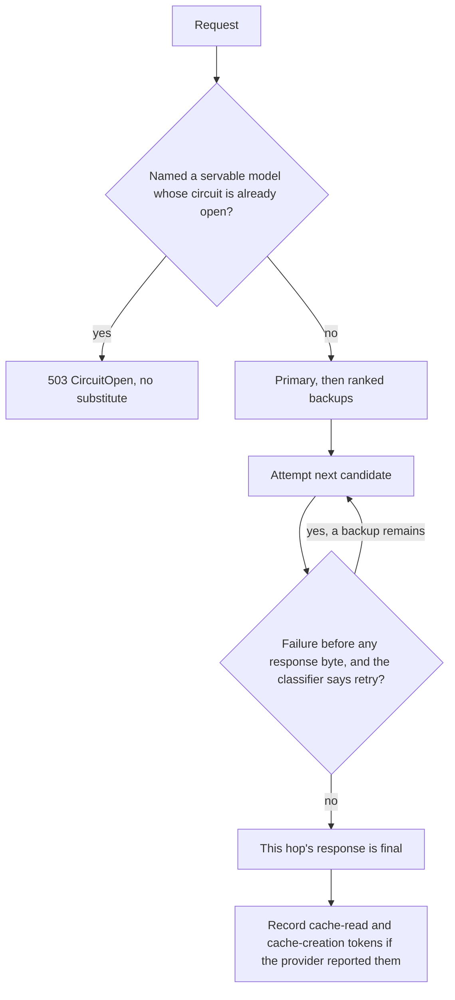

# Switch models only at a cache break

> **Status: proposal — not implemented.** The router does not keep a conversation on one model in
> order to preserve a provider prompt-cache discount, and it does not detect cache breaks. Nothing
> here is an approved plan or permission to code.
> [ADR-0008 Amendment 1](../adr/0008-codegraph-serena-dual-engine-code-smell-pipeline.md#amendment-1-2026-09-02-stop-rules)
> requires an observed cost before the work is scheduled.

The idea is taken from GitHub's page
[About GitHub Copilot Fusion](https://docs.github.com/en/copilot/concepts/models/copilot-fusion),
read on 2026-11-20.

## What Fusion's page says

"Routing occurs along natural cache boundaries and large changes in conversation complexity to
avoid additional cache-related costs without quality improvements." Later, under billing: "Copilot
Fusion keeps your main conversation on the same model whenever possible, so the conversation
continues to benefit from cached tokens. Models that assist, such as a reviewer, receive only the
context they need."

The page does not publish the breakpoint rule, the token discount, or which providers' caches it
means. This note does not invent those details.

## What the code does when a model fails or a switch happens

Each request is decided on its own. `"model": "auto"` (any casing) asks the router to pick. A real,
servable model name is served as that model. An explicit model whose circuit is already open is
not replaced: `RoutingCandidateBuilder` sets `ExplicitCircuitTripBlockMessage`, and
`ProxyMiddleware` returns 503 with substitution reason `CircuitOpen` before the candidate loop.

When the router is allowed to choose, `RoutingCandidateBuilder` builds an ordered list: the
primary, then every other eligible configured model. `FailoverCandidateRanker` orders that tail.
When the policy published per-model scores, those models come first. Models it did not score, and
every model when no scores were published, are ordered by `RouterMemory.GetAverageScore` for the
request's dimension, using a cold-start score when memory has no observation. The pinned judge
model is excluded. That order is a failover list. It is not a cache
plan. Nothing in the builder reads a previous turn's model or a prompt-cache marker.

Inside one request, `ProxyMiddleware` tries the next candidate only while it can still do so
without having written a body byte. The reasons are transport failure (connection failure, timeout,
or a send that throws as an outage) and the statuses `UpstreamFailureClassifier` marks retriable:

- 5xx and 404, even when the next candidate is the same provider. An explicit client pick
  does not block these.
- A plain 429 (not classified as out-of-credits) only when some remaining candidate is a different
  provider. An explicit pick does not block that.
- 401, 403, 405, an embedded credential error, and an out-of-credits 400 or 429 only when some
  remaining candidate is a different provider and this attempt is not an explicit client pick that
  has not already been substituted.
- Any other status, including a 422 and a 400 that is neither out-of-credits nor an embedded
  credential error, is not a failover.

The middleware comment calls this walk an outage failover. `RequestTelemetryPublisher.ExtractUsageAndCost`
calls it an infrastructure-outage cascade and says it is not verifier-driven re-routing. A low
quality score is not one of the reasons. If the winning hop has started its body, a later failure
truncates that stream. The client is not switched to another model mid-stream.

A switch that does happen is a whole new upstream call for the remainder of that request. The
backup receives the rewritten request. The router does not ask whether the failed call had already
cached a prefix, and it does not copy a cache breakpoint onto the backup. Nothing in this path
claims the backup inherits the failed model's cache.

After the response, usage parsing stores `CacheCreationTokens` and `CacheReadTokens` when the
provider reported them (`UsageInfo`, Anthropic's `cache_creation_input_tokens` and
`cache_read_input_tokens`). Those counts price the request that already happened. They are not an
input to the next routing decision. `UtilityRoutingPolicy` prices every candidate with
`PriceContext.Standard`. Its remarks say nothing upstream computes whether the request repeats
cached context, so the cached rate is not used to pick a model.
`TaxonomyComparisonService.EstimateCounterfactual` prices the baseline at the standard input rate
on purpose: the baseline model never served the session, so it would have met a cold cache.
Modelling a warm cache would mean replaying the session, which that method does not do.

Two adjacent mechanisms are easy to confuse with this proposal, and neither is it:

- **Native Messages passthrough.** A client that already speaks Anthropic to `POST /v1/messages`
  is forwarded byte for byte (`AnthropicPayloadTranslator.ShouldTranslate` returns false on that
  path). Any `cache_control` the client sent stays in that body. The OpenAI-to-Anthropic translator
  documents `cache_control` as out of scope: those parts are not faithfully translated.
- **The local semantic cache** ([`semantic-cache.md`](semantic-cache.md)). Off by default. It can
  replay a saved completion. It is not provider prompt caching. Scope includes the upstream model,
  so a later request that routes to a different model is a miss. A hit does not call the provider
  and does not show up as `cache_read_tokens`.

Across turns, nothing sticks the next `auto` decision to the previous routed model. The next
request can select a different candidate. That is a new upstream model, with whatever cold cache
that model has for the prefix.

## What the proposal would add

Prefer the model that already holds the conversation's cached prefix, and change models when the
cache would break anyway (a boundary the provider would not reuse) or when the task has changed
enough that the discount is not worth keeping. An assisting call, if one existed, would receive a
smaller context. Arc Router has no assisting-model call today; cascade is a separate proposal
([`todo-cascade-mode.md`](todo-cascade-mode.md)).

The current failover behavior would stay the outage path. This proposal is about not spending the
discount on a voluntary switch. A transport failover already abandons the failed model for the
rest of that request, before any body byte, and pays whatever uncached prompt the backup bills.

## What would still have to be designed

- What a "cache break" is in this codebase. The router does not insert `cache_control`. On
  translated Anthropic traffic it does not preserve it. On native Messages traffic the breakpoints
  belong to the client. OpenAI-compatible providers in this tree are not given a breakpoint
  planner either.
- Whether "the same model" means the client-facing `ModelName` or the upstream
  `ProviderModelId`. Two client names can share one upstream id. The semantic cache already treats
  that as one scope; prompt-cache identity may not match it.
- How a stickiness rule interacts with exploration and with an explicit model name.
  `OrchestratorRoutingPolicy` rolls `Routing:ExplorationRate` (default `0.05`, and
  `Routing:EnableExploration` defaults to true) and can replace its vote with a uniform pick from
  the eligible candidates. `UtilityRoutingPolicy` does not explore. An explicit servable name never
  reaches either policy.
- How to count the discount that was lost. The ledger can show `CacheReadTokens` on the requests
  that stayed, and a zero cache-read on the request that switched. It cannot, by itself, show the
  tokens that would have been read if the previous model had been kept. That counterfactual is the
  measurement, and it is not implemented. The baseline pricer cited above refuses to invent a warm
  cache for the same reason.

## Measured cost before anyone builds it

A reason to build this would be a measured loss: requests that changed model while the prefix was
still cacheable, the cache-read tokens those requests did not get, and the quality difference the
switch bought. [ADR-0008 Amendment 1](../adr/0008-codegraph-serena-dual-engine-code-smell-pipeline.md#amendment-1-2026-09-02-stop-rules)
does not accept the Fusion sentence as that measurement. This file does not contain the counts.

CodeGraph had no index for this tree when the note was written, and Serena was not asked. This is
not a smell finding and does not belong in
[`code-smell-refactoring-plan.md`](code-smell-refactoring-plan.md).
