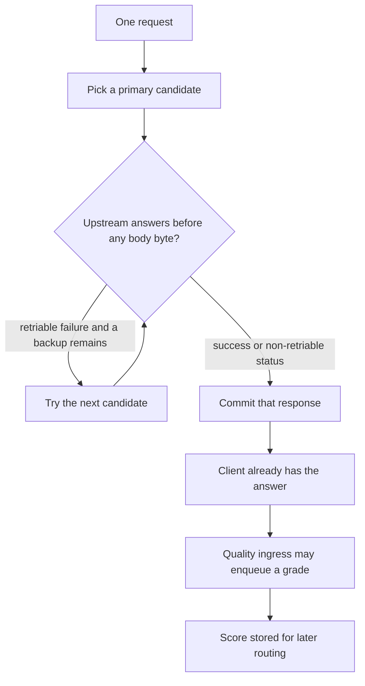

# Cascade mode

> **Status: proposal — not implemented.** Copilot Fusion's cascade (a cheaper model drafts, a judge
> checks the draft, a stronger model takes over if the draft fails) does not exist in this repository.
> Nothing here is an approved plan, a boarded issue, or permission to code. [ADR-0008 Amendment 1](../adr/0008-codegraph-serena-dual-engine-code-smell-pipeline.md#amendment-1-2026-09-02-stop-rules)
> requires an observed cost before work is scheduled. This note does not supply that measurement.

The idea is taken from GitHub's page
[About GitHub Copilot Fusion](https://docs.github.com/en/copilot/concepts/models/copilot-fusion),
read on 2026-11-20. Only that page is used for Fusion. Arc Router claims below are from the current
code and from [`docs/how-it-learns.md`](../how-it-learns.md) where that page matches the code.

## What Fusion's page says

Fusion chooses one of three execution patterns per prompt: **single** (one model), **cascade**, or
**critique**. Cascade is: "An efficient model drafts a solution, and a judge inspects the draft and
decides whether to accept it or escalate to a stronger model." Fusion adds those extra model calls
only when the task warrants them. Cascade and critique take longer because they include review
calls. Intermediate drafts may be revised or discarded; the user is shown the final response.
Choosing the pattern is described as a lightweight step.

This repository does not implement critique either. Critique is named here only so cascade is not
confused with it. There is no separate proposal for critique.

## What the code does today

One candidate commits the client response. `ProxyMiddleware` walks an ordered candidate list and
stops at the first hop it commits: a success, a non-retriable status, or the last candidate. `RequestTelemetryPublisher.ExtractUsageAndCost` calls that
walk an infrastructure-outage cascade, and says it is not verifier-driven re-routing. A low grade
is not a reason to try the next model.

A hop is retried only before any response byte is committed. `UpstreamFailureClassifier` decides:

- 5xx and 404 retry while another candidate remains, including a candidate on the same provider.
  An explicit client pick does not block these.
- A plain 429 (not classified as out-of-credits) retries only when some remaining candidate is a
  different provider. An explicit pick does not block that.
- 401, 403, 405, an embedded credential error, and an out-of-credits 400 or 429 retry only when
  some remaining candidate is a different provider and this attempt is not an explicit client pick
  that has not already been substituted.
- Any other status, including a 422 and a 400 that is neither out-of-credits nor an embedded
  credential error, is not retried.

Once the body starts streaming, that hop is final. A later stream error truncates the client
response. It does not call another model.

Grading happens after that response has already been sent. `RequestTelemetryPublisher` calls
`IQualityIngress.TryIngest` only from `PublishTelemetryEventAsync`, after telemetry publish, which
itself runs after `HttpResponse.CompleteAsync`. `QualityIngress` samples, extracts, and enqueues.
It does not block the client, and a sampled-out request is not graded at all.
[`docs/router/quality-verifier-architecture.md`](quality-verifier-architecture.md) lists the graders,
none of which run the model's code:

1. Static analysis of an extracted snippet.
2. A G-Eval judge on a free backbone model.
3. CodeJudge, ICE-Score, and RACE. With no stored override, each of those three turns on when an
   eligible free backbone exists, and stays off when none does
   (`PortfolioGraderSettingsConfigureOptions`). A stored `router_settings` row can force a flag
   either way.

Results that do come back are joined by correlation id into one score
([`docs/how-it-learns.md`](../how-it-learns.md)). The judge is allowed not to arrive. That score
updates the transcript row (`TranscriptScoreObserver` calls `ITranscriptStore.UpdateOutcomeAsync`).
It does not start another completion. The pinned
judge model is kept out of the auto-select candidate list (`RoutingCandidateBuilder.GetEligibleRoutes`,
the exclusion [ADR-0027](../adr/0027-grade-non-coding-responses-on-a-bootstrap-recipe-and-keep-them-out-of-code-tallies.md)
states so the teacher is not chosen as the answerer).

The live memory writers key that grade by `QualityIngestContext.Model`. The publisher sets that
field to the client's requested model string, not `route.ModelName`. A client that sent `auto` is
filed under `auto`. `MemoryKnnVoter` then skips any neighbor whose `ChosenModel` is not one of the
configured candidates, so an `auto` row does not vote for a backend.
`RouterMemoryScoreObserver` writes a live average only for a `Complete` grade on a code recipe, and
it uses the same model string. `QualityRescanService` regrades a saved row with
`TranscriptRecord.RoutedModel`, and [`docs/how-it-learns.md`](../how-it-learns.md) states that the
sweep writes the receipt only, not the tally.

So the graders can score a finished answer. They do not accept or reject a draft, and they do not
call a stronger model for the user who is still waiting.

## How a cascade could map onto those pieces

| Fusion step | Closest piece that exists | What it does not do |
|---|---|---|
| Efficient model drafts | The primary candidate. Utility traffic and a light subagent already have a cost-aware ranking (`UtilityRoutingPolicy`). The default general path (`OrchestratorRoutingPolicy`, on unless `Routing:EnableOrchestratorPolicy` is false) has no cost term. | Nothing marks a candidate as a "draft" or withholds it from the client. |
| Judge inspects the draft | Static analysis and the G-Eval / portfolio graders, joined into one score. | They run after the client has the answer. They are sampled, queued, and allowed to come back `Incomplete`. |
| Stronger model takes over | The rest of the candidate list `RoutingCandidateBuilder` already ranks. | That list is walked for a transport outage or a retriable HTTP status, and candidates are skipped for budget, a stopped provider or model, or an open circuit. A low grade does not enter it. |

A cascade that reused the graders unchanged would show the user the draft and only learn afterwards.
That is the learning loop in [`docs/how-it-learns.md`](../how-it-learns.md). It is not Fusion's
cascade.

## What would still have to be designed

- Whether the judge runs before any byte is sent, and what a streaming or tool-calling draft does
  with edits it already made. Fusion's own page says discarded draft edits are not undone.
- Which score is an accept, and which grader is allowed to decide. Static analysis does not call a
  model. The G-Eval judge does, so it is a second billed call even when the draft is accepted.
- How the draft model and the escalation model are chosen. The general path does not rank by price.
  Copying `UtilityRoutingPolicy`'s reward onto every coding request would change live routing, not
  just add a label.
- How the grade is attributed. Today's ingress key is the requested name. A cascade that wants to
  learn "this draft model failed" has to store the model that wrote the draft. The transcript row
  already has `RoutedModel` for the model that served; it does not have a draft-then-escalated pair,
  because only one hop serves the request.
- Latency and spend of the extra calls, including the case where the judge abstains or the queue is
  full (`queue_full` stores an `Incomplete` receipt and does not enqueue a score).

## Measured cost before anyone builds it

[ADR-0008 Amendment 1](../adr/0008-codegraph-serena-dual-engine-code-smell-pipeline.md#amendment-1-2026-09-02-stop-rules)
says a finding is not scheduled without an observed cost. The same bar applies to this feature. A
usable cost would be a counted set of served answers whose later grade was poor, the price already
paid for them, and the price a second model would have added, measured on this router's own
traffic. This file does not contain that count. Until it does, cascade stays a proposal.

CodeGraph had no index for this tree when the note was written, and Serena was not asked. This is
not a dual-engine smell result, and it does not belong in
[`code-smell-refactoring-plan.md`](code-smell-refactoring-plan.md).
